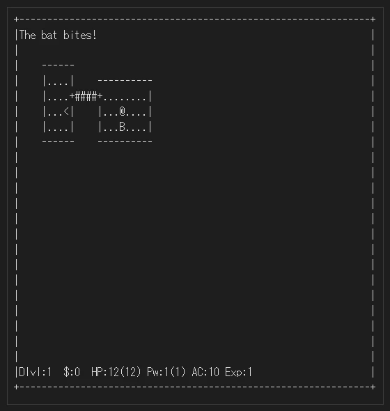
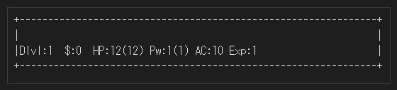
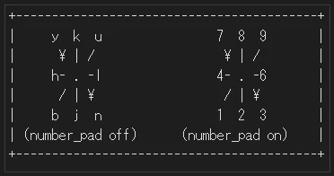

# NetHack 5.0 ガイドブック (NetHack Guidebook)

NOTICE: Modified by NetHackJP contributor @satokiyon; latest change date: 2026-10-23.

脅威の迷宮へのガイド (NetHackガイドブック)

オリジナル版 - Eric S. Raymond (NetHack 5.0.1用に Mike Stephenson と協力者たちによって編集・拡張された)

2026年7月4日

1. はじめに (Introduction)

最近、あなたは日々の仕事に身が入らず、心ここにあらずの思いを抱くようになっていました。ここ数ヶ月というもの、採掘、盗み、聖戦、そして戦闘といった奇妙な夢が夜ごとに眠りを妨げていますが、その理由は定かではありません。もしかすると、こうした夢はずっとあなたの内にあり、長い年月の間どうにかして忘れていたのではないか、とさえ思えます。ある夜、あなたは突然目を覚まし、悲鳴を上げます。夢の中の迷宮のいたるところに潜んでいる、奇怪で強大な生き物たちの生々しい記憶に怯えたのです。夢を悩ますこれら細部の光景は、果たして現実のものなのでしょうか？夜が明けるたび、遺跡の近くにある謎めいた洞窟に入りたいという欲求が強まっていくのを感じます。しかし毎朝、あなたはすぐにその考えを頭から振り払います。 自分より前にその洞窟に入り、戻ってこなかった者たちの話を思い出すからです。やがて、夢に見た幻想的な場所を探し求めたいという渇望に抗えなくなります。結局のところ、かつて洞窟に潜った他の冒険者たちが戻ってきたとき、彼らは出発時よりも裕福になっているように見えました。それに、戻ってこなかった者たち全員が、単にさらに先へと進み続けているだけではないと誰が言い切れるでしょうか？

あたりを聞き回ると、「イェンダーの魔除け（Amulet of Yendor）」と呼ばれる宝物の噂を耳にします。それを見つけることができれば、莫大な富をもたらすといいます。ある伝説によれば、その魔除けを見つけた者は 神々から不死を与えられるとさえ言われています。その魔除けは、脅威の 迷宮（Mazes of Menace）の深奥、ゲヘナの谷（Valley of Gehennom）を越えたどこかにあると噂されています。伝説を聞いた瞬間、あなたは自分が洞窟に 降り、語り継がれる魔除けを探し求めるべき、深遠で未知の理由があることに気づきました。たとえ魔除けの力についての噂が嘘であったとしても、 途中で夢に出てきたような恐ろしく神秘的な生物に出会えれば、少なくとも冒険の物語を地元の吟遊詩人たちにかなりの額で売ることができるはずです。あなたは地元の宿屋で最後の一夜を過ごして英気を養いますが、宿屋の壁に張り出された自分の成功オッズ（賭け率）が下がる一方なのを見て、次第に憂鬱になっていきます。

朝、あなたは目を覚まし、荷物をまとめてダンジョンへと出発します。数日間、何事もなく旅を続けた後、脅威の迷宮への入り口を示す古代の遺跡が 見えてきました。すでに夜も更けていたため、入り口に野営し、星空の下で夜を明かします。朝、装備を整え、おそらく地上での最後になるであろう 食事を済ませ、あなたはダンジョンへと足を踏み入れます……。

## 2 ここで何が起きているのか？ (What is going on here?)

あなたはNetHackのゲームを始めたばかりです。あなたの目的は、できるだけ多くの財宝を手に入れ、イェンダーの魔除けを回収し、脅威の迷宮から 生きて脱出することです。

冒険の危険に対処するための能力や強さは、あなたの経歴や訓練によって異なります。

考古学者（Archeologist）はダンジョンを熟知しており、素早く移動して現地の怪物たちに忍び寄ることができます。適切な学術探検のための 道具を装備して出発し、古代の言語を読むことができます。

蛮族（Barbarian）は未開の地からやってきた歴戦の戦士です。並外れた 筋力、頼れる鎖帷子、そして巨大な両手剣だけを携えてクエストを開始します。

洞窟人（Caveman/Cavewoman）は並外れた筋力を持ってスタートしますが、あいにく武器は新石器時代のものです。

治療師（Healer）は医術と本草学に精通しています。活力を回復させ、 痛みを和らげ、麻酔をかけ、毒を中和する薬草や生薬を知っており、医療 器具を使って生物の健康状態や病状を診断できます。彼らは医業によってかなりの蓄えを得ており、それを携えてダンジョンに入ります。

騎士（Knight）は、騎士道の理想への献身と、非常に優れた鎧によって、 一般的な軽装兵とは一線を画しています。

武闘家（Monk）は禁欲主義の修行僧であり、心身の厳しい鍛錬によって、武器を持たずとも武器があるのと同様に効果的に戦うことができます。鎧を 身につけませんが、そのぶん機動力に優れています。

司祭（Priest/Priestess）は戦闘的な聖職者であり、武器、鎧、そして奇跡の魔術をもって正義の大義を推し進める十字軍です。祈りを通じて神々と交信する能力は、時として彼らを窮地から救い出しますが、逆に窮地に陥れることもあります。

レンジャー（Ranger）は森を最も得意としており、ダンジョンの中では少々場違いだと言う者もいます。しかし、弓術だけでなく、追跡や隠密行動の専門家でもあります。

盗賊（Rogue）は敏捷で隠密性に優れた泥棒であり、錠前、罠、毒に関する 知識を持っています。彼らの強みは奇襲にあり、それを遺憾なく発揮します。

侍（Samurai）は封建時代の日本のエリート戦士です。軽装で素早く、この上なく鋭利な大小二振りの刀を帯びています。

観光客（Tourist）は、たくさんのゴールド（買い物に便利です）、クレジットカード、大量の食料、いくつかの地図、そして高価なカメラを持ってスタートします。ほとんどのモンスターは写真を撮られるのを嫌います。

ワルキューレ（Valkyrie）は屈強な女戦士です。過酷な北国での生い立ちにより、彼女たちは強靭で極度の寒さに耐性があり、隠密性と狡猾さを身につけています。

魔法使い（Wizard）は、魔法の知識、選りすぐりの魔法アイテム、そして 魔術に対する特別な適性を持ってスタートします。一見ひ弱で簡単に倒せそうに見えますが、経験を積んだ魔法使いは恐るべき強敵となります。

キャラクターの種族を選ぶこともできます（ただし制限があり、ほとんどの役割には選択可能な種族の制約があります）。

ドワーフ（Dwarf）は人間やエルフよりも小柄ですが、がっしりとして 頑強です。ドワーフの最も顕著な特徴は、採掘と金属加工に関する深い専門知識です。ドワーフの鎧の品質は、エルフのミスリル鎧にも引けを取らないと言われています。

エルフ（Elf）は機敏で素早く、洞察力に優れています。エルフの鋭い 知覚を逃れられるものはほとんどありません。エルフの工芸品の高い品質は、武器や鎧においてしばしば有利に働きます。

ノーム（Gnome）はドワーフよりも小柄ですが、全般的にはドワーフによく似ています。ノームは採掘の達人として知られており、脅威の迷宮の 中にはこの種族によって築かれた秘密の地下鉱山が存在し、富と危険に満ちていることで知られています。

人間（Human）は地上界で圧倒的にありふれた種族であり、他の種族と比較される際の基準となっています。特別な種族能力はありませんが、どの役割でも活躍することができます。

オーク（Orc）は、あらゆる生き物（他のオークさえも含む）を憎む、残虐で野蛮な種族です。何よりもエルフを比類なき激しさで憎悪しており、機会があればどんなことでもしてエルフを殺そうとします。オークが鍛造 した鎧や武器は、概して粗悪な品質です。

## 3 画面上の表示は何を意味しているのか？ (What do all those things on the screen mean?)

画面上には、現在のダンジョン階層であなたが訪れた場所と目にしたもののマップが表示されます。階層を探索するにつれて、その全貌が目の前の画面に現れていきます。

NetHackの祖先である『Rogue』が最初に登場したとき、その画面指向 （screen orientation）はコンピュータ・ファンタジー・ゲームにおいてほぼ 類を見ないものでした。それ以来、画面表示によるプレイは例外ではなく標準となり、NetHackもこの素晴らしい伝統を受け継いでいます。擬似的な英語の文章でコマンドを受け付け、結果を言葉で説明するテキスト・アドベンチャー・ゲームとは異なり、NetHackのコマンドはすべて1〜2打鍵のキーストロークであり、 結果は画面上にグラフィカルに表示されます。画面サイズは最低でも24行×80列を推奨します。画面がそれより大きい場合でも、マップには21×80の領域のみが使用されます。

NetHackは、点字読取機や音声合成装置の助けを借りれば、視覚障害のあるプレイヤーでもプレイすることができます。視覚障害者向けのNetHackの設定方法は、このドキュメントの後半に含まれています。

NetHackはプレイするたびに新しいダンジョンが生成されます。開発者たちでさえ、何度もクリアしているにもかかわらず、いまだに刺激的で楽しいゲームだと感じています。

NetHackはさまざまな表示オプションを提供しています。利用可能なオプションは、ハードウェアやソフトウェアの機能、および実行ファイル作成時に有効にされたコンパイル時オプションによって、移植版ごとに異なります。可能な表示オプションは、モノクロ文字インターフェース、カラー文字インター フェース、および「タイル」と呼ばれる小さな絵を使用したグラフィカル・ インターフェースの3つです。2つの文字インターフェースでは、他の文字を含むフォントを代用することもできますが、デフォルトの割り当てでは、すべてを 表現するために標準のASCII文字を使用します。ゲームプレイに関しては、各種 表示オプション間に違いはありません。このガイドブックではタイルや色を再現できず、またすべての移植版に共通しているため、ゲーム中に画面で見かけるものを参照する際には、モノクロ文字表示のデフォルトASCII文字を使用します。

NetHackで何が起きているかを理解するためには、まずNetHackが画面をどのように扱っているかを理解する必要があります。NetHackの画面は、テキスト・ アドベンチャー・ゲームの「あなたは……を見る」という描写に代わるものです。図1は、NetHackの画面がどのように見えるかのサンプルです。画面の見え方はプラットフォームによって異なります。



<details>
<summary>テキスト版（アスキーアート）を表示</summary>

```text
        +---------------------------------------------------------------+
        |The bat bites!                                                 |
        |                                                               |
        |    ------                                                     |
        |    |....|    ----------                                       |
        |    |.<..|####...@...$.|                                       |
        |    |....-#   |...B....+                                       |
        |    |....|    |.d......|                                       |
        |    ------    -------|--                                       |
        |                                                               |
        |                                                               |
        |                                                               |
        |Player the Rambler   St:12 Dx:7 Co:18 In:11 Wi:9 Ch:15 Neutral |
        |Dlvl:1 $:993 HP:9(12) Pw:3(3) AC:10 Exp:1/19 T:752 Hungry Conf |
        +---------------------------図1---------------------------------+
```
</details>



<details>
<summary>テキスト版（アスキーアート）を表示</summary>

```text
        +---------------------------------------------------------------+
        |Player the Rambler   St:12 Dx:7 Co:18 In:11 Wi:9 Ch:15         |
        |Neutral $:993 HP:9(12) Pw:3(3) AC:10 Exp:1/19 Hungry           |
        |Dlvl:1 T:752                                  Conf             |
        +---------------------------図2---------------------------------+
```
</details>

### 3.1 ステータス行（下部） (The status lines (bottom))

画面の最下部2行（または3行）には、現在のステータスを説明する暗号めいた情報がいくつか含まれています。図1は、マップの下にある伝統的な 2行のステータスエリアを示しています。図2は、statuslines:3 オプションが 設定されている場合のステータスエリアのみを示しています（すべてのインターフェースがこのオプションをサポートしているわけではありません）。ステータス行が画面の幅を超えると、切り捨てによりすべてが表示されない場合があります。数値が大きくなり、複数の状態が存在する場合、2行形式では 2行目のスペースが足りなくなりますが、標準的な24行端末は3行目を表示するのに十分な高さがないため、statuslines:2 がデフォルトとなっています。

各ステータス項目の意味は以下の通りです。

名前（Title） キャラクターの名前と職業上のランク（役割と経験レベルに基づきます。以下を参照）。

筋力（Strength） キャラクターの力の強さの尺度。6つの基本属性の1つです。人間のキャラクターの属性は3から18の範囲ですが、人間以外はこの限界を 超えることがあります（時折、18/xxという形式の超人的な筋力を得ることがあり、魔法によっても属性が通常の限界を超えることがあります）。数値が高いほど、より力が強いことを意味します。筋力は、物理的な作業の成功率、戦闘で与えるダメージ、持ち運べる荷物の量に影響します。

器用さ（Dexterity） 器用さは、戦闘での命中率、罠の回避、および敏捷性や物体の操作を必要とするその他の作業に影響します。

耐久力（Constitution） 耐久力は、怪我やその他のスタミナへの負担からの回復能力に影響します。 筋力が低いか適度な場合、耐久力は持ち運べる荷物の量にも影響します。 筋力が十分に高ければ、耐久力による運搬能力への寄与は問題にならなくなります。

知力（Intelligence） 知力は、呪文を唱える能力や呪文書を読む能力に影響します。

賢明さ（Wisdom） 賢明さは、（特に魔法を扱う際の）実地経験から得られます。これは 魔法エネルギー（魔力）に影響します。

魅力（Charisma） 魅力は、特定の生物があなたに対してどのように反応するかに影響します。特に、店主が提示する価格に影響することがあります。

属性（Alignment） 秩序（Lawful）、中立（Neutral）、混沌（Chaotic）。多くの場合、 秩序は善、混沌は悪とみなされますが、法的判断と倫理的判断が常に一致 するわけではありません。属性は、他のモンスターがあなたにどのように反応するかに影響します。同じ属性のモンスターは攻撃的でない可能性が 高く、逆に反対の属性のモンスターは、あなたの存在にひどく憤慨する可能性が高くなります。

ダンジョン階層（Dungeon Level） ダンジョンのどのくらいの深さにいるかを示します。レベル1から始まり、ダンジョンを深く進むにつれて数値が増えていきます。一部の階層は特殊で、数字ではなく名前で識別されます。イェンダーの魔除けは20階層より深いどこかにあると言われています。

ゴールド（Gold） 公然と持ち歩いているゴールドの数。容器の中に隠しているゴールドはカウントされません。

ヒットポイント（Hit Points） 現在のヒットポイントと最大ヒットポイント。ヒットポイントは、死ぬまでにどの程度のダメージに耐えられるかを示します。戦闘で攻撃を受けるほど数値は下がります。休息したり、特定の魔法のアイテムや呪文を使用したりすることで、ヒットポイントを回復できます。括弧内の数字は、ヒットポイントが到達できる最大値です。

魔力（Power） スペルポイント。呪文を唱えるために利用可能な神秘のエネルギー （マナ）の量を示します。これも休息によって回復します。

アーマークラス（Armor Class） 鎧が敵対的な生物からの打撃をどの程度効果的に防ぐかの尺度。この数値が低いほど防具は効果的であり、アーマークラスが負の値になることも十分にあり得ます。詳細については、「アイテム」の「防具」のセクションを参照してください。

経験（Experience） 現在の経験レベル。showexp オプションが設定されている場合、スラッシュと経験値が続きます。冒険を続けるにつれて経験値が得られ、特定の 経験値合計に達すると経験レベルが上がります。経験を積むほど、より 上手に戦い、魔法の攻撃に耐えられるようになります。（レベルが 2桁になる頃には、経験値を表示することの有用性は著しく低下します。 限られたステータス行のスペースを節約するために、`O` コマンドを使って showexp をオフにすることができます。）

時間（Time） 経過したターン数。time オプションを設定している場合に表示されます。

状態（Status） 空腹度（Hunger）: 現在の空腹状態。値は、満腹（Satiated）、 空腹なし（Not Hungry または Normal）、空腹（Hungry）、 衰弱（Weak）、失神（Fainting）です。通常状態（Normal）の場合は 表示されません。

荷重（Encumbrance）: 持ち運んでいるものが移動能力にどのように影響しているかの指標。値は、無荷重（Unencumbered）、重荷（Burdened）、圧迫（Stressed）、過重（Strained）、超過重（Overtaxed）、 過積載（Overloaded）です。無荷重（Unencumbered）の場合は表示 されません。

致命的な状態（Fatal conditions）: 石化（Stone: 石化しつつある）、スライム（Slime: 緑のスライムに変わりつつある）、絞殺（Strngl: 首を絞められている）、食中毒（FoodPois: 急性の食中毒に苦しんでいる）、末期症状（TermIll: 不治の病に苦しんでいる）。

致命的でない状態（Non-fatal conditions）: 盲目（Blind: 目が見えない）、難聴（Deaf: 耳が聞こえない）、朦朧（Stun: 朦朧状態）、混乱（Conf: 混乱状態）、幻覚（Hallu: 幻覚状態）。

移動修正（Movement modifiers）: 浮遊（Lev: 浮遊中）、飛行（Fly: 飛行中）、騎乗（Ride: 騎乗中）。

他にも状態や修正は存在しますが、他のステータス項目と一緒に表示 する十分なスペースがありません。

- `#attributes` : コマンド（デフォルトキー `^X`）を使用すると、すべての現在のステータス情報を略語なしの形式で表示できます。また、ステータス行にもっとスペースがあれば含まれていたであろう他の情報も表示されます。

### 3.2 メッセージ行（上部） (The message line (top))

画面の最上行は、視覚的に表現することが不可能な事象を説明するメッセージのために予約されています。最上行に「--More--」と表示された場合、NetHackには画面に表示すべき別のメッセージがありますが、まず現在表示されているものを読んだことを確認したいという意味です。次のメッセージを読むには、スペースキーを押してください。

メッセージ行に表示されるメッセージの種類や表示方法を変更するには、 「メッセージの種類の構成」および verbose オプションを参照してください。

### 3.3 マップ（画面の残りの部分） (The map (rest of the screen))

画面の残りの部分は、これまでに探索した階層のマップです。画面上の各シンボルは何らかの物体や地形を表しています。各種グラフィックス・ オプションを設定してゲームが使用するシンボルの一部を変更することもできますが、設定しない場合はデフォルトのシンボルが使用されます。以下はデフォルトのシンボルの意味の一覧です。

- `-` : 部屋の水平な壁や角、または開いた東西方向の扉。
- `|` : 部屋の垂直な壁、開いた南北方向の扉、または墓碑（grave）。
- `.` : 部屋の床、氷、扉のない出入口、または開いた跳ね橋の通路部分。
- `#` : 通路、鉄格子、木、または閉じた跳ね橋の落とし格子（portcullis）。
注意: 通路内の刻み目（engraving）も # として表示されますが、 通常の通路とは異なる色で表示されます。

- `>` : 下り階段: 次の階層への通路。
- `<` : 上り階段: 前の階層への通路。
- `+` : 閉じた扉、または習得できる可能性のある呪文が記された呪文書。
- `@` : あなたのキャラクター、人間、またはエルフ。
- `$` : ゴールドの山。
- `^` : 罠（一度発見したもの）。
- `)` : 武器。
- `[` : 一揃いの防具、またはその一部。
- `%` : 食べられるもの（必ずしも健康的・安全とは限りません）。
- `?` : 巻物（スクロール）。
- `/` : 杖（ワンド）。
- `=` : 指輪（リング）。
- `!` : 薬（ポーション）。
- `(` : 便利な道具（ツルハシ、鍵、ランプ……）。
- `"` : 魔除け、またはクモの巣。
- `*` : 宝石や石（価値がある場合もあれば、無価値な場合もあります）。
- `` ` `` : 大きな岩、像、または部屋の床の刻み目。
注意: 像はそれが模しているモンスターのシンボルとして表示されるため、グレーヴ・アクセント（バッククォート）としては表示されません。

- `0` : 鉄球。
- `_` : 祭壇、または鉄の鎖。
- `{` : 噴水、またはシンク。
- `}` : 水たまり、堀、水の壁、溶岩の溜まり、または溶岩の壁。
- `\` : 豪華な玉座。
- `a-z` : および
- `A-HJ-Z` : および
@&':; 英字やその他の特定のシンボルは、脅威の迷宮のさまざまな住人を 表しています。注意してください、彼らは執念深く獰猛なことがあります。しかし、時には助けになることもあります。

- `I` : 特定の種類のモンスターではなく、透明（不可視）やその他の目に見えないモンスターの最後に確認された位置を示します。モンスターが既に 移動している可能性があることに注意してください。ここでは `s`、 `F`、`m` コマンドが役立つかもしれません。
- `1-5` : 「警告（warning）」属性によって感知された見えないモンスターを示す 1から5までの数字。数値が小さいほど危険度が低く、数値が大きいほど危険なモンスターであることを示します。
これらすべてのシンボルを暗記する必要はありません。`/` コマンドを使えば、いつでもそのシンボルが何を表しているかをゲームに尋ねることができます（詳細は次の章を参照してください）。

## 4 コマンド (Commands)

コマンドは、そのコマンドに割り当てられた1文字または2文字を入力するか、拡張コマンド入力でコマンド名を入力することによって開始できます。「探索（search）」のように、NetHackがそれ以上の情報を収集する必要のないコマンドもあります。一方で、方向や使用するアイテムなど、 追加情報を必要とするコマンドもあります。追加情報を必要とするコマンドでは、NetHackは選択肢のメニューか、情報を要求するコマンドライン・ プロンプトを表示します。どちらが表示されるかは、主に menustyle オプションの設定に依存します。

例えば、一般的な質問として「何を使いたいですか？ [a-zA-Z ?*]」 という形式があり、持ち歩いているアイテムを選択するよう求められます。ここで、「a-zA-Z」は選択可能なアイテムの所持品記号です。`?` と入力すると、所持品リストが表示され、各文字が何を指しているかを確認できます。この例では、`*` も表示されており、予期しないものを使いたい場合に、リストにないアイテムを選択できることを示しています。`*` と入力すると全所持品がリストアップされるため、持っているすべてのアイテムの所持品記号を確認できます。最後に、考え直してコマンドを中止したい場合は、ESC キーを押すことでコマンドをキャンセルできます。

一部のコマンドの前に数値を入力することで、その回数だけ繰り返すことができます。例えば「10s」と入力すると10回探索します。number_pad オプションが設定されている場合は、回数の接頭辞として `n` を入力する必要があるため、上記の例では「n10s」と入力します。回数を指定しても意味のないコマンドでは、数値は無視されます。さらに、より細かな制御のために移動コマンドにも接頭辞を付けることができます（下記参照）。回数指定や接頭辞をキャンセルするには、ESC キーを押してください。

コマンドのリストはかなり長いですが、ゲーム中にいつでも `?` コマンドを使ってヘルプテキストのメニューにアクセスし、読むことができます。以下は、参考にデフォルトのキー割り当てです。

- `?` : ヘルプメニュー：利用可能ないくつかのヘルプテキストの1つを表示 します。
- `/` : 「whatis」コマンド。シンボルが何を表しているかを説明します。位 置を指定するか、シンボル（あるいは単語全体）を入力して説明を求めることができます。位置を指定するには、マップ上の特定の場所にカーソルを移動させてから、`.`、`,`、`;`、`:` のいずれかを押します。`.` は選択した場所のシンボルを説明し、help オプションがオンになっているかどうかに応じて「詳細情報（More info?）」を条件付きで確認し、その後別の場所を選択するよう求めます。`,` はシンボルを説明しますが、追加情報はスキップし、別の場所を選択させます。`;` は追加情報をスキップし、別の場所の選択も求めません。 `:` は確認を求めずに追加情報があれば表示します。場所を選択しているときに ESC キーを押すとこのコマンドは終了し、`?` を押すと使い方の簡単なリマインダーが表示されます。 autodescribe オプションがオンの場合、カーソルを移動させると、各場所で見えるものの短い説明が表示されます。場所を選択中に `#` を入力すると、そのオプションのオン・オフを切り替えられます。 whatis_coord オプションは、短い説明にマップ座標を含めるかどうかを制御します。位置ではなく名前を指定すると、常にその名前について利用可能な詳 細情報が表示されます。 近くのモンスター、現在表示されているすべてのモンスター、近くのアイテム、またはすべてのアイテムの説明を要求することもできます。 whatis_coord オプションは、その説明にどの形式のマップ座標を含めるかを制御します。
- `&` : コマンドが何をするかを説明します（whatdoes）。
- `<` : （階段やはしごの上にいる場合）前の階層に上がります。
- `>` : （階段やはしごの上にいる場合）次の階層に下ります。
[yuhjklbn] 示された方向に1歩進みます（図3参照）。そこにモンスターを感じるか覚えている場合、代わりにそのモンスターと戦います。これらの1 歩移動コマンドのみがモンスターとの戦闘を引き起こします。他のコマンド（下記）は「安全」です。



<details>
<summary>テキスト版（アスキーアート）を表示</summary>

```text
+------------------------------------------+
|     y  k  u                7  8  9       |
|      \ | /                  \ | /        |
|     h- . -l                4- . -6       |
|      / | \                  / | \        |
|     b  j  n                1  2  3       |
| (number_pad オフ)     (number_pad オン)  |
+-------------------図3--------------------+
```
</details>

[YUHJKLBN] 壁にぶつかるか何かに遭遇するまで、その方向に進みます。 m[yuhjklbn] 接頭辞: アイテムを拾ったり戦ったりせずに移動します（そこにモンスターがいることを覚えていても移動します）。いくつかの非移動コマンドは、メニュー経由での操作を要求するために `m` 接頭辞を使用します（menustyle:traditional オプションを 一時的に上書きするため）。主に、特定のクラスのアイテムが1つしかない場合に `,`（拾う）で使用すると便利です（通常は「どの種類 のアイテム？」というプロンプトが出ないため、そのプロンプトで `m` を入力する機会がありません）。この接頭辞は "#travel" コマンドで視界内の興味深いターゲットのメニューを表示させます。また、`\`（既知の発見済みアイテム一覧 を表示）や `` ` ``（特定のクラスの既知の発見済みアイテム一覧を表示） コマンドで使用すると、いくつかの並べ替えメニューを表示します（ これは sortdiscoveries オプションの新しい値を設定します）。さらに、"#vanquished"（倒した敵）や "#genocided"（虐殺した敵）コマンドでも並べ替えメニューを表示するために使用されます。他のいくつかのコマンド（食料を食べる、生贄を捧げる、缶詰作成キットを使う、飲む、浸す、容器を傾ける）では、`m` 接頭辞を使うことで床にある対象アイテムの確認をスキップし、直接所持品の確認に 移ることができます。また、"#loot"（鞍を外すため）では容器をスキップして直接隣接するモンスターの確認に移ります。デバッグモード（別名「ウィザードモード」）では、`m` 接頭辞は "#teleport" や "#wizlevelport" コマンドでも使用できます。 F[yuhjklbn] 接頭辞: モンスターと戦います（そこにモンスターがいると推測される場合でも戦います）。 g[yuhjklbn] 接頭辞: 何か興味深いものが見つかるまで移動します。 G[yuhjklbn] または <Control>+[yuhjklbn] 接頭辞: `g` と似ていますが、通路の分岐は興味深いものとはみなされません。注意: <Control>+<key> は、<Shift> キーのように <Control> または <Ctrl> キーを押したまま <key> を入力し、<key> を離してから <Control> を離すことを意味します。ガイドブックの他の場所では、同じ意味の短縮形として ^<key> が使われています。コントロール文字は大文字・小文字を区別しない（ケースインセンシティブ）ため、 ^x と ^X は同じです。 M[yuhjklbn] 古いバージョンでは `M` を移動の接頭辞としてサポートしており、 `m` と <Control>+<方向> の効果を組み合わせたものでした。これは現在、接頭辞としてはサポートされていませんが、`m` と G<方向> を組み合わせることで同様の効果が得られます。また、`m` は g<方向>、<Control>+<方向>、または <Shift>+<方向> と組み合わせて使 用することもできます。

- `_` : 最短経路アルゴリズムを使用して、マップ上の特定の場所まで移動します。最短経路は、ヒーローが知っている（例：見たことがある、または以前通過した）マップ上の位置に基づいて計算されます。既知の経路がない場合は推測が行われます。`G` 接頭辞とほぼ同じ条件で停止しますが、アイテムを拾わないため、暗黙的に `m` 接頭辞が強制されます。マウスをサポートしている移植版では、現在の位置以外の場所をクリックしたときにもこのコマンドが呼び出されます。
- `.` : 待機または休息。1ターンの間、何もしません。safe_wait がオンの場合、`m` 接頭辞を付けることで、敵対的なモンスターの隣であっても1ターン待機することができます。
- `a` : 道具（ツルハシ、鍵、ランプなど）を適用（使用）します（apply）。ワンド（杖）に使用した場合、そのワンドは折れ、その過程で魔法が 解放されます。確認が必要です。
- `A` : 防具など、身につけているアイテムを1つ以上脱ぎます（take off all）。 防具を1つだけ脱ぐ場合は `T`（take off）、アクセサリーを1つだけ外す場合は `R`（remove）を使用してください。
- `^A` : 直前のコマンドを繰り返します。
- `c` : 扉を閉めます（close）。
- `C` : モンスター、個別のアイテム、またはアイテムの種類に名前（呼び名） を付けます（name）。拡張コマンド "#name" と同じです。
- `^C` : パニックボタン。ゲームを終了します。
- `d` : 何かを置きます（落とします/drop）。例えば "d7a" は、アイテム a を7つ置くことを意味します。
- `D` : 複数のものを置きます（drop types）。 「どんな種類のものを置きたいですか？ [!%= BUCXPaium]」という質 問に対して、0個以上のアイテム記号を入力し、その後に `a`、`i`、 `u`、`m` のいずれか（複数可）を続けることができます。さらに、 祝福/呪われていない/呪われている（blessed/uncursed/cursed）のグループを1つ以上入力できます。 - DB:祝福されている（blessed）ことがわかっている全アイテムを置 く。 - DU:呪われていない（uncursed）ことがわかっている全アイテムを 置く。 - DC:呪われている（cursed）ことがわかっている全アイテムを置く。 - DX:B/U/C 状態が不明な全アイテムを置く。 - DP:最後に拾ったアイテムを置く。 - Da:確認なしで全アイテムを置く。 - Di:何かを置く前に所持品を確認する。 - Du:（店内で）未払いのアイテムのみを置く。 - Dm:メニューを使って置くアイテムを選択する。 - D%u: 未払いの食料のみを置く。最後の例は組み合わせを示しています。アイテムのフィルタリングには4つのカテゴリがあります：クラス（ポーションなら `!`、巻物なら `?` など）、店舗の状態（未払いなら `u`、つまり店の所有物）、 祝福/呪いの状態（上記の `B`、`U`、`C`、`X`）、そして新しさ（ `P`、最近拾ったアイテム。時間ではなく拾ったり置いたりした行為によって制御されます）。 1つのカテゴリで複数の値を指定した場合（ポーションと巻物なら "!? "、祝福と呪われていないなら "BU"）、所持品が指定された値のいずれかに一致すれば基準を満たします（"!?" は `!` または `?` を意味します）。複数のカテゴリを指定した場合、所持品は各カテゴリの基準をすべて満たす必要があります（"%u" はクラス `%` かつ未払い `u` を意味します）。最後に、複数のカテゴリ内で複数の値を指定することもできます。"!?BU" は、祝福されているか呪われていないことがわかっている、すべてのポーションと巻物を選択します。 （3.6より前のバージョンでは、フィルタの組み合わせの動作が異なっていました。）
- `^D` : 何かを蹴ります（kick。通常は扉）。
- `e` : 食料を食べます（eat）。 通常は床にある食べられるアイテムを確認し、見つからないか選択されなかった場合、所持品内の食べられるアイテムを確認します。`e` の前に `m` 接頭辞を付けると、床にあるものを食べようとする動作をバイパスします。すでに満腹の状態で食べようとすると、窒息死する恐れがあります。あえて食べる場合、最初の一口で生き残れば「食べ続けますか？」と尋ねられます。paranoid_confirmation:eating オプションを設定することで、単なる y ではなく yes という回答を要求するようにできます。
- `E` : 床にメッセージを刻みます（engrave）。 - E-:指で埃の中に書きます。 「Elbereth」（エルベレス）という言葉を刻むと、ほとんどのモンスターはあなたに直接攻撃（接近戦）をしてこなくなります（ただし、あなたが攻撃すると文字が消えてしまいます）。これは一息つくためにしばしば役立ちます。
- `f` : 矢筒（または矢筒袋、あるいは準備ができているもの）に入れたアイテムを発射（射撃または投擲）します（fire）。以前に `Q` コマンドで弾薬を選択しておくか、autoquiver が true の場合はコンピュ ータに適切なものを選ばせることができます。装備している武器が「 投げて戻ってくる」特性を持っており、矢筒が空で、かつ autoquiver が false の場合、矢筒を補充する代わりにその装備中の武器を投げます。長柄武器を装備している場合にも自動的にそれを使 用します。fireassist が true の場合、発射時に自動的に矢筒の弾 薬に合う発射装置（例えば弓やスリング）を装備しようとします。これには数ターンかかることがあり、途中でモンスターに邪魔される可 能性もあります。終わった後は、メインの接近戦用武器に持ち替えるのを忘れないでください。より一般的な投擲や射撃については、`t`（throw）も参照してください。
- `i` : 所持品リスト（持っているすべてのもの）を表示します（inventory） 。
- `I` : 所持品の選択した部分を表示します（inventtype）。通常は、防具なら `[`、ポーションなら `!` のように、特定のアイテム種別の文字を指定します。 - I*:所持品内のすべての宝石・石を表示。 - Iu:すべての未払いアイテムを表示。 - Ix:勘定書に載っている、すべての使い果たしたアイテムを表示。 - IB:祝福されていることがわかっている全アイテムを表示。 - IU:呪われていないことがわかっている全アイテムを表示。 - IC:呪われていることがわかっている全アイテムを表示。 - IX:祝福/呪いの状態が不明な全アイテムを表示。 - IP:最後に拾ったアイテムを表示。 - I$:所持ゴールドを数える。
- `o` : 扉を開けます（open）。
- `O` : オプションを設定します（options）。現在のオプションの値を示すメニューが表示されます。ほとんどの値は、そのオプションのメニュー項目を選択する（つまり、文字を入力するかクリックする）だけで変更できます。ブール値（真偽値）以外の選択肢については、メニューを閉じるとさらにメニューやプロンプトが表示されます。利用可能なオプションはこのガイドブックの後半に記載されています。オプションは通常、`O` コマンドではなくゲー ム開始前に設定されます。詳細については後述のオプションのセクションを参照してください。`O` の前に `m` 接頭辞を付けると、高度なオプション（#optionsfull）が表示されます。
- `^O` : ダンジョンの概要（Overview）を表示します。 "#overview" のショートカット。これまでに訪れた興味深いダンジョン階層をリストアップします。（3.6.0より前は、`^O` はすべての特殊階層の配置を表示するデバッグモードのコマンドでした。そのコマンドを実行するには "#wizwhere" を使用してください。）
- `p` : 買い物代金を支払います（pay）。
- `P` : アクセサリー（指輪、魔除け、または目隠し）を身につけます（put on）。このコマンドは防具を着るためにも使用できます。どのアイテムを使うかのプロンプトにはアクセサリーのみが表示されますが、リストにない防具を選択すればそれを着ようとします。（下記の `W` コマンドを参照してください。そちらは選択肢として防具を表示しますが、アクセサリーを受け付けてそれを身につけようとします。）
- `^P` : 以前のメッセージを繰り返します（previous message）。 続けて `^P` を押すと、さらに前のメッセージを繰り返します。一部 のインターフェースでは、msg_window オプションによって動作を変更できます。
- `q` : 何かを飲みます（quaff。ポーション、水など）。噴水やシンクがある場合、そこから飲むかどうかを尋ねられます。それを断ると、所持品からポーションを選ぶ機会が与えられます。`q` の前に `m` 接頭辞を付けると、噴水やシンクから飲むかどうかの確 認をスキップします。
- `Q` : 矢筒（quiver）、矢筒袋、あるいは一般的に準備ができているアイテムを選択します（一度に利用できるのはこれらのうち1つだけです）。 選択したものは `f` コマンドを使って投げることができます。
- `r` : 巻物や呪文書を読みます（read）。
- `R` : 身につけているアクセサリー（指輪、魔除け、または目隠し）を外します（remove）。 2つ以上身につけている場合は、どれを外すか尋ねられます。1つしか 身につけていない場合は、デフォルトでは確認なしに外されますが、 paranoid_confirmation:Remove オプションを設定してプロンプトを出すようにすることもできます。このコマンドは防具を脱ぐためにも使用できます。外すアイテムのプロンプトには身につけているアクセサリーのみが表示されますが、着 ている防具を選択することもできます。（下記の `T` コマンドを参照してください。そちらは選択肢として防具を表示しますが、アクセサリーを受け付けてそれを外そうとします。）
- `^R` : 画面を再描画します（redraw）。
- `s` : 周囲の隠し扉や罠を捜索（search）します。通常、何かを察知するには数回の試行が必要です。safe_wait がオンの場合、`m` 接頭辞を付けることで、敵対的なモンスターの隣であっても1ターン捜索を行うことができます。また、隣接する「記憶されているが、見えないモンスター」のマーカーの場所に、まだモンスターがいるかどうかを確認 するためにも使用できます。
- `S` : ゲームを保存（save）します（プレイを中断してプログラムを終了します）。保存されたゲームは、次回同じキャラクター名でプレイするときに自動的に再開されます。 通常のプレイでは、保存されたゲームが再開されると、保存データファイルは削除されます。探索モード（explore mode）では、再開が完 了した後にファイルを保持するか削除するかを尋ねられます。ファイルを保持することで、しばらくプレイしてから保存せずに終了し、後で再びその状態から再開することが可能になります。 「現在のゲーム状態を保存してプレイを続ける」コマンドは、保存ファイルが保持・再利用できる探索モードであっても存在しません。
- `t` : アイテムを投げる（throw）、または発射体を射撃します。個別の「射撃」コマンドはありません。弓を装備しているときに矢を投げれば、それは矢を射ていることになり、弓の武器スキルボーナスやペナルティが適用されます。弓を装備していないときに矢を投げれば、手で投げていることになり、一般的に射撃よりも効果が低くなります。 `Q`（quiver）コマンドであらかじめ選択しておいたアイテムを、いくつかの補助機能付きで投げたり射撃したりするには、`f`（fire） も参照してください。
- `T` : 防具を脱ぎます（take off）。 2つ以上の部位を身につけている場合は、どれを脱ぐか尋ねられます。 （スーツやシャツを覆っているクローク、またはシャツを覆っているスーツを脱ぐ場合、その下のアイテムは存在しないものとして扱われることに注意してください。）1つしか身につけていない場合は、デフォルトでは確認なしに脱がされますが、 paranoid_confirmation:Remove オプションを設定してプロンプトを出すようにすることもできます。このコマンドはアクセサリーを外すためにも使用できます。脱ぐアイテムのプロンプトには身につけている防具のみが表示されますが、身 につけているアクセサリーを選択することもできます。（上記の `R` コマンドを参照してください。そちらは選択肢としてアクセサリーを 表示しますが、防具を受け付けてそれを脱ごうとします。）
- `^T` : 能力がある場合、テレポートします（teleport）。
- `v` : 現在のゲームにおける重要なイベントの一覧を表示します。 #chronicle でも表示されます。以前は `v` はゲームのバージョン番 号を表示していましたが、現在は `V` を使用してください。
- `V` : バージョン番号を表示します（version）。以前は `V` はゲームの歴史の概要を表示していましたが、現在は #history で利用可能です。
- `w` : 武器を構えます（wield）。 - w-:何も構えず、素手（またはグローブ越し）で戦います。 一部のキャラクターは一度に2つの武器を構えることができます。その場合は `X` コマンド（または拡張コマンド "#twoweapon"）を使用 してください。
- `W` : 防具を着ます（wear）。このコマンドはアクセサリー（指輪、魔除け、または目隠し）を身につけるためにも使用できます。どのアイテムを使うかのプロンプトには防具のみが表示されますが、リストにないアクセサリーを選択すればそれを身につけようとします。（上記の `P` コマンドを参照してください。そちらは選択肢としてアクセサリーを表示しますが、防具を受け付けてそれを着ようとします。）
- `x` : 構えている武器と、予備の武器スロットにあるアイテムを交換（ exchange）します。 予備の武器は、二刀流（二武器戦闘）を行う際の副武器として使用されます。スロットのいずれかが空であっても、交換は行われることに注意してください。
- `X` : キャラクターが可能であれば、二武器戦闘（二刀流）を切り替えます （twoweapon）。拡張コマンド "#twoweapon" でも利用可能です。 （3.6より前のバージョンでは、このキーは通常のプレイから「探索 モード（explore mode）」、別名「発見モード（discovery mode）」 に切り替えるコマンドでしたが、現在は "#exploremode" と M-X に 移動しました。）
- `^X` : キャラクターに関する基本情報を表示します（attributes）。名前、役割、種族、性別（洞窟人/Caveman や司祭/Priestess のように役割名で明らかな場合を除く）、属性、および守護神と敵対する 神を表示します。また、ステータス行にある各種情報を、より詳細な形式で表示します。これには、スペースの都合で通常のステータス表 示には現れないいくつかの追加事項も含まれます。 通常のプレイでは、`^X` が表示するのはこれだけです。探索モードでは、役割とステータスのフィードバックに加えて、啓蒙（ enlightenment）の魔法によって得られる情報も表示されます。
- `z` : ワンド（杖）を振ります（zap）。 - z.:自分自身を対象にするには、方向に `.` を使用します。
- `Z` : 呪文を詠唱します（cast / zap）。 - Z.:自分自身を対象にするには、方向に `.` を使用します。
- `^Z` : ゲームを中断します（suspend。ジョブ制御のあるUNIX(R)版のみ）。 詳細は後述の "#suspend" を参照してください。
- `:` : 足元にあるものを見ます（look）。
- `;` : 見えるシンボルがどんな種類の物体に対応しているかを表示します。
- `,` : 足元の床からアイテムをいくつか拾い上げます（pickup）。`m` 接頭 辞を付けて、選択メニューを強制することができます。
- `@` : 自動拾い（autopickup）オプションのオン・オフを切り替えます。
- `^` : 以前に見つけた隣接する罠の種類を尋ねます（showtrap）。
- `)` : どの武器を構えているか教えます（seeweapon）。
- `[` : どの防具を着ているか教えます（seearmor）。
- `=` : どの指輪を身につけているか教えます（seerings）。
- `"` : どの魔除けを身につけているか教えます（seeamulet）。
- `(` : どの道具を使っているか教えます（seetools）。
- `*` : どの装備を使っているか教えます（seeall）。上記の5つの個別コマンドを1つにまとめたものです。
- `$` : 所持しているゴールドを報告します（showgold）。店の貸し（クレジット）や借り（借金）も表示される場合があります。
- `+` : 知っている呪文の一覧を表示します（showspells）。このコマンドを使用して、呪文リストの順番を並べ替えることもできます。リスト全体をソートするか、メニューから呪文を1つ選んで別の呪文と入れ替えることができます。呪文のペアを入れ替えると、その詠唱文字（キーストローク）も変更されるため、この変更は現在の `+` コマンドが終了した後も持続します。リスト全体のソートは一時 的です。最新のソート順を現在の `+` コマンド終了後も持続させるには、再度ソートオプションを選び、「詠唱文字を再割り当て（ reassign casting letters）」を選択してください。（それ以降に習 得した呪文は、ソート順の途中に挿入されるのではなく、リストの最後に追加されます。）
- `\` : どんな種類のアイテムが発見（識別）されているかを表示します（ known）。`m` 接頭辞を付けて、優先する表示順序を選択できます。
- `` ` `` : 特定のクラスのアイテムの発見済みタイプを表示します（knownclass） 。`m` 接頭辞を付けて、優先する表示順序を選択できます。
- `|` : 固定所持品表示（perm_invent オプション）がサポートされ、有効になっている場合、マップではなくそちらを操作します（perminv）。 menu_first_page、menu_previous_page、menu_next_page、 menu_last_page キー（デフォルトは `^`、`<`、`>`、`|`）を使用してスクロールできます。一部のインターフェースでは、 menu_shift_left、menu_shift_right キー（デフォルトは `{`、`}`） もサポートしています。Return（Enter）キーまたは Escape キーを押すとプレイを再開します。
- `!` : シェルにエスケープします。詳細は後述の "#shell" を参照してください。
- `Del` : 障害物のないマップを表示します（terrain）。現在階層の探索済みの部分を、モンスターなし、モンスターとアイテムなし、あるいはモンスターとアイテムと罠なしの状態で表示できます。 <del> キーは、キーボードによっては <delete> や <rubout> と表記 されていることもあります。実際のコントロール文字ではありませんが、^? と表示されることもあります。多くの端末には <delete> と <backspace> キーを入れ替えるオプションがあるため、<del> キーを入力してもこのコマンドが実行されない場合があります。その場合は、代わりに拡張コマンド "#terrain" を使用してください。
- `#` : 拡張コマンドを実行します。
ご覧の通り、NetHackの作者たちはすべてのアルファベットを使い切ってしまったため、これはあまり頻繁に使われないコマンドを導入するための方法です。どの拡張コマンドが利用可能かは、ゲームがどのような機 能でコンパイルされたかに依存します。

- `#adjust` : 所持品記号を調整します（fixinv オプションが "on" のときに最も便利です）。オートコンプリート（自動補完）が効きます。デフォルトキーは `M-a` です。

  このコマンドを使用すると、アイテムをある所持品スロットから別のスロットへ移動させることができます。これにより、あなたにとって意味のある文字を割り当てたり、所持品リストが表示される際に特定の場所に表示させたりすることができます。現在空のスロットに移動させることもできますし、移動先が埋まっている場合（かつ合体しない場合）は、そこのアイテムと移動するアイテムのスロットを入れ替えます。`#adjust` は、アイテムのスタックを分割するためにも使用できます。調整するアイテムを選ぶ際、その文字の前に個数を入力してください。

  個数を指定せずに調整する場合、以前は移動先に互換性のあるスタックがあればすべて収集されていました。その動作は変更されました。互換性のあるスタックを集めるには、スタックを「それ自身の」所持品スロットに対して `#adjust` してください。名前に割り当てがある場合、他の同じ名前のスタック、または名前のないスタックが、他の属性がすべて一致すれば合体します。名前がない場合は、名前のない他のスタックのみが対象となります。いずれの場合も、名前が異なる互換性のあるスタックは合体しません。これは、`#adjust` を使ってあるスロットから「別の」スロットへ移動させる場合とは対照的です。その状況では、（個数を指定せずに）移動させる互換性のあるスタックは、いずれか一方が名前を持ち、もう一方が持たない場合に合体し、結果としてその名前が引き継がれます。一方で、分割（個数を指定）する場合は、移動先スタックと合体するかどうかを判断する際に、元のスタックの名前は無視されます。

- `#annotate` : 現在のダンジョン階層に関連付けるテキストを1行指定できます。注釈（アノテーション）のあるすべての階層は、`#overview` コマンドで表示されます。オートコンプリートが効きます。デフォルトキーは`M-A` です。number_pad がオンの場合は `^N` も使えます。

  `#annotate` の前に `m` 接頭辞を付けると、接頭辞付きの`#overview` と同じになります。

- `#apply` : ツルハシ、鍵、ランプなどの道具を適用（使用）します。デフォルトキーは `a` です。

  使用する道具が床にあるアイテムに作用する場合、`m` 接頭辞を付けるとそれらをスキップします。

  ワンドに使用した場合、そのワンドは折れ、その過程で魔法が解放されます。確認が必要です。

- `#attributes` : 属性やステータス情報を表示します。デフォルトキーは `^X` です。

- `#autopickup` : 自動拾いオプションのオン・オフを切り替えます。デフォルトキーは`@` です。

- `#bugreport` : ブラウザウィンドウを開き、NetHack開発チームにレポートを送信します。ビルド時に無効にされている場合があります。有効な場合、システム構成ファイルで CRASHREPORTURL が設定されている必要があります。

- `#call` : モンスター、所持品内のアイテム、床にあるアイテム、または発見済みリストにあるアイテムに名前を付けます。または、現在の階層に注釈を追加します（`#annotate` と同じ）。デフォルトキーは `C` です。

- `#cast` : 呪文を詠唱します。デフォルトキーは `Z` です。

- `#chat` : 誰かに話しかけます（会話）。デフォルトキーは `M-c` です。

- `#chronicle` : 重要なゲームイベントの一覧を表示します。デフォルトキーは `v`です。

- `#close` : 扉を閉めます。デフォルトキーは `c` です。

- `#conduct` : 継続している自発的な挑戦（Conduct）のリストを表示します。オートコンプリートが効きます。デフォルトキーは `M-C` です。詳細は後述の「行動（Conduct）」のセクションを参照してください。

- `#debugfuzzer` : ファズ・テスターを開始します。デバッグモードのみ。

- `#dip` : アイテムを何かに浸します（dip）。オートコンプリートが効きます。デフォルトキーは `M-d` です。

  `m` 接頭辞を付けると、現在地に噴水や水たまりがあっても、そこへ浸すのをスキップします。

- `#down` : 階段やはしごを下ります。デフォルトキーは `>` です。

- `#drop` : アイテムを置きます（落とします）。デフォルトキーは `d` です。

- `#droptype` : 特定の種類のアイテムを置きます。デフォルトキーは `D` です。

- `#eat` : 何かを食べます。デフォルトキーは `e` です。`m` 接頭辞を付けると、床にあるアイテムを食べるのをスキップします。

- `#engrave` : 床に文字を刻みます。デフォルトキーは `E` です。

- `#enhance` : 武器や呪文のスキルを向上させ、または確認します。オートコンプリートが効きます。デフォルトキーは `M-e` です。

- `#exploremode` : 通常のプレイから、スコアの記録されない探索モード（explore mode）へ切り替えます。デフォルトキーは `M-X` です。

  確認が必要です。デフォルトの回答は n（no）です。本当に探索モードに切り替える場合は y と答えてください。paranoid_confirmation:quit オプションを設定することで、yes という回答を要求するようにできます。

- `#fight` : 指定した方向へ強制的に戦うための接頭辞キーです。そこに戦うべきものが何も見えなくても攻撃します。デフォルトキーは `F`、またはnumber_pad がオンの場合は `-` です。

- `#fire` : 矢筒にある弾薬を発射します。可能であれば発射装置を自動的に装備したり、装備中の長柄武器で攻撃したりします。デフォルトキーは`f` です。

- `#force` : 鍵をこじ開けます。オートコンプリートが効きます。デフォルトキーは `M-f` です。

- `#genocided` : 虐殺（genocide）したモンスターの種類をリストアップします。探索モードやデバッグモードでは、絶種（extinct）した種類も表示されます。

  表示順序は `#vanquished` と同じです。`m` 接頭辞を付けると、利用可能なソート順のメニューが表示されます。`#genocided` または`#vanquished` のいずれかで変更すると、両方の順序が変更されます。

  ソート順が「倒した数：多い順」または「倒した数：少ない順」（これらは `#vanquished` 用です）に設定されている場合、`#genocided` では無視され、代わりにアルファベット順が使用されます。`#genocided` で使用する場合、メニューからそれら2つの選択肢は除外されます。

  オートコンプリートが効きます。デフォルトキーは `M-g` です。

- `#glance` : マップ上のシンボルが何に対応しているかを表示します。デフォルトキーは `;` です。

- `#help` : ヘルプメニューを表示します。デフォルトキーは `?` です。number_pad がオンの場合は `h` も使えます。

- `#herecmdmenu` : 現在の場所に対して可能なアクションのメニューを表示します。メニューは網羅的なものではなく、可能性の高いアクションのサブセットに限定されます。オートコンプリートが効きます。

  マウスサポートが有効で herecmd_menu オプションが On の場合、ヒーロー（または騎乗中の乗騎）をクリックするとこのコマンドが実行されます。

- `#history` : ゲームの開発の歴史の概要を表示します。

- `#inventory` : 所持品を表示します。デフォルトキーは `i` です。

- `#inventtype` : 特定の種類のアイテムを一覧表示します。デフォルトキーは `I` です。

- `#invoke` : アイテムの特殊な力を発動（Invoke）させます。オートコンプリートが効きます。デフォルトキーは `M-i` です。

- `#jump` : 別の場所へジャンプ（跳躍）します。オートコンプリートが効きます。デフォルトキーは `M-j` です。number_pad がオンの場合は `j` も使えます。

- `#kick` : 何かを蹴ります。デフォルトキーは `^D` です。number_pad がオンの場合は `k` も使えます。

- `#known` : 発見済みのアイテムの種類を表示します。デフォルトキーは `\` です。

  `m` 接頭辞を付けると、sortdiscoveries オプションに新しい値を設定して、発見済みアイテムの表示順序を制御できます。

- `#knownclass` : 特定のクラスの発見済みアイテムを表示します。デフォルトキーは`` ` `` です。

  `m` 接頭辞の動作は `#known` と同じです。

- `#levelchange` : 経験レベルを変更します。オートコンプリートが効きます。デバッグモードのみ。

- `#lightsources` : 移動する光源を表示します。オートコンプリートが効きます。デバッグモードのみ。

- `#look` : 足元にあるものを見ます。デフォルトキーは `:` です。

- `#lookaround` : 周囲で見えるもの、または覚えているものを説明します。

- `#loot` : 足元にある箱やバッグ、または隣にいる乗騎の鞍を漁ります（物色）。オートコンプリートが効きます。`m` 接頭辞を付けると、現在地の容器をスキップして、直接鞍を外す動作に移ります。デフォルトキーは`M-l` です。number_pad がオンの場合は `l` も使えます。

- `#monster` : （モンスターに変身している際）モンスターの特殊能力を使用します。オートコンプリートが効きます。デフォルトキーは `M-m` です。

- `#name` : モンスター、個別のアイテム、またはアイテムの種類に名前を付けます。`#call` と同じです。オートコンプリートが効きます。デフォルトキーは `N`、`M-n`、`M-N` です。

- `#offer` : 神々に生贄を捧げます（Offer）。オートコンプリートが効きます。デフォルトキーは `M-o` です。

  成功するためには祭壇を見つける必要があります。最近殺したモンスターの死体が最適な生贄となります。

  `m` 接頭辞を付けると、祭壇の上にあるアイテムを捧げるのをスキップします。

- `#open` : 扉を開けます。デフォルトキーは `o` です。

- `#options` : オプション設定を表示・変更します。デフォルトキーは `O` です。`m` 接頭辞を付けると、高度なオプションが表示されます。

- `#optionsfull` : 高度なゲームオプション設定を表示します。デフォルトキーはありません。`m` 接頭辞を付けると、より単純な options コマンドを実行します。（主に BINDING=O:optionsfull を使用して、`O` キーを単純なオプションから伝統的な高度なオプションに戻す場合に便利です。）

- `#overview` : ダンジョンについて発見した情報を表示します。訪れた階層で注釈があるものはすべて含まれ、また多くの事象（祭壇、玉座、噴水など、あるいは別のダンジョン分岐への階段）は自動的に注釈を生成します。ゲーム終了時の情報開示でダンジョンの概要（overview）を選択した場合は、注釈の有無にかかわらず、訪れたすべての階層が含まれます。

  `#overview` の前に `m` 接頭辞を付けると、ダンジョンの概要をメニュー形式で表示します。そこでは、その階層に戻ることなく、訪れた任意の階層を選択して注釈を追加したり削除したりできます。また、これにより「興味深い」サブセットだけでなく、訪れたすべての階層が強制的に表示されます。

  オートコンプリートが効きます。デフォルトキーは `^O` と `M-O`です。

- `#panic` : パニック・ルーチンをテストします。現在のゲームを終了します。オートコンプリートが効きます。デバッグモードのみ。

  確認を求められます。デフォルトは n（no）で、プレイを続行します。本当にパニックを起こす場合は y と答えてください。paranoid_confirmation:quit オプションを設定することで、yes という回答を要求するようにできます。

- `#pay` : 買い物代金を支払います。デフォルトキーは `p` です。

- `#perminv` : 固定所持品表示（perm_invent オプション）がサポートされ、有効になっている場合、マップではなくそちらを操作します。`>` や `<`などのメニュースクロールキーを求められます。Return またはEscape を押すと通常のプレイに戻ります。デフォルトキーは `|` です。

- `#pickup` : 現在地のアイテムを拾い上げます。デフォルトキーは `,` です。`m`接頭辞を付けると、メニューの使用を強制します。

- `#polyself` : 自分自身をポリモーフ（変身）させます。オートコンプリートが効きます。デバッグモードのみ。

- `#pray` : 神々に助けを求めて祈ります（Pray）。オートコンプリートが効きます。デフォルトキーは `M-p` です。

  以前に助けを受けた後、あまりに早く祈るのは得策ではありません。（ヒント：生きてダンジョンに入ることは、すでに助けを受けたものとみなされます。おそらく、新しいゲームを始めてすぐに祈るべきではないでしょう。）このコマンドを誤って使用するとトラブルを招く可能性があるため、祈る前に意図を確認させるオプションがあります。デフォルトで有効になっており、paranoid_confirmation オプションをリセットすることで無効にできます。

- `#prevmsg` : 以前に表示されたゲームメッセージを表示します。デフォルトキーは`^P` です。

- `#puton` : アクセサリー（指輪、魔除けなど）を身につけます。デフォルトキーは `P` です。

- `#quaff` : 何かを飲みます（Quaff）。デフォルトキーは `q` です。

  `m` 接頭辞を付けると、現在地に噴水やシンクがあっても、そこから飲むのをスキップします。

- `#quit` : ゲームを保存せずにプログラムを終了します。オートコンプリートが効きます。

  このコマンドを誤って使用すると現在のゲームが失われるため、終了前に意図を確認するよう求められます。デフォルトの回答は n（no）で、プレイを続行します。本当に終了する場合は y と答えてください。paranoid_confirmation:quit オプションを設定することで、yesという回答を要求するようにできます。

- `#quiver` : 矢筒に入れる弾薬を選択します。デフォルトキーは `Q` です。

- `#read` : 巻物、呪文書、あるいは他の何かを読みます。デフォルトキーは `r`です。

- `#redraw` : 画面を再描画します。デフォルトキーは `^R` です。number_pad がオンの場合は `^L` も使えます。

- `#remove` : アクセサリー（指輪、魔除けなど）を外します。デフォルトキーは`R` です。

- `#repeat` : 直前のコマンドを繰り返します。デフォルトキーは `^A` です。

- `#reqmenu` : いくつかのコマンドの動作を変更したり、メニューを要求したりするための接頭辞キーです。移動コマンドと一緒に使うと、自動拾いを防ぎます。デフォルトキーは `m` です。

- `#retravel` : 以前に選択した目的地へ移動します。デフォルトキーは `C-_` です。`#travel` も参照してください。

- `#ride` : 鞍を置いた生物に騎乗する（または騎乗をやめる）動作を行います。オートコンプリートが効きます。デフォルトキーは `M-R` です。

- `#rub` : ランプや石を擦ります（Rub）。オートコンプリートが効きます。デフォルトキーは `M-r` です。

- `#run` : 指定した方向へ走る（run）ための接頭辞キーです。デフォルトキーは、number_pad がオフの場合は `G`、number_pad が 1 または 3 の場合は `5`、2 または 4 の場合は `M-5` です。

- `#rush` : 指定した方向へ突き進む（rush）ための接頭辞キーです。デフォルトは、number_pad がオフの場合は `g`、number_pad が 1 または 3 の場合は `M-5`、2 または 4 の場合は `5` です。

- `#save` : ゲームを保存してプログラムを終了します。デフォルトキーは `S`です。

- `#saveoptions` : 構成オプションを設定ファイルに保存します。この操作はファイルを上書きし、すべてのコメントを削除するため、手動で設定ファイルを編集している場合は使用しないでください。

- `#search` : 周囲の罠や隠し扉を捜索します。デフォルトキーは `s` です。

- `#seeall` : 使用中のすべての装備を表示します。デフォルトキーは `*` です。使用中のアイテムが1つしかない場合でも、メニューに表示されます。

- `#seeamulet` : 現在身につけている魔除けを表示します。デフォルトキーは `"` です。`m` 接頭辞を付けると、メッセージだけでなくメニューで表示するように強制します。

- `#seearmor` : 現在身につけている防具を表示します。デフォルトキーは `[` です。身につけているものが1つしかない場合でも、メニューに表示されます。

- `#seerings` : 現在身につけている指輪を表示します。デフォルトキーは `=` です。指輪を2つ身につけている場合（あるいは1つだけであっても、それが「本物の」指輪ではなく肉の指輪である場合）はメニューで表示されます。指輪が1つの場合にメニューを強制するには `m` 接頭辞を使用してください。

- `#seetools` : 現在使用中の道具を表示します。デフォルトキーは `(` です。使用中の道具が1つの場合（目隠し、タオル、レンズの着用、ランプやキャンドルの点灯、ペットに繋いだリードなど）、結果はメッセージで表示されます。2つ以上ある場合、または `m` 接頭辞が付けられた場合は、メニューが表示されます。

- `#seeweapon` : 現在構えている武器を表示します。デフォルトキーは `)` です。二刀流の場合、副武器に関する個別のメッセージが表示されます。`m`接頭辞を付けるとメニューを強制し、主武器、二刀流でなくても予備の武器、および現在矢筒スロットに割り当てられているものが含まれます。

- `#shell` : シェルへエスケープし、NetHackからサブプロセスに切り替えます。ビルド時に無効にされている場合があります。有効な場合、システム構成ファイルで特定のユーザーのアクセスを制御できます。ゲームに戻るには、シェルコマンド `exit` を使用してください。デフォルトキーは `!` です。

- `#showgold` : 所持品内のゴールドを報告します。持ち歩いている容器の中にある、把握しているゴールドも含みます。店内にいる場合は、その店でのクレジットや借金も報告されます。デフォルトキーは `$` です。

- `#showspells` : 既知の呪文をリストアップし、並べ替えます。デフォルトキーは `+`です。

- `#showtrap` : 隣接する罠（アイテムやモンスターに隠れている場合もあります）を説明します。対象となるには、その罠がすでに発見されている必要があります。（`#terrain` コマンドを使えば、すべてのアイテムとモンスターを一時的に取り除いた状態でマップを表示できるため、発見済みのすべての罠を確認することが可能です。）デフォルトキーは`^` です。

- `#sit` : 座ります。オートコンプリートが効きます。デフォルトキーは `M-s`です。

- `#stats` : メモリ使用統計を表示します。オートコンプリートが効きます。デバッグモードのみ。

- `#suspend` : ゲームを一時中断（サスペンド）し、保存して終了することなく、NetHackから開始元の端末に切り替えます。ビルド時に無効にされている場合があります。有効な場合、主にUNIX上のttyおよびcursesインターフェースで役立ちます。ゲームに戻るには、シェルコマンド`fg` を使用してください。デフォルトキーは `^Z` です。

- `#swap` : 構えている武器と予備の武器を交換します。デフォルトキーは `x`です。

- `#takeoff` : 防具を1つ脱ぎます。デフォルトキーは `T` です。

- `#takeoffall` : すべての防具を脱ぎます。デフォルトキーは `A` です。

- `#teleport` : 階層内をテレポートします。デフォルトキーは `^T` です。

- `#terrain` : 障害物のないマップを表示します。通常のプレイでは、現在階層の探索済みの部分を、モンスターなし、モンスターとアイテムなし、あるいはモンスターとアイテムと罠なしの状態で表示できます。

  視界内にガスの雲がある場合、それらを表示するか下の床を表示するかを決定する際、罠と同じように扱われます。

  探索モードでは、探索済みの部分だけでなく全マップを表示することを選択できます。デバッグモードにはさらなる選択肢があります。

  オートコンプリートが効きます。デフォルトキーは `<del>` または`<delete>` です（上記の Del を参照）。

- `#therecmdmenu` : あなたの隣の場所に対して可能なアクションのメニューを表示します。メニューは網羅的なものではなく、可能性の高いアクションのサブセットに限定されます。オートコンプリートが効きます。

- `#throw` : 何かを投げます。デフォルトキーは `t` です。

- `#timeout` : タイムアウト・キュー（予約されたイベント）を確認します。オートコンプリートが効きます。デバッグモードのみ。

- `#tip` : 容器（バッグや箱）を傾けて中身をぶちまけます。床に容器がある場合、ゲームはそれらのうち1つを選ぶか「持っているものを傾ける」かを尋ねます。後者を選んだ場合、所持品のどのアイテムを傾けるかを尋ねる別のプロンプトが表示されます。

  `m` 接頭辞を付けると、床の容器をスキップして所持品から選択しますが、menustyle:traditional で床に2つ以上の容器がある特殊な状況では、床の容器メニューから開始されます。

  オートコンプリートが効きます。デフォルトキーは `M-T` です。

- `#toggle` : ブール値（真偽値）オプションのオン・オフを切り替えます。括弧内に切り替えたいオプションの名前をパラメータとして必要とします。オプションはゲーム内で設定可能である必要があります。

  例:BIND=':toggle(price_quotes)BIND=@:toggle(autopickup)

- `#travel` : マップ上の特定の場所まで移動します。デフォルトキーは `_` です。「メニュー要求（request menu）」接頭辞を使うと、カーソルを動かすことなく、視界内の興味深いターゲットのメニューを表示します。カーソルでターゲットを選んでいるときに autodescribe オプションがオンの場合、キャラクターがその場所への経路を知らなければ、最上行に "(no travel path)"（移動経路なし）と表示されます。`#retravel` も参照してください。

- `#turn` : アンデッドを退散させます（Turn）。オートコンプリートが効きます。デフォルトキーは `M-t` です。

- `#twoweapon` : 二武器戦闘（二刀流）のオン・オフを切り替えます。オートコンプリートが効きます。デフォルトキーは `X` です。number_pad がオフの場合は `M-2` も使えます。

  この種の戦闘に適した武器を使用していない場合、自動的にオフになることに注意してください。

- `#untrap` : 何か（罠、扉、またはチェスト）の罠を外します。デフォルトキーは`M-u` です。number_pad がオンの場合は `u` も使えます。状況によっては、罠にかかったモンスターを救出するためにも使用できます。

- `#up` : 階段やはしごを上がります。デフォルトキーは `<` です。

- `#vanquished` : 倒した（vanquished）モンスターを種類と数でリストアップします。

  倒したモンスターのリストには、あなただけでなく、罠やモンスター同士で殺されたものもすべて含まれます。一方で、殺されずにゲームから取り除かれたもの（虐殺された、あるいはなだめられた店主によって召喚された警官隊が解散させられた場合など）や、マップ上に置かれたときにすでに死体だったものは除外されます。

  `#vanquished` の前に「メニュー要求」接頭辞を付けると、（リストに少なくとも2種類のモンスターが含まれている場合）利用可能なソート順のメニューが表示されます。選択された順序はsortvanquished オプションに割り当てられ、以降の `#vanquished`要求でも記憶されます。`#genocided` コマンドもこのソート順を共有します。

  ゲーム終了時の情報開示で、倒したモンスターを表示するかどうか尋ねられた際、`a` と答えるとソートメニューから選択できます。

  オートコンプリートが効きます。デフォルトキーは `M-V` です。

- `#version` : このバージョンのNetHackのコンパイル時オプションを表示します。

  第2段落には、含まれているユーザー・インターフェースの一覧が記載されています。2つ以上ある場合は、実行構成ファイルのwindowtype オプションを使用して、使用したいものを選択できます。

  オートコンプリートが効きます。デフォルトキーは `M-v` です。

- `#versionshort` : プログラムのバージョン番号に加えて、実行中のコピーがソースからビルドされた日付と時刻を表示します（バージョンのリリース日ではありません）。デフォルトキーは `V` です。

- `#vision` : 視界（vision）配列を表示します。オートコンプリートが効きます。デバッグモードのみ。

- `#wait` : 何もせず1歩分休みます。デフォルトキーは `.` です。rest_on_space がオンの場合はスペースキーも使えます。

- `#wear` : 防具を身につけます。デフォルトキーは `W` です。

- `#whatdoes` : キーが何をするか教えます。デフォルトキーは `&` です。

- `#whatis` : シンボルが何の種類に対応しているかを表示します。デフォルトキーは `/` です。

- `#wield` : 武器を構えます。デフォルトキーは `w` です。

- `#wipe` : 顔を拭います。オートコンプリートが効きます。デフォルトキーは`M-w` です。

- `#wizborn` : モンスターの誕生、死亡、虐殺、絶種に関する統計を表示します。デバッグモードのみ。

- `#wizbury` : 足元とその周囲にアイテムを埋めます。オートコンプリートが効きます。デバッグモードのみ。

- `#wizcast` : あらゆる呪文を唱えます。デバッグモードのみ。

- `#wizdetect` : 控えめな半径内にある隠されたもの（隠し扉、罠、または見えないモンスター）を明らかにします。時間は経過しません。オートコンプリートが効きます。デバッグモードのみ。デフォルトキーは `^E` です。

- `#wizgenesis` : モンスターを生成します。個数を指定して複数生成することも可能です。オートコンプリートが効きます。デバッグモードのみ。デフォルトキーは `^G` です。

- `#wizidentify` : 所持品内のすべてのアイテムを識別します。オートコンプリートが効きます。デバッグモードのみ。デフォルトキーは `^I` です。

- `#wizintrinsic` : 1つ以上の本質的（intrinsic）な属性を設定します。オートコンプリートが効きます。デバッグモードのみ。

- `#wizkill` : 指さすだけでモンスターをゲームから取り除きます。デフォルトではヒーローが標的を殺したことになり、功績や非難を受けます。それを上書きするには、コマンドの前に `m` 接頭辞を付けてください。オートコンプリートが効きます。デバッグモードのみ。

- `#wizlevelport` : 別の階層へテレポートします。オートコンプリートが効きます。デバッグモードのみ。デフォルトキーは `^V` です。

- `#wizmap` : 階層のマップを明らかにします。オートコンプリートが効きます。デバッグモードのみ。デフォルトキーは `^F` です。

- `#wizrumorcheck` : 最初と最後の真実の噂、および最初と最後の偽りの噂を表示して、噂の境界線を検証します。また、最初、2番目、および最後のランダムな刻み目、墓碑銘、幻覚モンスターも表示します。オートコンプリートが効きます。デバッグモードのみ。

- `#wizseenv` : マップ上の場所の seen vector（視認ベクター）を表示します。オートコンプリートが効きます。デバッグモードのみ。

- `#wizsmell` : モンスターの臭いを嗅ぎます。オートコンプリートが効きます。デバッグモードのみ。

- `#wizwhere` : 特殊階層の場所を表示します。オートコンプリートが効きます。デバッグモードのみ。

- `#wizwish` : 何かを「願い（Wish）」ます。オートコンプリートが効きます。デバッグモードのみ。デフォルトキーは `^W` です。コマンドの前に `m`接頭辞を付けると、願いの履歴メニューが表示されます。

- `#wmode` : 壁の状態（wall mode）を表示します。オートコンプリートが効きます。デバッグモードのみ。

- `#zap` : ワンドを振ります。デフォルトキーは `z` です。

  #?ヘルプメニュー：利用可能な拡張コマンドのリストを取得します。

  キーボードにメタキー（他のキーと組み合わせて押すと、"メタ"[第8ビット、または "ハイ" ビット] を設定して修飾するキー）がある場合、コマンドの最初の文字をメタ入力することで、多くの拡張コマンドを呼び出すことができます。

  Windows や MS-DOS では、"Alt" キーをこの方法で使用できます。他のシステムで、"Alt" と他のキーを入力すると Escape とそのキーからなる2文字のシーケンスが送信される場合は、altmeta オプションを設定することで NetHack にそれらを meta+<key> として結合させることができます。（この結合動作は、NetHack がコマンドの実行を待っているときにのみ行われ、名付けや願いの入力を受け付けているときには行われません。）

  コントロール文字では ^x と ^X が同じものを表すのとは異なり、メタ文字はケースインセンシティブではありません。M-x と M-X は異なるものを表します。メタ文字経由で実行できるコマンドの一部は、小文字の同等物が別のコマンドに使用されているため、文字を大文字にする必要があり、meta+Shift+<letter> の3つのキーの組み合わせが必要になります。

  M-?  #? （すべてのプラットフォームでサポートされているわけではありません）

  M-2  #twoweapon （number_pad オプションが有効な場合を除く）

  M-a  #adjust

  M-A  #annotate

  M-c  #chat

  M-C  #conduct

  M-d  #dip

  M-e  #enhance

  M-f  #force

  M-g  #genocided

  M-i  #invoke

  M-j  #jump

  M-l  #loot

  M-m  #monster

  M-n  #name

  M-o  #offer

  M-O  #overview

  M-p  #pray

  M-r  #rub

  M-R  #ride

  M-s  #sit

  M-t  #turn

  M-T  #tip

  M-u  #untrap

  M-v  #version

  M-V  #vanquished

  M-w  #wipe

  M-X  #exploremode

  number_pad オプションがオンの場合、以下の追加の文字コマンドが利用可能です。

  h    #help

  j    #jump

  k    #kick

  l    #loot

  N    #name

  u    #untrap

## 5 部屋と通路

ダンジョン内の部屋や通路は、明るいか暗いかのどちらかです。視界内にある明るい場所はすべて表示されます。暗い場所は、自分から1マスの範囲内にある場合のみ表示されます。探索を進めるにつれて、壁や通路はマップ上に残ります。

隠し通路（Secret corridors）は隠されており、一見すると固い岩のように 見えます。隣接した状態で `s`（捜索）コマンドを使えば見つけることができます。複数回の捜索が必要になることもあります。捜索に成功すると、 隠し通路は普通の開いた通路の場所に変わります。マッピングの魔法は 隠し通路を明らかにし、普通の通路に変換して表示します。

### 5.1 出入り口

出入り口（Doorways）は部屋と通路を繋ぎます。一部の出入り口には扉がなく、そのまま通り抜けることができます。他には扉があり、それらは開いているか、閉じているか、あるいは鍵がかかっています。閉じた扉を開けるには `o`（開ける）コマンドを使い、再び閉じるには `c`（閉じる）コマンドを使います。デフォルトでは autoopen オプションが有効になっているため、単に 閉じた扉の場所へ歩こうとするだけで、`o` を使わずに扉を開けようとします。混乱していたり、朦朧としていたり、不器用（fumbling）な状態にある場合は、 autoopen による開門は機能しません。

開いた扉に斜め方向から入ることはできません。水平または垂直に、正面から近づく必要があります。扉のない出入り口には、ある特定の階層 （"#overview" で「原始的なエリア」と説明される場所）を除いて、このような制限はありません。

解錠の魔法も存在しますが、通常は序盤では利用できません。魔法を使わずに鍵のかかった扉を通るには、まず `a`（使う）コマンドで解錠用具を使い、それから扉を開けます。デフォルトでは autounlock オプションも有効になっているため、解錠用具を持っている状態で（`o` や autoopen を使って） 鍵のかかった扉を開けようとすると、その扉に道具を使うかどうかを尋ねられます。あるいは、`^D`（蹴る）コマンドで閉じた扉（鍵の有無にかかわらず）を蹴破ることもできます。扉を蹴破ると扉は破壊され、大きな音が発生します。その音で眠っているモンスターが目覚めるかもしれません。

一部の閉じた扉にはブービートラップが仕掛けられており、開けようとしたり（解錠されている場合）、解錠しようとしたり（施錠されている場合）、あるいは蹴破ろうとしたりすると爆発します。蹴破るのと同様に、爆発は扉を破壊し、大きな音を立てます。"#untrap" コマンドを使えば、扉に罠がないか調べることができますが、見つけるには数回の試行が必要になるかもしれません。罠が見つかった場合は、それを解除（disarm）するかどうかを尋ねられます。同意した場合、成功すれば罠は除去されますが、失敗すれば爆発が引き起こされます。（断った場合は、事実上、そこに罠があったことを忘れたことになります。）

閉じた扉は、モンスターを締め出すのに役立ちます。ほとんどのモンスターは閉じた扉を開けることができませんが、中には扉を気にする必要のないものもいます（例えば、ゴーストは扉を通り抜けることができ、霧の雲は扉の下を通り抜けることができます）。扉を開けられるモンスターの中には、 鍵開け道具を使えるものもいます。また、巨人のように扉を粉砕できるものもいます。

隠し扉（Secret doors）は隠されており、（部屋の中から見れば）普通の壁に見えたり、（外から見れば）固い岩に見えたりします。これらは `s` （捜索）コマンドで見つけることができますが、数回の試行が必要になる場合があります（運が悪ければ、かなりの回数が必要になるかもしれません）。 一度発見されれば、あらゆる面で通常の扉と同等になります。マッピングの 魔法では、隠し扉は明らかになりません。

### 5.2 罠（`^`）

ダンジョンの至るところには、不用心な侵入者を陥れるための罠が仕掛けられています。例えば、突然落とし穴に落ちて、這い上がるまでの数ターンの 間動けなくなるかもしれません（後述）。罠は通常、その上に移動して発動させるか、誰かが発動させるのを目撃するか、あるいは `s`（捜索）コマンドで発見（しばしば数回の試行が必要で、運が悪ければ非常に多くの回数が必要）するまで、マップには表示されません。扉探索の杖や霊感の呪文も、控えめな範囲内にある罠を明らかにしますが、それには罠が（そのときに見えているかどうかにかかわらず）視界内にある必要があります。他にも罠を明らかにする魔法は存在します。

モンスターも罠にかかることがあり、これを防御戦略として利用できる可能性があります。残念ながら、罠はあなたのペットにとっても有害です。ペットを含むモンスターは、以前にその種類の罠に遭遇したことがあれば、 通常はマップに表示されている罠の上に乗るのを避けます。

落とし穴（pit）、トラバサミ（bear trap）、クモの巣（web）のような 一部の罠は、あなたをその場に拘束します。隣接する場所へ移動しようとすることで脱出を試みることができ、必要に応じて繰り返せば、最終的には 自由になれます。

別の場所へ飛ばす罠もあります。テレポートの罠は、同じ階層の別の場所へあなたを送ります。レベルテレポートの罠は、現在より数階層下から 一番上の階層までの範囲から選ばれた、ランダムな階層へあなたを送ります。これらの罠は、発動するたびに新しい目的地を選びます。落とし扉 （trap door）や穴（hole）も別の階層へ送りますが、目的地は常に現在より 下の階層です。通常は1つ下の階層ですが、もっと深くなることもあります。 （レベル）テレポートの罠とは異なり、特定の落とし扉や穴の移動先階層は固定されているため、そこに落ちれば毎回同じ階層にたどり着きます。ただし、その階層の同じ場所であるとは限りません。魔法のポータルも同様の動作をしますが、いくつか追加のバリエーションがあります。 一部のポータルは双方向で、移動先は常に決まっており、戻ってくるための別のポータルに繋がっています。他は一方通行で、特定の階層に送りますが、その階層の特定の場所であるとは限りません。

古典的なコンピュータゲーム「倉庫番（Sokoban）」に基づいた、あらかじめマップが決まっている特殊な多層構造のエリアがあります。そのゲームでは、あなたは倉庫の作業員として、障害物を避けながら木箱を指定された場所に配置します。NetHackでの目的は、落とし穴や穴がすべて埋まるまで大岩（boulder）を押し続け、その先にあるものへの通路を 確保することです。倉庫番のゲームでは東西南北の4方向にしか移動できず、 目的地に置かれた木箱はその場所へのアクセスを遮断します。NetHackの倉庫番階層では、（2つの隣接する大岩の間を通るような場合を除いて）斜めに 移動することができますが、大岩を押すことができるのは4方向のみです。 落とし穴や穴を埋めた大岩は、大岩と罠の両方が消滅するため、その場所への 通常のアクセスが可能になります。注意深い先読みを行えば、伝統的な倉庫番のルールに従ってすべての階層をクリアすることが可能です。 （ヒント：倉庫番のパズルを解くには、操作スペースを広げるために、大岩を最終的な目的地から一旦遠ざける必要があることがよくあります。） NetHackには「やり直し（undo）」機能がないため、行き詰まった場合に備えていくつかの猶予が認められています。例えば、各階層には少なくとも 1つの予備の大岩があります。また、大岩と同じ場所に入り込む（そして通り抜ける）ためにすべての荷物を置いたり、魔法や道具で大岩を破壊したり、 「大地の巻物」で新しい大岩を作り出したりすることも可能です。しかし、そのような行為を行うと、特定のメッセージは出ませんが、あなたの幸運値 （luck）が低下します。倉庫番での行動に対するフィードバックについては、「挑戦（Conduct）」のセクションを参照してください。

### 5.3 階段とはしご（`<`, `>`）

一般的に、ダンジョンの各階層には前の階層へ上がる階段（`<`）と、次の階層へ下る階段（`>`）があります。しかし、いくつか例外もあります。例えば、ダンジョンのかなり早い段階で、2つの下り階段がある階層に出会うでしょう。1つはさらにダンジョンの奥へと続き、もう1つは 「ノームの鉱山（Gnomish Mines）」と呼ばれるエリアへと分岐しています。それらの鉱山はやがて行き止まりに突き当たるため、そこを探索した後は （探索することを選んだならば）、メインのダンジョンまで登って戻る必要があります。

階段を通ったり、別の階層に送る罠を発動させたりすると、離れる階層は非アクティブ化され、ディスク上のファイルに保存されます。以前訪れた 階層に移動する場合は、ファイルから読み込まれて再アクティブ化されます。まだ訪れていない階層へ移動する場合は、その階層が作成されます（ほとんどのランダム階層はゼロから、一部の「特殊」階層はテンプレートから、あるいは後述する「ボーンレベル」の場合は以前のゲームの残骸からロードされます）。モンスターは現在の階層でのみアクティブであり、他の 階層にいるものは実質的に停止状態に置かれます。

通常、階段を登り降りすると、目的地の対応する階段の上に到着します。しかし、階段を通る際にペット（後述）や他のモンスターが十分に近くにいれば一緒についてきます。時折、それらの生物が移動中にあなたと場所を入れ替えてしまうことがあります。その場合、ペットやモンスターが階段の 上に到着し、あなたは階段の近くに置かれることになります。

はしご（Ladders）も階段と同じ目的で使用され、ゲームプレイ中はこの2種類の階層間接続にほとんど違いはありません。

### 5.4 店と買い物

時折、扉の近くに店主が立ち、床にたくさんのアイテムが置かれた部屋に出くわすことがあります。アイテムを拾い上げてから `p` コマンドを使うことで 購入できます。アイテムを拾う前にその上に立ち、"#chat" コマンドを使うと価格を問い合わせることができます。代金を支払う前にアイテムを使用すると 請求が発生し、店主は負債をすべて清算するまで店から出させてくれません。

店の中でアイテムを床に置くことで、店主に売却できます。提示されたゴールドで売却するかどうかを尋ねられるか、あるいは店主が興味を示さない （一般的に、商品はその店が扱っている商品の種類と一致している必要があります）旨を伝えられます。

店内で誤って何かを落としてしまった場合、通常、店主は何の補償もなしに所有権を主張します。それを取り戻したい場合は、買い戻さなければなりません。

店主は時々手持ちの資金が尽きることがあります。その場合、何かを売ろうとするとゴールドの代わりにクレジット（掛け金）が提供されます。クレジットは購入代金の支払いに使用できますが、それを獲得した店でのみ有効です。他の店主はそれを受け入れません。（もしダンジョン内で 「クレジットカード」を見つけたとしても、店で使おうとしないでください。店主はそれを受け付けません。）

所持しているゴールドの量を報告する `$` コマンドは、現在の店の負債やクレジットがあればそれも表示します。"Iu" コマンドは、未払いのアイテム （まだ店の所有物であるもの）を持ち歩いている場合にそれを一覧表示します。 "Ix" コマンドは、使い切った未払いアイテムやその他の店舗利用料を、インベントリのような形式で表示します。

#### 5.4.1 店の特殊な挙動

店の挙動には、いくつか予想外の側面があるかもしれません。

* 商品の価格はさまざまな要因によって変動します。

* 店主は、扉のすぐ内側のマスを店の外であるかのように扱います。

* 店主はあなたを一瞬たりとも見逃さず監視しますが、他の客には概ね無関心です。

* 店が「棚卸し中（closed for inventory）」の場合、自発的に開くことはありません。

* 商品が品切れになっても、店に新しい商品が補充されることはありません。

### 5.5 移動のフィードバック

マップ上を移動しても、通常は新しい場所に主人公が描画される以外のフィードバックはありません。ただし、アイテムやその山の上に乗った場合、 罠の上に乗った場合、あるいはモンスターがいるマスへ移動しようとした場合は例外です。通常のフィードバックを補強するために使用できるオプションがいくつかあります。

pile_limit オプションは、同じマップ上のマスにいくつのアイテムが 重なった場合に、個別に一覧表示する代わりに「ここには複数のアイテムがある」と表示するかを制御します。デフォルトは 5 です。これを 1 に設定すると、アイテムを一覧表示せずに常にそのメッセージを表示します。0 に 設定するのは特殊なケースで、山の大きさにかかわらず常にすべてのアイテムを 一覧表示します。なお、この数値はアイテムの個数の合計ではなく、そこにある個別のスタックの数を指します（つまり、7本の矢や25枚のゴールドは、それぞれ個数が多くてもスタックとしては1と数えられ、両方が同じ場所にあれば合計2となります）。

「拾わない（nopickup）」コマンド接頭辞（デフォルトは `m`）を移動方向の前に付けると、自動拾いを試みることなく、またそれらに関するフィードバックを受けることなく、アイテムの上に乗ることができます。

mention_walls オプションは、壁や固い岩にぶつかったり、マップの 端から出ようとしたりした際にフィードバックを出すかどうかを制御します。 通常、何も起こりません（主人公が盲目で壁が表示されていない場合を除 きます。その場合はぶつかった壁がマップに描画されます）。このオプションは、突進（rushing）や走り（running）が何らかの明らかでない理由で停止した際にもフィードバックを与えます。

mention_decor オプションは、「家具・調度品」の上を歩いたときにフィードバックを出すかどうかを制御します。通常、階段や噴水、祭壇、その他さまざまなものの上に移動しても、それらが1つ以上のアイテムによって覆われていない限り、何も表示されません。このオプションを true に設定すると、覆われていない場合でもそれらを説明します。扉のない出入り口や開いた扉は言及に値しないとみなされますが、閉じた扉（そのマスに移動できる場合）や壊れた扉は言及されます。移動可能である場合、水や溶岩、氷の上に移動した際は、まだその地形の上にいなければフィー ドバックが出ますが、水から別の水、溶岩から別の溶岩、氷から別の氷へ 移動した際は（間に別のメッセージが挟まらない限り）繰り返されません。それらから「通常の」地形に戻る際も1回メッセージが出ますが、もしアイテムに関するフィードバックがあれば、陸に戻ったことは暗黙的に 示されます。

confirm および safe_pet オプションは、平和的なモンスターやペットのいるマスへ移動しようとした際に何が起こるかを制御します。

「拾わない（nopickup）」コマンド接頭辞（デフォルトは `m`）は、 「攻撃せずに移動する」接頭辞でもあり、見えるモンスターのいるマスへ、 移動を攻撃とみなさずに踏み込もうとする際に使用できます（後述の 「モンスター」の「戦闘」のサブセクションを参照）。「戦闘（fight）」 コマンド接頭辞（デフォルトは `F`、number_pad がオンの場合は `-`）は、 見えないモンスターがいる場所を推測して攻撃したり、平和的なモンスターやペットを意図的に攻撃したりする際に使用できます。

run_mode オプションは、1つのコマンドで2歩以上移動する際（突進、 走り、トラベル（travel）の際）に、どの程度の頻度でマップを再描画するかを制御します。

### 5.6 ローグ・レベル

ダンジョンの10階代半ばから後半にかけて登場するある階層は、NetHackの先祖である「hack」が着想を得た「rogue」へのオマージュです。

この階層は通常、他の階層とは異なる表示になります。タイルではなく文字で表示されたり、文字表示の場合は線描画記号が使われなかったりします。また、ゴールドは `$` ではなく `*` と表示され、階段は `<` や `>` ではなく `%` と表示されます。実際のゲームプレイにもいくつかの小さな 違いがあります。出入り口に扉がなく、部屋で使われた光の巻物や灯りの杖、灯りの呪文は、キャラクターの周囲だけでなく部屋全体を照らします。さらに、モンスターは大文字で表されます。ローグ・レベルではモンスターに小文字が使われないため、通常小文字で表されるモンスターはそこではランダム生成されません。

この階層のわずかな奇妙さはバグではなく、仕様です……。

## 6 モンスター

見ることができないモンスターは画面に表示されません。注意してください！暗い場所で突然出くわすかもしれません。いくつかの魔法のアイテムは、モンスターに発見される前に（中には非常に鼻の利くものもいます）、こちらからそれらを見つける手助けをしてくれます。

画面に表示されているモンスターの情報を得るには、`/` および `;` コマンドを使用できます。"#name" コマンド（デフォルトでは `C` に割り当て） を使うと、モンスターに名前を付けることができます。これは複数のモンスターがいる場合に個体を区別するのに役立ちます。空白1文字だけの名前を付けると、以前の名前を削除できます。

拡張コマンド "#chat" を使うと、隣接するモンスターに話しかけることができます。実際の対話（自分が何を話すかを選択すること）はできませんが、店主やデルフィの神託者といった一部のモンスターと会話すると、有益な 結果が得られることがあります。

### 6.1 戦闘

モンスターを見かけて戦いたい場合は、単にそのマスへ歩いて行こうとしてください。遭遇するモンスターの多くは、こちらから攻撃しない限り 自分の用事に専念しています。中には怒らせると非常に危険なものもいます。 覚えておいてください。用心深さこそ勇気の真髄です（君子危うきに近寄らず）。

大抵の状況では、移動によって平和的なモンスターを攻撃しようとすると、その意図を確認されます。デフォルトでは `y` と答えることで攻撃の意図を 認めますが、移動に `y` を使っている場合は誤操作の原因になりやすいです。代わりに paranoid_confirmation:attack オプションを設定して、"yes" と完全に入力するよう要求させることができます。

モンスターが見えない場合（透明であるか、盲目になっている場合）、その存在を察知すると `I` という記号が表示されます。そのマスへ歩いて 行こうとすると、見えるモンスターと同様に戦おうとします。もちろん、モンスターがすでに移動していた場合は空振りに終わります。モンスターが 移動したと推測し、戦いたくない場合は、`m` コマンドを使って戦わずに 移動できます。同様に、モンスターの存在を覚えていないがとにかく攻撃してみたい場合は、`F` コマンドを使用できます。

### 6.2 あなたのペット

ゲーム開始時、あなたは小犬（`d`）、子猫（`f`）、または小馬（`u`）を 連れています。ペットはダンジョン内であなたの後ろをついて回り、一緒にモンスターと戦ってくれます。あなたと同様に、ペットも生き残るためには 食料を必要とします。犬や猫は通常、新鮮な死骸や他の肉類を自分で食べて 自活します。馬は手に入りにくい菜食（植物性の食料）を必要とします。ペットが心配だったり、しつけをしたい場合は、食料を投げて与えることもできます。適切にしつけられたペットは、特定の状況で非常に役に立ちます。

あなたのペットもモンスターを倒すことで経験値を獲得し、時間の経過 とともに成長して、ヒットポイントが増えたり与えるダメージが大きくなったりします。序盤はペットの方があなたより上手に敵を倒せることさえあり、低レベルのキャラクターにとってペットは非常に有用です。

あなたが移動する際にペットが隣にいれば、階段の上り降りにもついてきます。そうでなければペットは取り残され、野生化してしまうかもしれません。同様に、あなたの場所を移動させる特定の種類の罠（例えば、 下の階層へ落とす落とし扉）を発動させた際、隣接しているペットは同行しますが、隣接していないペットは取り残されます。ペット自身がそのような罠を発動させることもあります。その際、あなたが隣にいたとしても、ペットと一緒に運ばれることはありません。

### 6.3 乗騎

ダンジョン内の特定の種類の生物は、適切な装備とスキルがあれば実際に騎乗することができます。野生の獣を説得して鞍（saddle）を 着けさせるのは、控えめに言っても困難です。多くのダンジョン探索者は、その協力関係を築くために魔法や魔術に頼らざるを得ませんでした。一度獣を制御下に置けば、"#ride" コマンドで簡単に鞍の乗り降りができます。 騎乗中は、自分が移動するのと同じ方法で獣をダンジョン内で導いてください。マップ上に表示されるのは、その獣の姿です。

騎乗スキルは "#enhance" コマンドで管理されます。詳細については、 「武器の習熟度」のセクションを参照してください。

`a`（使う）コマンドを使い、所持品の中から鞍を選んで、隣接する 生物に鞍を着けようと試みます。成功すれば、鞍はその生物の所持品へ 移されます。

鞍を着けた生物の隣で "#loot" コマンドを使えば、その生物から鞍を外そうと試みます。成功すれば、鞍はあなたの所持品へ戻ります。

### 6.4 ボーンレベル

他の冒険者（あるいはあなたの前世！）のゴースト（幽霊）や死体、およびその遺品に遭遇することがあります。ゴーストは倒すのが難しいですが、 移動が遅くダメージも小さいため、避けるのは簡単です。亡くなった冒険者の 遺品を回収することもできますが、それらは呪われている可能性が高いです。以前のプレイヤーを殺したものが何であれ、注意してください。それはおそらくまだ近くに潜んでおり、最後の勝利に浸っていることでしょう。

### 6.5 モンスターの持続性

モンスター（人間やペットも含む一般的な呼称）は、見えるか、あるいは他の方法で感知できる間だけ表示されます。モンスターが見えなくなったり感知できなくなったりする場所へ移動すると、そのモンスターはマップから消えます。あなたではなく、モンスターの方が移動した場合も同様です。

しかし、見ることや感知することができないモンスターに遭遇した場合 （例えば、透明なモンスターに肩を軽く叩かれたときなど）、そこにあると思われる場所に特殊な「記憶されているが、見えないモンスター」のマーカー（`I`）が表示されます。それは、たとえ見えないモンスターが別の場所へ移動したり、あなたが通常はその場所が見えない位置へ移動したとしても、そこにモンスターがいないことが証明されるまで残り続けます。

## 7 アイテム

ダンジョン内で何かを見つけた場合、それを拾い上げたいと思うのが 一般的です。NetHackでは、`,` コマンドを使ってこれを行います。 autopickup オプションがオンの場合、`m` 接頭辞を付けて移動しない限り、アイテムの上を歩くだけで自動的に拾い上げます。

持ち運べる以上の荷物を持っている場合、NetHackはその旨を告げ、それ以上何も拾えなくなります。そうでなければ、拾ったアイテムを持ち物袋に加え、何を拾ったかを教えてくれます。

所持品（インベントリ）にアイテムを加えると、そのアイテムの重量も 負荷（重量制限）に加算されます。運べる荷物の量は、あなたの筋力 （strength）と耐久力（constitution）に依存します。屈強で頑丈であるほど、追加の荷物による影響は少なくなります。しかし、ダンジョン内で持ち歩くすべての荷物の重さが、あなたを圧迫する時が訪れます。あなたの反応は鈍くなり、カロリーを早く消費するため、それに対処するためにより 頻繁に食料が必要になります。最終的には重荷に耐えきれなくなり、持っているものを捨てるか、その重さで潰れてしまうことになります。

NetHackは、どれほど重い荷物を背負っているかを教えてくれます。 荷物の負荷がかかっている場合、画面最下部のステータス表示に「負担 （Burdened）」、「重荷（Stressed）」、「苦痛（Strained）」、「限界 （Overtaxed）」、または「超過（Overloaded）」のいずれかの状態が 表示されます。

アイテムを拾うと、インベントリ文字（所持品記号）が割り当てられます。アイテムに対して操作を行う多くのコマンドでは、どのアイテムを使用 したいかを尋ねられます。所持している特定のアイテムを選ぶよう求められた場合、通常は選択可能なインベントリ文字のリストが提示 されます（上記の「コマンド」を参照）。

武器のような一部のアイテムは、容易に見分けがつきます。一方、巻物や薬のようなアイテムには、種類に応じて異なる説明（未識別名）が 与えられます。1回のゲーム中において、同じ説明を持つ2つのアイテムは同じ種類です。しかし、その説明はゲームごとに異なります。

これらのアイテムを使用した際、その効果が明らかであれば、NetHackはそれが何であるかをあなたに代わって記憶します。効果が極めて明白でない場合は、後で識別できるように、その種類のアイテムを何と呼びたいかを尋ねられます。また、特定の種類のすべてのアイテム、あるいは個別のアイテムに名前を付けるために、いつでも同じ目的で "#name" コマンドを使用できます。すでに名前が付けられているアイテムに "#name" を使い、値として空白1文字を指定すると、新しい名前を割り当てる代わりに以前の名前が削除されます。

### 7.1 呪いと祝福

見つかるあらゆるアイテムは、本来は役に立つものであっても、呪われている可能性があります。呪いの最も一般的な効果は、そのアイテムから離れられなくなる（くっついてしまう）ことです。呪われた武器は構えると手に張り付き、手放すことができなくなります。身に着けた呪われたアイテムは、通常の方法では外せなくなります。さらに、呪われた武器や 防具は通常（常にではありませんが）負の強化値を持っており、戦闘での効果が低下します。他の呪われたアイテムも、別の形で性能が低下したり有害な作用をもたらしたりします。

アイテムは代わりに祝福されていることもあります。祝福されたアイテムは、通常、通常の呪われていないアイテムよりも効果的または有益に機能 します。例えば、祝福された武器は悪魔に対してわずかにより多くのダメージを与えます。

呪われても祝福されてもいないアイテムは、「呪われていない（uncursed）」 と呼ばれます。「祝福されていない（unblessed）」と表現することもできますが、ゲーム内で目にするのは「呪われていない」という指定です。 「コップに水が半分入っているか、半分空であるか」という状況ですので、お好きなように解釈してください。

アイテムに呪いをかけたり解いたりする魔法の手段が存在するため、呪われたアイテムにくっついてしまっても、呪いを解いて外すことが可能です。僧侶（Priest/Priestess）は、あらゆるアイテムのこの属性に対して先天的 な感受性を持っているため、他の役割よりも容易に呪われたアイテムを避けることができます。アイテムを祭壇の上に置くと、それが着地するのを見ることができれば、その祝福・呪いの状態が明らかになります。

状態が不明なアイテムは、所持品リストに接頭辞なしで表示されます。状態がわかっているアイテムは、説明の中に「呪われた（cursed）」、 「呪われていない（uncursed）」、または「祝福された（blessed）」という 言葉が含まれることで区別されます。場合によっては、他の情報から十分に推測できるため、冗長として「uncursed」が省略されることもあります。 implicit_uncursed オプションを使用してこれを制御できます。これをオフにすると、他の属性から推測できる場合でも「uncursed」が表示されるようになります。

アイテムの祝福・呪い状態は、しばしば「BUC」属性（Blessed, Uncursed, Cursed）または「BUCX」（Blessed, Uncursed, Cursed, or unknown）と呼ばれます。（「beatitude（至福・浄化状態）」という 用語が使われることもあります。）

### 7.2 アーティファクト

一部のアイテムには特別な力が宿っており、「アーティファクト （Artifacts）」として知られています。それらは特定の型（長剣やオークの短剣など）を持ち、「巨人殺し（Giantslayer）」や「グリムトゥース（Grimtooth）」のような固有の名前を持っています。アーティファクト武器は、通常、同種の普通の武器よりも大きなダメージを与えます。すべてのモンスターに対して追加ダメージを与えるものもあれば、特定の 種類のモンスターに対してのみ追加ダメージを与える（そのため他の種類に対しては普通の武器と変わらない）ものもあります。構えている際に防御能力を付与するものや、ここに記載されていない他の力を持つものもあります。

これらは、ショップ内を含む（ただしこれに限定されない）床の上に単に落ちているのを見つけることもあれば、守護神の祭壇での "#offer" の報酬として与えられることもあります。いくつかはモンスターが落とすこともありますし、正しい名前を付けることで同種の普通のアイテムから変換されることもあります。あるいは、もし「願い（wish）」が叶えられれば願うこともできますが、そのような願いは失敗することもあります。

アーティファクトの中には特定の属性（alignment）を持つものと、そうでないものがあります。自分と異なる属性を持つアーティファクトを 生贄の報酬として得ることはありません。それらを願ったり、見つけて使おうとしたりすると、衝撃を受けるかもしれません。

各役割には、クエスト（Quest）ダンジョン支部に含まれる固有のアーティファクトがあります。これらは一般に「クエスト・アーティファクト」として知られています。すべてに属性があり、そのほとんどは武器ではありません。これらがランダムに見つかることはありません。

`\` や `` ` `` コマンドは、完全に識別された（名前とアイテムの種類を 知っているだけでは不十分です）アーティファクトを一覧表示します。

### 7.3 レリック

名前があり、限定的な特殊能力を持つユニークなアイテムが3つありますが、これらはアーティファクトには分類されません。それぞれが特定のモンスターに守られており、ゲームの後半で使用するために3つすべてを 集める必要があります。それらは「開門のベル（Bell of Opening）」、 「死者の書（Book of the Dead）」、および「祈祷の燭台（Candelabrum of Invocation）」です。未識別の状態での対応する説明は、「銀のベル」、 「パピルスの魔法書」、および「燭台」です。

### 7.4 武器（`)`）

危険に満ちた迷宮（Mazes of Menace）のモンスターの多くは、隙があれば理由もなくあなたを殺そうとします。身を守る（相手を先に倒す） ためには武器が必要です。武器がなければ、1〜2ポイントのダメージしか 与えられません（ボーナスがあればそれが加算されます）。修道女・修道士 （Monk）のキャラクターは例外で、通常は武器を使うよりも素手（または手袋をはめた手）の方が大きなダメージを与えます。

メイスや剣のように構えて使う武器（wielded weapons）と、矢や槍のように投げて使う武器（thrown weapons）があります。武器でモンスターを攻撃するには、それを構えて攻撃するか、相手に向かって投げなければなりません。槍なら単に投げることを選ぶことができます。矢を射るには、まず弓を構え、それから矢を射る（投げる）必要があります。クロスボウはクロスボウの矢（ボルト）を射出します。スリングは小石や（宝石などの） 他の石を投射します。

強化された武器には「プラス」（または正・負どちらにもなり得る 「命中補正」）があり、モンスターへの命中率と与えるダメージを増加させます。武器の強化値を知る唯一の方法は、魔法的な何らかの手段でそれを識別することです。大半の武器は、錆などの何らかの損傷を受けます。そのような「侵食（erosion）」によるダメージは修復可能です。

攻撃がモンスターに命中するかどうか、および命中した際にどれほどのダメージを与えるかは、多くの要因に依存します。その中には、武器の 種類、武器の品質（強化値や侵食の有無）、経験レベル、筋力、器用さ、 荷物の負荷、そして武器の習熟度（後述）が含まれます。モンスターのアーマークラス（防具を身に着けているかどうかに限らない総合的な防御値） も要因の一つです。また、一部のモンスターは特定の種類の武器に対して特に脆弱です。

多くの武器は片手で構えることができますが、両手を必要とするものもあります。両手武器を構えているときは盾を装備できず、その逆も同様です。片手武器を構えているときは、構えているメインの武器と予備の武器を入れ替える `x` コマンドで準備を整えておくことで、もう1つの武器をすぐに使えるようにしておくことができます。さらに、「二刀流戦闘 （two weapon combat）」スキルの習熟度があれば、メインとサブとして 両方の武器を同時に構えることができます。これの有効化・無効化には `X` コマンドを使用します。必要なスキルを利用できるのは一部の種類のキャラクター（例えばバーバリアン）に限られます。そのスキルがあっても、一度に2つの武器を使用すると、1つの武器だけを使う場合と比べて標的に対する命中率にペナルティが課されます。

まったく武器を構えたくない場合もあるかもしれません。そのためには `-` を構える（wield）か、あるいは身に着けている他のアイテムを脱ぐことに加えて現在の武器を構えから外すことができる `A` コマンドを使用 します。

AD&Dプレイヤーの皆さんにお伝えしておくと、AD&Dに存在した各武器は、 NetHackにおいてもモンスターに対してほぼ同等のダメージを与えます。より馴染みの薄い武器の一部（アクリス、ルツェルン・ハンマー、ベック・ ド・コルバンなど）は、AD&Dのサプリメントである『Unearthed Arcana』 の付録で定義されています。

一部のインターフェースは weaponstatus オプションをサポートしています。これが有効な場合、現在構えている武器を説明する追加のステータス状態が表示されます。

武器を使用するためのコマンドは、`w`（構える）、`t`（投げる）、 `f`（発射する）、`Q`（矢筒に詰める）、`x`（武器を交換する）、 `X`（二刀流）、および "#enhance"（後述）です。

#### 7.4.1 投擲と射撃

`t` コマンドを使えば、ほぼあらゆるものを投げることができます。投げるアイテムを尋ねるプロンプトが表示されます。`?` を選ぶと、所持品の中から投げられる可能性が高いとみなされるものが一覧表示され、 `*` を選ぶと所持品全体が一覧表示されます。投げるものを選んだ後は、特定の標的ではなく、方角を尋ねられます。何かが飛ぶ距離は、主にアイテムの種類とあなたの筋力に依存します。矢は手で投げることもできますが、弓を構えた状態で発射した方がはるかに遠くまで飛び、命中する可能性も高くなります。

一部の武器は投げると手元に戻ってきます。何にも当たらなかった場合のブーメランはその代表的な例です。アクリス（革紐付きの棍棒）を構えた状態で投げると、何かに当たった場合でも戻ってきます。十分に力のある主人公なら戦鎚ミョルニルを投げることができます。そしてワルキューレが投げた場合、何かに当たっても当たらなくても常に手元に戻ってきます。

矢筒（quiver）は投射物を便利に保管するための場所であり、投射物を1つずつ選ぶことなく素早く発射できるようにします。`Q` コマンドを使って、手持ちの投射物（または投擲可能なアイテム）の1つを矢筒に割り当てます。その後は、`f` コマンドを使って矢筒の中身を素早く発射または投擲できます。autounlock オプションと同様に機能する autoquiver オプションもあり、矢筒が空の状態で `f` コマンドを使用すると、適切な投擲物を矢筒に 詰めるかどうかを尋ねられます。

quiver_fired オプションが有効な場合、`t` コマンドで何かを投げた際、それが自動的に矢筒のスロットに装填されます。これにより、その後に `f` コマンドを使って同じ種類のアイテムを投げ続けることが容易になります。

#### 7.4.2 武器の習熟度

モンスターに対して特定の種類の武器を使い続けるにつれて、その 種類の武器を扱う技術が向上していきます。すべてのキャラクターがあらゆる種類の武器の扱いを習得できるわけではありません。また、ある種類の武器で最高レベルに達することができるキャラクターであっても、他の種類の武器では基本的な習熟度を超えてスキルを向上させることはできないかもしれません。例えば、魔法使いは短剣の扱いには長けていますが、幅広剣のスキルは高くできません。

"#enhance" 拡張コマンドは、現在の武器の習熟度（および魔法の 習熟度）を確認し、1つ以上のスキルを十分に使い込んで向上させる 資格を得たときに、どのスキルを向上させるかを選択するために使用 されます。スキルのランクは、「none（なし）」（進歩できないため 「restricted（制限されている）」とも呼ばれます）、「unskilled （未熟）」、「basic（基本）」、「skilled（熟練）」、「expert （エキスパート）」です。制限されたスキルは "#enhance" のリストには 表示されません。（神の介入によって特定のスキルの制限が解除されることがあり、その場合は「unskilled」から始まり、「basic」まで制限 されます。）一部のキャラクターは、素手戦闘や武術のスキルを 「expert」を超えて「master（マスター）」や「grand master（グランドマスター）」まで高めることができます。

制限されている、あるいは「unskilled」の武器を使用すると、モンスターへの命中率および命中時のダメージ量にわずかなペナルティが 課されます。「basic」レベルではペナルティもボーナスもありません。 「skilled」レベルでは、命中率とダメージ量にわずかなボーナスが得られ、 「expert」レベルではそのボーナスがさらに高くなります。命中させることに成功すると、次のスキルレベルに向けた訓練が促進される可能性があります（すでにそのスキルの限界に達していない限り）。そのような 訓練が次のレベルの閾値に達すると、自分のスキルにより自信が持てるようになったというメッセージが表示されます。その時点で、"#enhance" を使用して1つ以上のスキルを向上させることができます。スキルは自動的 には向上しません。総合的なスキル枠には限界があるため、どのスキルを向上させ、どれを無視するかを積極的に選択する必要があるからです。

#### 7.4.3 二刀流戦闘

一部のキャラクターは、一度に2つの武器を使用できます。そのための準備は面倒に思えるかもしれませんが、使っているうちに自然に身につきます。2つの武器を装備するには、`X`（#twoweapon）コマンドを使用する必要があります。しかしその前に、両手に武器を持っている必要があります。（2つの武器は完全に平等ではないことに注意してください。 通常装備する方の手にあるものがメインとみなされ、もう一方がサブとみなされます。最も顕著な違いは、二刀流を止めた後、あるいは始める前に現れます。メインは装備中の武器であり、サブは単に予備の武器として指定されたインベントリ内のアイテムです。）

メインの武器は装備しているが、逆の手が空いているか、間違った武器を持っている場合は、`x`、`w`、`x` の順に操作します。まずメインを 逆の手に持ち替え（スワップ）、サブとして使いたいものを装備し、それから両方を本来の手に戻します。サブまたは予備の武器は正しいがメインが正しくない場合は、単に `w` でメインを装備してください。最後に、どちらの手も正しい武器を持っていない場合は、`w`、`x`、`w` の順に操作します。まずサブにする予定のものを装備し、それを逆の手に持ち替え、それからメインを装備します。

pushweapon オプションを使用すると、プロセス全体を簡略化できます。これが有効な場合、`w` で何かを装備すると、現在構えていた武器が自動的に予備の武器になります。したがって、`w`、`w` の順に操作することで、まずサブにしたい武器を構え、次にメインにしたい武器を構えれば、最初の武器がサブのポジションに押し出されます。

二刀流モードのときに `X` コマンドを使用すると、一刀流モードに戻ります。どちらかの武器を投げたり落としたり、あるいは盗まれたり 破壊されたりした場合も、一刀流に戻ります。

### 7.5 防具（`[`）

ダンジョンには友好的でないものがたくさん潜んでいます。敵の一撃から身を守るために防具が必要です。防具の種類によって防御の度合いが 異なります。アーマークラス（AC）は、この防御の尺度です。ACはAD&Dと同様に測定され、10が防具なしに相当し、数値が低いほど優れた防具であることを意味します。AD&Dに存在する各鎧は、NetHackにおいても同等の防御を提供します。

以下は、各鎧が提供するアーマークラスの値のリストです。

ドラゴンの鱗鎧                            1 鋼鉄の鎧、水晶の鎧                        3 青銅の鎧、鉄片の鎧、帯金の鎧、ドワーフのミスリル服         4 鎖かたびら、エルフのミスリル服            5 鱗の鎧、オークの鎖かたびら                6 鉄環の鎧、鋲付き革鎧、ドラゴンの鱗                           7 革鎧、オークの鉄環の鎧                    8 革の服                                    9 なし                                     10

他の防具（鎧の上のクローク、鎧の下のシャツ、兜、小手、靴、盾） を装備して、ACをさらに下げることもできます。これらの多くはACを1点または2点改善します（全体の値を小さくし、最終的には負の値にします） が、強化することも可能です。シャツは例外で、強化されない限り保護を提供しません。一部のクロークも未強化の状態ではACを改善しませんが、すべてのクロークは、その下に着ている鎧を錆や腐食から守り、一部のモンスターの接触攻撃を防ぐ効果があります。

防具が強化されている場合、その防御力は通常よりも良く（あるいは悪く）なり、その「プラス」（あるいはマイナス）の値がACから差し引かれます。例えば、+1の鎖かたびらは通常の鎖かたびらよりも優れた保護を提供し、ACをさらに1ユニット下げて4にします。防具を身に着けると、すぐにそのACと提供される「プラス」の値がわかります。呪われた防具は 通常、取り外せないことに加えて、負の強化値（マイナス）を持っています。

多くの防具は錆などの何らかの損傷を受けます。そのような損傷は修復可能です。一部の防具は呪文の詠唱を妨げる場合があります。

ゲーム開始前に nudist オプションを設定して、防具を一切身に着けずにゲーム全体をプレイすることに挑戦できます（達成するのは極めて困難な自らに課す挑戦です）。

一部のインターフェースは armorstatus オプションをサポートしています。これが有効な場合、現在身に着けている防具を要約した追加のステータス状態が表示されます。

防具を使用するためのコマンドは、`W`（着る）と `T`（脱ぐ）です。 `A` コマンドを使えば、防具やその他の身に着けているアイテムを脱ぐことができます。また、通常はアクセサリー用の `P`（身につける）や `R`（外す）も防具に使用できますが、何を着るか脱ぐかを選択するプロンプトでは、防具は候補として表示されません。

### 7.6 食料（`%`）

生き残るためには食料が必要です。あまりに長い間食事を取らないと失神し、最終的には飢餓によって命を落とします。一部の食料は保護しておかないと腐敗し、食べると体に悪影響を及ぼします。アイスボックス （ice box）や缶詰（tin）に保存された食料は通常新鮮さを保ちますが、アイスボックスは重く、缶詰は開けるのに時間がかかります。

モンスターを倒すと、通常はその死骸（corpse）が残り、これも 「食料」となります。これらの中には食べられるものが多くありますが、すべてが食べられるわけではありません。中には食べた際に特別な能力を授けてくれるものもあります。「食べたものがあなた自身になる（you are what you eat）」というのは良い経験則です。

一部の役割や一部のモンスターは菜食主義（ベジタリアン）です。 菜食主義のモンスターは動物の死骸を決して食べませんが、菜食主義のプレイヤーは食べることも可能です。ただし、かなり不快な副作用が伴います。

fruit オプションを使って、好きな食べ物の名前を1つの食料アイテムに付けることができます。

食料を食べるコマンドは `e` です。

### 7.7 巻物（`?`）

巻物には様々な題名が付けられていますが、おそらく何千年も前に古代の魔法使いによって付けられたのでしょう。巻物の題名は、その 真の性質とは何の関係もありません。呪われていない巻物や祝福された巻物は、読むと通常は有益な効果をもたらしますが、呪われた巻物は大抵有害です。巻物を読むと（いくつかの稀な例外を除き）、巻物は消滅します。

巻物の題名は読むまで解読できないため、読んだときに何が起こるかは分かりません。効果が明らかであれば、その巻物は識別され、以降のゲームではその効果によって呼ばれるようになります。

巻物を読むコマンドは `r` です。盲目の状態では、巻物を読むことはできません（点字の巻物のような極めて特殊な例外を除きます）。

### 7.8 薬（`!`）

薬は飲む（`q`）か、モンスターに投げつける（`t`）か、あるいは何かを浸す（#dip）ことができます。巻物と同様に、薬もその外観 （例えば「澄んだ薬」や「泡立つ薬」など）によって表され、ゲームごとにその真の効果は変化します。祝福された薬や呪われた薬は、通常とは異なる効果をもたらすことがあります。

### 7.9 杖（`/`）

杖（ワンド）は魔法のエネルギーを蓄えた道具であり、`z` コマンドで振ることでそのエネルギーを放出できます。杖にはそれぞれ決まった回数の 「充填量（charges）」があり、使用するたびに1回分消費されます。充填量が尽きた杖は、魔法の手段によって再充填（recharge）できる場合もあります。

杖には光線を発射するもの、自分自身に効果を及ぼすもの、あるいは 足元や周囲の環境に影響を与えるものなど、様々な種類があります。床に文字を彫る（`E` コマンド）際に杖を使用すると、その杖の効果を試すことができます。

### 7.10 指輪（`=`）

指輪は身に着ける（`P` コマンド）ことで、様々な魔法の効果や能力を 身に着けている間中提供します。外すには `R` コマンドを使用します。 一度に身に着けられる指輪は、左手と右手に各1個、合計2個までです。

指輪を身に着けていると、その魔法の力を維持するために通常よりも多くのエネルギーを消費し、結果として空腹になるのが早くなります （「胃袋の指輪」のような例外もあります）。

### 7.11 呪文書（`+`）

呪文書には魔法の呪文が記されています。`r` コマンドで呪文書を 読むことで呪文を習得できます。習得した呪文は、`Z` コマンドで唱えることができます。呪文を唱えるには魔法エネルギー（エネルギーポイント） を消費します。

呪文の詠唱は、身に着けている防具の種類や重さ、空腹度、およびその魔法分野の習熟度によって成功率が左右されます。金属製の硬い防具を着ていると、呪文の詠唱は非常に困難になります。

習得した呪文は時間の経過とともに徐々に記憶から薄れていき、最終的 には忘れてしまいます。その場合は、呪文書を再度読んで呪文を思い出す必要があります。呪文書は何度も読むと徐々に劣化し、最終的には消滅します。

### 7.12 道具（`(`）

道具には、探索や戦闘を助ける多種多様な実用具が含まれます。道具を使用するには `a`（適用する/使う）コマンドを使います。光源（ランタンや松明など）、解錠用具（鍵開け道具やクレジットカード）、音を鳴らす道具 （ホイッスルや角笛）、掘削用具（つるはしなど）などがあります。

#### 7.12.1 容器

容器（袋、チェスト、大型金庫など）はアイテムを中に収納するために使用されます。容器の中にアイテムを入れたり出したりするには、`a` コマンドを使用するか、床にある容器の真上に立って "#loot" コマンドを使用します。また、"#tip" コマンドを使えば、容器の中身を一気に床へぶちまけることができます。

アイテムを容器に入れておくことで、荷物の整理に役立つだけでなく、水濡れによる巻物や薬の劣化を防ぐことができます。ただし、「魔法の鞄 （bag of holding）」の中に特定の魔法のアイテム（打ち消しのワンドなど） を入れると、大爆発を引き起こして中身がすべて失われる危険があるため、 細心の注意が必要です。

### 7.13 魔除け（`"`）

魔除け（アミュレット）は首にかける装身具で、身に着けるには `P` コマンド、外すには `R` コマンドを使用します。一度に身に着けられる 魔除けは1つだけです。魔除けは強力な防御や耐性、あるいは特殊な効果をもたらします。

### 7.14 宝石（`*`）

宝石の中には非常に価値の高いものがあり、店で高値で売却できます。また、ゴールドよりも軽量で効率的な資産の運搬手段となります。価値ある宝石を持ってダンジョンから生還すると、最終スコアに加算されます。

価値の低い小石やガラス玉も宝石と同じ分類に含まれますが、これらはスリングの弾や投擲武器として使用できます。

### 7.15 大岩（`` ` ``）

大岩（boulder）や像（statue）はマップ上で `` ` `` として表示 されます。これらは非常に重く、通路や部屋の出入り口を塞ぐことがあります。

大岩は進む方向に障害物がなければ、歩いて体当たりすることで押して動かすことができます。また、つるはしで砕いたり破壊の魔法を使ったりして小石の山にすることもできます。非常に強いモンスター （巨人など）は、大岩を拾い上げて投擲武器として使用することがあります。

像は大岩と異なり押して動かすことはできませんが、通行を妨げることはありません。像をつるはしで壊すと中からアイテムやモンスターが出現することがあります。設定によっては、像は `` ` `` ではなくそのモンスター本来の記号で表示されることもあります。

### 7.16 ゴールド（`$`）

ゴールドはダンジョン内での通貨であり、店での買い物や祭壇への寄付に使用されます。また、脱出時のスコアにも加算されます。一部のモンスター（ニュフや金喰い虫など）は、あなたが所持しているゴールドに引き寄せられます。

ゴールドは祝福や呪いの状態が存在しない唯一のアイテムです。常に 「呪われていない」状態ですが、通常はその状態は明示されません。

### 7.17 アイテムの持続性

一度視認したアイテムは、あなたがその場を離れて直接見えなくなっても、マップ上に記憶として表示され続けます。モンスターがそれを拾ったり 腐敗して消滅したりした場合でも、再びその場所を視認するまではマップ上に 表示されたまま残ります。

ただし、その場所に「見えないモンスター」のマーカー（`I`）が重なった場合、モンスターが移動してマーカーが消えた際に、以前そこにあったアイテムの記憶も一緒に失われてしまうことがあります。再びその場所に 近づいて視認すれば、アイテムは再発見されます。

アイテムが山になっている場合、マップ上には最も上にあるアイテムの 記号のみが表示されます。hilite_pile オプションを有効にすると、単一のアイテムとアイテムの山を視覚的に区別して強調表示することができます。

## 8 行動（Conduct）

NetHackで勝利すること自体が十分に困難であるにもかかわらず、 自らにプレイ上の制限を課すことでさらなる挑戦を求めるプレイヤーもいます。ゲームはこれらの挑戦（誓い）のいくつかを自動的に記録しており、ゲーム中いつでも "#conduct" コマンドを使用するか、ゲーム終了時に 確認することができます。誓いを破る行動を取ると、その項目はリストから消去されます。これにより、これらの制限を守って勝利したプレイヤーは、より大きな「自慢する権利（bragging rights）」を得ることができます。なお、これらの制限を守らずにゲームをクリアしても何ら問題はなく、初めてクリアするプレイヤーが誓いを守っていることは稀です。

いくつかの挑戦は食事の行動に関するものです。その中で最も困難なのは 「絶食（foodless）」の挑戦です。生物は食料がなくても長期間生き延びることができますが、生理学的に水分は不可欠です。そのため、少量の栄養をもたらすものであっても、水や飲料を飲むことには制限がありません。また、餓死しそうなときに神に助けを祈ることも、いかなる食事の挑戦にも 違反しません。

厳格な「ヴィーガン（vegan）」の食事とは、動物由来のあらゆる食料を 避けることです。主な栄養源は果物や野菜です。ブロッブ（`b`）、ゼリー （`j`）、菌類（`F`）の死骸や缶詰も植物性物質とみなされます。人間の 食料の中にも動物性食品を使わずに作られているものがあります。具体的には、レンバス、クラム、保存食（軍糧丸）、Kレーション、Cレーションです。 金属や通常は消化できない物質も、それを消化できる生物にポリモルフして 食べた場合はヴィーガン食とみなされます。ただし、そのようなアイテムを 食べた場合でも「絶食」の誓いには違反することに注意してください。

「ベジタリアン（vegetarian）」は動物を食べませんが、ヴィーガンほど動物の副産物に厳格ではありません。上記のヴィーガン食品に加えて、ブラック・プディング以外のあらゆるプディング（`P`）、卵および卵から作られた食品（フォーチュンクッキーやパンケーキ）、乳製品（クリームパイやキャンディバー）、ローヤルゼリーの塊を食べることができます。修道士・ 修道女（Monk）はベジタリアンの食事を守ることが期待されています。

いかなる種類の肉を食べることも、ベジタリアン、ヴィーガン、そして 絶食の誓いに違反します。これにはトライプ・ラーション（乾燥胃袋）、前述以外のモンスターの死体や缶詰、そしてダンジョン内で見つかる他の様々な肉の塊が含まれます。ポリモルフ中にモンスターを丸呑みして消化することは、その生物の死体を食べたのと同じように扱われます。それらを消化できる生物に変化している間に革、ドラゴンの鱗、骨のアイテムを食べること、あるいはマインドフレイヤーに変化している間にモンスターの脳を 食べることは、動物を食べたとみなされます。ただし、蝋（ワックス）は単なる動物の副産物に過ぎません。

誓いに関わらず、消化できないアイテムや食べると危険なアイテムも存在します。モンスターに対して「丸呑みして消化する」攻撃を行うことは、そのモンスターの死体を食べるのと同等です。ここでの「ヴィーガン」 という言葉は、食事の文脈においてのみ使用されていることに注意してください。動物由来のアイテム（革、ドラゴンの鱗、骨、角、珊瑚など）を使用したり身に着けたりしないことを選択するのは自由ですが、ゲームはそれを追跡しません。また、「乳白色（milky）」の薬は半透明の白に見えるかもしれませんが、乳は含まれていないためヴィーガンの食事と両立します。スライムモールドやプレイヤーが定義した「果物（fruit）」は、たとえ 「サクランボ」から「ポークチョップ」まで何であっても、ヴィーガンであるとみなされます。

「無神論者（Atheist）」は宗教を拒む者です。これは、`#pray` （祈る）、`#offer`（神への生贄）、アンデッド退散（turn undead）、僧侶との `#chat`（会話）を行わないことを意味します。特に厳格な読者は、僧侶や修道士のキャラクターでプレイすること自体がこの誓いに違反すると 主張するかもしれませんが、それはプレイヤーの選択に任されています。イェンダーの魔除けを守護神に捧げることはゲームクリアのために必要であるため、この誓いにはカウントされません。また、怒った神、僧侶、その他の宗教的人物から話しかけられてもペナルティはありません。真の無神論者は言葉を聞いても、そこに特別な意味を見出さないからです。

「貧者（Pauper）」は、所持品も呪文も、武器や魔法のスキルも持たずにゲームを開始します（騎士としてプレイしている場合、小馬には鞍がありません）。これは、設定ファイルまたは NETHACKOPTIONS 環境変数に OPTIONS=pauper を設定して新しいゲームを開始することでのみ有効になります。ゲームが開始した後は、通常の方法でアイテム、呪文、スキルを獲得して使用することができます。

ほとんどのプレイヤーは装備した武器（あるいは武器として装備することを意図した道具）で戦います。別の挑戦は、そのような装備した武器を使わずにゲームをクリアすることです。武器を投げたり、発射したり、 蹴ったりすることは許可されています。杖、呪文、その他の種類のアイテムを使用することや、素手や手足で戦うことも許可されています。

NetHackにおける「平和主義者（Pacifist）」は、他のいかなるモンスターの死をも直接引き起こさない（すなわち、その死によって 経験値が得られるような殺害を行わない）誓いです。これは極めて困難な挑戦ですが、他の手段で経験値を得ることは可能です。

「文盲（Illiterate）」のキャラクターは、読み書きを行いません。これには、巻物、呪文書、フォーチュンクッキーのメッセージ、Tシャツを 読むこと、巻物を書くこと、あるいは「X」（文盲の人の伝統的な署名） 以外の刻印をすることが含まれます。刻印を読むことや、ゲームをクリアするために絶対に必要なアイテムを読むことは、この誓いにはカウントされません。初期インベントリにある巻物や呪文書の正体（および呪文の 知識）は、冒険の開始前に師から教わったものとみなされ、カウントされません。

メインダンジョンの横道に「倉庫番（Sokoban）」と呼ばれるエリアがあり、前の罠のセクションで簡単に説明しました。そこで述べたように、 目的は大岩を落とし穴や穴に押し込んで埋め、大岩と罠の両方を消滅させて 通り抜けられるようにすることです。そのエリアでは、いくつかの特別な 「ルール」が有効になります。斜めに大岩を押せないなど、回避できないルールもあります。魔法や道具で大岩を壊さないなどの他のルールは回避 できますが、そうすると幸運値のペナルティを受けます。その際、特定のメッセージは表示されませんが、行動（conduct）として追跡されます。 `#conduct` コマンドとゲーム終了時の開示では、倉庫番の特別なルールを守ったかどうか、破った場合は何回違反したかが報告されます。これにより、どの行動が不運を招くかを知る手がかりが得られ、将来その行動を 繰り返すのを避けるべきかどうかの判断材料になります。（注意：倉庫番の 行動記録は、現在のゲーム中に倉庫番のエリアに足を踏み入れた場合にのみ 表示されます。一度足を踏み入れると、そこで特に何もしなくても、開示 される行動の一部になります。倉庫番のルールを一度も破らずにゲームをクリアすることは、「倉庫番の賞品を獲得した」という実績も達成している場合に最も意味を持ちます。）

ゲームによって追跡される挑戦は他にもいくつかあります。虐殺 （genocide）によって1種類以上のモンスターを根絶することができますが、この機能を使わずにプレイすることは挑戦とみなされます。ゲームがモンスターを虐殺する機会を提供したとき、辞退したい場合はモンスターの 種類に「none」と答えることができます。アイテムの形を同じ種類の別のアイテムに変えること（ポリパイリング）、あるいは自分の姿を別の生物に変えること（ポリセルフ）を、ポリモルフの杖、呪文、あるいは薬によって 行うことができます。これらの効果を避けることも、それぞれ挑戦とみなされます。ペットを含むモンスターを変化させることは、どちらの挑戦も破りません。最後に、願い（wish）を受けることがあります。いかなるアイテムも願わなかったゲームは挑戦であり、アーティファクトを願わなかったゲームも同様です（たとえアーティファクトがすぐに消滅したとしても）。ゲームがアイテムを願う機会を提供したとき、辞退したい場合は 「nothing」を選択できます。

### 8.1 実績（Achievements）

ゲーム終了時の開示では、究極の昇天に向けた進捗を表す様々な実績も 表示されます（達成されている場合）。これらは行動（conduct）と直接の 関係はありませんが、同じ「自慢する権利」のカテゴリに属し、開示中の 質問の数を制限するためにグループ化されています。ここでは、難易度順におおよそ並べていますが、必ずしも達成する順序ではありません。

階級 (Rank)        - 特定の階級の称号を得た。店 (Shop)          - 店に入った。寺院 (Temple)      - 寺院に入った。 鉱山 (Mines)       - ノームの鉱山に入った。 鉱山街 (Town)      - 鉱山街に入った。 神託 (Oracle)      - デルフィの神託者に相談した。小説 (Novel)       - ディスクワールド小説の一節を読んだ。倉庫番 (Sokoban)   - 倉庫番に入った。大部屋 (Big Room)  - 大部屋に入った。倉庫番の賞品 (Soko-Prize) - 倉庫番の最上階を探索し、そこで特別なアイテムを見つけた。 鉱山の果て (Mines' End)  - ノームの鉱山の最下層を探索し、そこで特別なアイテムを見つけた。メドゥーサ (Medusa)- メドゥーサを倒した。旋律 (Tune)        - 城の階層にある跳ね橋を開閉するために使える旋律を発見した。ベル (Bell)        - 開門のベルを獲得した。ゲヘナ (Gehennom)  - ゲヘナに入った。燭台 (Candle)      - 祈祷の燭台を獲得した。書物 (Book)        - 死者の書を獲得した。 祈祷 (Invocation)  - ゲヘナの最下層への道を開いた。 魔除け (Amulet)    - イェンダーの魔除けを獲得した。元素界 (Endgame)   - 元素界に到達した。アストラル (Astral)- アストラル界に到達した。 盲目 (Blind)       - 生まれつき盲目でプレイした。 難聴 (Deaf)        - 生まれつき難聴でプレイした。 裸族 (Nudist)      - 防具を一度も身に着けなかった。 貧者 (Pauper)      - 何も持たずに開始した。昇天 (Ascended)    - 魔除けを最終目的地に届けた（昇天した）。

注：

実績は、ここに挙げた順序ではなく、現在のゲーム中に発生した 順序で記録され、その後に報告されます。

各役割には、経験レベル1、3、6、10、14、18、22、26、30で授与される 9つの「階級（Rank）」称号があります。経験レベル1のものは実績として 記録されません。レベルを失って低い階級に戻っても、対応する実績が 破棄されることはありません。

## 9 オプション

NetHackがどのように動作すべきかについての個人的な好みや 考え方の違いにより、NetHackの動作を変更するために設定できるオプションがあります。

### 9.1 オプションの設定

オプションはいくつかの方法で設定できます。ゲーム内では、 「O」コマンドですべてのオプションを表示し、そのほとんどを変更できます。また、設定ファイルや NETHACKOPTIONS 環境変数に 記述することで、オプションを自動的に設定することもできます。 一部のバージョンのNetHackには、ゲームを開始する前にオプションを 設定できるフロントエンドプログラムや、システム管理者用のグローバル設定も用意されています。

### 9.2 設定ファイルの使用

設定ファイルのデフォルト名は、オペレーティングシステムによって異なります。

UNIX、Linux、macOSでは、ユーザーのホームディレクトリにある 「.nethackrc」です。ファイルは存在しないかもしれませんが、 通常のASCIIテキストファイルであり、任意のテキストエディタで作成できます。

Windowsでは、名前は「.nethackrc」で、 「%USERPROFILE%\NetHack\」フォルダにあります。ファイルは存在しないかもしれませんが、通常のASCIIテキストファイルであり、任意のテキストエディタで作成できます。NetHackを初めて実行した後、 「%USERPROFILE%\NetHack\」に「.nethackrc.template」という名前の 設定ファイルのデフォルトテンプレートが見つかるはずです。 設定ファイルを作成していない場合、NetHackはデフォルトのテンプレートファイルを使用して自動的に作成します。

MS-DOSでは、nethack.exe と同じフォルダにある 「defaults.nh」です。

設定ファイル内の「#」で始まる行はコメントとして扱われ、無視されます。空行も無視されます。

「[」で始まり「]」で終わる行はセクションマーカーです （閉じ括弧「]」の後に空白を置き、その後に「#」で始まる任意のコメントを続けることができます）。角括弧の間のテキストがセクション名です。セクションマーカーは CHOOSE ディレクティブの後にのみ有効で、名前は大文字小文字を区別しません。セクションマーカーの後の行は、別のセクションが始まるか、名前のないマーカーに遭遇するか、あるいはファイルが終わるまで、そのセクションに属します。セクション内の行は、 CHOOSE ディレクティブがそのセクションを選択しない限り無視されます。

ファイル内ではさまざまな設定ディレクティブを使用でき、そのいくつかは複数回使用できます。一般に、ディレクティブは大文字で書かれ、その後に等号、そしてそのディレクティブに特有の 設定値が続きます。

以下は許可されているディレクティブのリストです。

OPTIONS オプションには、ブール（真偽値）オプションと複合オプションの 2つのタイプがあります。ブールオプションは設定のオン・オフを切り替え、複合オプションはより多様な値を取ります。ブールオプションをオフにするには、先頭に「no」または「!」を付けます。 複合オプションの場合、オプション名と値はコロンで区切られます。 一部のオプションは永続的で、新しいゲームにのみ適用されます。 複数の OPTIONS ディレクティブを指定でき、1つの OPTIONS ディレクティブ内にカンマで区切って複数のオプションを指定することもできます。 （カンマで区切られたオプションは、右から左へと処理されます。）

例：

OPTIONS=dogname:Fido OPTIONS=!legacy,autopickup,pickup_types:$"=/!?+

HACKDIR NetHackが必要とするファイルのデフォルトの場所です。Windowsでは、 HACKDIRのデフォルトは NetHack.exe または NetHackw.exe ファイルのある場所です。そのため、通常はHACKDIRを設定して上書きする必要はなく、推奨もされません。

LEVELDIR 進行中のレベルファイルが保存される場所です。デフォルトはHACKDIRで、書き込み可能である必要があります。

SAVEDIR セーブしたゲームが保管される場所です。デフォルトはHACKDIRで、書き込み可能である必要があります。

BONESDIR ボーンズファイルが保管される場所です。デフォルトはHACKDIRで、書き込み可能である必要があります。

LOCKDIR ファイル同期用のロックが保存される場所です。デフォルトはHACKDIRで、書き込み可能である必要があります。

TROUBLEDIR ゲームの中断や自己診断されたゲームの問題の記録が保管される場所です。デフォルトはHACKDIRで、書き込み可能である必要があります。

AUTOCOMPLETE 拡張コマンドのオートコンプリート（自動補完）を有効または無効にします。オートコンプリートはX11ウィンドウポートには影響しません。 複数のオートコンプリートを指定できます。オートコンプリートを有効にするには、拡張コマンドをリストアップします。コマンドの前に「!」を付けると、そのコマンドのオートコンプリートが無効になります。

例：

AUTOCOMPLETE=zap,!annotate

AUTOPICKUP_EXCEPTION pickup_types オプションの例外を設定します。「自動拾いの例外設定」 のセクションを参照してください。

BINDINGS 一部の特殊キー、メニューショートカット、拡張コマンド、あるいはマウスボタンのキー割り当てを変更します。複数のバインディングを指定できます。形式はキー、続いてコマンドをコロンで区切ったものです。詳細については「キー割り当ての変更」のセクションを参照してください。

例：

```text
BIND=^X:getpos.autodescribe
```

CHOOSE カンマで区切られたパラメータの中から、アクティブなセクション名として1つをランダムに選択します。他のセクションの行は無視されます。

例：

OPTIONS=color CHOOSE=char A,char B [char A]

```text
OPTIONS=role:arc,race:dwa,align:law,gender:fem
[char B]
OPTIONS=role:wiz,race:elf,align:cha,gender:mal
[] #CHOOSEの終わり
OPTIONS=!rest_on_space
```

「[]」がある場合、前のセクションは閉じられ、新しいセクションは始まりません。その後に続く内容はすべてのセクションに共通となります。そうでない場合、最後のセクションはオプションファイルの最後まで続きます。

MENUCOLOR メニューの行を異なる色で強調表示します。「メニューの色の設定」 のセクションを参照してください。

MSGTYPE 一番上の行に表示されるメッセージの表示方法を変更します。 「メッセージの種類の設定」のセクションを参照してください。

ROGUESYMBOLS Rogue（ローグ）レベルの記号セット用のカスタム記号です。 下記の SYMBOLS を参照してください。

SOUND サウンドマッピングを定義します。「ユーザーサウンドの設定」のセクションを参照してください。

SOUNDDIR サウンドファイルを含むディレクトリを定義します。「ユーザー サウンドの設定」のセクションを参照してください。

SYMBOLS 特別なRogueレベルを除くすべてのダンジョンレベルで使用される 記号セット内の1つ以上の記号を上書きします。「NetHackの記号の変更」のセクションを参照してください。

例：

# 小さな句読点（ティックマーク）を数字に置き換える SYMBOLS=S_golem:7

WIZKIT デバッグモードのみ：開始時のインベントリに追加するアイテムです。値は、1行に1つのアイテム名が書かれたテキストファイルの名前で、最大128行までです。各行は願い（wish）を処理する関数によって処理されます。エントリは願いの履歴に追加されます。wizwish コマンドを参照してください。

例：

```text
WIZKIT=~/wizkit.txt
```

以下は、設定ファイルの内容の例です。

# 職業、種族、性別、属性を設定する

```text
OPTIONS=role:Valkyrie, race:Human, gender:female, align:lawful
#
# 自動拾いをオンにし、自動的に拾うオブジェクトの種類を設定する
OPTIONS=autopickup,pickup_types:$"=/!?+
#
# マップのカスタマイズ
OPTIONS=color           # 可能であればカラーで表示する
OPTIONS=lit_corridor    # 照明された通路を異なる表示にする
OPTIONS=hilite_pet,hilite_pile
# 小さな句読点（ティックマーク）を数字に置き換える
OPTIONS=boulder:0
SYMBOLS=S_golem:7
#
# 開始時のスプラッシュ画面を表示しない（Windows GUIのみ）
OPTIONS=!splash_screen
```

### 9.3 NETHACKOPTIONS 環境変数の使用

NETHACKOPTIONS 変数は、さまざまなオプションの初期値をカンマで区切ったリストです。オン・オフのみを切り替えられるものもあります。それらをオンにするにはオプションの名前をリストに加え、オフにするには名前の前に「!」または「no」を入力します。文字列を値として取るものもあります。文字列オプションを設定するには、オプション名、 続いてコロンまたは等号、そして文字列の値を入力します。値は次のカンマまたは文字列の終わりで終了します。

例えば、カラーをオン、legacy（以前の仕様）をオフ、キャラクター名を「Blue Meanie」、指定する果物を「lime」にするように環境変数を設定するには、cshでは以下のコマンドを入力します （「!」はシェルの特殊文字であるため、エスケープが必要であることに注意してください）。

% setenv NETHACKOPTIONS "color,\!leg,name:Blue Meanie,fruit:lime"

sh、ksh、またはbashでは、以下の2つのコマンドを入力します。

$ NETHACKOPTIONS="color,!leg,name:Blue Meanie,fruit:lime" $ export NETHACKOPTIONS

NETHACKOPTIONS の値は、実質的に設定ファイル内の単一の OPTIONS ディレクティブと同じです。「OPTIONS=」のプレフィックスが暗黙的に含まれ、カンマで区切られたオプションは右から左へと処理されます。 BIND や MSGTYPE などの他の種類の設定ディレクティブは許可されません。

カンマ区切りのオプションリストの代わりに、使用したい設定ファイルのフルパスを NETHACKOPTIONS に設定することもできます。そのフルパスがスラッシュで始まらない場合は、NetHackに残りがファイル名であることを知らせるために、前に「@」（アットマーク） を付けてください。スラッシュで始まる場合は、アットマークは 省略可能です。

### 9.4 カスタマイズオプション

ここでは、さまざまなオプションの機能について説明します。 長すぎる文字列は切り捨てられる場合があります。リストされているオプションの一部は、あなたのダンジョンでは無効になっている可能性があります。

一部のオプションは永続的であり、ゲームとともに保存され、リロードされます。設定ファイルで永続的オプションを変更しても、それは新しいゲームにのみ適用されます。

- **accessiblemsg**

  メッセージに場所や方向の情報（デフォルトはオフ）を追加します。

- **acoustics**

  キャラクターが聞く音に関するメッセージ（デフォルトはオン）を有効にします。これはコンピューターのオーディオ機能とは関係ありません。永続的。

- **alignment**

  開始時の属性（align:lawful（秩序）、align:neutral（中立）、または align:chaotic（混沌））。最初の1文字だけで指定できます。多くの職業や人間以外の種族では、選択できる属性が制限されています。選択肢を除外するための否定の使用方法については role を参照してください。

  align が指定されていない場合、デフォルト値はありません。職業や種族によって属性が強制されない限り、プレイヤーに尋ねられます。「O」コマンドでは設定できません。永続的。

- **armorstatus**

  現在着用している防具を要約した追加のステータス条件を表示します（デフォルトはオフ、すべてのインターフェースでサポートされているわけではありません）。

  通常、複数の防具を着用している場合は、以下の順序でアルファベットのリストが表示されます。

  G - 小手 (gloves)C - クローク (cloak)A - 鎧 (suit)U - シャツ (shirt)H - 兜 (helmet)B - 靴 (boots)S - 盾 (shield)

- **autodescribe**

  マップ上の場所を尋ねられたときに、カーソルの下にある地形を自動的に説明します（デフォルトは真）。 description にマップの座標を含めるかどうかは whatis_coord オプションで制御します。

- **autodig**

  採掘道具を装備しており、掘ることができる場所に移動しようとしたときに、自動的に掘削を行います（デフォルトは偽）。永続的。

- **autoopen**

  閉じているドアに向かって歩くと、それを開けようと試みます（デフォルトは真）。永続的。

- **autopickup**

  自分が移動した場所にあるものを自動的に拾います（デフォルトはオフ）。永続的。

  動作を微調整する方法については pickup_types およびautopickup_exception を参照してください。

  注意：バージョン5.0.0より前は、autopickup のデフォルトはオンでした。

- **autoquiver**

  箙（えびら）に何も入っていない、あるいは準備されていない状態で「f」（発射）コマンドを試みたときの動作を制御します（デフォルトは偽）。真の場合、コンピューターが箙や箙袋を補充するか、適切な武器を準備します。その際、武器の祝福・呪い、強化値、ダメージ、あるいは品質は考慮されないことに注意してください。代わりに「Q」コマンドを使用して、手動で箙や箙袋を補充したり準備したりすることも自由です。適切な武器が見つからない場合、あるいはオプションが偽の場合は、代わりに「t」（投げる）コマンドが実行されます。永続的。

- **autounlock**

  施錠されたドアに向かって歩こうとしたり、施錠された容器を略奪（loot）しようとしたりしたときにとるべき行動を制御します。プラス記号で区切られた値のリストを取ります。

  Untrap    - 罠を探すかどうか尋ねます。罠があっても見つけられない場合があります。見つかった場合は、罠の解除を試みるかどうか尋ねられます。断った場合、そのドアや箱が罠にかかっていることをキャラクターは忘れます。Apply-Key - 鍵やその他の解錠道具を持っている場合、それを使うかどうか尋ねます。Kick      - ドアを蹴ります（untrap を省略または拒否し、かつapply-key を省略するか鍵を持っていない、あるいは鍵の使用を拒否した場合。容器には効果がありません）。Force     - 現在装備している武器で容器の蓋をこじ開けようとします（untrap を省略または拒否し、かつ apply-keyを省略するか鍵を持っていない、あるいは鍵の使用を拒否した場合。ドアには効果がありません）。None      - 上記のどれも行いません。他の選択肢と組み合わせることはできません。

  値を省略した場合は autounlock:apply-key として扱われます。autounlock の前に「!」または「no」を付けた場合はautounlock:none として扱われます。

  ドアや容器に罠が仕掛けられている場合、鍵を使うと罠が作動する可能性があります。ドアを蹴ることに成功するとドアは壊れ、近くのモンスターが目覚めます。容器をこじ開けることに成功するとその鍵は壊れますが、中身の一部が壊れたり、武器が損傷したり、あるいはその両方が起こる可能性があります。

  デフォルトは Apply-Key です。永続的。

- **blind**

  キャラクターを永久に盲目の状態で開始させます（デフォルトは偽）。永続的。

- **bones**

  ボーンズファイルの保存と読み込みを許可します（デフォルトは真）。永続的。

- **boulder**

  岩（ボルダー）を表示するために使用される文字を設定します（デフォルトは「大きな岩」クラスの記号である「`` ` ``」です）。

- **catname**

  開始時の猫に名前を付けます（例：「catname:Morris」）。「O」コマンドでは設定できません。

- **character**

  キャラクターの種類（職業）を選択するための「role」の同義語です（例：「character:Monk」）。詳細については role を参照してください。

- **checkpoint**

  プログラムのクラッシュ後の復旧を可能にするため、レベルが変わるたびにゲームの状態を保存します（デフォルトはオン）。永続的。

- **cmdassist**

  初心者のプレイヤーが予想される間違いを犯したことを検知した場合に、ゲームが追加のコマンド支援を提供するようにします（デフォルトはオン）。

- **confirm**

  ペット、店主、その他の平和的な生物への攻撃時に、ユーザーに確認を求めます（デフォルトはオン）。永続的。

- **dark_room**

  照明された部屋の、視界の外にあるエリアを表示します（デフォルトはオン）。永続的。

- **deaf**

  キャラクターを永久に耳が聞こえない状態で開始させます（デフォルトは偽）。永続的。

- **dropped_nopick**

  このオプションがオンの場合、落としたアイテムは、たとえautopickup がオンであり、かつそれらが pickup_types に含まれているか、肯定的な自動拾い例外に一致していても、自動的には拾われません（デフォルトはオン）。永続的。

- **disclose**

  ゲーム終了時にプログラムがどのような情報を開示するかを制御します。値は、プロンプト/カテゴリのペアをスペースで区切ったリストです（デフォルトは「ni na nv ng nc no」で、各候補に対してデフォルトの回答が「n」のプロンプトを表示します）。永続的。選択肢は以下の通りです。

  i - インベントリを開示するa - 属性を開示するv - 倒したモンスターを要約するg - 絶滅させたモンスターの種類をリストアップするc - 行動（conduct）を表示する。実績があればそれも表示o - ダンジョンの概要を表示する

  各開示の選択肢の前に、その動作を微調整するためのプレフィックスをオプションで付けることができます。有効なプレフィックスは以下の通りです。

  y - プロンプトを表示し、デフォルトを「はい（yes）」にするn - プロンプトを表示し、デフォルトを「いいえ（no）」にする+ - プロンプトを表示せずに開示する- - 開示せず、プロンプトも表示しない

  倒したモンスターのリストと絶滅させた種類のリストはソートできるため、「v」と「g」にはさらに2つの選択肢があります。

  ? - プロンプトを表示し、デフォルトを「尋ねる（ask）」にする# - プロンプトを表示せずに開示し、ソート順を尋ねる

  「尋ねる」とは、メニューからソート順の1つを選択することを指します。「+」（プロンプトなしで開示）を選択した場合、あるいはプロンプトに対して「a」ではなく「y」と答えた場合は、sortvanquished オプションで指定された順序でモンスターを表示するのがデフォルトになります。

  省略されたカテゴリは暗黙的に「n」プレフィックス付きで追加されます。プレフィックスを省略して指定されたカテゴリは、暗黙的に「+」プレフィックスを使用します。開示カテゴリの順序は関係ありません。ゲーム終了時の開示表示は決まった順序に従います。

  （例：「disclose:yi na +v -g o」）この例では、インベントリはプロンプトを表示してデフォルトを「はい」に、属性はプロンプトを表示してデフォルトを「いいえ」に、倒したモンスターはプロンプトなしで開示に、絶滅させた種類は開示せずプロンプトも表示しないに、行動は暗黙的にプロンプトを表示してデフォルトを「いいえ」に、概要はプロンプトなしで開示に設定されます。

  倒したモンスターのリストには、あなただけでなく、罠やお互いによって殺されたすべてのモンスターが含まれることに注意してください。また、ダンジョンの概要には訪れたすべてのレベルが表示されますが、まだ発見していないことは開示されません。

- **dogname**

  開始時の犬に名前を付けます（例：「dogname:Fang」）。「O」コマンドでは設定できません。

- **extmenu**

  利用可能なコマンドのポップアップメニューを表示するように拡張コマンドのインターフェースを変更します。Enterキーを押す必要がない点を除けば、従来のインターフェースとキーストロークの互換性があります。ttyインターフェース用に実装されています（デフォルトはオフ）。

  拡張コマンドの選択に常にメニューを使用するX11インターフェースの場合、メニューに利用可能なすべてのコマンドを表示するか（オン）、伝統的に拡張コマンドとみなされてきたコマンドのサブセットのみを表示するか（オフ）を制御します。

- **female**

  「gender:female」の古い同義語です。「O」コマンドでは設定できません。

- **fireassist**

  弓やスリングなどの適切な発射具を装備していない状態で「f」（発射）コマンドを試みたときの動作を制御します。オンの場合、自動的に発射具を装備します。デフォルトはオンです。

- **fixinv**

  アイテムを落としたとき、そのアイテムのインベントリ文字が固定されたままになります（デフォルトはオン）。これがオフの場合、アイテムを落とすと残りのインベントリ文字がすべてずれます。永続的。

- **force_invmenu**

  インベントリアイテムを求めるコマンドで、メニュー文字を含むテキストクエリの代わりにメニューを表示します。デフォルトはオフ。

- **fruit**

  食べ物の名前を自分の好きなものに名付けます（例：「fruit:mango」）（デフォルトは「slime mold（スライムモールド）」）。基本的には、NetHackが時折使用するノスタルジックな遊び心です。スライムモールドよりも食欲をそそるものに設定すべきでしょう。リンゴ、オレンジ、梨、バナナ、メロンはすでにNetHackに存在するため、それらは使用しないでください。

- **gender**

  開始時の性別（gender:male または gender:female）。最初の1文字だけで指定できます。非推奨の male および female オプションを使って性別を指定することもできますが、 gender オプションも存在する場合は、それが優先されます。選択肢を除外するための否定の使用方法については role を参照してください。

  性別が指定されていない場合、デフォルト値はありません。職業や種族によって性別が強制されない限り、プレイヤーに尋ねられます。「O」コマンドでは設定できません。永続的。

  goldX祝福・呪いの状態（BUCX）に基づいてオブジェクトをフィルタリングする際、ゴールドを X（祝福・呪いの状態が不明、オンの場合）あるいは U（呪われていないことが判明している、オフの場合。デフォルト）として扱うかどうか。ゴールドは決して祝福されたり呪われたりしませんが、 implicit_uncursed オプションがオフであっても「呪われていない」とは説明されません。

- **help**

  「/」コマンドで調べたオブジェクトに関する詳細な情報がある場合、それを表示するかどうか尋ねます（デフォルトはオン）。ヘルプをオフにすると、「詳細を表示しますか？」というプロンプトで中断されないため、単にものを見るのが速くなりますが、興味深い、あるいは重要な情報を見逃す可能性もあります。永続的。

- **herecmd_menu**

  マウスをサポートするウィンドウポートを使用しているときに、自分自身や隣の場所をクリックした場合、その場所で可能なアクションのメニューを表示します。「#herecmdmenu」および「#therecmdmenu」コマンドと同じです。

- **hilite_pet**

  ペットを、似たような動物と視覚的に区別します（デフォルトはオフ）。このオプションの動作は、使用しているウィンドウの種類に依存します。テキストウィンドウでは、テキストの強調表示や反転表示がしばしば使われます。タイル表示では、通常ペットの近くにハートマークが表示されます。

  ttyまたはcursesインターフェースでは、 petattr オプションがペットの強調方法を制御し、それを設定すると必要に応じてhilite_pet オプションがオンまたはオフになります。

- **hilite_pile**

  山積みのオブジェクトを個々のオブジェクトと視覚的に区別します（デフォルトはオフ）。このオプションの動作は、使用しているウィンドウの種類に依存します。テキストウィンドウでは、テキストの強調表示や反転表示がしばしば使われます。タイル表示では、通常山積みの最上部にあるオブジェクトの横に小さなプラス記号が表示されます。

- **hitpointbar**

  ステータス表示の名前と称号の後ろに、ヒットポイントのバーグラフを表示します（デフォルトはオフ）。

  「curses」インターフェースは、プログラム作成時にステータスの強調表示機能が無効になっていても、これをサポートします。「tty」および「mswin」（いわゆるWindows GUI）インターフェースは、作成時にステータスの強調表示が有効になっている場合にのみサポートします。バーを表示するために強調表示ルールを設定する必要はありません。ヒットポイントに対して有効なルールがあり、それが色を指定している場合は、その色がバーに使われます。ただし、ビデオ属性を指定している場合は、それは無視され、反転表示が優先されます。ttyとcursesでは、現在のヒットポイント値がクリティカルHPの閾値以下である場合、点滅も使われます。

  「Qt」インターフェースも hitpointbar をサポートしており、ハードコードされた配色で名前と称号の上に塗りつぶされたバーを描画します。（これを書いている時点では、バーを有効にしていると意図せずステータスパネルのリサイズができなくなります。リサイズするには、 #optionsfull コマンドを使って hitpointbar オプションを一時的にオフにし、オフの間にリサイズを行い、それから同じコマンドを使って再びオンに戻してください。）

- **horsename**

  開始時の馬に名前を付けます（例：「horsename:Trigger」）。「O」コマンドでは設定できません。

- **ignintr**

  中断信号（ブレークを含む）を無視します（デフォルトはオフ）。永続的。

- **implicit_uncursed**

  物体の説明において、他の側面から推測できる場合に「呪われていない（uncursed）」という表記を省略します（デフォルトはオン）。永続的。

  メニューのカラー表示を使用している場合は、これをオフにしたいかもしれません。

- **legacy**

  ゲーム開始時に導入メッセージを表示します（デフォルトはオン）。永続的。

- **lit_corridor**

  夜視能力やキャラクターが持っている光源によって見える通路のマスを、照明されているものとして表示します（デフォルトはオフ）。永続的。

- **lootabc**

  容器とやり取りするためにメニューを使用する際、記憶術的な「o」、「i」、「b」ではなく、古いキーボードショートカットの「a」、「b」、「c」を使用します（デフォルトはオフ）。永続的。

- **mail**

  ゲーム中のメール配信を有効にします（デフォルトはオン）。永続的。

- **male**

  「gender:male」の古い同義語です。「O」コマンドでは設定できません。

- **mention_decor**

  階段、噴水、祭壇など、通常は1つ以上のオブジェクトに覆われているときにのみ説明されるさまざまなダンジョンの特徴の上に歩いたときに、フィードバックを与えます（デフォルトはオフ）。「O」コマンドでは設定できません。永続的。

- **mention_map**

  興味深いマップ上の場所が変化したときに、フィードバックを与えます（デフォルトはオフ）。

- **mention_walls**

  壁に向かって歩いたときにフィードバックを与えます（デフォルトはオフ）。永続的。

- **menucolors**

  メニュー行のカラー表示を有効にします（デフォルトはオフ）。色の設定方法については「メニューの色の設定」を参照してください。

- **menustyle**

  （例えば Drop（別名 droptype）コマンドに応答して）さまざまなオブジェクトを選択する必要があるときに使用される方法を制御します。指定する値は、以下のいずれかの最初の1文字である必要があります：traditional（従来型）、combination（組み合わせ型）、full（完全型）、または partial（部分型）。デフォルトは fullです。永続的。

  「Traditional」は非常に初期のバージョンで利用可能だった唯一の方法です。オブジェクトクラスの文字を求めるプロンプトがあり、続いて選択されたオブジェクトクラスに一致するすべてのアイテムに対して1つずつプロンプトが表示されます。「Combination」は、関心のあるオブジェクトクラスのプロンプトから始まりますが、その後に1つずつプロンプトを出すのではなく、一致するオブジェクトのメニューを表示します。「Full」は、文字入力プロンプトの代わりにオブジェクトクラスのメニューを表示し、その後に選択用の一致するオブジェクトのメニューを表示します。（「A」（Autoselect-All：すべて自動選択）を選択すると、2番目のメニューはスキップされます。誤ってこれを選択するのを避けるには、paranoid_confirm:AutoAll を設定して確認を必要とするようにしてください。）「Partial」はオブジェクトクラスによるフィルタリングをスキップし、すぐにすべてのオブジェクトのメニューを表示します。

- **menu_deselect_all**

  メニュー内のすべてのアイテムの選択を解除するキー。デフォルトは「-」。

- **menu_deselect_page**

  メニューの現在のページ内のすべてのアイテムの選択を解除するキー。デフォルトは「\」。

- **menu_first_page**

  メニューの最初のページにジャンプするキー。デフォルトは「^」。

- **menu_headings**

  メニューの見出しをどのように強調表示するかを制御します。テキスト属性、またはアンパサンド（&）で区切られたテキストの色と属性を取ります。許可されている属性と色については「メニューの色の設定」を参照してください。すべてのポートが実際にすべての種類を表示できるわけではありません。

- **menu_invert_all**

  メニュー内のすべてのアイテムの選択状態を反転させるキー。デフォルトは「@」。

- **menu_invert_page**

  メニューの現在のページ内のすべてのアイテムの選択状態を反転させるキー。デフォルトは「~」。

- **menu_last_page**

  メニューの最後のページにジャンプするキー。デフォルトは「|」。

- **menu_next_page**

  次のメニューページに進むキー。デフォルトは「>」。

- **menu_objsyms**

  インベントリやその他のオブジェクトメニューは、通常オブジェクトクラス（武器、防具など）によって分けられ、各グループの最初にメニューの見出し行があります。メニューの各見出し行にそのオブジェクトクラスの表示記号を追加するように設定できます。また、各メニューエントリの個々のアイテムに表示記号を追加することもできます。タイルマップの場合、それはオブジェクトのタイルの縮小版になります。テキストマップの場合、それはオブジェクトのクラスに使われるのと同じ文字になります。これは、クラス間でオブジェクトを区切る見出しがない場合に最も役立ちます。可能な値は以下の通りです。

  0 - None（なし）  - 見出し行にもメニューエントリにも記号を表示しません。1 - Headers（見出し）- 見出し行には記号を表示しますが、エントリには表示しません。2 - Entries（エントリ）- メニューエントリ行には記号を表示しますが、見出しには表示しません。3 - Both（両方）   - 見出しとエントリの両方に記号を表示します。4 - Conditional（条件付き）- 見出しがない場合にのみエントリに記号を表示します。5 - One-or-other（どちらか一方）- 見出しに記号を表示するか、見出しがない場合はエントリに表示します。

  ttyおよびcursesでサポートされています。値を設定する際、数字またはキーワードで指定できます。デフォルト値は Conditional(4) です。

- **menu_overlay**

  メニューを描画する前に画面を消去せず、メニューを画面の右端に揃えます。ttyポートのみ。（デフォルトはオン）

- **menu_previous_page**

  前のメニューページに戻るキー。デフォルトは「<」。

- **menu_search**

  テキストを検索し、一致するメニューアイテムの選択状態を切り替えるキー。デフォルトは「:」。

- **menu_select_all**

  メニュー内のすべてのアイテムを選択するキー。デフォルトは「.」。

- **menu_select_page**

  メニューの現在のページ内のすべてのアイテムを選択するキー。デフォルトは「,」。

- **menu_shift_left**

  右にスクロールされたメニューを左に戻すキー。cursesおよびX11のperm_invent（常時表示インベントリ）に対してのみ実装されています。デフォルトは「{」。

- **menu_shift_right**

  右端を越えてテキストがあるメニューを右にスクロールするキー。cursesおよびX11の perm_invent に対してのみ実装されています。デフォルトは「}」。

- **mon_movement**

  主人公がモンスターの動きに気づいたときにメッセージを表示します（デフォルトはオフ）。

- **monpolycontrol**

  モンスターの形が変わるたびに、新しい形を尋ねるプロンプトを表示します（デフォルトはオフ）。デバッグモードのみ。

- **montelecontrol**

  モンスターがテレポートされるたびに、目的地を尋ねるプロンプトを表示します（デフォルトはオフ）。デバッグモードのみ。

- **mouse_support**

  入力や移動にマウスを使用できるようにします。有効な設定は以下の通りです。

  0 - 無効1 - 有効にし、マウスの使用をサポートするためにOS側の調整を行う2 - 1と同様だが、OS側の調整は行わない

  値を省略した場合は1を指定したのと同じであり、 mouse_supportを否定した場合は0を指定したのと同じです。

- **msghistory**

  保持する（そして「^P」で呼び出すことができる）一番上の行のメッセージの数（デフォルトは20）。「O」コマンドでは設定できません。

- **msg_window**

  呼び出されたメッセージの表示方法を変更できます。現在はtty（4つの選択肢すべて）およびcurses（「f」と「r」の選択肢、デフォルトは「r」）でのみサポートされています。可能な値は以下の通りです。

  s - 単一メッセージ（デフォルト。3.4.0より前の唯一の選択肢）c - 組み合わせ。「単一」として2つのメッセージ、次に「フル」として表示f - フルウィンドウ。古いメッセージが先r - 反転フルウィンドウ。新しいメッセージが先

  後方互換性のために、値を指定する必要はありません（デフォルトは「full」）。また、否定することもできます（デフォルトは「single」）。

- **name**

  キャラクターの名前を設定します（デフォルトはユーザー名）。ハイフンと職業の1文字以上の文字を付け加えることで、職業を設定することもできます（すなわち、 -A -B -C -H -K -M -P -Ra-Ro -S -T -V -W のいずれかをサフィックスとして付けます）。職業に -@ が使われた場合は、ランダムに職業が自動選択されます。

  一部のシステムではデフォルトはプレイヤーのユーザー名ですが、他のシステムではデフォルトはなく、プレイヤーに尋ねられます。前者の場合、「player」のような汎用的な名前を指定することで、後者のように動作させることができます。「O」コマンドでは設定できません。

- **news**

  もし存在すればNetHackのニュースファイルを読みます（デフォルトはオン）。ニュースはゲーム開始時に表示されるため、「O」コマンドでこれを設定することに意味はありません。

- **nudist**

  防具を身に着けていない状態でキャラクターを開始させます（デフォルトは偽）。永続的。

- **null**

  端末にパディング用のヌル文字を送信します（デフォルトはオン）。永続的。

- **number_pad**

  移動に文字の代わりに数字キーを使用します（デフォルトは0、またはオフ）。有効な設定は以下の通りです。

  0 - 文字で移動。「yuhjklbn」1 - 数字で移動。数字の「5」は「G」移動プレフィックスとして機能2 - 1と同様だが、「5」は「G」ではなく「g」プレフィックスとして機能3 - 電話のキーレイアウトを使用して数字で移動。上が123、下が7894 - 3と2を組み合わせたもの。電話レイアウトにMS-DOS互換性を追加-1 - 文字で移動するが、北西に「z」、杖を振る（zap）に「y」を使用

  後方互換性のために、値を省略した場合は1を指定したのと同じであり、number_pad を否定した場合は0を指定したのと同じです。（設定2と4はMS-DOSまたは古いPC Hackとの互換用です。「5」の動作が異なることに加え、「Alt-5」は「G」として、「Alt-0」は「I」として機能します。設定-1は、「y」と「z」のキーの場所が入れ替わっている一部のQWERTZキーボードに対応するためのものです。）数字で移動する場合、（12回検索するための「12s」のように）回数プレフィックスを受け入れるコマンドに対してプレフィックスを入力するには、前に文字「n」を付けてください（「n12s」）。

- **packorder**

  オブジェクトの種類をリストアップする順序を指定します（デフォルトは "") `` [%?+!=/(*`0_"] ``）。このオプションの値は、さまざまなオブジェクトの種類を表す記号を含む文字列である必要があります。省略された種類は、以前の順序の最後に追加されます。

- **paranoid_confirmation**

  代替プロンプト（確認）が必要な特定の状況のリストをスペースで区切ったものです。デフォルトは「paranoid_confirmation:prayswim trap」です。

  Confirm     - 「y」ではなく「yes」を要求するように設定されたプロンプトにおいて、拒否する場合も単なる非「yes」応答ではなく「no」を要求するようにします。pray および AutoAll も「yes」または「no」を要求するように変更されます。quit        - ゲームの終了、またはスコアが記録されないエクスプローラー（探索）モードへの切り替えを確認するために、「y」ではなく「yes」を要求します。die         - 死亡を確認するために、「y」ではなく「yes」を要求します（通常のプレイでは有用ではありません。エクスプローラーモードに適用されます）。bones       - デバッグモードで死亡した際に、ボーンズデータを保存するかどうかを確認するために、「y」ではなく「yes」を要求します。attack      - 平和的なモンスターへの攻撃を確認するために、「y」ではなく「yes」を要求します。wand-break  - apply（適用）コマンドで杖を折ることを確認するために、「y」ではなく「yes」を要求します。eating      - 食べ続けるかどうかを確認するために、「y」ではなく「yes」を要求します。Were-change - 主人公が変化制御能力を持っている際に、ライカンスロピー（獣化病）によって姿が変わることを確認するために、「y」ではなく「yes」を要求します。pray        - すぐに祈るのではなく、祈りの試行を確認するために「y」を要求します。デフォルトでオンです。（単なる「y」ではなく「yes」を要求するには、Confirm も設定してください。）trap        - 既知の罠の中、あるいは上へ移動する試みを確認するために「y」を要求します（無害とみなされる場合を除きます）。有効な場合、この確認は可視のガス雲の領域に移動する際にも使われます。（単なる「y」ではなく「yes」を要求するには、Confirm も設定してください。）「m」移動プレフィックスを使用することで確認をスキップできます。swim        - 水や溶岩の中へ歩くのを防ぎます。デフォルトでオンです。（これらが設定されているときに、あえてそのような地形に足を踏み入れるには、隣接した状態で「m」移動プレフィックスを使用してください。）AutoAll     - menustyle:Full において、オブジェクトクラスフィルタリングメニューで「A」（すべて自動選択）が選ばれたときに確認を要求します。（単なる「y」ではなく「yes」を要求するには、 Confirm も設定してください。）Remove      - 「R」および「T」コマンドにおいて、該当するアイテムを1つしか身に着けていない場合でも、インベントリからの選択を要求します。all         - 上記のすべてをオンにします。

  デフォルトでは、 pray、 swim、および trap の選択肢が有効で、他は無効です。他の選択肢を設定せずにこれらを無効にするには、paranoid_confirmation:none を使用してください。これらを有効に保ちつつ他の選択肢を設定するには、新しいリストにそれらを含めるか（例： paranoid_confirmation:attack pray swim Remove）、あるいはリストの最初のエントリの前にプラス記号を付けます（例： paranoid_confirmation:+attack Remove）。以前に設定されたエントリを、他を削除せずに削除するには、リストの最初のエントリの前にマイナス記号を付けます（例： paranoid_confirmation:-swim）。新しいエントリの追加と古いエントリの削除を両方行うには、複数の paranoid_confirmation オプション設定を使用するか、あるいは「+」形式を使用し、追加するエントリはその名前で、削除するエントリは「!」と名前でリストアップしてください。肯定的なエントリ（「!」なし）と否定的なエントリ（「!」付き）を混ぜることもできます。

- **pauper**

  何も持っていない状態でキャラクターを開始させます（デフォルトは偽）。永続的。

  初期装備に紐付いた呪文やスキルも持たずに開始します。ゲームが始まってからアイテム、呪文、スキルを獲得して使用することを妨げるものではありません。

- **perm_invent**

  真の場合、現在のインベントリを常にウィンドウに表示します（デフォルトは偽）。

  これは、この機能を実装しているウィンドウシステムインターフェースに対してのみ意味を持ちます。実装されている場合、perminv_mode オプションを使用して perm_invent で何を表示するかを微調整できます。 perm_invent が偽のときにそれをnone 以外の値に設定すると、 perm_invent は真に変わります。

- **perminv_mode**

  perm_invent オプションを補完します。値は以下のいずれかです。

  none   - perm_invent が偽であるかのように動作します。all    - ゴールドを除くすべてのインベントリを表示します。full   - ゴールドを含むすべてのインベントリを表示します。in-use - 使用中のアイテム（着用中、装備中、点灯したランプ）のみを表示します。デフォルトは none ですが、 perminv_mode が none のときに perm_invent が真に設定されると、自動的に all に変更されます。

  注意：ゴールドを箙や弾薬ポーチに装備している場合、そのモードが通常ゴールドを省略する設定であっても、 all に含まれます。

- **petattr**

  マップ上にペットを表示する際に使用する1つ以上のテキスト強調属性を指定します。実質的に hilite_pet ブールオプションのスーパーセットです。curses または tty インターフェースのみ有効。値は none、bold（太字）、dim（暗い）、underline（下線）、italic（イタリック）、blink（点滅）、inverse（反転）のいずれかです。端末のハードウェアやエミュレーションソフトウェアによっては、一部の選択肢が機能しない場合があります。

- **pettype**

  複数の種類のペットを使用する職業をプレイしている場合に、開始時のペットの種類を指定します。あるいは、開始時のペットを一切持たないことを選択します。可能な値は「cat（猫）」、「dog（犬）」、「horse（馬）」、および「none（なし）」です。現在プレイしている職業でその選択が許可されていない場合、その設定は暗黙のうちに無視されます。例えば、「horse」は騎士（ナイト）をプレイしている場合にのみ有効になります。「O」コマンドでは設定できません。

- **pickup_burden**

  この負荷レベル（Unencumbered（無重荷）、Burdened（重荷）、streSsed（圧迫）、straiNed（過重）、overTaxed（超過重）、または overLoaded（過積載））を超えるアイテムを拾おうとした際に、続行するかどうかを尋ねます（デフォルトは「S」）。永続的。

- **pickup_stolen**

  このオプションがオンで autopickup もオンの場合、モンスターに盗まれたアイテムを、たとえそれが pickup_types に含まれていなかったり自動拾い例外に一致したりしても、拾おうと試みます（デフォルトはオン）。永続的。

- **pickup_thrown**

  このオプションがオンで autopickup もオンの場合、自分が投げたアイテムを、たとえそれが pickup_types に含まれていなかったり自動拾い例外に一致したりしても、拾おうと試みます（デフォルトはオン）。永続的。

- **pickup_types**

  autopickup がオンのときに自動的に拾うオブジェクトの種類を指定します。デフォルトはすべての種類です。永続的。

  値はオブジェクト記号のリストです。例えば、ゴールド、巻物、薬を拾うには pickup_types:$?! とします。 autopickup_exception設定ファイル行を使用して、自動拾いの動作をさらに微調整できます。

  pickup_types を「none（なし）」に設定する方法はありません（値を空にすると「all（すべて）」に戻ります）。自動的にアイテムを拾うのを避けつつ、 autopickup_exception 設定によって拾う・拾わないを制御するために autopickup をオンにしておきたい場合は、pickup_types を「.」に設定してください。これは毒（venom）の種類記号であり、毒のアイテムに遭遇することはないため、意図せず何かを拾うことはありません。

- **pile_limit**

  床にあるオブジェクトの山の上を歩いたときに、「ここには数個/いくつか/たくさんのオブジェクトがある」というメッセージを表示し、オブジェクトのポップアップリストを表示しないようにする閾値です。値が0の場合は「無制限（常にオブジェクトをリスト表示）」を意味します。値が1の場合は、山のサイズは常にそれ以上になるため、実質的に「決してオブジェクトを表示しない」ことを意味します。デフォルト値は5です。永続的。

- **playmode**

  値は「normal（通常）」、「explore（エクスプローラー）」、または「debug（デバッグ）」です。通常のプレイの代わりに、エクスプローラーモード（ディスカバリーモードとも呼ばれる）またはデバッグモード（ウィザードモードとも呼ばれる）を選択できます。デバッグモードは、特定のユーザー名でログインしている場合（マルチユーザーシステムの場合）や特定のキャラクター名を指定した場合（シングルユーザーシステムの場合）にのみ許可されたり、あるいは完全に無効になっていたりする場合があります。許可されていない、あるいは不可能な場合に要求すると、代わりにエクスプローラーモードになります。デフォルトは通常プレイです。

- **price_quotes**

  まだ識別していないオブジェクトの名前がゲーム内で言及されるたびに、そのアイテムについてこれまでに確認した売買価格の範囲も表示されます（それが何であるかを絞り込むのに役立ちます）。表示される価格はアイテム1つの単価です（複数のアイテムの山を見ている場合でも同様です）。多くのプレイヤーは、オブジェクトを識別している間はこのオプションをオンにし、通常のプレイではオフに戻したいと思うかもしれません。デフォルトはオフです。

- **pushweapon**

  すでに何かを装備しているときに「w」（装備）コマンドを使用すると、古いアイテムが予備の武器スロットに押し出されます（デフォルトはオフ）。同様に、「a」（適用）コマンドによって適用したアイテムを装備することになった場合も同様です。永続的。

- **query_menu**

  特定の「はい/いいえ」の問い合わせに対して、プロンプトの代わりにメニューを使用します。

- **quick_farsight**

  設定されている場合、透視（千里眼）能力がランダムに発動した際に、マップを閲覧するためにプレイが中断される「周囲の様子を感じ取った」というメッセージが表示されるのを通常防ぎます。水中や飲み込まれている場合など、一部の状況ではこのオプションは無視されます。呪文による透視には影響しません。呪文の場合は、発見されたオブジェクトやモンスターを確認するために中断することはそれほど邪魔にはならないからです。デフォルトはオフ。永続的。

- **race**

  種族を選択します（例：「race:human」）。選択肢は、人間（human）、ドワーフ（dwarf）、エルフ（elf）、ノーム（gnome）、オーク（orc）ですが、ほとんどの職業において、人間以外の種族は制限されています。選択肢を除外するための否定の使用方法については role を参照してください。

  race が指定されていない場合、デフォルト値はありません。職業によって種族が強制されない限り、プレイヤーに尋ねられます。「O」コマンドでは設定できません。永続的。

- **reroll**

  キャラクターの開始時のインベントリと属性を再ロール（やり直し）することを許可します（デフォルトは偽）。永続的。

  単に勝利を目指すだけであれば、キャラクターを再ロールすることは推奨されるプレイ方法ではないことに注意してください（幸運なスタートが勝利に与える影響は、ゲーム後半のアクションに比べればはるかに小さいものです）。このオプションは、一部のプレイヤーがどうしてもそうしたがることを認めるため、また、特定の種類のチャレンジゲームにおいて再ロールが必要になる場合があるために存在します。

- **rest_on_space**

  スペースバーを「.」（#wait）コマンドの同義語にします（デフォルトはオフ）。永続的。

- **role**

  キャラクターの種類（職業）を選択します（例：「role:Samurai」）。「character」の同義語です。職業を指定する別の方法についてはname を参照してください。

  このオプションは、職業がランダムに選択される際に、選択肢を制限するためにも使用できます。職業をスペースで区切ったリストを使用し、それぞれを否定するか、あるいはオプション自体を否定してください。否定は、ブールオプションと同様に、オプションまたはその値の前に「!」または「no」を付けることで行われます。例：

  OPTIONS=role:!arc !bar !kniOPTIONS=!role:arc bar kni

  すべて否定であれば、 role オプションを複数記述することもできます。

  role が指定されていない場合、デフォルト値はありません。プレイヤーに尋ねられます。「O」コマンドでは設定できません。永続的。

- **roguesymset**

  Rogue（ローグ）レベルで画面に表示される記号を変更するために、「symbols」ファイル内にある名前付き記号セットの1つを選択するのに使用されます。

- **rlecomp**

  セーブファイルを書き出す際に、マップのランレングス圧縮（RLE）を行います。すべてのポートがランレングス圧縮をサポートしているわけではありません。既存のセーブファイルを読み込む際には影響しません。

- **runmode**

  複数ターンにわたる移動（Shift+方向キーやCtrl+方向キーなどによる走行、あるいは travel コマンドやマウスクリックによる移動）を行う際の、マップウィンドウの画面更新量を制御します。可能な値は以下の通りです。

  teleport - 移動が終了した後にマップを更新します。run      - 約7歩ごとにマップを更新します。walk     - 1歩ごとにマップを更新します。crawl    - walk と同様ですが、各歩の後に少し停止します。

  このオプションはゲームの画面表示にのみ影響し、移動の実際の結果には影響しません。デフォルトは「run」です。3.4.1より前のバージョンでは「teleport」のみが使用されていました。効果が顕著かどうかは、使用しているウィンドウポートや端末の種類に依存します。永続的。

- **safe_pet**

  ペットを（知らずに）攻撃するのを防ぎます（デフォルトはオン）。永続的。

- **safe_wait**

  敵対的なモンスターの隣にいるときに、待機や検索を行うのを防ぎます（デフォルトはオン）。永続的。

- **sanity_check**

  各ターンの前にモンスター、オブジェクト、およびマップを評価します（デフォルトはオフ）。デバッグモードのみ。

- **scores**

  終了時に表示されるスコアリストのどの部分を表示するかを制御します（例：「scores:5 top scores/4 around my score/own scores」）。各カテゴリの最初の1文字（「t」、「a」、または「o」）だけで十分です。永続的。

- **showdamage**

  キャラクターがダメージを受けるたびに、受けたダメージ量と残りヒットポイントを表示するメッセージを出します。

- **showexp**

  累積経験値を一番下の行に表示します（デフォルトはオフ）。永続的。

- **showrace**

  自分自身を職業の字形（glyph）ではなく、種族の字形で表示します（デフォルトはオフ）。この設定は表示上の外見にのみ影響し、ゲームがあなたを扱う方法には影響しないことに注意してください。永続的。

- **showscore**

  累積スコアの概算を一番下の行に表示します（デフォルトはオフ）。デフォルトでは、この機能はプログラム作成時に抑制されています。永続的。

- **showvers**

  ゲームのバージョン番号をステータス行に含めます（デフォルトはオフ）。異なるバージョンやバリアントを切り替えて使う場合や、スクリーンショットを撮ったり動画を配信したりする場合に便利かもしれません。 NetHackのQtインターフェースを使用しているか、端末エミュレータが25行未満しか表示できない場合を除き、ステータス情報のスペースをより多く確保するためにstatuslines:3 オプションを使用することをお勧めします。永続的。

  versinfo オプションを使用すると、 showvers が表示する情報を限定的に制御できます。

- **silent**

  端末のビープ音を抑制します（デフォルトはオン）。永続的。

- **sortdiscoveries**

  「\」および「`` ` ``」コマンドの出力のソート動作を制御します。永続的。

  可能な値は以下の通りです。

  o - オブジェクトの種類をクラスごとに、各クラス内では発見順にリストアップします（デフォルト）。s - オブジェクトの種類を sortloot の分類（クラスごと、クラス内ではサブクラス（防具における兜、靴、小手など）ごと）でリストアップします。名前が割り当てられたことで一部が判明したオブジェクトの種類は、完全に識別された種類の前に来ます。c - クラスごとに、各クラス内ではアルファベット順にリストアップします。a - すべてのクラスにわたってアルファベット順にリストアップします。

  「O」コマンド、または「\」や「`` ` ``」コマンドの前に「m」プレフィックスを付けることで、対話的に設定できます。

- **sortloot**

  インベントリや #loot コマンドなどの拾うリストのソート動作を制御します。永続的。

  可能な値は以下の通りです。

  full - 常にリストをソートします。loot - #loot や拾う（pickup）コマンドなど、インベントリ文字を使用しないリストのみをソートします。none - ソートせずに伝統的な方法でリストを表示します（デフォルト）。

- **sortpack**

  インベントリを表示する際、中身を種類ごとにソートします（デフォルトはオン）。永続的。

- **sortvanquished**

  #vanquished コマンドおよび #genocided コマンドの出力のソート動作を制御します。永続的。

  可能な値は以下の通りです。

  t - 伝統的。モンスターレベル順。同等の場合は内部のモンスターインデックス順（デフォルト）。d - モンスターの難易度評価順。同等の場合は内部インデックス順。a - アルファベット順。まずユニークモンスターを表示し、次にその他をすべて表示します。c - モンスタークラス順。各クラス内ではレベルの低い順。n - 倒した数が多い順。同等の場合は内部モンスターインデックス順。z - 倒した数が少ない順。同等の場合は内部インデックス順。

  「m O」コマンド、または #vanquished か #genocided コマンドの前に「m」プレフィックスを付けることで、対話的に設定できます。

- **sounds**

  統合されたサウンドライブラリからサウンドを出せるようにします（デフォルトはオン）。

- **sparkle**

  モンスター（自分自身を含む）が、耐性のある攻撃を受けたときに、きらめく効果を表示します（デフォルトはオン）。永続的。

- **spot_monsters**

  主人公がモンスターに気づいたときにメッセージを表示します（デフォルトはオフ）。

- **standout**

  モンスターと「--More--」を太字にします（デフォルトはオフ）。永続的。

- **statushilites**

  ステータスの強調（hilite）動作がそのフィールドを何ターン強調し続けるかを制御します。否定するかゼロに設定すると、ステータス強調が無効になります。詳細については「ステータスの強調設定」を参照してください。

- **status_updates**

  画面下部のステータス行の更新を許可します（デフォルトは真）。

- **suppress_alert**

  このオプションにはNetHackのバージョンレベルを設定でき、そのバージョンおよびそれ以前のバージョンでの機能変更に関する警告通知メッセージを抑制します（例：「suppress_alert:3.3.1」）。

- **symset**

  画面に表示される記号を変更するために、「symbols」ファイル内にある名前付き記号セットの1つを選択するのに使用されます。デフォルトの記号を明示的に選択するには「symset:default」を使用してください。

- **terrainstatus**

  主人公の足元の場所を説明する追加のステータス条件を表示します（デフォルトはオフ。すべてのインターフェースでサポートされているわけではありません）。

- **time**

  経過したゲーム時間をターン数で一番下の行に表示します（デフォルトはオフ）。永続的。

- **timed_delay**

  爆発や移動する物体など、表示効果のために一時的に停止する際、画面に追加の文字を送信するのではなくタイマーを使用します。（「tty」および「curses」インターフェースのみ適用。「X11」インターフェースは常にタイマーベースの遅延を使用します。プログラムに組み込まれている場合はデフォルトでオンです。）永続的。

- **tips**

  ゲームプレイ中に役立つヒントを表示します（デフォルトはオン）。永続的。

- **tombstone**

  死亡時に墓石のグラフィックを描画します（デフォルトはオン）。永続的。

- **toptenwin**

  終了時の表示を stdout（標準出力）ではなく NetHack ウィンドウに出力します（デフォルトはオフ）。このオプションを設定すると、親ウィンドウなしで開始されたウィンドウ版のNetHackでもスコアリストが表示されるようになりますが、端末やエミュレータウィンドウではゲーム終了後にスコアリストが残りません。

- **travel**

  マウスクリックによる travel コマンドを許可します（デフォルトはオン）。このオプションをオフにすると、マップウィンドウ上で誤ってマウスクリックをした場合に、意図しない移動が行われるのを防ぐことができます。「_」（「#travel」）コマンドによる移動には影響しません。永続的。

- **tutorial**

  ゲーム開始時にチュートリアルレベルをプレイします。設定ファイルでこのオプションをオンまたはオフに設定すると、確認の問い合わせがスキップされます。

- **verbose**

  ゲーム中により多くの解説を提供します（デフォルトはオン）。永続的。

- **versinfo**

  showvers オプションがステータス行に何を表示するかを制御します。

- **weaponstatus**

  現在装備している武器を説明する追加のステータス条件を表示します（デフォルトはオフ。すべてのインターフェースでサポートされているわけではありません）。

  表示される可能性のある値には以下のようなものがあります。

  bare-hnds - 武器を持っておらず、小手もはめていないempty-hnd - 武器は持っていないが、小手をはめているdual-weps - 二刀流をしている

- **whatis_coord**

  autodescribe がオンの状態で「/」や「;」コマンドを使ってマップの周囲を見渡す際に、説明の後に座標を表示します。場所の選択を求められる他の状況でも機能します。

  可能な設定は以下の通りです。

  c - 方位（「east（東）」や「3s（南に3）」や「2n,4w（北に2、西に4）」）f - 完全な方位（「east」や「3south」や「2north,4west」）m - マップ座標 <x,y>（マップの列 x=0 は使用されません）s - 画面座標 [row,column]（行はttyの使用法に合わせてオフセットされます）n - なし（座標を表示しません）［デフォルト］

  whatis_coord オプションは、「/」のサブコマンドである「/m」、「/M」、「/o」、「/O」でも使用されます。その場合、「none」の設定は「map」で上書きされます。

- **whatis_filter**

  マップ上の場所を取得する際に、キーを使って次または前の標的を順に切り替える際、候補のフィルタリングを許可します。

  n - フィルタリングなし［デフォルト］v - 視界内のみa - 同じエリア内のみ

  エリアフィルタは少し予測的です。ドアの場所に立っている場合、最後に移動しようとしていた側のドアのエリアを考慮します。

  フィルタリングは、場所を取得する際に「getpos.filter」キーを使って変更することもできます。

- **whatis_menu**

  マップ上の場所を取得する際に、キーを使って次または前の標的を順に切り替える代わりに、メニューを使って標的を選択します（デフォルトはオフ）。

- **whatis_moveskip**

  マップ上の場所を取得する際に、Shift+移動キーやMeta+数字キーを使って高速移動する際、一度に8ユニット移動するのではなく、同じ字形（glyph）をスキップして移動します（デフォルトはオフ）。

- **windowtype**

  プログラムが複数のインターフェースをサポートするように作成されている場合に、どれを使用するかを選択します（例：「tty」や「X11」）。デフォルトは作成時の設定によります。「#version」で確認してください。「O」コマンドでは設定できません。

  このオプションを使用する場合、他のさまざまなオプションの有効・無効に影響を与える可能性があるため、最初に設定されるべきです。設定ファイル内に複数行ある場合は、最初のコメント以外の行に記述してください。 NETHACKOPTIONS のカンマ区切りのリストや、設定ファイル内の OPTIONS 行の場合は、リストの最も右側のオプションにする必要があります。

- **wizweight**

  オブジェクトの説明にその重量を加えます（デフォルトはオフ）。デバッグモードのみ。

- **zerocomp**

  セーブファイルを書き出す際に、内容のゼロ圧縮（zero-comp）を行います。すべてのポートがゼロ圧縮をサポートしているわけではありません。既存のセーブファイルを読み込む際には影響しません。

### 9.5 ウィンドウポートのカスタマイズオプション

ここでは、選択したウィンドウの種類（windowtype）の特性をカスタマイズおよび変更するために使用されるさまざまなオプションについて説明します。長すぎる文字列は切り捨てられる場合があります。すべてのウィンドウポートがここに挙げられたすべての設定に対応しているわけではありません。これらのオプションのいずれかを 設定ファイルに安全に追加でき、ウィンドウポートが好みに合わせて 調整できる場合は、そうしようと試みます。不可能な場合は、暗黙のうちに無視されます。オプションが現在使用しているウィンドウポートでサポートされているかどうかは、オプションリストに 表示されるかどうかで確認できます。一部のオプションは動的であり、ゲーム中に「O」コマンドで指定できます。

- **align_message**

  メッセージウィンドウを配置する場所（top（上）、bottom（下）、left（左）、または right（右））。

- **align_status**

  ステータスウィンドウを配置する場所（top（上）、bottom（下）、left（左）、または right（右））。

- **ascii_map**

  NetHackが可能であれば、タイルグラフィックではなく単純な文字（英字や句読点）を使用してマップを表示します。場合によっては、文字に罫線記号を付け加えることができます。ディスプレイがサポートしている場合は、 symset オプションを使用してDECgraphics や IBMgraphics などの記号セットを選択してください。ascii_map を True に設定すると、 tiled_map は強制的に Falseになります。

- **color**

  NetHackが可能であれば、さまざまなモンスター、オブジェクト、およびダンジョンの特徴をカラーで表示します（デフォルトはオン）。

- **eight_bit_tty**

  NetHackが可能であれば、8ビット文字の値（例えば trapsオプションで指定されたもの）をそのまま端末に渡します（デフォルトはオフ）。

- **font_map**

  NetHackが可能であれば、マップウィンドウに指定された名前のフォントを使用します。

- **font_menu**

  NetHackが可能であれば、メニューウィンドウに指定された名前のフォントを使用します。

- **font_message**

  NetHackが可能であれば、メッセージウィンドウに指定された名前のフォントを使用します。

- **font_status**

  NetHackが可能であれば、ステータスウィンドウに指定された名前のフォントを使用します。

- **font_text**

  NetHackが可能であれば、テキストウィンドウに指定された名前のフォントを使用します。

- **font_size_map**

  NetHackが可能であれば、マップウィンドウにこのサイズのフォントを使用します。

- **font_size_menu**

  NetHackが可能であれば、メニューウィンドウにこのサイズのフォントを使用します。

- **font_size_message**

  NetHackが可能であれば、メッセージウィンドウにこのサイズのフォントを使用します。

- **font_size_status**

  NetHackが可能であれば、ステータスウィンドウにこのサイズのフォントを使用します。

- **font_size_text**

  NetHackが可能であれば、テキストウィンドウにこのサイズのフォントを使用します。

- **fullscreen**

  NetHackが可能であれば、ウィンドウではなく全画面で表示しようと試みます。

- **guicolor**

  マップ以外のデータ（メニューの選択文字など）を表示する際に、カラーテキストや強調属性を使用します。cursesインターフェースのみ有効。デフォルトはオン。

- **large_font**

  NetHackが可能であれば、大きなフォントを使用します。

- **map_mode**

  NetHackが可能であれば、指定された方法でマップを表示します。

- **player_selection**

  NetHackが可能であれば、キャラクター選択のためにダイアログボックスを表示するか、プロンプトを使用します。

- **popup_dialog**

  NetHackが可能であれば、入力のためにダイアログボックスを表示します。

- **preload_tiles**

  NetHackが可能であれば、タイルをメモリにプリロードします。例えば、プロテクトモードのMS-DOS版では、ゲーム開始時にタイルをRAMにプリロードするかどうかを制御します。そうすることでタイルグラフィックのパフォーマンスが向上しますが、メモリをより多く消費します（デフォルトはオン）。「O」コマンドでは設定できません。

- **scroll_amount**

  NetHackが可能であれば、主人公が scroll_margin に達したときに、このセル数分だけ表示をスクロールさせます。

- **scroll_margin**

  NetHackが可能であれば、主人公またはカーソルがウィンドウの端からこのセル数だけ離れたときに、表示をスクロールさせます。

- **selectsaved**

  NetHackが可能であれば、ゲーム開始時に既存のセーブゲームのメニューを表示し、プレイヤーが選択できるようにします。すべてのポートがこのオプションをサポートしているわけではありません。

- **softkeyboard**

  画面上にキーボードを表示します。携帯端末などがこのオプションをサポートしている可能性が高いです。

- **splash_screen**

  NetHackが可能であれば、起動時にスプラッシュ画面を表示します（デフォルトは「はい（yes）」）。

- **statuslines**

  マップの下に表示される伝統的なステータス表示の行数。設定可能な値は2と3です（デフォルトは2）。

  3に設定すると、ttyインターフェースは一部のフィールドを移動させ、主にステータス条件を専用の行に表示します。少なくとも25行を表示できるディスプレイが推奨されます。この値はゲーム中に「O」コマンドで切り替えることができます。

  cursesインターフェースも、 align_status オプションが topまたは bottom に設定されている場合には同様に動作しますが、left または right に設定されている場合は statuslines を無視します。

  Qtインターフェースはすでに3行以上のステータスを表示しているため、 statuslines の値を異なる方法で使用します。3の場合、ステータスウィンドウを垂直に広げたQtインターフェース本来の形式でステータスを描画します。2の場合、一部のフィールドを別の行に移動して1行分を削減し、高さを抑えて少し凝縮させます。（qt-5.9より古いバージョンのQtを使用して作成されている場合、statuslines は実行時設定ファイルまたは NETHACKOPTIONS でのみ設定可能で、プレイ中に「O」コマンドで変更することはできません。）

  term_cols および

- **term_rows**

  cursesインターフェースのみ有効。表示に使用する列数と行数です。cursesは指定された値にリサイズしようと試みますが、大きすぎる場合はより小さなサイズで妥協します。デフォルトは現在のウィンドウサイズです。

- **tile_file**

  デフォルトを上書きする代替タイルファイルの名前を指定します。

  注意：X11インターフェースは、代替タイルファイルを選択するためにNetHackのオプションではなくXリソースを使用します。サンプルのX「アプリケーションデフォルト」ファイルである NetHack.ad を参照してください。

- **tile_height**

  タイル表示が可能なポートにおいて、各タイルの好ましい高さを指定します。

- **tile_width**

  タイル表示が可能なポートにおいて、各タイルの好ましい幅を指定します。

- **tiled_map**

  NetHackが可能であれば、単純な文字（英字や句読点、あるいは罫線記号）ではなくタイルグラフィックを使用してマップを表示します。 tiled_map を True に設定すると、 ascii_map は強制的にFalse になります。

- **use_darkgray**

  黒色の字形（glyph）に対して、青色の代わりに太字の黒色を使用します（TTYのみ）。

- **use_inverse**

  NetHackが可能であれば、ゲームが指定したときに反転表示を行います。

- **vary_msgcount**

  NetHackが可能であれば、メッセージウィンドウに一度にこの数のメッセージを表示します。

- **windowborders**

  有効な場合に、マップ、ステータスエリア、メッセージエリア、および常時表示インベントリウィンドウの周囲に枠線を描くかどうかを指定します。cursesインターフェースのみ有効。設定可能な値は以下の通りです。

  0 - オフ。枠線を一切表示しません。1 - オン。常に枠線を表示します。2 - 自動。ディスプレイが少なくとも (24+2)x(80+2) のサイズであればオンにします［デフォルト］。3 - オン。ただし perm_invent については強制的にオフにします。4 - 自動。ただし perm_invent については強制的にオフにします。

  （「2」の 26x82 の閾値は、ディスプレイの行数と列数を指します。align_status が left または right に設定されている場合に枠線を表示するには、少なくとも110列（80+2+26+2）の幅が必要です。）

  有効な場合、常時表示インベントリウィンドウはほとんどのディスプレイに収まらないほど大きくなり、内容が切り捨てられることがあります。枠線が強制的にオン（1）であるか、ディスプレイが枠線を表示できるほど大きい（2）場合、値を3または4に設定すれば、マップ、メッセージ、ステータスウィンドウの枠線は保持されますが、インベントリをさらに2行分表示でき、かつ各インベントリ行を2列分広げる余裕が生まれます。

- **windowcolors**

  NetHackが可能であれば、特定のスタイルのすべてのウィンドウを、指定された前景色と背景色で表示します。Windows GUI およびcurses ウィンドウポートのみ有効。形式は以下の通りです。

  OPTION=windowcolors:style foreground/background

  ここで、 style は「menu」、「message」、「status」、「text」のいずれかです。 foreground（前景色）と background（背景色）は、数値（ハッシュ記号の後に3対の16進数、#rrggbb）、名前付きの色（black、red、green、brown、blue、magenta、cyan、orange、bright-green、yellow、bright-blue、bright-magenta、bright-cyan、white、gray、purple、silver、maroon、fuchsia、lime、olive、navy、teal、aqua）、あるいは（Windowsのみ）Windows UIの色のいずれかです（true-black、activeborder、activecaption、appworkspace、background、btnface、btnshadow、btntext、captiontext、graytext、greytext、highlight、highlighttext、inactiveborder、inactivecaption、menu、menutext、scrollbar、window、windowframe、windowtext）。

- **wraptext**

  NetHackが可能であれば、テキストの長い行がウィンドウの表示領域に収まらない場合に折り返します。

### 9.6 クラッシュレポートのオプション

NetHackは、あなたがフォーム上で手動で送信をクリックしない 限り、コンピューターからいかなる情報も送信しないことに注意してください。

- **crash_email:email_address**
- **crash_name:your_name**

  これらのオプションは、クラッシュレポートや #bugreportフォームでの入力を省くためにのみ使用されます。

- **crash_urlmax:bytes**

  このオプションは生成されるURLの長さを制限するために使われます。ブラウザが任意の長さのURLを処理できない場合にのみ必要です。

### 9.7 プラットフォーム固有のカスタマイズオプション

ここでは、特定のプラットフォームやポートで使用される、ポートの動作をカスタマイズおよび変更するためのオプションについて説明します。

- **altkeyhandling**

  キーストロークを処理する代替方法を選択します（Win32 ttyNetHackのみ）。処理タイプの名前は「default」、「ray」、「340」のいずれかです。

- **altmeta**

  このオプションが利用可能なシステムでは、ESCで始まる2文字のシーケンスを、2番目の文字のメタシフト版に変換するようにNetHackに伝えるように設定できます（デフォルトはオフ）。

  この変換はコマンドに対してのみ行われ、他の入力プロンプトには行われません。コマンドの前に回数プレフィックスとして1つ以上の数字を入力する場合（ number_pad オプションが設定されている場合は前に n を付けます）も、この変換の対象になることに注意してください。したがって、ESCを入力してカウントを中断しようとすると、NetHackは2文字のシーケンスを完了させるために別の文字を待機した状態になります。そのようなカウントのキャンセルを完了させるには、2回目のESCを入力してください。他のプロンプトでは、1回のESCで十分です。

- **BIOS**

  IBM PC互換のBIOS ROMを搭載したマシンにおいて、画面表示を素早く更新し、キーボードを読み取る（矢印キーによる移動を可能にする）ためにBIOSコールを使用します（デフォルトはオフ。OS/2、PC、およびST版NetHackのみ）。

- **rawio**

  より高速な出力とより確実な入力のために、raw（非cbreak）モードを強制します（これがないと、MS-DOSでは時折「^P」をプリンタの切り替えとして扱うことがあります）（デフォルトはオフ。OS/2、PC、およびST版NetHackのみ）。注意：DEC Rainbowsでは、これをオンにするとハングアップします。「O」コマンドでは設定できません。

- **subkeyvalue**

  （Win32 tty NetHackのみ）。国際的なキーボードの問題を補うために、オペレーティングシステムがNetHackに返すキーストロークの値を変更するために使用できます。 OPTIONS=subkeyvalue:171/92とすると、もともと171が返されるはずだった場合に、NetHackには92を返します。必要に応じて、設定ファイル内で複数のsubkeyvalue 指定を使用できます。「O」コマンドでは設定できません。

- **video**

  使用するビデオモードを設定します（PC版NetHackのみ）。値は「autodetect」、「default」、「vga」、または「vesa」です。「vesa」に設定すると、VGAハードウェアの全機能を活用して、タイルが表示されます。「vga」に設定すると、すべてのVGAハードウェアと互換性のあるモードである、640x480の16色固定でタイルが表示されます。サードパーティ製のタイルセットはおそらく動作しません。「autodetect」に設定すると、まず「vesa」、次に「vga」を試し、どちらのモードも動作しない場合は最終的に「default」を設定します。「O」コマンドでは設定できません。

- **video_height**

  VGAモードの垂直解像度を設定します（MS-DOSのみ。 video:vesa使用時）。

- **video_width**

  VGAモードの水平解像度を設定します（MS-DOSのみ。 video:vesa使用時）。

- **videocolors**

  NO_TERMSを使用するPCシステム用のカラーパレットを設定します（デフォルトは 4-2-6-1-5-3-15-12-10-14-9-13-11、PC版NetHackのみ）。色の順序は、赤、緑、茶、青、マゼンタ、シアン、明るい白、明るい赤、明るい緑、黄色、明るい青、明るいマゼンタ、明るいシアンです。「O」コマンドでは設定できません。

- **videoshades**

  利用可能な3つのグレースケールの輝度レベルを設定します（デフォルトは dark normal light、PC版NetHackのみ）。ゲームの表示が読みにくい場合は、これらのスケールを調整してみてください。それでも問題が解決しない場合は、 !color を試してください。「O'」コマンドでは設定できません。

### 9.8 正規表現

正規表現は通常、POSIX拡張正規表現です。正規表現ライブラリが存在しないプラットフォームでは、正規表現サポートなしでNetHackを作成することも可能です。現代のプラットフォームではそのようなことはありませんが、もしあなたのNetHackがそのように作成されている場合は、パターンの代わりにグロブ（glob）パターンが使われます。いずれにせよ、本書では両方を「正規表現」と呼びます。これは、 自動拾いの例外、メッセージの種類、メニューの色、およびユーザー サウンドに適用されます。

### 9.9 自動拾いの例外設定

pickup_types オプションで設定できる範囲を超えて、 autopickup オプションの動作をさらに微調整できます。

設定ファイルに autopickup_exception 行を記述することで、ゲームが何かを自動的に拾おうとしたときにチェックされるパターンを定義できます。

autopickup_exception pickup_types オプションの例外を設定します。 autopickup_exception オプションの後に、現在地のオブジェクトの 説明の単数形と照合するためのパターンとして使用される正規表現を 続けます。

さらに、パターンの最初の文字として使われた場合に特別に扱われる文字があります。具体的には以下の通りです。

< - パターンの残りに一致するオブジェクトを常に拾う > - パターンの残りに一致するオブジェクトを決して拾わない

autopickup_exception ルールは設定ファイルに現れる順序で処理されるため、後のルールが前のルールを上書きすることが可能です。

例外は「O」コマンドでも設定できますが、設定ファイルには含まれないため、ゲームを保存して復元した場合には有効になりません。 autopickup_exception ルールはゲームとともに保存されません。

以下にいくつかの例を挙げます。

```text
autopickup_exception="<*arrow"
autopickup_exception=">*corpse"
autopickup_exception=">* cursed*"
```

上記の最初の例は、あらゆる種類の矢を自動拾いする結果になります。2番目の例は、あらゆる死体を自動拾いから除外します。最後の例は、呪われていることが判明しているアイテムを自動拾いから 除外します。

### 9.10 キー割り当ての変更

設定ファイル内の BIND 節を使用することで、一部の特殊コマンド、メニューショートカットキー、および拡張コマンドのデフォルトのキー 割り当てを変更することが可能です。形式はキー、続いて割り当てるコマンドをコロンで区切ったものです。キーには、単一の文字（「x」）、コントロールキー（「^X」、「C-x」）、メタキー（「M-x」）、マウスボタン、または3桁の10進ASCIIコードを指定できます。

例：

```text
BIND=^X:getpos.autodescribe
BIND=\:menu_first_page
BIND=v:loot
```

拡張コマンドキー 同じ拡張コマンドに複数のキーを割り当てることができます。割り当てる拡張コマンドとして「nothing」を使用すると、キーの割り当てが解除されます。また、「<esc>」、「<enter>」、および 「<space>」キーを割り当てることもできます。メニュー・アクセラレータキー (Menu accelerator keys) メニューの操作やアクセラレータキーも、設定ファイルの OPTIONS 行を 通じて割り当て直すことができます。オブジェクトの記号や選択用の文字をメニュー・アクセラレータに割り当てることはできません。 一部のインターフェースのみが、一部のメニュー・アクセラレータをサポートしています。

マウスボタン (Mouse buttons) 「mouse1」または「mouse2」を「nothing」、「therecmdmenu」、 「clicklook」、または「mouseaction」に割り当てることができます。

特殊コマンドキー (Special command keys) 以下は割り当て直しが可能な特殊コマンドです。これらの一部は同じキーに問題なく割り当てることができますが、他は同じ「コンテキスト」 にあり、同じキーに割り当てた場合はそれらのコマンドのうちの 1つしか利用できなくなります。特殊コマンドは単一のキーにのみ割り当てることができます。

- **count**

  コマンドをこの回数だけ繰り返すために、回数の入力を開始するプレフィックスキーです。 number_pad がオンの場合のみ有効。デフォルトは「n」です。

- **getdir.help**

  方向を尋ねられたときに、ヘルプを表示するキーです。デフォルトは「?」です。

- **getdir.mouse**

  方向を尋ねられたときに、擬似的なマウスクリックを開始するキーです。場所を選択するように求められます。移動キーを使ってマップ上でカーソルを移動させ、 getpos.pick.once キー（デフォルトは「,」）または getpos.pick キー（デフォルトは「.」）を入力して、左クリックまたは右クリックを行ったかのように終了します。「#therecmdmenu」コマンドを使用している場合にのみ役立ちます。デフォルトは「_」です。

- **getdir.self**

  方向を尋ねられたときに、自分自身を対象にするキーです。デフォルトは「.」です。

- **getdir.self2**

  方向を尋ねられたときに、自分自身を対象にする代替キーです。デフォルトは「s」です。

- **getpos.autodescribe**

  場所を選択するように求められたときに、自動解説（autodescribe）のオン・オフを切り替えるキーです。デフォルトは「#」です。

- **getpos.all.next**

  場所を選択するように求められたときに、次に近い興味深い地点へ移動するキーです。デフォルトは「a」です。

- **getpos.all.prev**

  場所を選択するように求められたときに、前に近い興味深い地点へ戻るキーです。デフォルトは「A」です。

- **getpos.door.next**

  場所を選択するように求められたときに、次に近いドアまたは出入り口へ移動するキーです。デフォルトは「d」です。

- **getpos.door.prev**

  場所を選択するように求められたときに、前に近いドアまたは出入り口へ戻るキーです。デフォルトは「D」です。

- **getpos.help**

  場所を選択するように求められたときに、ヘルプを表示するキーです。デフォルトは「?」です。

- **getpos.mon.next**

  場所を選択するように求められたときに、次に近いモンスターへ移動するキーです。デフォルトは「m」です。

- **getpos.mon.prev**

  場所を選択するように求められたときに、前に近いモンスターへ戻るキーです。デフォルトは「M」です。

- **getpos.obj.next**

  場所を選択するように求められたときに、次に近いオブジェクトへ移動するキーです。デフォルトは「o」です。

- **getpos.obj.prev**

  場所を選択するように求められたときに、前に近いオブジェクトへ戻るキーです。デフォルトは「O」です。

- **getpos.menu**

  場所を選択するように求められたときに、次または前のキーを使ってターゲットを順に切り替える際、メニューの表示を切り替えるキーです。デフォルトは「!」です。

- **getpos.moveskip**

  場所を選択するように求められたときに、Shift＋移動キーまたはMeta＋数字キーを使って高速移動する際、8ユニットずつ移動するのではなく、同じ字形（glyph）をスキップして移動するように切り替えるキーです。デフォルトは「*」です。

- **getpos.filter**

  場所を選択するように求められたときに、次または前のキーを使ってターゲットを順に切り替える際のフィルタリングモードを変更します。フィルタリングなし、視界内のみ、同じエリア内のみを順に切り替えます。デフォルトは「"」です。

- **getpos.pick**

  場所を選択するように求められたときに、その場所を決定し、場合によっては詳細情報を求めるキーです。方向を尋ねられた後に擬似マウスクリックを行う場合（前述の getdir.mouse を参照）、右クリックとして応答するために使用されるキーです。デフォルトは「.」です。

- **getpos.pick.once**

  場所を選択するように求められたときに、その場所を決定し、詳細情報を求めるのをスキップするキーです。方向を尋ねられた後に擬似マウスクリックを行う場合、左クリックとして応答するために使用されるキーです。デフォルトは「,」です。

- **getpos.pick.quick**

  場所を選択するように求められたときに、その場所を決定し、詳細情報を求めるのをスキップし、場所選択ループを終了するキーです。デフォルトは「;」です。

- **getpos.pick.verbose**

  場所を選択するように求められたときに、その場所を決定し、尋ねることなく詳細情報を表示するキーです。デフォルトは「:」です。

- **getpos.self**

  場所を選択するように求められたときに、自分の現在地に移動するキーです。デフォルトは「@」です。

- **getpos.unexplored.next**

  場所を選択するように求められたときに、次に近い未探索の地点へ移動するキーです。デフォルトは「x」です。

- **getpos.unexplored.prev**

  場所を選択するように求められたときに、前に近い未探索の地点へ戻るキーです。デフォルトは「X」です。

- **getpos.valid**

  場所を選択するように求められたときに、有効なターゲット地点を表示するキーです。デフォルトは「$」です。

- **getpos.valid.next**

  場所を選択するように求められたときに、次に近い有効な地点へ移動するキーです。デフォルトは「z」です。

- **getpos.valid.prev**

  場所を選択するように求められたときに、前に近い有効な地点へ戻るキーです。デフォルトは「Z」です。

### 9.11 メッセージの種類の設定

メッセージがユーザー定義のパターンに一致する場合、メッセージエリアでのメッセージの表示方法を変更できます。

一般に、メッセージの種類を記述するための設定ファイルのエントリは以下のようになります： MSGTYPE=type "pattern"

- `type` : - メッセージをどのように表示すべきか pattern - 一致させるパターン
パターンは正規表現である必要があります。

許可されている type は以下の通りです：

show  - メッセージを通常通り表示します。 hide  - メッセージを決して表示しません。 stop  - moreプロンプトを表示してユーザーの入力を待ちます。 norep - メッセージを一度だけ表示します。間に他のメッセージが 表示されない限り、繰り返して表示しません。

NetHackの内部パターン照合機能を使用したメッセージ設定の例です：

```text
MSGTYPE=stop "You feel hungry."
MSGTYPE=hide "You displaced *."
```

これは、「You feel hungry（お腹が空いた）」というメッセージが 表示されるたびにmoreプロンプトで中断し、「You displaced <何か> （～の位置を入れ替えた）」に一致するメッセージは一切表示しないことを指定しています。

定義された MSGTYPE 行の順序は重要です。最後に一致したルールが使用されます。一般的なケースを先に書き、例外をその下に書いてください。

### 9.12 メニューの色の設定

一部のプラットフォームでは、メニュー行がユーザー定義のパターンに一致する場合、メニュー行で使用される色を定義できます。現時点では、tty、curses、win32tty、および win32gui インター フェースがこれをサポートしています。

一般に、メニューの色のマッピングを記述するための設定ファイルのエントリは以下のようになります：

```text
MENUCOLOR="pattern"=color&attribute
```

pattern    - 一致させるパターン color      - パターンに一致する行に使用する色 attribute  - パターンに一致する行に使用する属性。属性はオプションです。省略する場合は、その前のアンパサンドも省略してください。属性が定義されていない場合は、属性は使用されません。

パターンは正規表現である必要があります。

許可されている色は、 black（黒）、 red（赤）、 green（緑）、 brown（茶）、 blue（青）、 magenta（マゼンタ）、 cyan（シアン）、 gray（グレー）、 orange（オレンジ）、 light-green（明るい緑）、 yellow（黄）、 light-blue（明るい青）、 light-magenta（明るいマゼンタ）、 light-cyan（明るいシアン）、および white（白） です。また、 no-color はデフォルトの前景色であり、必ずしも他の色と同じであるとは限りません。

許可されている属性は、 none（なし）、 bold（太字）、 dim（暗い）、 italic（イタリック）、 underline（下線）、 blink（点滅）、および inverse（反転）です。「Normal」は「none」の同義語です。使用 されるプラットフォームが属性を独自に解釈する場合があることに注意してください。

NetHackの内部パターン照合機能を使用したメニューカラーの例です：

```text
MENUCOLOR="* blessed *"=green
MENUCOLOR="* cursed *"=red
MENUCOLOR="* cursed *(being worn)"=red&underline
```

これは、「 blessed（祝福された）」を含むメニュー行を緑色で 表示し、「 cursed（呪われた）」を含む行を赤色で表示し、同じ行に「 cursed 」に続いて「(being worn)（装備中）」がある場合は赤色かつ下線付きで表示することを指定しています。 設定ファイルには複数の MENUCOLOR エントリを記述でき、メニュー 行に最後に一致した MENUCOLOR 行がその行に適用されます。

「 uncursed（呪われていない）」に一致する色指定を1つ以上 行いたい場合は、呪われていないことが判明しているすべてのアイテムが実際に「uncursed」という説明付きで表示されるように、 implicit_uncursed オプションをオフにすることをお勧めします。

### 9.13 ユーザーサウンドの設定

一部のプラットフォームでは、ユーザー定義のパターンに一致するメッセージがメッセージウィンドウに送られたときに再生されるサウンドファイルを定義できます。現時点では、Qtポート、win32tty、および win32gui ポートがユーザーサウンドの使用をサポートしています。

ユーザーサウンドをメッセージにマッピングするためには、以下の 設定ファイルエントリが関連します：

SOUNDDIR 再生されるサウンドファイルが格納されているディレクトリ。

SOUND サウンドファイルをユーザー指定のメッセージパターンにマッピングするエントリ。各 SOUND エントリは以下の部分に分けられます：

MESG        - メッセージウィンドウのマッピング（5.0.0でサポートされている唯一のもの） msgtype     - オプション。使用するメッセージの種類。「メッセージの種類の設定」を参照 pattern     - 一致させるパターン sound file  - 再生するサウンドファイル volume      - サウンドファイルを再生する際の音量 sound index - オプション。サウンドファイルに対応するインデックス

パターンは正規表現である必要があります。

例：

```text
SOUNDDIR=C:\nethack\sounds
SOUND=MESG "This door is locked" "lock.wav" 100
SOUND=MESG hide "^You miss the " "swing.wav" 75
```

### 9.14 ステータスの強調表示設定

あなたのNetHackは「ステータスの強調表示（Status Hilites）」をサポートするように作成されている場合があります。その場合、閾値を 設定してステータス表示のフィールドの色や外観を変更することで、ゲーム画面をカスタマイズできます。

ステータスカラーを定義するための形式は以下の通りです：

```text
OPTION=hilite_status:field-name/behavior/color&attributes
```

例えば、設定ファイルに以下の行を記述すると、ヒットポイントが 30%以下に低下したときに、ヒットポイントフィールドが赤色で 表示されるようになります：

```text
OPTION=hilite_status:hitpoints/<=30%/red/normal
```

（この例では、実際には30%以下に対して red&normal を、30%超に対して no-color&normal を指定しています。）

別の例として、設定ファイルに以下の行を記述すると、知恵 （Wisdom）の値が下がったときに赤色で、上がったときに緑色で 表示されるようになります：

```text
OPTION=hilite_status:wisdom/down/red/up/green
```

許可されている色は、 black（黒）、 red（赤）、 green（緑）、 brown（茶）、 blue（青）、 magenta（マゼンタ）、 cyan（シアン）、 gray（グレー）、 orange（オレンジ）、 light-green（明るい緑）、 yellow（黄）、 light-blue（明るい青）、 light-magenta（明るいマゼンタ）、 light-cyan（明るいシアン）、および white（白） です。また、「no-color」はディスプレイのデフォルトの前景色 であり、必ずしも黒や白、あるいは他の色と同じではありません。

許可されている属性は、 none（なし）、 bold（太字）、 dim（暗い）、 underline（下線）、 italic（イタリック）、 blink（点滅）、および inverse（反転）です。「Normal」は「none」の同義語であり、他の属性と組み合わせて使用すべきではありません。

色と属性の両方を指定するには、「&」を使って組み合わせます。 複数の属性を指定するには、「+」を使ってそれらを組み合わせます。例：「magenta&inverse+dim」。

ディスプレイはその能力に応じて特定の属性を代替したり無視 したりする場合があり、一般に属性を独自に解釈する場合があることに注意してください。例えば、一部のディスプレイシステムでは、太字の要求が点滅になったり、その逆になったりする場合があります。また、別の属性がすでに設定されている状態で属性の 要求を出すと、以前の属性と組み合わされるのではなく、置き換えられる場合もあります。NetHackは（少なくともttyインター フェースでは）属性要求を一度にすべてではなく逐次的に出すため、そのような状況を制御する唯一の方法は、属性を1つだけ指定することです。

以下のステータスフィールドの外観を調整できます： title（称号）  dungeon-level（階層） experience-level（経験レベル） strength（力）     gold（金）         experience（経験値） dexterity（器用） hitpoints（HP）         HD（ヒットダイス） constitution（体力） hitpoints-max（最大HP） time（時間） intelligence（知能） power（魔力）        hunger（空腹状態） wisdom（知恵）    power-max（最大魔力） carrying-capacity（可搬重量） charisma（魅力）   armor-class（AC）     condition（状態） alignment（属性）                          score（スコア）

疑似フィールド「characteristics」を使用すると、 Str, Dex, Con, Int, Wis, Cha の6つすべてを一度に設定できます。「HD」は 「ヒットダイス」であり、ポリモルフ（変化）中に表示される 経験レベルの近似値です。「experience（経験値）」、「time （時間）」、および「score（スコア）」は、他のオプション設定に応じて条件付きで表示されます。

「condition」は、振る舞い（behavior）の代わりに、以下の状態フラグを取ります： stone（石化）、 slime（スライム化）、 strngl（首吊り）、 foodpois（食中毒）、 termill（末期症状）、 blind（盲目）、 deaf（聴覚障害）、 stun（朦朧）、 conf（混乱）、 hallu（幻覚）、 lev（浮遊）、 fly（飛行）、 ride（乗馬）。 stone から termill までの別名として「major_troubles（重大なトラブル）」、 blind から hallu までの別名として「minor_troubles （軽微なトラブル）」、 lev, fly, ride の別名として「movement （移動）」、そしてすべての状態に対して「all」を使用できます。

許可されている振る舞い（behavior）は、「always（常に）」、 「up（上昇）」、「down（下降）」、「changed（変化）」、 百分率または絶対値の閾値、あるいは照合するテキストです。ヒットポイントフィールドについては、追加の振る舞いである 「criticalhp（瀕死状態）」が利用可能です。これは、ヒットポイントが重大な問題の閾値（最大HPや経験レベルによって 異なります）以下になった場合に、他の振る舞いルールよりも優先されます。

* 「always」は、そのフィールドのデフォルト属性を設定します。

* 「up」、「down」は、フィールドの値が上がったとき、または 下がったときのフィールド属性を設定します。この属性は statushilites ターン後にタイムアウトします。

* 「changed」は、フィールドの値が変化したときのフィールド属性を設定します。この属性は statushilites ターン後にタイムアウトします。（フィールドに「changed」ルールと、値の変化に一致する「up」または「down」ルールの両方がある場合は、「up」または「down」の方が優先されます。）

* 百分率（percentage）は、フィールドの値がその百分率に一致 したときのフィールド属性を設定します。0から100の間の数字の後に「%」を付けて指定します。百分率の前に「<=」 または「>=」を付けると、値がその百分率以下または以上である場合にも一致します。厳密に下回る、または上回る場合に 一致させるには、プレフィックス「<」または「>」を使用 してください。（それらの場合、数値制限はわずかに緩和され、>-1% および <101% が許可されます。）百分率ルールをサポートしているのは4つのフィールドだけです。 「hitpoints」と「power」の百分率は単純で、対応する最大値に基づいています。百分率の強調ルールは、 「experience level（経験レベル）」および「experience points（経験値）」（ showexp オプションが有効な場合に有効）でも許可されています。これらについては、百分率は現在の経験レベルの開始から次のレベルの開始までの進捗に基づいています。例えば、レベル2が20ポイントから始まり、レベル3が40ポイントから始まる場合、30ポイント持っていれば 50%、35ポイント持っていれば75%になります。経験値において100%は達成不可能です（レベルが上がり、計算が新しいレベル用にリセットされるため）が、 =100% というルールは 許可されており、次のレベルまであと正確に1経験値足りないという特殊なケースに一致します。

* 絶対値（absolute value）は、フィールドの値がその数値に 一致したときに属性を設定します。数値は0以上である必要がありますが、負の値を許可する「armor-class（AC）」は例外です。数値の前に任意で「=」を付けることができます。数値の前に「<=」または「>=」を付けると、値がそれ以下またはそれ以上の場合にも一致します。プレフィックスが「<」 または「>」の場合は、厳密に上回る、または下回る場合にのみ一致します。

* criticalhp（瀕死状態）は、ヒットポイントフィールドにのみ 適用され、現在のヒットポイントが閾値（最大HPや経験 レベルによって異なります）を下回った場合にのみ適用されます。閾値に達すると、 criticalhp ルールは他のすべてのヒットポイントルールよりも優先されます。

* テキスト（text）一致は、フィールドの値がテキストに一致 したときに属性を設定します。テキスト一致は、「alignment （属性）」、「carrying-capacity（可搬重量）」、「hunger （空腹状態）」、「dungeon-level（階層）」、および「title （称号）」に対してのみ使用できます。「title」については、 職業の階級称号のみがテストされ、キャラクター名は無視 されます。

ゲーム内のオプションメニューを使用すると、設定ファイル用の正しい構文を確認するのに役立ちます。

statushilites オプションを0に設定することで、この機能全体を無効にできます。

強調表示の例：

```text
OPTION=hilite_status: gold/up/yellow/down/brown
OPTION=hilite_status: characteristics/up/green/down/red
OPTION=hilite_status: hitpoints/100%/gray&normal
OPTION=hilite_status: hitpoints/<100%/green&normal
OPTION=hilite_status: hitpoints/<66%/yellow&normal
OPTION=hilite_status: hitpoints/<50%/orange&normal
OPTION=hilite_status: hitpoints/<33%/red&bold
OPTION=hilite_status: hitpoints/<15%/red&inverse
OPTION=hilite_status: condition/major/orange&inverse
OPTION=hilite_status: condition/lev+fly/red&inverse
```

### 9.15 NetHackの記号の変更

NetHackは、記号ファイルから記号セット全体を読み込むことができます。

記号ファイルから特定の記号セットを選択するために使用されるオプションは以下の通りです：

symset 読み込みたい記号セットの名前を設定します。

roguesymset ローグレベルで表示するために読み込みたい記号セットの名前を 設定します。

設定ファイルの SYMBOLS および ROGUESYMBOLS オプションを使用して、1つ以上の記号を上書きすることもできます。記号は名前:値のペアとして指定されます。NetHackは値の文字列を伝統的な C言語の方式でエスケープ処理することに注意してください。これは、 \ が後に続く文字を文字通りに解釈するためのプレフィックスであることを意味します。したがって、 \ は \\ と表す必要があります。特別なプレフィックス形式である \m は記号値のメタビットをオンにし、 ^ プレフィックスは後に続く文字をコントロールキャラクター として扱うようにします。

NetHackの記号 記号名                 説明

| 記号 | 記号名 | 説明 |
|:---:|:---|:---|
|  | `S_air` | 空気 |
| `_` | `S_altar` | 祭壇 |
| `"` | `S_amulet` | 魔除け |
| `A` | `S_angel` | 天使のような存在 |
| `a` | `S_ant` | 蟻やその他の昆虫 |
| `^` | `S_anti_magic_trap` | 反魔法フィールド |
| `[` | `S_armor` | 鎧や防具の一部 |
| `[` | `S_armour` | 鎧や防具の一部 |
| `^` | `S_arrow_trap` | 矢の罠 |
| `0` | `S_ball` | 鉄球 |
| `#` | `S_bars` | 鉄格子 |
| `B` | `S_bat` | コウモリや鳥 |
| `^` | `S_bear_trap` | トラバサミ |
| `-` | `S_blcorn` | 左下角 |
| `b` | `S_blob` | ブロッブ |
| `+` | `S_book` | 呪文書 |
| `)` | `S_boomleft` | 左に開いたブーメラン |
| `(` | `S_boomright` | 右に開いたブーメラン |
| `` ` `` | `S_boulder` | 岩 |
| `-` | `S_brcorn` | 右下角 |
| `>` | `S_brdnladder` | 支部の下り梯子 |
| `>` | `S_brdnstair` | 支部の下り階段 |
| `<` | `S_brupladder` | 支部の上り梯子 |
| `<` | `S_brupstair` | 支部の上り階段 |
| `C` | `S_centaur` | ケンタウロス |
| `_` | `S_chain` | 鉄の鎖 |
| `#` | `S_cloud` | 雲 |
| `c` | `S_cockatrice` | コカトリス |
| `$` | `S_coin` | コインの山 |
| `#` | `S_corr` | 通路 |
| `-` | `S_crwall` | 壁 |
| `#` | `S_darkroom` | 暗い部屋 |
| `^` | `S_dart_trap` | ダーツの罠 |
| `&` | `S_demon` | 上位の悪魔 |
| `*` | `S_digbeam` | 掘削ビーム |
| `>` | `S_dnladder` | 下り梯子 |
| `>` | `S_dnstair` | 下り階段 |
| `d` | `S_dog` | 犬やその他のイヌ科動物 |
| `D` | `S_dragon` | ドラゴン |
| `;` | `S_eel` | 海の怪物 |
| `E` | `S_elemental` | エレメンタル |
| `#` | `S_engrcorr` | 通路の刻銘 |
| `` ` `` | `S_engroom` | 部屋の刻銘 |
| `/` | `S_expl_tl` | 爆発の左上 |
| `-` | `S_expl_tc` | 爆発の上中央 |
| `\` | `S_expl_tr` | 爆発の右上 |
| `|` | `S_expl_ml` | 爆発の中央左 |
|  | `S_expl_mc` | 爆発の中心 |
| `|` | `S_expl_mr` | 爆発の中央右 |
| `\` | `S_expl_bl` | 爆発の左下 |
| `-` | `S_expl_bc` | 爆発の下中央 |
| `/` | `S_expl_br` | 爆発の右下 |
| `e` | `S_eye` | 目や球体 |
| `^` | `S_falling_rock_trap` | 落石の罠 |
| `f` | `S_feline` | 猫やその他のネコ科動物 |
| `^` | `S_fire_trap` | 炎の罠 |
| `!` | `S_flashbeam` | 閃光ビーム |
| `%` | `S_food` | 食料 |
| `{` | `S_fountain` | 噴水 |
| `F` | `S_fungus` | 菌類やカビ |
| `*` | `S_gem` | 宝石や石 |
|  | `S_ghost` | 幽霊 |
| `H` | `S_giant` | 巨大な人型生物 |
| `G` | `S_gnome` | ノーム |
| `'` | `S_golem` | ゴーレム |
| `|` | `S_grave` | 墓 |
| `g` | `S_gremlin` | グレムリン |
| `-` | `S_hbeam` | 水平ビーム [魔法のアニメーション] |
| `#` | `S_hcdbridge` | 水平に上がった跳ね橋 |
| `+` | `S_hcdoor` | 水平な壁にある閉まったドア |
| `.` | `S_hodbridge` | 水平に下りた跳ね橋 |
| `|` | `S_hodoor` | 水平な壁にある開いたドア |
| `^` | `S_hole` | 穴 |
| `@` | `S_human` | 人間やエルフ |
| `h` | `S_humanoid` | 人型生物 |
| `-` | `S_hwall` | 水平な壁 |
| `.` | `S_ice` | 氷 |
| `i` | `S_imp` | インプや下位の悪魔 |
| `I` | `S_invisible` | 不可視のモンスター |
| `J` | `S_jabberwock` | ジャバウォック |
| `j` | `S_jelly` | ゼリー |
| `k` | `S_kobold` | コボルト |
| `K` | `S_kop` | キーストーン・コップ |
| `^` | `S_land_mine` | 地雷 |
| `}` | `S_lava` | 溶岩 |
| `}` | `S_lavawall` | 溶岩の壁 |
| `l` | `S_leprechaun` | レプラコーン |
| `^` | `S_level_teleporter` | 階層テレポート |
| `L` | `S_lich` | リッチ |
| `y` | `S_light` | 光 |
| `#` | `S_litcorr` | 照明された通路 |
| `:` | `S_lizard` | トカゲ |
| `\` | `S_lslant` | 斜めビーム [魔法のアニメーション] |
| `^` | `S_magic_portal` | 魔法のポータル |
| `^` | `S_magic_trap` | 魔法の罠 |
| `m` | `S_mimic` | ミミック |
| `]` | `S_mimic_def` | ミミック |
| `M` | `S_mummy` | ミイラ |
| `N` | `S_naga` | ナーガ |
| `.` | `S_ndoor` | ドアのない出入り口 |
| `n` | `S_nymph` | ニンフ |
| `O` | `S_ogre` | オーガ |
| `o` | `S_orc` | オーク |
| `p` | `S_piercer` | ピアサー |
| `^` | `S_pit` | ピット |
| `#` | `S_poisoncloud` | 毒の雲 |
| `^` | `S_polymorph_trap` | 変化の罠 |
| `}` | `S_pool` | 水 |
| `!` | `S_potion` | 薬 |
| `P` | `S_pudding` | プディングやウーズ |
| `q` | `S_quadruped` | 四足獣 |
| `Q` | `S_quantmech` | 量子力学者 |
| `=` | `S_ring` | 指輪 |
| `` ` `` | `S_rock` | 岩や像 |
| `r` | `S_rodent` | ネズミ |
| `^` | `S_rolling_boulder_trap` | 転がる岩の罠 |
| `.` | `S_room` | 部屋の床 |
| `/` | `S_rslant` | 斜めビーム [魔法のアニメーション] |
| `^` | `S_rust_trap` | 錆の罠 |
| `R` | `S_rustmonst` | ラストモンスターやディスエンチャンター |
| `?` | `S_scroll` | 巻物 |
| `#` | `S_sink` | シンク |
| `^` | `S_sleeping_gas_trap` | 睡眠ガスの罠 |
| `S` | `S_snake` | ヘビ |
| `s` | `S_spider` | クモやムカデ |
| `^` | `S_spiked_pit` | スパイク付きピット |
| `^` | `S_squeaky_board` | きしむ床 |
| `0` | `S_ss1` | 魔法の盾 1/4 |
| `#` | `S_ss2` | 魔法の盾 2/4 |
| `@` | `S_ss3` | 魔法の盾 3/4 |
| `*` | `S_ss4` | 魔法の盾 4/4 |
| `^` | `S_statue_trap` | 像の罠 |
|  | `S_stone` | 硬い岩 |
| `]` | `S_strange_obj` | 奇妙な物体 |
| `-` | `S_sw_bc` | 丸呑みの下中央 |
| `\` | `S_sw_bl` | 丸呑みの左下 |
| `/` | `S_sw_br` | 丸呑みの右下 |
| `|` | `S_sw_ml` | 丸呑みの中央左 |
| `|` | `S_sw_mr` | 丸呑みの中央右 |
| `-` | `S_sw_tc` | 丸呑みの上中央 |
| `/` | `S_sw_tl` | 丸呑みの左上 |
| `\` | `S_sw_tr` | 丸呑みの右上 |
| `-` | `S_tdwall` | 壁 |
| `^` | `S_teleportation_trap` | テレポートの罠 |
| `\` | `S_throne` | 豪華な玉座 |
| `-` | `S_tlcorn` | 左上角 |
| `|` | `S_tlwall` | 壁 |
| `(` | `S_tool` | 便利な道具（つるはし、鍵、ランプなど） |
| `^` | `S_trap_door` | 落とし穴 |
| `t` | `S_trapper` | トラッパーやラーカー・アバブ |
| `-` | `S_trcorn` | 右上角 |
| `#` | `S_tree` | 木 |
| `T` | `S_troll` | トロール |
| `|` | `S_trwall` | 壁 |
| `-` | `S_tuwall` | 壁 |
| `U` | `S_umber` | アンバーハルク |
|  | `S_unexplored` | 未探索の地形 |
| `u` | `S_unicorn` | ユニコーンや馬 |
| `<` | `S_upladder` | 上り梯子 |
| `<` | `S_upstair` | 上り階段 |
| `V` | `S_vampire` | 吸血鬼 |
| `|` | `S_vbeam` | 垂直ビーム [魔法のアニメーション] |
| `#` | `S_vcdbridge` | 垂直に上がった跳ね橋 |
| `+` | `S_vcdoor` | 垂直な壁にある閉まったドア |
| `.` | `S_venom` | 飛び散った毒 |
| `^` | `S_vibrating_square` | 振動する床 |
| `.` | `S_vodbridge` | 垂直に下りた跳ね橋 |
| `-` | `S_vodoor` | 垂直な壁にある開いたドア |
| `v` | `S_vortex` | 渦 |
| `|` | `S_vwall` | 垂直な壁 |
| `/` | `S_wand` | 杖 |
| `}` | `S_water` | 水 |
| `)` | `S_weapon` | 武器 |
| `"` | `S_web` | クモの巣 |
| `w` | `S_worm` | ワーム |
| `~` | `S_worm_tail` | ロングワームの尻尾 |
| `W` | `S_wraith` | レイス |
| `x` | `S_xan` | ザンやその他の珍しい昆虫 |
| `X` | `S_xorn` | ゾーン |
| `Y` | `S_yeti` | 猿のような生物 |
| `Z` | `S_zombie` | ゾンビ |
| `z` | `S_zruty` | ズルーティ |
|  | `S_pet_override` | ACCESSIBILITY=1 設定時のすべてのペット |
|  | `S_hero_override` | ACCESSIBILITY=1 設定時の主人公 |
| `*` | `S_rock` | という名前は紛らわしいですが、岩（rock）や石（stone）には |
|  | `S_gem` | が使われます。岩が指しているのは像やボルダー（大岩）ですが、 |

### 9.16 Unicodeを使用したマップ字形のカスタマイズ

使用しているプラットフォームや端末が UTF-8 文字シーケンスの 表示をサポートしている場合は、Unicode コードポイント値と RGB カラーを字形（glyph）表現に割り当てることで、ゲーム画面をカスタマイズできます。カスタマイズは、 enhanced1 セットのように記号ファイル内に UTF8 ハンドラを持つ symset で使用するように指定することも、 nethack.rc ファイル内で個別に指定することもできます。

字形表現を定義するための形式は以下の通りです：

```text
OPTIONS=glyph:glyphname/U+nnnn/R-G-B
```

字形表現を表示するには、使用しているウィンドウポートが UTF-8 文字シーケンスと明示的な RGB カラーの表示をサポートしている必要があります。例えば、設定ファイルに以下の行を記述すると、 glyphname G_pool の字形表現に Unicode コードポイント U+224B を使い、 RGB 値 0-0-160 で表される色を使用するようになります：

```text
OPTIONS=glyph:G_pool/U+224B/0-0-160
```

許容される glyphname のリストは、 nethack --dumpglyphnames で生成できます。個々の NetHack 字形は G_ プレフィックスを使用して指定できます。あるいは、 glyphname に S_ 記号を使用して、その特定の 記号にマッピングされるすべての NetHack 字形に対してカスタム表現を保存することもできます。

カスタマイズの表示を有効にするには、 Enhanced symset のように、 UTF8 ハンドラを持つ symset を選択する必要があります。

### 9.17 視覚障害者向けのNetHack設定

NetHackは、ダンジョンのマップを作成する際に標準のASCII文字のみを使用するように設定できます。これにより、（デフォルトでは特別な罫線文字を使用する）MS-DOS版のNetHackであっても、音声および/または点字アクセス技術を使用する視覚障害者にとって完全にアクセシブルになります。プレイヤーは、スクリーンリーダーのレビュー機能に関する十分な知識が必要であり、1文字ずつ水平および垂直に移動する方法を知っている必要があります。また、スクリーンリーダーの検索機能も非常に価値があることがわかるでしょう。 画面レイアウトを把握するために、プレイ前にこのガイドブックを 確認しておいてください。また、PCカーソルの位置を特定できる必要もあります。カーソルは常にあなたのキャラクターがいる場所にあります。 @記号を検索するだけでは、同じ記号で表される他の人型生物がいるため、必ずしも自分のキャラクターが見つかるとは限りません。スクリーンリーダーには、レビューカーソルとPCカーソルの行と列を教えてくれる機能があるはずです。これらの座標は、画面上のアイテムの全体的な位置をより良く把握するために役立つことが多いです。

NetHackは、ゲームメッセージを音声合成プログラムなどの外部 プログラムに送信する機能をサポートするように作成することも可能です。 「#version」拡張コマンドで「external program as a message handler」 と表示されれば、そのNetHackにはその機能が備わっています。 Linuxやその他の POSIX システムでソースからNetHackを作成する場合は、 MSGHANDLER を定義して有効にしてください。この機能を使用するには、 環境変数 NETHACK_MSGHANDLER に実行可能ファイルを設定します。このプログラムは、ゲームメッセージを唯一のパラメータとして実行 されます。

ゲームをよりアクセシブルにするための最も重要な設定は以下の 通りです：

- **symset:plain**

  視覚障害者のプレイヤーによる使用に適した記号セットを読み込みます。

- **menustyle:traditional**

  これは音声合成装置へのインターフェースを補助します。

- **nomenu_overlay**

  メニューを消去された画面に表示し、左端に揃えます。

- **number_pad**

  多くの音声アクセスプログラムは、画面をレビューするために数字キーパッドを使用します。その場合は number_pad オプションを無効にし、伝統的なローグライクコマンドを使用してください。

- **paranoid_confirmation:swim**

  水や溶岩の中へ歩くのを防ぎます。

- **accessiblemsg**

  メッセージに方向や場所の情報を追加します。

- **spot_monsters**

  主人公がモンスターに気づいたときにメッセージを表示します。accessiblemsg と組み合わせてください。

- **mon_movement**

  主人公がモンスターの動きに気づいたときにメッセージを表示します。spot_monsters および accessiblemsg と組み合わせてください。

- **autodescribe**

  ターゲットを指定する際に、カーソルの下の地形を自動的に説明します。

- **mention_map**

  興味深いマップ上の場所が変化したときに、フィードバックメッセージを表示します。

- **mention_walls**

  壁に向かって歩いたときや、 travel コマンドが中断されたときに、フィードバックメッセージを表示します。

- **whatis_coord:compass**

  カーソルでターゲットを指定する際、自分のキャラクターからの相対座標でカーソル位置を説明します。

- **whatis_filter:area**

  カーソルでターゲットを指定する際、同じエリア（同じ部屋、同じ通路など）にある場所のみが考慮されるように候補をフィルタリングします。

- **whatis_moveskip**

  カーソルでターゲットを指定し、高速移動を使用する際、一度に8ユニット移動するのではなく、同じ字形（glyph）をスキップして移動します。

- **nostatus_updates**

  スクリーンリーダーが画面下のステータス行を読み上げる場合、それらの行の更新を防ぎます。同じ情報は「#attributes」コマンドで確認できます。

- **showdamage**

  受けたダメージと残りヒットポイントをメッセージで表示します。

### 9.18 システム管理者向けのグローバル設定

NetHackが SYSCF オプションを有効にして作成されている場合、システム管理者はグローバル設定を行う必要があります。これは、前述の伝統的なユーザーごとの設定ファイル（上記参照）と同じ形式のファイルです。このファイルは sysconf という名前にし、他のNetHackサポートファイルと同じディレクトリに配置する必要があります。このファイルで認識されるオプションは以下の通りです。 設定されていないオプションは、あらかじめ組み込まれたデフォルト値 （あなたのシステムには適切でない場合があります）を使用します。

- **WIZARDS**

  デバッグモード（一般にウィザードモードと呼ばれます）でのプレイを許可するユーザー名のスペース区切りリスト。アスタリスク（*）1つを指定すると、誰でもデバッグモードでゲームを開始できるようになります。

- **SHELLERS**

  シェルエスケープコマンド（!）の使用を許可するユーザーのリスト。構文は WIZARDS と同じです。

- **EXPLORERS**

  エクスプローラーモードの使用を許可するユーザーのリスト。構文は WIZARDS と同じです。

- **GENERICUSERS**

  キャラクター名として使用されるのではなく、「お名前は？」とプロンプトを表示すべきユーザー名のリスト。

- **MSGHANDLER**

  実行可能ファイルのパスとファイル名。メッセージウィンドウにメッセージが表示されるたびに、NetHackはこのプログラムを実行します。プログラムはメッセージを唯一のパラメータとして受け取ります。

- **MAXPLAYERS**

  同時に実行できるゲームの最大数を制限します。

- **SUPPORT**

  ローカルなサポートを受ける方法を説明する文字列（デフォルト値なし）。

- **RECOVER**

  このシステムでゲームを復元する方法を説明する文字列（デフォルト値なし）。

- **SEDUCE**

  0 または 1 を指定し、それぞれ SEDUCE オプションを無効または有効にします。無効な場合、インキュバスやサキュバスはニンフのように振る舞います。

- **CHECK_PLNAME**

  これを1に設定すると、 EXPLORERS、 WIZARDS、および SHELLERS において、ユーザーのログイン名の代わりにプレイヤー名をチェックするようになります。

- **CHECK_SAVE_UID**

  0 または 1 を指定し、それぞれセーブファイルのUID（ユーザー識別番号）チェックを無効または有効にします（復元しようとしているユーザーが、保存したユーザーと同じであることを確認するため）。

  以下の4つのオプションはスコアファイルに影響します：

- **PERSMAX**

  1人あたりの最大エントリ数。

- **ENTRYMAX**

  スコアファイル内の最大エントリ数。

- **POINTSMIN**

  スコアファイルに記録されるために必要な最小ポイント数。

- **PERS_IS_UID**

  スコアファイルにおいて個人を特定するために、ユーザー名（0）または数値のユーザーID（1）のどちらを使用するかを指定します。

- **HIDEUSAGE**

  コマンドラインの使用法に関するヘルプメニュー項目を表示するか（0）、抑制するか（1）を制御します。

- **MAX_STATUENAME_RANK**

  ランダムな像の名前として使用する、スコアファイルのエントリの最大数（デフォルトは10）。

- **ACCESSIBILITY**

  プレイヤーが設定ファイルで S_pet_override およびS_hero_override 記号を設定できる機能を、無効（0）または有効（1）にします。

- **PORTABLE_DEVICE_PATHS**

  Windows OSのみ。有効（1）にすると、ゲームはすべての外部ファイルを探し、すべての出力ファイルを標準の場所ではなく1つの場所に書き込みます。

- **DUMPLOGFILE**

  ゲーム終了時のダンプログ（dumplog）が保存されるファイル名。これを定義しないと、ダンプログは作成されません。ゲームが DUMPLOG を有効にしてコンパイルされている場合にのみ利用可能です。以下のプレースホルダーを使用できます：

  %% - 文字通りの「%」%v - バージョン（例：「5.0.0-0」）%u - ゲームのUID%t - ゲーム開始時刻（UNIXタイムスタンプ形式）%T - 現在時刻（UNIXタイムスタンプ形式）%d - ゲーム開始時刻（YYYYMMDDhhmmss形式）%D - 現在時刻（YYYYMMDDhhmmss形式）%n - プレイヤー名%N - プレイヤー名の最初の1文字

- **LIVELOG**

  ライブログ（livelog）ファイルが存在する場合に書き込まれるイベントの種類のビットマスク。プログラムに付属のサンプル sysconfファイルには、使用される各ビットの意味をリストしたコメントが含まれています。複数のプレイヤーによる同時プレイをサポートするサーバーシステム（具体的には、それぞれが個別のシングルプレイヤーゲームを実行している状態）において、観戦者にゲームの進行状況を表示するためのものです。 LIVELOG を有効にしてプログラムがビルドされている場合にのみ関連します。利用可能な場合でも、シングルプレイヤーの環境では、適切にメンテナンスされない限りファイルが非常に大きくなる可能性があるため、コメントアウトしたままにしておくべきです。

- **CRASHREPORTURL**

  https://www.nethack.org/links/cr-5.0.0.html に設定され、かつサポートが組み込まれている場合、ゲームがパニックを起こしたり内部的に矛盾した状態になったりした際、あるいは#bugreport コマンドが呼び出された際に、問題を報告するために必要な情報があらかじめ入力されたブラウザウィンドウを表示します。

  10. スコアリング

  NetHackは、設定に応じて、使用しているマシン上のトップスコアまたはトップスコアラーのリストを保持します。後者の場合、マシンの各アカウントはこのリストに（勝利していないスコアを）1つだけ登録できます。このリストの誰よりも高いスコアを獲得するか、以前の自分のスコアを更新すると、現在の名前で適切な場所に挿入されます。スコアをいくつ保持するかは、NetHackのコンパイル時に設定されます。

  スコアは主に、獲得した経験値、集めた戦利品、探索した深さ、およびゲームがどのように終了したかに基づいています。ゲームを途中で終了（quit）した場合、持っているすべてのゴールドをそのまま持って脱出できます。しかし、危険に満ちた迷宮（Mazes of Menace）で殺された場合、死体が発見されたときにギルドに報告されるのはゴールドの9割だけです（冒険者が発見料を徴収することで知られています）。ですから、そのモンスターにもう一撃与えて生き残る可能性にかけるか、それとも諦めて今持っているもので止めるかをよく考えてください。終了すればすべてのゴールドを保持できますが、戦って生き残れば、さらに多くのものが見つかるかもしれません。

  現在のトッププレイヤーやゲームのリストを確認したい場合は、ほとんどのバージョンで nethack -s all と入力することで表示できます。

  11. エクスプローラーモード

  NetHackは複雑で困難なゲームです。初心者は生き残る術を知らないことに不安を感じ、怯えてしまうかもしれません。ですが、心配はいりません。あなたのダンジョンには「エクスプローラー（探索）」または「ディスカバリー（発見）」モードが備わっています。これは、古いセーブファイルを保持し、死を免れることができるモードです。その代償は、ハイスコアリストに載ることができないというわずかなことだけです。

  エクスプローラーモードを有効にするには2つの方法があります。1つは、コマンドラインスイッチ -X を付けて、あるいはオプションでplaymode:explore を設定してゲームを開始することです。もう1つは、すでにプレイ中のゲームで「#exploremode」拡張コマンドを実行することです。エクスプローラーモードで新しいゲームを開始すると、開始時のインベントリに願いの杖（wand of wishing）が提供されますが、プレイ途中で切り替えた場合には提供されません。エクスプローラーモードのその他の利点については、恐れを知らぬ読者の皆さんが自ら発見してください。

  11.1. デバッグモード

  デバッグモードはウィザードモード（wizard mode）とも呼ばれ、この短い説明とコマンド説明に記載されているさまざまな「デバッグモード専用」コマンド以外にはドキュメント化されていません。これはキャラクターに神のような力を与えるためのものではなく、プログラム内の問題を追跡するためのものであり、デバッグを試みるプレイヤーは自分でその使い方を理解することが期待されています。コマンドラインスイッチ -D を付けるか、オプションで playmode:debug を設定してゲームを開始することで起動します。

  一部のシステムでは、デバッグモードの使用を許可されるために特定のユーザー名でログインしている必要があります。他のシステムでは、主人公に特定のキャラクター名を付ける必要があります（職業は何でも構いません。「ウィザードモード」と魔法使い（Wizard）の職業には何の関係もありません）。許可されていない、あるいは利用できない場合にデバッグモードでゲームを開始しようとすると、代わりにエクスプローラーモードにフォールバックします。

  12. 謝辞 (Credits)

  オリジナルの Hack ゲームは、バークレイ UNIX の Rogue ゲームをモデルにしていました。本書の大部分は、 Michael C. Toy およびKenneth C. R. C. Arnold による『A Guide to the Dungeons of Doom』から恥ずかしげもなく拝借したものです。また、一部は Ken Arromdeeによる『Further Exploration of the Dungeons of Doom』を翻案しました。

  NetHackは、文字通り数十人の人々の仕事の成果です。ゲーム開発の過程における主な出来事を以下に記します：

  Jay Fenlason は、 Kenny Woodland、 Mike Thome、およびJon Payne の協力を得てオリジナルの Hack を書きました。

  Andries Brouwer は、Stichting Mathematisch Centrum（現在のCentrum Wiskunde & Informatica）に在籍中に大規模な書き直しを行い、Hack を全く別のゲームへと変貌させました。彼はUNIXシステムで使用するための Hack ソースコードを Usenet ニュースグループnet.sources（後に comp.sources に改名）に投稿して公開し、1984年12月にバージョン1.0、続いて 1.0.1、 1.0.2、そして1985年7月にようやく 1.0.3 をリリースしました。これについて議論するために、Usenet ニュースグループ net.games.hack（後に rec.games.hack に改名、最終的に rec.games.roguelike.nethack に移行）が作られました。

  Don G. Kneller は Hack 1.0.3 を Microsoft C と MS-DOS に移植し、PC HACK 1.01e を作成しました。バージョン 1.03g で DEC Rainbowグラフィックスのサポートを追加し、さらに少なくとも4つのバージョン（3.0、 3.2、 3.51、 3.6。これらは古い Hack のバージョン番号であり、現代の NetHack のものではないことに注意してください）を作成し続けました。

  R. Black は PC HACK 3.51 を Lattice C と Atari 520/1040ST に移植し、 ST Hack 1.03 を作成しました。

  Mike Stephenson は、これらさまざまなバージョンを再び統合し、追加された多くの機能を取り入れて、1987年に NetHack バージョン 1.4を作成しました。その後、彼は NetHack 1.4 の機能拡張とデバッグのために数千人のキャストを調整し、 NetHack バージョン 2.2 および 2.3をリリースしました。 Hack と同様に、これらもソースコードを Usenetに投稿することでリリースされ、ニュースグループから消えた後もftp や uucp を通じてアクセス可能なさまざまなアーカイブで利用可能なままでした。

  後に、 Mike はゲームのさらなる大規模な書き直しを調整し、Ken Arromdee、 Jean-Christophe Collet、 Steve Creps、Eric Hendrickson、 Izchak Miller、 Eric S. Raymond、 John Rupley、Mike Threepoint、および Janet Walz からなるチームを率いて、NetHack 3.0c を作成しました。

  NetHack 3.0 は、 Eric R. Smith によって Atari へ、Timo Hakulinen によって OS/2 へ、そして David Gentzel によってVMS へ移植されました。彼ら3人と Kevin Darcy は後に主要な NetHack開発チームに加わり、その後の 3.0 の改訂版を作成しました。

  Olaf Seibert は NetHack 2.3 および 3.0 を Amiga へ移植しました。Norm Meluch、 Stephen Spackman および Pierre Martineau は、 PC版NetHack 3.0 用のオーバーレイコードを設計しました。 Johnny Lee はNetHack 3.0 を Macintosh へ移植しました。他のさまざまなダンジョニアたちとともに、彼らは 3.0 の後半の改訂版を通じて PC、 Macintosh、および Amiga ポートの拡張を続けました。

  バージョン 3.0 は、比較的短期間にリリースされた10個の「パッチレベル（patchlevel）」改訂版を経ました。当時のバージョンは、ベースリリースを 3.0 と呼び、その後は 3.0.0 や 3.0.1 ではなく、「3.0a」から「3.0j」、「3.0 patchlevel 1」から「3.0 patchlevel 10」、あるいは「3.0pl1」から「3.0pl10」などと呼ばれていました。3つの要素からなる番号付け方式は 3.1.0 から使われ始めました。

  Mike Stephenson が率い、 Izchak Miller と Janet Walz が調整した NetHack 開発チーム（この時点では Ken Arromdee、 David Cohrs、Jean-Christophe Collet、 Kevin Darcy、 Matt Day、 Timo Hakulinen、Steve Linhart、 Dean Luick、 Pat Rankin、 Eric Raymond、およびEric Smith を含む）は、 3.0 の抜本的な改訂に着手しました。彼らはゲームのデザインを再構築し、コードの主要部分を書き直しました。彼らは複数のダンジョン、新しい表示方式、特定のキャラクターごとの特別なクエスト、新しい最終局面、その他多くの新機能を追加し、NetHack 3.1 を作成しました。バージョン 3.1.0 は1993年1月にリリースされました。

  Ken Lorber、 Gregg Wonderly および Greg Olson は、 RichardAddison、 Mike Passaretti、および Olaf Seibert の助力を得て、Amiga 版 NetHack 3.1 を開発しました。

  Norm Meluch と Kevin Smolkowski は、 Carl Schelin、 StephenSpackman、 Steve VanDevender、および Paul Winner の助力を得て、NetHack 3.1 を PC に移植しました。

  Jon W{tte と Hao-yang Wang は、 Ross Brown、 Mike Engber、David Hairston、 Michael Hamel、 Jonathan Handler、 Johnny Lee、Tim Lennan、 Rob Menke、および Andy Swanson の助力を得て、Macintosh 版 NetHack 3.1 を開発し、 MPW へ移植しました。彼らの開発成果を基に、 Bart House が Think C ポートを追加しました。

  Timo Hakulinen は NetHack 3.1 を OS/2 へ移植しました。Eric Smith は NetHack 3.1 を Atari へ移植しました。 Pat Rankin は、Joshua Delahunty の助力を得て、 VMS 版 NetHack 3.1 を担当しました。Michael Allison は NetHack 3.1 を Windows NT へ移植しました。

  Dean Luick は、 David Cohrs の助力を得て、 X11 版 NetHack 3.1を開発しました。これはマップをグラフィカルではなくテキストとして描画していましたが、英字や句読点の代わりに小さな画像を持つ、オプションで使用可能なカスタム X11 フォントである nh10.bdf を含んでいました。これはタイルの先駆けでした。それらの画像は個々のモンスターやオブジェクトの種類にまで及ぶものではなく、単にモンスターやオブジェクトのクラスを置き換えるだけのものでした（例えば、すべての「a」という昆虫に対して1つのカスタム画像、すべての「[」という鎧に対して別の画像といった具合で、カブトムシとアリ、あるいはクロークと靴で別々の画像があるわけではありませんでした）。

  Warwick Allison は、小さな絵がクラスだけでなく特定の種類のモンスターやオブジェクトごとに区別される「アイコン（icon）」として記述された、グラフィカルな Atari 版 NetHack を書きました。彼はそれらを NetHack 開発チームに提供し、チームはそれらを「タイル（tiles）」と改名しました。この用語は、その後他のさまざまなゲームでも使われるようになりました。 NetHack のタイルサポートは、その後他のプラットフォーム（当初は MS-DOS、後にWindows、 Qt、および X11 も）で実装されました。

  Michael Allison、 Ken Arromdee、 David Cohrs、 Jessie Collet、Steve Creps、 Kevin Darcy、 Timo Hakulinen、 Steve Linhart、Dean Luick、 Pat Rankin、 Eric Smith、 Mike Stephenson、 Janet Walz、および Paul Winner からなる 3.2 NetHack 開発チームは、1996年4月にバージョン 3.2.0 をリリースしました。

  バージョン 3.2 は、開発チーム結成10周年を迎えました。ゲームへの献身の証として、オリジナル NetHack 開発チームの全13メンバー全員が、そのリリースの作業開始時点でもチームに残っていました。 3.1.3 と 3.2.0 のリリースの間に、 NetHack 開発チームの創設メンバーの一人である Izchak Miller 博士が癌と診断され、他界されました。そのリリースのゲームは、開発チームと移植チームによって彼に捧げられました。

  バージョン 3.2 は、以前のバージョンよりも安定していることが証明されました。多くのバグが修正され、悪用（abuse）が排除され、より良いゲームプレイのためにゲーム機能が調整されました。

  NetHack 3.1 および 3.2 の存続期間中、数人のゲーム愛好家がゲームに独自の修正を加え、これらの「バリアント（variant）」を公開しました：

  Tom Proudfoot と Yuval Oren は NetHack++ を作成しました。これは、一部の人々が C のソースコードを C++ に変換したものだと誤解したため、すぐに NetHack-- に改名されました。独立して作業していた Stephen White は NetHack Plus を書きました。Tom Proudfoot は後に NetHack Plus と自身の NetHack-- を統合してSLASH を作成しました。 Larry Stewart-Zerba と Warwick Allison はWizard Patch によって魔法詠唱システムを改善しました。Warwick Allison はまた、 NetHack を Qt インターフェースを使用するように移植しました。

  Warren Cheung は SLASH と Wizard Patch を組み合わせてSlash'EM を作成し、 Kevin Hugo の助力を得てさらに機能を追加しました。 Kevin は後に NetHack 開発チームに加わり、これらのアイデアの優れた部分を NetHack 3.3 に取り入れました。

3.2 への最終アップデートはバグ修正リリースの 3.2.3 であり、 西暦2000年にちょうど間に合うように 1999年12月に 3.3.0 と同時にリリースされました。新しいバージョンが出たため、 3.2.3 はソースコードのパッチとしてのみリリースされ、通常配布されていたようなすぐにプレイ可能な形式での配布はありませんでした。

（古いバージョンの復活を検討している方へ： 3.2.3 より前のすべてのバージョンには 2000年問題がありました。ハイスコアファイルとログファイルには2桁の年でフォーマットされた日付が含まれており、 1999年の「99」の後に 2000年の「100」が続きました。書き出しには成功しましたが、意図せずファイルレイアウトに余分な列が導入され、スコアエントリを正しく読み戻すことができなくなり、新しいハイスコアの挿入や、現在のゲームでランダムな幽霊や像の名前に使う古いキャラクター名の取得が妨げられました。）

Michael Allison、 Ken Arromdee、 David Cohrs、 Jessie Collet、 Steve Creps、 Kevin Darcy、 Timo Hakulinen、 Kevin Hugo、 Steve Linhart、 Ken Lorber、 Dean Luick、 Pat Rankin、 Eric Smith、 Mike Stephenson、 Janet Walz、および Paul Winner からなる 3.3 NetHack 開発チームは、1999年12月に 3.3.0 を、2000年8月に 3.3.1 をリリースしました。

バージョン 3.3 は多くの「初めて」を提供しました。種族と職業を分離した最初のバージョンでした。エルフ（Elf）という職業はエルフという種族のために削除され、ドワーフ、ノーム、オークの種族が、おなじみの人間種族と並んでゲームに初めて登場しました。修道士 （Monk）とレンジャー（Ranger）の役割が、考古学者、バーバリアン、洞窟人、武闘家、騎士、司祭、浮浪者、侍、観光客、ヴァルキリー、そしてもちろん魔法使い（Wizard）に加わりました。また、馬に乗ることができるようになった最初のバージョンであり、発見されたすべてのバグをリストアップする公式ウェブサイトが開設された最初のバージョンでもありました。絶えず増え続けるバグリストにも関わらず、 3.3 は1年半以上も存続するほど安定していることが証明されました。

3.4 NetHack 開発チームは、当初 Michael Allison、 Ken Arromdee、 David Cohrs、 Jessie Collet、 Kevin Hugo、 Ken Lorber、 Dean Luick、 Pat Rankin、 Mike Stephenson、 Janet Walz、および Paul Winner で構成され、 2002年3月の NetHack 3.4.0 リリースの直前に Warwick Allison が加わりました。

バージョン 3.3 と同様に、さまざまな人々がゲーム全体に貢献するとともに、 NetHack が動作するさまざまなプラットフォーム上のポートをサポートしました：

Pat Rankin は VMS 版 3.4 を維持しました。

Michael Allison は MS-DOS 版 NetHack 3.4 を維持しました。 Paul Winner と Yitzhak Sapir は激励を送りました。

Dean Luick、 Mark Modrall、および Kevin Hugo は Macintosh 版 3.4 を維持および拡張しました。

Michael Allison、 David Cohrs、 Alex Kompel、 Dion Nicolaas、および Yitzhak Sapir は Microsoft Windows 版 3.4 を維持および拡張しました。 Alex Kompel は Windows ポート用の新しいグラフィカルインターフェースを寄贈しました。また、 Alex Kompel は 3.4.1 用の Windows CE ポートも寄贈しました。

Ron Van Iwaarden は、ここ数回のリリースにおける OS/2 版 NetHack の唯一のメンテナでした。残念ながら、 Ron の最後の OS/2 マシンは2006年初頭に動かなくなりました。長年 OS/2 上で NetHack を存続させてくれた Ron に多大なる感謝を捧げます。

Janne Salmijarvi と Teemu Suikki は、 Janne Salmijarvi が

#### 3.3.1 用に復活させた後、 Amiga 版 3.4 を維持および拡張しました。

Christian "Marvin" Bressler は、 3.3.1 用に復活させた後、 Atari 版 3.4 を維持しました。

2003年12月の NetHack 3.4.3 のリリースは、長いリリース休止期間の始まりとなりました。 3.4.3 は非常に安定したバージョンであることが証明され、10年以上にわたってコミュニティに楽しみを提供し続けました。 NetHack 開発チームは、 3.4.3 の期間中、 舞台裏でゆっくりと静かにゲームの開発を続けました。同じ時期に、 NetHack コミュニティ内でいくつかの新しいバリアントが登場しました。注目すべきは、 Derek S. Ray による sporkhack、 Patric Mueller による unnethack、当初 Daniel Thaler、次に Alex Smith による nitrohack とその後継、そして Tung Nguyen による Dynahack です。これらのバリアントのいくつかは、今日でもコミュニティによって 開発、維持、享受され続けています。

2014年9月、開発中のコードの中間スナップショットが他の当事者によって公開されました。そのコードは進行中の作業であり、 適切なリリースとしてのデバッグプロセスを経ていなかったため、そのコードスナップショットにあるバージョン番号は引退させ、公式の NetHack リリースでは決して使用しないことが決定されました。 NetHack 開発チームの公式ウェブサイト nethack.org にその旨の告知が掲載され、 3.4.4、 3.5、あるいは 3.5.0 という公式リリースバージョンは決して存在しないことが述べられました。

2015年1月、 NetHack 3.6 のリリースに向けた準備が始まりました。

最終的に 3.6.0 としてリリースされるものの開発開始時、 NetHack 開発チームは Warwick Allison、 Michael Allison、 Ken Arromdee、 David Cohrs、 Jessie Collet、 Ken Lorber、 Dean Luick、 Pat Rankin、 Mike Stephenson、 Janet Walz、および Paul Winner で構成されていました。 2015年初頭、 3.6.0 のリリースに先立ち、新しいメンバーである Sean Hunt、 Pasi Kallinen、および Derek S. Ray が NetHack 開発チームに加わりました。

3.6.0 の開発の終わり頃、ゲーム内に見られる多くのユーモラスで楽しい機能の重要なインスピレーションの源の一人であった作家 Terry Pratchett 氏が他界されました。 NetHack 3.6.0 では、彼への 追悼が捧げられました。

3.6.0 は2015年12月にリリースされ、 3.4.3 のリリース以降に 開発チームが行った作業と、コミュニティで愛されていたいくつかのパッチを統合しました。多くのバグが修正され、一部のコードが再構築されました。

NetHack 開発チーム、および Steve VanDevender と Kevin Smolkowski は、 NetHack 3.6 がさまざまな種類の UNIX 上で動作し続けることを保証し、 X11 インターフェースを維持しました。

Ken Lorber、 Haoyang Wang、 Pat Rankin、および Dean Luick は MacOS 版 NetHack 3.6 のポートを維持しました。

Michael Allison、 David Cohrs、 Bart House、 Pasi Kallinen、 Alex Kompel、 Dion Nicolaas、 Derek S. Ray および Yitzhak Sapir は Microsoft Windows 版 NetHack 3.6 のポートを維持しました。

Pat Rankin は、限られたアクセス環境にありながらも NetHack 3.6 用の VMS ポートを維持しようと試みました。 Kevin Smolkowski は、 Alpha および Integrity（別名 Itanium、 IA64）上の最新バージョンの OpenVMS（これを書いている時点では V8.4）用にそれを更新し、テストしましたが、 VAX は対象外でした。

Ray Chason は 3.6 用に MS-DOS ポートを復活させ、必要なアップデートをコミュニティ全体に提供しました。

2018年4月後半、 3.6.0 に対する数百件のバグ修正といくつかの新機能がまとめられ、 NetHack 3.6.1 としてリリースされました。

#### 3.6.1 リリース時の NetHack 開発チームは、 Warwick Allison、

Michael Allison、 Ken Arromdee、 David Cohrs、 Jessie Collet、 Pasi Kallinen、 Ken Lorber、 Dean Luick、 Patric Mueller、 Pat Rankin、 Derek S. Ray、 Alex Smith、 Mike Stephenson、 Janet Walz、および Paul Winner で構成されていました。

2019年5月初旬、さらに 320 件のバグ修正といくつかの拡張、および採用された curses ウィンドウポートを含む 3.6.2 がリリースされました。

数十年にわたり移植チームの参加者としてゲームに貢献してきた Bart House が、 2019年5月後半に NetHack 開発チームに加わりました。

NetHack 3.6.3 は 2019年12月5日にリリースされ、 NetHack 3.6.2 に対する 190 件以上のバグ修正が含まれていました。

NetHack 3.6.4 は 2019年12月18日にリリースされ、セキュリティ修正といくつかのバグ修正が含まれていました。

NetHack 3.6.5 は 2020年1月27日にリリースされ、いくつかのセキュリティ修正と少数のバグ修正が含まれていました。

NetHack 3.6.6 は 2020年3月8日にリリースされ、セキュリティ修正といくつかのバグ修正が含まれていました。

NetHack 3.6.7 は 2023年2月16日にリリースされ、セキュリティ修正といくつかのバグ修正が含まれていました。

NetHack 3.6 に続くメジャーリリースの開発作業は、 NetHack 3.6.0 がリリースされたのとほぼ同時期の 2015年に始まりました。その開発 作業は、 2015年から 2023年にかけての各 NetHack 3.6 リリースと並行 して続けられ、 2026年4月末まで継続されました。初めて、その開発 内容は進行中に GitHub や SourceForge で公開共有されました。次期リリースのバージョン番号はまだ確定していませんでしたが、 NetHack-3.7 work-in-progress (WIP) というラベルの下で行われました。

開発内容を公開したことで、多くの良いことと、いくつかの課題がもたらされました。人々は変更点や新機能をほぼ即座に観察し、批判することができ、実際にそうすることも多々ありました。 GitHub のプルリクエストシステムにより、人々が開発に直接貢献することが容易になりました。貢献によってゲーム内の非常に多くのバグが解決されました。すべての貢献者に感謝いたします。

2026年初頭、ゲームの開発が公式リリースの開始を検討できるほど安定してきたため、開発チームはゲーム内の変更の性質と数を再検討 しました。メジャーリリースに値する十分な深さと広さがあることが明らかになり、バージョン 5.0 に決定されました。これは 3.x に対する新しいメジャーリリースであり、もしバージョン 4.0 としてリリースされていた場合に生じたかもしれない、既存のバリアントとの曖昧さや混乱を招くこともありませんでした。

NetHack 5.0.0 は 2026年5月28日にリリースされました。

NetHack 5.0.0 のソースコードは、 C99 標準に準拠するように修正され、近代化されました。 5.0.0 リリースには、 3100 件以上の修正、変更、および更新された機能が含まれていました。

NetHack 5.0 は、過去のバージョンの lex および yacc によるレベルおよびダンジョンコンパイラを、それらの要素を提供するための新しい Lua インタープリタベースのアプローチに置き換えた最初のバージョンでした。 Lua は NetHack 5.0.0 のクエストテキストにも使用されています。開発チーム全体が、それを実現させた Pasi Kallinen の働きに感謝しています。

NetHack 5.0 リリース時点でのコア開発チーム（現役およびかつてのメンバーを含む）は、 Warwick Allison、 Michael Allison、 Ken Arromdee、 David Cohrs、 Jessie Collet、 Bart House、 Kevin Hugo、 Pasi Kallinen、 Ken Lorber、 Dean Luick、 Pat Rankin、 Derek S. Ray、 Alex Smith、 Patric Mueller、 Mike Stephenson、 Janet Walz、 Paul Winner でした。

Ken Lorber、 Pat Rankin、 Patrick Mueller および Michael Allison は、 NetHack 5.0 が macOS 上で動作することを保証するのを助けました。

Ingo Paschke はどうにかして Amiga 用の NetHack 5.0 ポートを復活させ、最新のプラットフォーム上のクロスコンパイラを使用してそれを実現しました。彼の働きは共有され、彼の努力のおかげで他の人々も容易に Amiga 版 NetHack 5.0 を作成できるようになりました。

Ray Chason は、 curses インターフェースの移植を含む、 NetHack 5.0 MS-DOS ポートのメンテナンス作業の大部分を貢献しました。 Michael Allison は、 NetHack 5.0 のコアの変更が msdos ポートでも動作し続け、それを存続させることを保証しました。 MS-DOS ポートのクロスコンパイルがそれを可能にし、大部分において苦労をなくす助けとなりました。

11年以上前に NetHack 5.0 の開発が始まって以来、 Windows 版 NetHack 5.0 に貢献した人々には、 Michael Allison、 David Cohrs、 Bart House、 Pasi Kallinen、 Alex Kompel、 Dion Nicolaas、 Derek S. Ray および Yitzhak Sapir が含まれます。

悲しいことに、開発チームは、過去数回の NetHack リリースにおいて OS/2 版 NetHack の唯一のメンテナであった故 Ron Van Iwaarden 氏のこれまでの貢献に謝辞を捧げ、追悼したいと思います。 Ron がいなくなるのは寂しいことです。

NetHack の公式サイトは Ken Lorber によって https://www.nethack.org/ で維持されています。

### 12.1 特別な感謝

NetHack コミュニティを代表して、 nethack.alt.org でパブリックな NetHack サーバーを提供してくださっている M. Drew Streib と Pasi Kallinen に再び深く感謝いたします。 hardfought.org を提供してくださっている Keith Simpson と Andy Thomson に感謝いたします。 Junethack、 The November NetHack Tournament、そしてかつての devnull.net（現在はなくなりましたが、忘れ去られてはいません）など、毎年の NetHack トーナメントに時間と労力を投じてくださっている名もなきダンジョニアの皆さんに感謝いたします。

### 12.2 ダンジョニア (Dungeoneers)

時折、ネット上のどこかにいる風変わりな個人が、ゲームを助けるための特に興味深い修正を送ってくれます。 NetHack 開発チームは、これらのならず者たちの中でも最悪な（＝最高の）人々の名前を、この「ダンジョニア」のリストに留めることがあります：

| ダンジョニア | ダンジョニア | ダンジョニア |
|:---|:---|:---|
| Adam Aronow | Irina Rempt-Drijfhout | Mike Gallop |
| Alex Kompel | Izchak Miller | Mike Passaretti |
| Alex Smith | J. Ali Harlow | Mike Stephenson |
| Andreas Dorn | Janet Walz | Mikko Juola |
| Andy Church | Janne Salmijarvi | Nathan Eady |
| Andy Swanson | Jean-Christophe Collet | Norm Meluch |
| Andy Thomson | Jeff Bailey | Olaf Seibert |
| Ari Huttunen | Jochen Erwied | Pasi Kallinen |
| Bart House | John Kallen | Pat Rankin |
| Benson I. Margulie | s        John Rupley | Patric Mueller |
| Bill Dyer | John S. Bien | Paul Winner |
| Boudewijn Waijers | Johnny Lee | Pierre Martineau |
| Bruce Cox | Jon W{tte | Ralf Brown |
| Bruce Holloway | Jonathan Handler | Ray Chason |
| Bruce Mewborne | Joshua Delahunty | Richard Addison |
| Cameron Root | Karl Garrison | Richard Beigel |
| Carl Schelin | Keizo Yamamoto | Richard P. Hughey |
| Chris Russo | Keith Simpson | Rob Menke |
| David Cohrs | Ken Arnold | Robin Bandy |
| David Damerell | Ken Arromdee | Robin Johnson |
| David Gentzel | Ken Lorber | Roderick Schertler |
| David Hairston | Ken Washikita | Roland McGrath |
| Dean Luick | Kestrel Gregorich-Trevor | Ron Van Iwaarden |
| Del Lamb | Kevin Darcy | Ronnen Miller |
| Derek S. Ray | Kevin Hugo | Ross Brown |
| Deron Meranda | Kevin Sitze | Sascha Wostmann |
| Dion Nicolaas | Kevin Smolkowski | Scott Bigham |
| Dylan O'Donnell | Kevin Sweet | Scott R. Turner |
| Eric Backus | Lars Huttar | Sean Hunt |
| Eric Hendrickson | Leon Arnott | Stephen Spackman |
| Eric R. Smith | M. Drew Streib | Stefan Thielscher |
| Eric S. Raymond | Malcolm Ryan | Stephen White |
| Erik Andersen | Mark Gooderum | Steve Creps |
| Fredrik Ljungdahl | Mark Modrall | Steve Linhart |
| Frederick Roeber | Marvin Bressler | Steve VanDevender |
| G. Branden Robinso | n        Matthew Day | Teemu Suikki |
| Gil Neiger | Merlyn LeRoy | Tim Lennan |
| Greg Laskin | Michael Allison | Timo Hakulinen |
| Greg Olson | Michael Feir | Tom Almy |
| Gregg Wonderly | Michael Hamel | Tom West |
| Hao-yang Wang | Michael Meyer | Warren Cheung |
| Helge Hafting | Michael Sokolov | Warwick Allison |
| Ingo Paschke | Mike Engber | Yitzhak Sapir |
| ブランド名および製品名は、それ | ぞれの所有者の商標または |  |
| 登録商標です。 |  |  |

