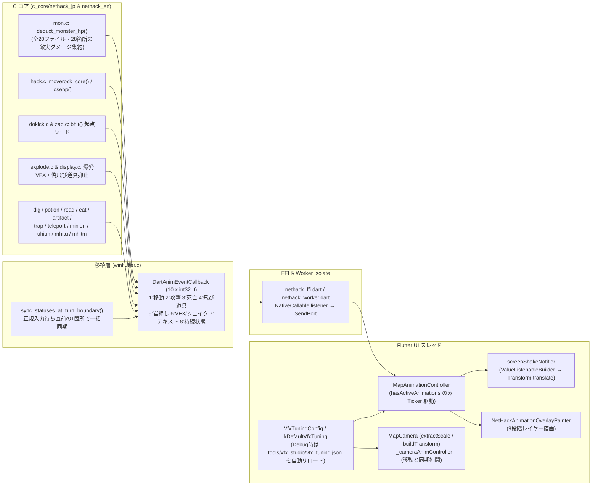

# マップアニメーション・VFX・フローティングテキスト設計ドキュメント

本ドキュメントは、DartHack に実装された**マップ・カメラ追従アニメーション、岩押し・アイテム蹴り移動演出、ハイブリッド・パーティクル VFX、独立設定のフローティングテキスト、持続的な状態マイクロ演出、控えめな画面シェイク、および開発者専用調整ツール（VFX Studio）** の全体アーキテクチャ・プロトコル仕様・設計思想・参考資料をまとめた開発者向けリファレンスです。

---

## 1. 概要と設計思想（特徴）

伝統的なローグライク（NetHack）の**「1 ターン 1 手のテンポの良さ・入力即応性」**と**「情報秘匿（ネタバレ防止）の厳格さ」**を一切損なわずに、視覚的な楽しさと状況把握のしやすさを高めるため、以下の設計原則を採用しています。

1. **非ブロッキング＆次入力時即スナップ完了（入力遅延ゼロ）**
   - マップ・カメラのアニメーションはすべて UI 層で非同期に再生され、C コアの入力待ちをブロックしません。
   - プレイヤーが次のキー・タップを入力した瞬間に進行中の短期アニメーションとカメラ補間を即座に完了位置へスナップ（`_snapAllAnimations()` / `snapAll()`）し、世代番号 `turnId` によって旧ターンの遅延到着イベントを破棄します。
2. **2 レイヤー分離描画による高パフォーマンス**
   - 静止マップ全体（`80 × 21 = 1,680` セル）は `RepaintBoundary` 配下の `NetHackMapPainter` に任せ、動的要素（移動中・戦闘中・浮遊中の数セル、パーティクル、光リング、フローティングテキスト、持続状態バッジ）だけを最前面の `NetHackAnimationOverlayPainter` で描画します。
   - 移動・バンプ・浮遊対象セルの静止グリフは、オーバーレイ側で背景地形（`bktile` / `bkchar`）をマスク上書きしてから前面グリフを補間座標へ描画し、二重残像や床の穴あきを防ぎます。
3. **静止時 Ticker 完全停止（省電力＆テスト安全）**
   - `MapAnimationController` は **Ticker を駆動すべき短期アニメ（`hasActiveAnimations`）** と **静止表示する持続状態（`hasAmbientStatuses`）** を厳密に分離しています。
   - 短期アニメが 0 件になると `Ticker` を自動停止するため、入力待ちの完全静止中は CPU/GPU 負荷 0% となり、Flutter の `WidgetTester.pumpAndSettle()` もハングせず 100% 安全に完了します。
4. **NetHack 原作準拠の情報秘匿（ネタバレゼロ）**
   - 盲目中（`Blind`）は視覚パーティクル VFX を抑止し、幻覚中（`Hallucination`）はポーション飛沫・爆発・召喚色をランダム化して未識別特定を防ぎます。
   - モンスターへのダメージ・状態変化は検知可能範囲（視界内・テレパシー等）に限定し、未露見の擬態ミミック・壁内埋没敵・`wildmiss` の未検知敵・原作で成否が秘匿される無力化（`m->mcan`）は情報漏洩しないよう除外しています。
5. **設定の独立性とデータ駆動設計（`VfxTuningConfig`）**
   - ユーザー設定として、「アニメーション」（ON/OFF・速度：`速い / 標準 / 遅い`）とは完全に独立して「フローティングテキスト」（ON/OFF、デフォルト ON）を切り替えられます。
   - すべての時間・イージング幅・粒数・初速・重力・リング半径・色パレット・シェイク振幅・同時上限は `VfxTuningConfig` モデルに一元化されており、開発者専用ツール **VFX Studio** からリアルタイム調整・プリセット比較・定数自動生成が可能です。

---

## 2. 参考にしたプロジェクト・知見

本機能の設計・演出選定にあたっては、以下の 2 つのオープンソース・ローグライク実装を参考にしつつ、NetHack 5.0 のゲームルールと Flutter の描画特性に合わせて独自に再設計しました。

### NethackModern
- **参照元**: <https://github.com/TheMetabee/NethackModern>
- **参考にした要素**:
  - **次入力時即スナップ完了方式**: 高速連打・オート移動時にアニメーションが操作を妨げない設計原則。
  - **移動補間とカメラ追従の同期**: 主人公の移動補間とカメラの平行移動を同一時間・同一イージング（`120ms`, `Curves.easeOutQuad`）で完全同期させ、画面酔いやガタつきを防止するアプローチ。
  - **近接戦闘の踏み込みバンプ＆被弾フィードバック**: グリッドベースでありながら打撃感を得られる最小限のモーション設計。

### T-Engine4（Tales of Maj'Eyal エンジン v1.7.6）
- **参照元**: T-Engine4 ソースコード（v1.7.6）
- **参考にした要素**:
  - **フローティングテキストによる状況可視化**: ダメージ・ミス・回復・レベルアップ・状態異常付与をメッセージログだけでなくキャラクター頭上へ色分け表示する UX。
  - **複数イベント同時発生時のスタガー表示**: 同一ターン・同一セルで複数テキストが重なって読めなくなる問題に対し、優先度絞り込み＋時間差発射（スタガー）＋ Y スタッキングで視認性を保つ手法。
  - **軽量パーティクル＆状態マイクロ演出**: 爆発・テレポート・ポーション飛沫・岩押し砂埃などの視覚フィードバックと、混乱・睡眠・石化など一目で分かる持続的オーバーレイ表現。

### DartHack 独自の最適化・拡張
- **`MaskFilter.blur` の完全排除**: モバイル GPU での負荷スパイクを避けるため、光リングや発光粒は同心円の半透明アルファ重ね塗りで表現しています。
- **画面シェイクの `ValueNotifier<Offset>` 分離**: 爆発・大被弾・扉蹴破りの `110ms` 間だけ `Transform.translate` を更新し、平常時の `InteractiveViewer` 再ビルドをゼロに抑えています。
- **非透過タイルセットでの床ズレ保護**: 透過タイル・テキストモードでは浮遊時にキャラを上浮き（`-0.11 * cellH`）＋移動追従ドロップシャドウを描画しますが、床が焼き込まれた非透過タイルではタイル位置を動かさずセル下部に淡い水色の浮遊弧のみを描画して視覚破綻を防いでいます。
- **開発者専用スタンドアロン調整環境（VFX Studio）**: 本番配布パッケージに一切混入しない `tools/vfx_studio/` 上で実物レンダラーを用いたプレビュー・調整を行い、開発中の JSON ホットリロードと本番用 `const` Dart 定数コード自動生成を両立しています。

---

## 3. アーキテクチャ全体像



### オーバーレイペインタの描画順（[nethack_animation_overlay_painter.dart](../sys/flutter/lib/widgets/nethack_animation_overlay_painter.dart)）

1. **背景マスク上書き** (`_drawBackgroundMask`): `animatedCellKeys`（移動・バンプ・被弾・浮遊上浮きセル）の静止前面グリフを背景地形で消去。
2. **浮遊ドロップシャドウ＆前面エンティティ** (`_drawForegroundGlyph`): 浮遊時（テキスト／透過タイル）は移動補間座標 `(x + moveDx, y + moveDy)` の足元に楕円影を描き、その上に `(x + dx, y + dy)` でキャラを描画。`printGlyph` 未到着の 1 フレーム目はイベント付属のフォールバックグリフで補完。
3. **消滅岩押し** (`activeVanishingObjectMoves`): 穴埋め・落とし穴・水没・テレポ罠時は移動先をマスクせず、滑り込みながら終盤（既定 `t=0.65..1.0`）で縮小＆フェードアウト。
4. **死亡フェードアウト** (`activeDeathFades`): 縮小しながらフェードアウト。
5. **飛び道具・光線** (`activeProjectiles`): 連結されたウェイポイント経路を滑らかに補間描画。
6. **持続的な状態マイクロ演出** (`activeAmbientStatuses`): 4 スロット優先度排他（外枠＆粒子・非透過タイル用浮遊弧・混乱の手・頭上バッジ）。
7. **同心円光リング VFX** (`activeRings`): 外側ハロー線＋内側コア線（非 blur）。
8. **ドット粒・発光粒パーティクル VFX** (`activeParticles`): ピクセル調正方形ドット粒、および 2 層半透明円の発光粒。
9. **フローティングテキスト** (`activeFloatingTexts`): 最前面に 4 方向 1px 黒縁取り付きで描画。

---

## 4. C ↔ Dart 共通イベントプロトコル

C コア（`winflutter.c`）から Dart 側（`MapAnimEvent`）へは、`DartAnimEventCallback`（`int32_t` × 10 引数）を通じてイベントを送出します。

```c
typedef void (*DartAnimEventCallback)(
    int32_t turn_id, int32_t event_type, int32_t entity_id,
    int32_t from_x, int32_t from_y, int32_t to_x, int32_t to_y,
    int32_t param1, int32_t param2, int32_t param3
);
```

### 4.1 `MapAnimEventType` 一覧

| `eventType` | 定数名（Dart） | `entityId` の意味 | `param1 / param2 / param3` の意味 |
| :---: | :--- | :--- | :--- |
| `1` | `move` | `0`: 主人公 / `>0`: `m_id` | 先行フレーム用 `tile / ch / argb` |
| `2` | `attack` | 攻撃者 ID | `param1`: 命中フラグ (`1`: 命中, `0`: ミス) |
| `3` | `death` | モンスター `m_id` | 死亡時の `tile / ch / argb` |
| `4` | `projectile` | `0` | 飛び道具の `tile / ch / argb`（同 `turnId` 連続座標を自動連結） |
| `5` | `objectMove` | `1`: 通常岩押し（残留）<br>`2`: 消滅岩押し（穴・水・罠） | 岩の `tile / ch / argb` |
| `6` | `vfx` | `MapVfxKind` (`1..10`) | `param1`: 動的 ARGB 色（`0` なら `VfxTuningConfig` 設定色）<br>`param2`: 強度 (`1..3`) または召喚種別 (`0:通常, 1:悪魔, 2:天使`) |
| `7` | `floatingText` | `FloatingTextKind` (`1..7`) | `param1`: 数値または `StatusTextCode`, `param2`: 上書き ARGB 色（通常 `0`） |
| `8` | `ambientStatus` | 11 ビット状態マスク (`AmbientStatusBits`) | `fromX == -1` で全セルクリア、通常は `(toX, toY)` を差分更新 |

### 4.2 `MapVfxKind`（`eventType == 6`）と色優先ルール

| 値 | 定数名 | 表現内容（既定値） | 画面シェイク | 色解決ルール | 主な発火元（C コア） |
| :---: | :--- | :--- | :---: | :--- | :--- |
| `1` | `dust` | 砂埃ドット粒（6粒） | なし | `tuning` 設定色 | `hack.c: moverock_core()` |
| `2` | `woodDebris` | 木片ドット粒（強: 12粒 / 弱: 6粒） | `param2 >= 2` で `2.5px` | `tuning` 設定色 | `dokick.c: kick_door()` |
| `3` | `rockDebris` | 石片ドット粒（10粒） | なし | `tuning` 設定色 | `dig.c`（壁・岩・像掘削） |
| `4` | `potionSplash` | 発光飛沫粒（10粒） | なし | **動的色優先**（薬色・幻覚色） | `potion.c`（ポーション破裂） |
| `5` | `explosion` | 2 重光リング＋発光粒（16粒） | `3.0px` | **動的色優先**（属性色・幻覚色） | `explode.c: explode()` |
| `6` | `teleport` | 出発地収束リング＋到着地拡散リング＋発光粒（8粒） | なし | `tuning` 設定色 | `teleport.c` |
| `7` | `levelUp` | 金色光リング＋上昇星粒（12粒） | なし | `tuning` 設定色 | `winflutter.c` (`sa2_xplevelup`) |
| `8` | `summon` | 収束光リング＋発光粒（7粒） | なし | 非幻覚: `tuning` 3種色<br>幻覚時: 動的ランダム色 | `minion.c` (`msummon` / `summon_minion`) |
| `9` | `kickImpact` | 蹴り衝撃ドット粒（6粒） | なし | `tuning` 設定色 | `dokick.c: really_kick_object()` |
| `10` | `bigHitShake` | 画面シェイクのみ | `2.5px` | ― | `hack.c: losehp()`（最大 HP 20% 以上被弾時） |

### 4.3 `FloatingTextKind`（`eventType == 7`）＆ `StatusTextCode`

| `entityId` | 定数名 | 表示例 | 優先度 | 色設定キー（`FloatingTextTuning`） |
| :---: | :--- | :--- | :---: | :--- |
| `1` | `dmgHero` | `-12` | 95 | `dmgHeroColor`（既定: 赤） |
| `2` | `dmgMon` | `-15` | 85 | `dmgMonColor`（既定: 黄白） |
| `3` | `miss` | `MISS` | 30 | `missColor`（既定: 灰白） |
| `4` | `healHp` | `+18` | 70 | `healHpColor`（既定: 緑） |
| `5` | `healPw` | `+10 Pw` | 65 | `healPwColor`（既定: 水色） |
| `6` | `levelUp` | `LEVEL UP!` | 110 | `levelUpColor`（既定: 金） |
| `7` | `statusGain` | 状態名（日英切替） | 40〜100 | 下記 **9 カテゴリパレット** |

`StatusTextCode` のコード区分と 9 カテゴリカラーパレット対応：
1. **`statusLethalColor`**（致死危機・極限警告）: `1:石化!`, `3:窒息!`, `6:捕縛!`, `34:失神`, `35:飢餓!`, `44:過積載!`
2. **`statusSlimeColor`**（粘液化）: `2:粘液化!`
3. **`statusSicknessColor`**（食中毒・病気）: `4:食中毒!`, `5:病気!`
4. **`statusDangerColor`**（重度危険）: `7:溶岩!`, `18:丸呑み`, `43:超過重`
5. **`statusMentalColor`**（精神異常）: `12:混乱`, `13:朦朧`, `14:幻覚`
6. **`statusImmobilizeColor`**（行動不能・逃走）: `15:麻痺`, `16:睡眠`, `17:失神`, `60:逃走`
7. **`statusImpairColor`**（拘束・消耗）: `19:拘束`, `20:罠拘束`, `23:脚傷`, `31:空腹`, `32:衰弱`, `33:失神寸前`, `40:重荷`, `41:圧迫`, `42:過重`
8. **`statusMovementColor`**（移動・感覚）: `10:盲目`, `11:難聴`, `21:懲罰`, `22:滑手`, `24:水没`, `25:鉄過敏`, `50:浮遊`, `51:飛行`, `55:透明`
9. **`statusBuffColor`**（強化・その他）: `30:満腹`, `52:騎乗`, `53:発光`, `54:加速`, `56:保持`, `61:減速`

### 4.4 `AmbientStatusBits`（`eventType == 8`、11 ビット＆4 スロット優先度排他）

複合状態になっても `32×32px` セルが視覚的に破綻しないよう、描画部位を 4 スロットに分割し、同一スロット内では最上位 1 種のみを描画します。

| スロット | 優先順位（左が最優先） | 対応ビット（`AmbientStatusBits`） | 描画内容 |
| :--- | :--- | :--- | :--- |
| **頭上** | 睡眠 > 麻痺・失神 > 混乱 > 朦朧 > 敵逃走 | `0x0001`, `0x0002`, `0x0004`, `0x0008`, `0x0400` | `Zzz` / `||` / `?` / `★` / 青い汗粒 |
| **外枠＆粒子** | 石化 > 粘液化 > 窒息・溶岩・捕縛 > 食中毒・病気 | `0x0020`, `0x0040`, `0x0100`, `0x0080` | 状態色の細枠＋4隅アクセント（＋揺らぐ小粒子） |
| **足元** | 浮遊・飛行 | `0x0010` | 透過/テキスト: 上浮き `floatLiftDy`＋移動追従影<br>非透過タイル: セル下部に淡い水色の浮遊弧のみ |
| **左右中段** | 混乱の手 (`u.umconf`) | `0x0200` | 左右端に極小赤桃色光点（ハロー＋コア） |

---

## 5. 主要実装のポイントと注意点

### 5.1 全経路モンスター実ダメージ集約（`deduct_monster_hp`）
- 日英両コアの `src/mon.c` に `deduct_monster_hp(struct monst *mon, int dmg)` を新設し、近接・投擲・魔法・ワンド・爆発・罠・ポーション・掘削・音楽・モンスター同士の戦闘・領域ダメージ・ワーム尻尾切断など **全 20 ファイル・28 箇所**の HP 減算を集約しています。
- 減算前後の実 HP 差分（`actual_dmg = before - after`）を算出し、`flutter_anim_mon_damage()` へ渡します。
- ロングワームの胴体への攻撃時は、頭座標ではなく被弾したセグメント座標にテキストを表示します。
- 擬態中ミミックへの初撃では、見破られる直前でも攻撃が当たった事実に合わせて表示できるよう判定を保護しています。

### 5.2 岩押しとアイテム蹴り・飛び道具起点シード
- **岩押し (`src/hack.c: moverock_core`)**: `LANDMINE`, `PIT`/`SPIKED_PIT`, `HOLE`/`TRAPDOOR`, `LEVEL_TELEP`/`TELEP_TRAP`, `boulder_hits_pool`, 通常 `dopush` の全分岐から `notify_boulder_push_anim()` を呼び出し、残留 (`1`) と消滅 (`2`) を正確に区別します。
- **飛び道具起点シード (`src/zap.c: bhit` & `winflutter.c`)**: 蹴ったアイテムや投げたアイテムは `tmp_at()` の初回座標が 1 マス先から始まるため、`flutter_anim_projectile_seed(start_x, start_y, glyph)` で起点を記録して初回ステップで自動連結し、敵直撃・穴落下・コイン合流での早期終了直前にも終点ステップを補完しています。
- **爆発グリフの分離 (`src/display.c` & `src/explode.c`)**: `tmp_at()` 経由で描かれる 3x3 爆発グリフが飛び道具として誤認識されないよう `glyph_is_explosion()` で除外し、アニメーション ON 時は爆発のレガシー 21 回ウェイトをスキップしてモダンな光リング VFX へ置き換えています。

### 5.3 ターン境界での状態変化一括同期（`sync_statuses_at_turn_boundary`）
- ターン途中の `bot()` 等で逐次評価すると、テレポート直前座標への誤表示や視界再計算前のネタバレが起きるため、**正規の入力待ち直前（`flutter_nhgetch` 内、`program_state.in_moveloop && !program_state.gameover && !g_in_display_blocking && !gv.vision_full_recalc`）の 1 箇所のみ**で評価します。
- **OFF 中のベースライン常時更新**: `g_floating_text_enabled == 0` の間も主人公状態・空腹・荷重・`fmon` 512 スロット追跡テーブルの更新自体は毎ターン継続し、コールバック送出のみを止めます。これにより、プレイ途中で設定を ON に戻した瞬間に過去の状態が一斉ポップアップする誤爆を防いでいます。
- **マップ切替・初期化時のリセット**: `flutter_init_nhwindows`, `flutter_exit_nhwindows`, `flutter_clear_nhwindow(WIN_MAP)` で `reset_status_trackers()` を呼び出し、ベースラインをリセットするとともに Dart 側へ `fromX = -1` の持続状態一括クリアを送ります。

### 5.4 フローティングテキストのスタガー発射＆上限管理
- 同一セル・同一ターンに複数テキストが発生した場合、完全重複を弾いた上で**重要度（`priority`）上位 3 件**（`maxFloatingTextsPerCellTurn`）に絞り、2 件目以降に `staggerMs × stackIndex`（速度倍率連動）の開始ディレイと `-stackSpacingCells * stackIndex` の Y スタッキングを与えて順番に浮かび上がらせます。
- 全体のメモリ・描画負荷上限として、既定でパーティクル **80 粒**・光リング **8 個**・フローティングテキスト **20 件** の上限キャップを設けています。

### 5.5 カメラ追従アニメーションと縮小ズーム時の `Matrix4` 3 軸保護（重要）
- `vector_math_64` の `Matrix4.getMaxScaleOnAxis()` は X・Y・Z 全 3 軸の最大スケール `max(scaleX, scaleY, scaleZ)` を返します。そのため、`Matrix4(scale, 0, 0, 0, 0, scale, 0, 0, 0, 0, 1.0, 0, tx, ty, 0, 1)` のように **Z 軸を `1.0` 固定**にしてしまうと、縮小ズーム時（例：`scale = 0.5`）に `getMaxScaleOnAxis()` が `1.0` を返し、縮小用オフセット `(tx, ty)` に等倍 `1.0` が適用されて画面が大幅に左上へ吹き飛ぶバグが発生します。
- これを防ぐため、[map_camera.dart](../sys/flutter/lib/utils/map_camera.dart) に以下の 2 つの純粋関数を用意し、[main.dart](../sys/flutter/lib/main.dart) および [full_map_dialog.dart](../sys/flutter/lib/widgets/full_map_dialog.dart) の全箇所で統一使用しています：
  1. **`MapCamera.extractScale(Matrix4)`**: Z 軸成分に一切影響されない 2D X 軸基底ベクトル長 `sqrt(s[0]^2 + s[1]^2)` から実際のズーム倍率を抽出。
  2. **`MapCamera.buildTransform({scale, tx, ty})`**: Z 軸（`storage[10]`）にも `scale` を設定した 3 軸等方スケール行列を構築し、Flutter 標準の `InteractiveViewer` 内部の `getMaxScaleOnAxis()` とも完全整合を維持。

---

## 6. 設定・永続化・FFI 同期仕様

| 設定項目 | `AppPrefs` キー | 既定値 | Worker メッセージ | C 側 FFI 関数 |
| :--- | :--- | :---: | :--- | :--- |
| アニメーション ON/OFF | `map_animation_enabled` | `true` | `set_animation_settings` | `SetAnimationSettingsFlutter(enabled, speedMode)` |
| アニメーション速度 | `map_animation_speed` | `'normal'` | `set_animation_settings` | 同上（`fast=0`, `normal=1`, `slow=2`） |
| フローティングテキスト | `floating_text_enabled` | `true` | `set_floating_text_enabled` | `SetFloatingTextEnabledFlutter(enabled)` |

- 速度プリセット倍率は `MotionTuning.multiplierForMode(speed.cMode)` で一元解決されます（既定値: `fast: 0.58x` / `normal: 1.0x` / `slow: 2.0x`）。マップ上のアニメーション時間と `main.dart` のカメラ追従時間の両方が同一倍率を参照します。
- 起動時は `NetHackWorkerSession` の `start` メッセージに上記 3 設定を同梱し、`startNetHack()` 呼び出し前にすべて C コアへ初期適用されます。

---

## 7. 関連ファイル一覧とテスト構成

### C コア・移植層
- **日英両コア共通宣言・スタブ**: `c_core/nethack_{jp,en}/include/extern.h`, `src/windows.c`
- **モンスター実ダメージ集約**: `c_core/nethack_{jp,en}/src/mon.c`（`deduct_monster_hp`）ほか全 20 ファイル
- **イベント生成・状態同期**: [winflutter.c](../sys/flutter/android/app/src/main/cpp/winflutter.c)

### Flutter フロントエンド（本番ランタイム `lib/`）
- **FFI / Worker**: [nethack_ffi.dart](../sys/flutter/lib/nethack_ffi.dart), [nethack_worker.dart](../sys/flutter/lib/nethack_worker.dart)
- **イベント・パラメータモデル**: [map_animation_event.dart](../sys/flutter/lib/models/map_animation_event.dart), [vfx_tuning_config.dart](../sys/flutter/lib/models/vfx_tuning_config.dart), [vfx_tuning_defaults.dart](../sys/flutter/lib/models/vfx_tuning_defaults.dart)
- **アニメーション・カメラ制御**: [map_animation_controller.dart](../sys/flutter/lib/utils/map_animation_controller.dart), [map_camera.dart](../sys/flutter/lib/utils/map_camera.dart)
- **オーバーレイ描画・全体マップ**: [nethack_animation_overlay_painter.dart](../sys/flutter/lib/widgets/nethack_animation_overlay_painter.dart), [full_map_dialog.dart](../sys/flutter/lib/widgets/full_map_dialog.dart)
- **画面統合・設定・多言語**: [main.dart](../sys/flutter/lib/main.dart), [settings_page.dart](../sys/flutter/lib/settings_page.dart), [app_ja.arb](../sys/flutter/lib/l10n/app_ja.arb), [app_en.arb](../sys/flutter/lib/l10n/app_en.arb)

### 開発者専用ツール（`tools/vfx_studio/` ※ユーザー非配布）
- **起動スクリプト・エントリーポイント**: [run_vfx_studio.ps1](../sys/flutter/tools/run_vfx_studio.ps1), [main.dart](../sys/flutter/tools/vfx_studio/main.dart)
- **スタジオ UI・タイル検出・設定 JSON**: [vfx_studio_page.dart](../sys/flutter/tools/vfx_studio/vfx_studio_page.dart), [studio_tile_loader.dart](../sys/flutter/tools/vfx_studio/studio_tile_loader.dart), [vfx_tuning.json](../sys/flutter/tools/vfx_studio/vfx_tuning.json)

### ユニット・ウィジェットテスト（計 50 ケース）
- [map_animation_controller_test.dart](../sys/flutter/test/utils/map_animation_controller_test.dart): 移動・攻撃・多段命中・死亡・飛び道具連結・通常/消滅岩押し・VFX 上限・シェイク復帰・フローティングテキスト独立＆スタガー・持続状態 Ticker 停止とクリアを検証。
- [map_camera_test.dart](../sys/flutter/test/utils/map_camera_test.dart): マップ固定スクロール計算、カメラ補間判定、縮小倍率での `buildTransform` / `extractScale` / 連続フレーム補間の回帰テストを検証。
- [vfx_tuning_config_test.dart](../sys/flutter/test/models/vfx_tuning_config_test.dart): `kDefaultVfxTuning` と JSON ラウンドトリップ一致、欠損キー安全フォールバック、`toDartConstSource()` 生成、テレポート発着 2 リング・召喚 3 種色・9 カテゴリ状態色の反映を検証。
- [vfx_studio_page_test.dart](../sys/flutter/test/tools/vfx_studio_page_test.dart): VFX Studio の 6 タブ切替・演出発火・持続状態トグル・プリセット＆A/B 比較・`pumpAndSettle()` 完了安全性を検証。
- [nethack_animation_overlay_painter_test.dart](../sys/flutter/test/widgets/nethack_animation_overlay_painter_test.dart): テキスト／透過タイル／非透過タイルの全モードで全演出要素がエラーなく描画されることを検証。
- [animation_settings_test.dart](../sys/flutter/test/widgets/animation_settings_test.dart): 日英両ロケールでの設定表示、アニメーション OFF 時の速度無効化、フローティングテキストの独立切替・永続化を検証。
- [nethack_worker_startup_test.dart](../sys/flutter/test/nethack_worker_startup_test.dart): `start` 前のガード、初期設定適用順序、`set_animation_settings` / `set_floating_text_enabled` の転送を検証。

---

## 8. 開発者専用パラメータ調整＆プレビューツール（VFX Studio）

アニメーション時間・各種 VFX 粒数/速度/色・光リング・フローティングテキスト・持続状態マイクロ演出・画面シェイク・上限キャップを試行錯誤しながらリアルタイム調整するための**開発者専用スタンドアロンツール（エンドユーザー非配布）**です。

### 8.1 起動方法と試行錯誤ワークフロー

```powershell
# 1. VFX Studio を起動
powershell -ExecutionPolicy Bypass -File sys\flutter\tools\run_vfx_studio.ps1

# 2. (任意) 実プレイ確認用に別ターミナルで DartHack 本体をデバッグ起動
Set-Location sys\flutter; flutter run -d windows
```

1. **VFX Studio 上でプレビュー＆微調整**:
   - 左ペインで表示モード（テキスト／`DartHack_private` の透過タイル 3 種／公開側の非透過タイル 4 種）・ズーム（`0.5x〜3.0x`）・言語（`JP/EN`）・速度（`速/標/遅`）を切り替え、下部ボタンで任意の演出を発火します。
   - **「リピート」** を ON にすると直近の演出が周期再生され、右ペインのスライダーや数値直打ち・Hex カラー変更をリアルタイムに見比べられます。
   - ヘッダーの **「A/B比較 (標準値で見る)」** をトグルすると、編集中の値を保持したままワンクリックで初期標準値と比較できます。変更済みの項目にはオレンジのドットと個別リセットボタン（`↺`）が表示されます。
2. **保存と実プレイへの即時ホットリロード**:
   - ヘッダー右端の **「保存 (JSON + Dart定数)」** を押すと、以下の 2 ファイルが同時に更新されます：
     1. [vfx_tuning.json](../sys/flutter/tools/vfx_studio/vfx_tuning.json): ツールの作業状態・カスタムプリセット・開発時ホットリロード用 JSON。
     2. [vfx_tuning_defaults.dart](../sys/flutter/lib/models/vfx_tuning_defaults.dart): 本番ビルドにコンパイル組み込みされる `const VfxTuningConfig kDefaultVfxTuning` 定数コード。
   - `flutter run`（`kDebugMode`）で起動中の DartHack ウィンドウへフォーカスを戻す（`AppLifecycleState.resumed`）だけで、`DebugVfxTuningReloader` がファイルの `lastModified` 更新を検知し、**再ビルド 0 秒で実プレイへ即座に反映**されます。
3. **リリースビルドへの反映**:
   - 調整完了後は既に [vfx_tuning_defaults.dart](../sys/flutter/lib/models/vfx_tuning_defaults.dart) が最新の `const` 定数コードに更新されているため、そのまま `windows_build.ps1` / `android_build.ps1` でビルド・`git commit` できます。Release ビルドでは JSON 読込コード自体が消滅し、ユーザー配布物にツールや JSON が一切露出しません。

### 8.2 6 カテゴリタブの調整対象一覧

| タブ名 | 調整可能な項目 |
| :--- | :--- |
| **1. 移動・戦闘** | 移動時間、歩行ホップ高さ、カメラ追従時間、近接バンプ時間・踏み込み幅、被弾時間・横揺れ・フラッシュ強度/色、死亡フェード時間・縮小率、飛び道具 1 マス時間・最大総時間、消滅岩フェード開始位置・終了スケール、速度倍率（速い/標準/遅い） |
| **2. VFX粒子** | 全 10 種（`dust`, `woodDebrisLight`, `woodDebrisHeavy`, `rockDebris`, `potionSplash`, `explosion`, `teleport`, `levelUp`, `summon`, `kickImpact`）ごとの粒数・最小/最大初速・重力・最小/最大サイズ・持続時間・発光ハロー有無・基準色、および召喚 3 種別色（通常・悪魔・天使） |
| **3. 光リング** | 全 6 種（`explosionOuter`, `explosionInner`, `teleportDepart`, `teleportArrive`, `levelUp`, `summon`）ごとの開始半径・終了半径・線幅比率・持続時間・色 |
| **4. テキスト** | 表示時間、同セル発射ディレイ（スタガー）、上昇セル量、スタック段差、文字サイズ比率、出現ポップ最大倍率、黒縁取り不透明度、基本 6 色、状態変化 9 カテゴリパレット |
| **5. 持続状態** | 浮遊上浮きオフセット、ドロップシャドウ幅/高/濃さ、非透過タイル用浮遊弧の太さ/色、頭上バッジ文字サイズ/上下揺れ幅、状態外枠の線幅/不透明度、1 ターンあたり位相進行量 |
| **6. シェイク・上限** | シェイク持続時間、爆発/大被ダメ/扉蹴破りの各振幅（px ※`0` で個別無効化可、大被ダメ発動閾値 20% は C コア固定）、最大パーティクル数・最大光リング数・最大テキスト総数・同セル最大表示件数 |

---

## 9. 今後の拡張ガイドライン

1. **新しい VFX を追加する場合**
   - [winflutter.c](../sys/flutter/android/app/src/main/cpp/winflutter.c) と [map_animation_event.dart](../sys/flutter/lib/models/map_animation_event.dart) の `MapVfxKind` に同じ整数コードを追加します。
   - [vfx_tuning_config.dart](../sys/flutter/lib/models/vfx_tuning_config.dart) の `particleKeys` / `defaultParticles`（または `ringKeys` / `defaultRings`）にキーを追加し、`MapAnimationController._handleVfx()` で `_spawnFromTuning()` / `_spawnRingFromTuning()` / `_triggerScreenShake()` を呼び出します（最後に VFX Studio で一度「保存」を押すか `toDartConstSource()` で `vfx_tuning_defaults.dart` を同期します）。
   - 視覚エフェクトは必ず C 側で `Blind` 抑止と `Hallucination` 色ランダム化を考慮してください。
2. **新しい状態テキストを追加する場合**
   - `winflutter.c` の `compute_hero_status_mask()`（またはモンスター 9 状態）と `StatusTextCode` に同じコードを追加し、`StatusTextCode.resolveLabel` / `resolveColor` / `resolvePriority` を定義します。
   - 必ず日英両コア（`c_core/nethack_jp`, `c_core/nethack_en`）を対称に保ち、非 GUI ビルド用に `src/windows.c` へ空スタブを維持してください。
3. **守るべき不変条件**
   - 持続状態（`eventType == 8`）やツールの待機状態のために `Ticker` / `Timer` を常時起動しないでください（バッテリー消費と `pumpAndSettle()` タイムアウトの原因になります）。
   - `NetHackAnimationOverlayPainter` 内で `MaskFilter.blur` を使用しないでください。
   - 2D マップカメラの `Matrix4` からズーム倍率を読む際は `getMaxScaleOnAxis()` を直接呼ばず必ず `MapCamera.extractScale()` を使い、行列生成時は `MapCamera.buildTransform()`（3 軸等方スケール）を使用してください。
   - 新しいイベント追加時は、必ず既存の `snapAll()`（次入力時即クリア）と `turnId < _minAcceptedTurnId`（旧世代破棄）のルールに従わせてください。
