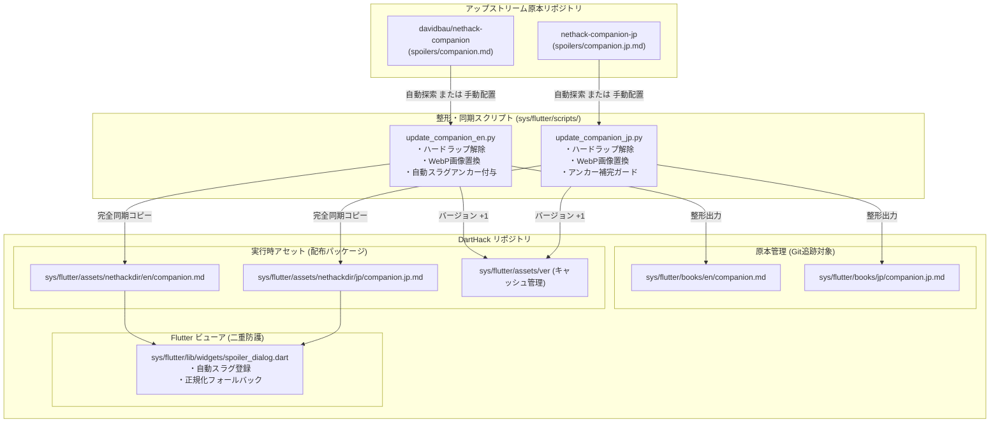
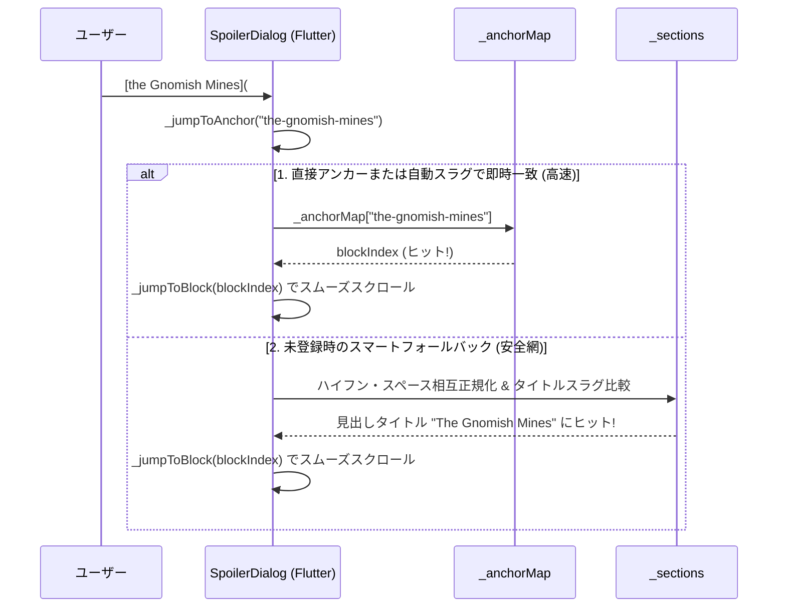

<!-- Modified by NetHackJP contributor @satokiyon; latest change date: 2026-10-27. -->
# NetHack 5.0 スポイラー Markdown 整形・同期パイプライン仕様書

本ドキュメントでは、NetHack 5.0 総合攻略手引書『A Traveler's Companion to the Mazes of Menace』（英語版および日本語版）の Markdown 原本（`companion.md` / `companion.jp.md`）を、アップストリームリポジトリ（`nethack-companion-jp` および `davidbau/nethack-companion`）から取り込んで DartHack 用に整形・同期・検証するための技術仕様、アーキテクチャ、処理方針、および運用手順について詳細に解説します。

---

## 1. 概要とシステムアーキテクチャ

### 1.1 背景
DartHack では、ゲームプレイ中にいつでも攻略情報やアイテム識別、モンスターデータ、戦術を閲覧できるインゲームスポイラービューア（`SpoilerDialog`）を搭載しています。
スポイラーの原本は、David Bau 氏らによって執筆された NetHack 5.0 公式対応の攻略手引書であり、日本語版翻訳プロジェクト（`nethack-companion-jp`）によって日本語化が進められています。

### 1.2 リポジトリ構成とデータフロー
原本リポジトリから DartHack 内への同期・反映は、専用の Python 整形スクリプトを経由して行われます。



- **原本管理ディレクトリ (`sys/flutter/books/`)**:
  DartHack 向けに整形された Markdown を Git バージョン管理する正規の場所です。
- **実行時アセットディレクトリ (`sys/flutter/assets/nethackdir/`)**:
  Flutter アプリケーションが実行時にバンドル・ロードする実体ファイルです。`books/` 側の内容と 100% 完全一致して同期配置されます。
- **アセットバージョン (`sys/flutter/assets/ver`)**:
  アセットファイルが更新された際、端末内の内部ストレージ（`/data/user/0/...`）に展開済みの古いアセットキャッシュを強制破棄・再展開させるため、更新時に必ず整数値を +1 インクリメントします。

---

## 2. DartHack 固有の Markdown 整形方針（AGENTS.md ルール51）

アップストリームの Markdown は、主に Pandoc を用いた書籍印刷（PDF/LaTeX）や静的 Web サイト向けに執筆されており、そのままではモバイル画面での折り返しや Flutter の簡易 Markdown パーサーで正常に表示・動作しません。そのため、以下の整形原則を厳格に適用します。

### 2.1 パラグラフ単位の改行（ハードラップの解消）
- **仕様**: 原本にある 70〜80 文字ごとの固定改行（ハードラップ）をすべて連結・解消し、「1段落1行（ソフトラップ）」に整形します。
- **理由**: スマートフォン等の狭い縦長画面でハードラップが残っていると、中途半端な位置で不自然に改行されて著しく可読性を損なうためです。
- **結合ルール**:
  - 英語文同士の行連結時は半角スペース（` `）を挿入して単語を結合。
  - 日本語（マルチバイト文字）同士の行連結時はスペースを挟まず直接結合。
  - 引用ブロック（`>`）やリスト項目（`- `, `1. `）も項目ごとに 1 行に連結。

### 2.2 特殊構文・アスキーアート・テーブルの完全保護
- **コードブロック (```` ... ````)**:
  ダンジョンマップ、アスキーアート、等幅テキストは、改行・インデント・空白を 100% そのまま保持します。
- **テーブル (`| ... |`)**:
  各種データ表（防具性能、モンスター一覧、価格表など）の行構造および区切り線を完全保護します。

### 2.3 インライン SVG（DMAP・フローチャート）の WebP 画像アセット化
原本に含まれる Pandoc 向けインライン SVG ブロックは、DartHack 用の軽量・高品位な WebP 画像アセット参照へ自動置換します：
- **ダンジョン系統図**:
  `<!-- DMAP-BEGIN -->` 〜 `<!-- DMAP-END -->`
  → ``（日本語版は `spoiler_dmap_jp.webp`）
- **アイテム識別フローチャート**:
  `<!-- FLOWCHART-BEGIN -->` 〜 `<!-- FLOWCHART-END -->`
  → ``（日本語版は `spoiler_flowchart_jp.webp`）

### 2.4 Pandoc / LaTeX / HTML 特有構文のクレンジング
- ````{=latex} ... ````、````{=html} ... ````、`<aside> ... </aside>`、`::: ...` などの Pandoc div / raw ブロックを除去します。
- **生 HTML・JavaScript・価格識別ツールバーの完全除去**:
  - Web 版スポイラー専用の動的価格計算スクリプト（`<script> ... </script>`）および価格識別ツールバー（`<div class="price-id-toolbar"></div>`）を完全に除去します。
  - アプリ内には存在しない Web ツールバー機能に言及した本文説明文（「魅力 / 売却 / 観光客 / 激怒ツールバーを使用して〜」等）を除去します。
  - 杖一覧テーブル直後にある `<small>...</small>` タグを除去し、注記テキストを Markdown イタリック（`*...*`）に変換します。
- **テーブルセル内 `<br>` の改行化と不要タグ防御**:
  - Markdown テーブル仕様に基づき、セル内の改行として使われている `<br>` は Markdown 内に維持し、Flutter ビューア（`SpoilerDialog`）の `_buildRichText` 側で `\n` に変換して正しく 2 行表示（英語／日本語訳）に整形します。
  - 同時に `SpoilerDialog` 側で未知・残存 HTML タグ（`<small>`, `<div>`, `<span>` 等）の防御的サニタイズを実施します。
- HTML コメント（`<!-- ... -->`）や PDF ダウンロード案内を除去します。
- 冒頭の HTML タイトル・名言ブロックは Markdown のイタリック（`*...*`）に変換します。
- ガイドブック参照リンクは DartHack 内の正式名称「脅威の迷宮へのガイド (Guide to the Mazes of Menace)」に統一します。
- **整形後バリデーションの義務化**:
  - 整形処理完了後、`price-id-toolbar`, `<script`, `<div`, `<button`, `<small` 等の禁止残骸が存在しないか自動検証（`validate_markdown`）し、残存時はパイプラインをエラー停止させます。

---

## 3. アンカーリンク解決と自動スラグ付与アーキテクチャ

### 3.1 発生していた問題のメカニズム
英語版スポイラー（`companion.md`）において、冒頭の `[the Gnomish Mines](#the-gnomish-mines)` などの内部リンクをタップしても該当見出しへジャンプしない問題が発生していました。

調査の結果、以下の 2 点が判明しました：
1. **暗黙スラグへの依存**:
   Pandoc や GitHub では、見出し `#### The Gnomish Mines` に対して自動的に ID `the-gnomish-mines` が割り当てられます。原著の 218 件の内部リンクのうち、**74% 以上（161件）の見出しには明示的なアンカー（`{#...}`）が存在せず、この暗黙スラグに依存**して書かれていました。
2. **Flutter パーサーの仕様とフォールバックの破綻**:
   Flutter 側の `spoiler_dialog.dart` は、見出し末尾に明示された `{#anchor-id}` のみを `_anchorMap` に登録していました。
   見つからない場合のフォールバックとして `s.title.toLowerCase().contains(cleanAnchor.toLowerCase())` を行っていましたが、リンク側の `cleanAnchor` は `"the-gnomish-mines"`（ハイフン区切り）、見出し側の `s.title` は `"The Gnomish Mines"`（スペース区切り）であるため、文字列マッチングが常に `false` となり、ジャンプがスキップされていました。
   （※一方、`[Saving Yourself from Imminent Death](#delayed-deaths)` は見出しに明示的アンカー `### ... {#delayed-deaths}` があったため正常動作していました）

### 3.2 採用した二重防護アーキテクチャ

DartHack では、この問題に対して「Markdown 生成スクリプト側」と「Flutter ビューア側」の双方からアプローチする二重防護を導入し、**全内部リンクの 100% 解決**を実現しました。



#### 第1の防護：スクリプトによる明示的アンカーの自動補完
`update_companion_en.py` および `update_companion_jp.py` において、見出し出力処理時に末尾に `{#...}` が無い見出しを検出し、Pandoc / GFM 準拠のスラグを自動生成して見出しに直接付与します。
- 例: `#### The Gnomish Mines` → `#### The Gnomish Mines {#the-gnomish-mines}`
- 例: `### Angelic beings `A`` → `### Angelic beings `A` {#angelic-beings-a}`
- 日本語版では、`#### ノームの鉱山 (The Gnomish Mines)` のように括弧内の英語表記を優先抽出してスラグ化します。

#### 第2の防護：Flutter ビューア側の自動スラグ登録と正規化フォールバック
`spoiler_dialog.dart`（および `guidebook_dialog.dart`）において：
1. **パース時**:
   見出しテキストから `_generateSlug(titleRaw)` を呼び出し、明示的アンカーだけでなく自動スラグ（定冠詞 `the-` の有無双方）も `_anchorMap` に補完登録。
2. **ジャンプ時 (`_jumpToAnchor`)**:
   アンカーマップ未登録の場合でも、アンカー側のハイフンをスペースに置換した文字列（`normalizedAnchor`）およびタイトル側のスラグ（`sectionSlug`）を比較し、表記揺れを吸収して確実に該当見出しへジャンプ。

---

## 4. 使用スクリプト仕様とコマンドリファレンス

スポイラーの更新・整形スクリプトは `sys/flutter/scripts/` 配下に配置されています。Python 3 標準ライブラリのみで動作し、外部パッケージのインストールは不要です。

### 4.1 英語版更新スクリプト (`update_companion_en.py`)

#### 基本実行コマンド
```powershell
cd sys/flutter
python scripts/update_companion_en.py
```

#### 原本パスの自動探索順序
`--source` を省略した場合、以下の優先度で原本ファイルを探索します：
1. `../../nethack-companion-jp/spoilers/companion.md`（日本語版リポジトリ内の英語原本）
2. `../../nethack-companion/spoilers/companion.md`（隣接する原著リポジトリ）
3. `../nethack-companion/spoilers/companion.md`

#### コマンドラインオプション
| オプション | 短縮 | デフォルト | 説明 |
| :--- | :--- | :--- | :--- |
| `--source <path>` | `-s` | 自動探索 | 入力元となる Markdown ファイルのパスを指定 |
| `--no-ver` | なし | `False` | `sys/flutter/assets/ver` のインクリメントをスキップ |
| `--no-test` | なし | `False` | 更新完了後の Flutter 単体テスト実行をスキップ |

---

### 4.2 日本語版更新スクリプト (`update_companion_jp.py`)

#### 基本実行コマンド
```powershell
cd sys/flutter
python scripts/update_companion_jp.py
```

#### 原本パスの自動探索順序
`--source` を省略した場合、以下の優先度で探索します：
1. `../../nethack-companion-jp/spoilers/companion.jp.md`
2. `../nethack-companion-jp/spoilers/companion.jp.md`

#### コマンドラインオプション
`update_companion_en.py` と同様（`--source`, `--no-ver`, `--no-test`）。

---

### 4.3 原本ファイルを手動配置して更新する場合のワンライナー

リポジトリ外から Markdown ファイルを直接 `sys/flutter/books/` にコピー配置した状態から整形・反映する場合、以下のコマンドで安全に上書き整形できます：

#### 英語版を手動配置した場合:
```powershell
powershell -NoProfile -Command "Copy-Item sys/flutter/books/en/companion.md sys/flutter/books/en/companion.md.bak -Force; python sys/flutter/scripts/update_companion_en.py --source sys/flutter/books/en/companion.md.bak; Remove-Item sys/flutter/books/en/companion.md.bak -Force"
```

#### 日本語版を手動配置した場合:
```powershell
powershell -NoProfile -Command "Copy-Item sys/flutter/books/jp/companion.jp.md sys/flutter/books/jp/companion.jp.md.bak -Force; python sys/flutter/scripts/update_companion_jp.py --source sys/flutter/books/jp/companion.jp.md.bak; Remove-Item sys/flutter/books/jp/companion.jp.md.bak -Force"
```

---

## 5. 運用手順と検証チェックリスト

### 5.1 定常更新フロー

1. **原本の取得・更新**:
   アップストリーム（`nethack-companion-jp` 等）の最新コミットを pull するか、手動で最新 Markdown を入手します。
2. **整形スクリプトの実行**:
   `update_companion_en.py` または `update_companion_jp.py` を実行します。
   - `books/` 配下の原本が整形・更新されます。
   - `assets/nethackdir/` 配下に完全同一のファイルがコピーされます。
   - `assets/ver` が自動で +1 インクリメントされます。
3. **自動テストの実行と確認**:
   スクリプト完了時に自動で単体テストが実行されます。手動で再実行する場合は以下を使用します：
   ```powershell
   cd sys/flutter
   flutter test test/widgets/companion_en_parse_test.dart
   flutter test test/widgets/companion_jp_parse_test.dart
   flutter test test/widgets/spoiler_dialog_test.dart
   ```
4. **Git コミット**:
   コミットメッセージのプレフィックスに `docs(spoiler):` を指定してコミットします。

### 5.2 反映チェックリスト
更新作業が完了した際は、必ず以下の項目を満たしていることを確認してください：

- [ ] `sys/flutter/books/en/companion.md` または `books/jp/companion.jp.md` が更新されていること
- [ ] `sys/flutter/assets/nethackdir/en/companion.md` または `assets/nethackdir/jp/companion.jp.md` が `books` 側とバイナリ/ハッシュ完全一致していること
- [ ] `sys/flutter/assets/ver` の数値がインクリメントされていること
- [ ] 内部リンクテスト（`companion_en_parse_test.dart` / `companion_jp_parse_test.dart`）で全アンカーが 100% 解決されていること
- [ ] `flutter test` がエラーなく全件パスすること

---

## 6. トラブルシューティング

### Q1. アプリ実行時にスポイラーの更新内容が反映されない
- **原因**: 端末内部に旧バージョンのアセットが展開されたまま残っている可能性があります。
- **解決策**: `sys/flutter/assets/ver` の整数値がインクリメントされていることを確認してください。数値が増加していれば、アプリ起動時に自動的に内部ストレージ側のアセットが上書き更新されます。

### Q2. 特定の内部リンクをタップしてもジャンプしない
- **原因**: リンク先アンカーに対応する見出しが存在しないか、スラグ生成規則から外れた特殊文字が含まれている可能性があります。
- **解決策**: `flutter test test/widgets/companion_en_parse_test.dart` を実行してください。テスト内に全内部リンクの存在検証が含まれているため、解決できないリンク名が理由付きで即座に特定・報告されます。

