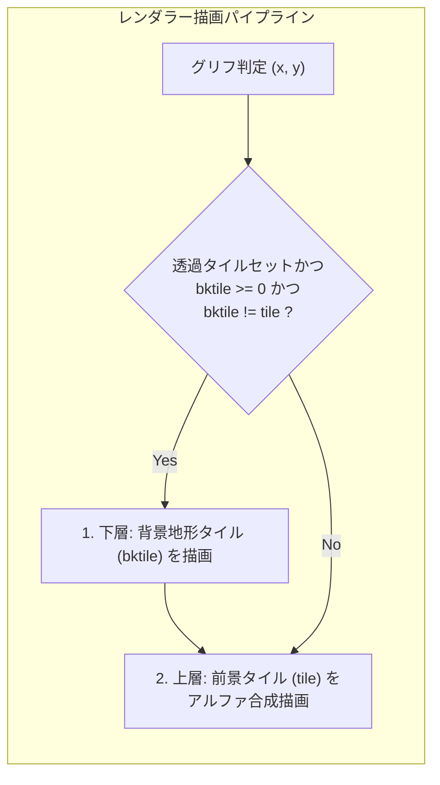
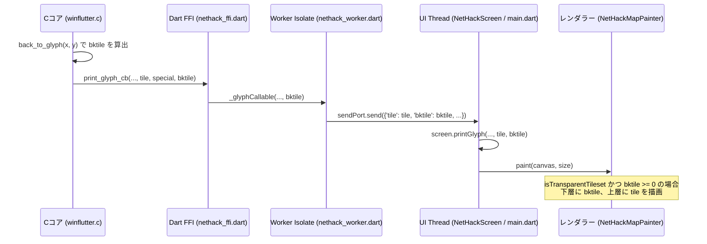

# 透過タイルセット対応と背景地形2層描画アーキテクチャ

本ドキュメントは、NetHack における透過タイルセット（KevinTam 等の透明・半透明ピクセルを含むタイル）に対応し、モンスターやアイテムの下に自然なダンジョン背景地形を描画するための「背景地形2層描画パイプライン」の設計および他ポート（Windows GUI, Linux/SDL, Web等）への移植・実装ガイドラインをまとめたものです。

---

## 1. 概要と課題

### 従来のタイル描画方式の課題
NetHack の標準的なタイル描画パイプライン（`win/X11`, `win/Qt`, `win/curses`, Windows GUI 版等）は、グリッド 1 マス（(x, y)）につき 1 枚のタイル（最前面にあるモンスター、アイテム、または地形）のみを描画します。

不透明な背景色（例：黒やマゼンタ）で塗りつぶされたクラシックなタイルセットであれば問題ありませんが、近代的な透過 PNG/WebP タイルセット（例：KevinTam Tiles 64x64 等）を表示した場合、キャラクターの足元や余白が透明・黒抜けになり、床や通路・階段などの地形が見えなくなってしまうという課題がありました。

### 解決方針
最前面タイル（キャラクター、アイテム、罠、効果等）を描画する直前に、その背後にある地形タイル（部屋の床、通路、階段、祭壇、開閉ドア、水、溶岩等）を下地として描画する **「背景地形2層描画（Layered Rendering）」** を導入します。



---

## 2. NetHack Cコアの背景グリフ機構と設計選定

### アップストリーム標準 `iflags.use_background_glyph` の不具合と落とし穴
本家 NetHack には `iflags.use_background_glyph` や `get_bkglyph_and_framecolor()` という仕組みが存在しますが、以下の重大な欠陥があるため本目的には使用できません：
1. **部屋の床の除外バグ**: `src/display.c` 内で `if (idx != S_room) tmp_bkglyph = cmap_to_glyph(idx);` となっており、ダンジョンの大部分を占める「普通の部屋の床（`S_room`）」が完全に除外され、背景グリフが未設定（`NO_GLYPH`）になります。
2. **祭壇や階段の欠落**: 階段や祭壇の上にモンスターやアイテムが乗っている場合、階段・祭壇属性が無視されて単なる床として処理されてしまいます。

### 最適解: `back_to_glyph(x, y)` の活用
NetHack Cコアの `src/display.c` に存在する内部関数 `back_to_glyph(int x, int y)` を使用します：
- **正確性**: 部屋の床、通路、階段、祭壇（信仰神の属性含む）、ドア（開・閉・破壊）、水、溶岩、シンク、プールなど、マップ上の純粋な背景地形グリフを 100% 正確に返します。
- **リアルタイム追従**: 壁をつるはしで掘る、ドアを開閉する、泉が枯れる等の動的な地形変化が発生した際にも、`levl[x][y]` が更新された直後に評価されるため、一切の遅延なく変化後の地形が背景として描画されます。
- **副作用ゼロ**: 純粋な読み取り専用関数であり、ゲームステートやターン、乱数を消費しません。

---

## 3. ネタバレ防止と視界・暗闇の整合性（重要仕様）

透過タイルの背景に無条件で地形を描画すると、未探索エリアや暗闇の情報がプレイヤーに漏洩（ネタバレ）してゲーム性が損なわれます。そのため、以下のガード条件を必ず適用します。

### (1) 未探索マス (`MG_UNEXPL`) の保護
- プレイヤーが一度も訪れていない部屋の床など、未探索マスでは背景タイル ID を無効値（`bktile = -1`）として扱い、黒背景（暗闇）を維持します。

### (2) 視界外探知モンスター (`MG_DETECT`) の暗闇維持
- テレパシーや超感覚、警告、薬品などで暗闇の中にいるモンスターの位置を探知した場合、そのマスはモンスターの存在のみが把握されている状態であり、視覚的には探索されていません（`levl[x][y].seenv == 0`）。
- ここで部屋の床を描画してしまうと、部屋の壁の形状や構造がプレイヤーに見えてしまうため、必ず `bktile = -1` として暗闇を維持します。

---

## 4. 他ポート（Windows GUI / Linux SDL / Web 等）への移植ガイドライン

他のウィンドウポート（Windows Native, SDL, WebAssembly, macOS 等）で透過タイル対応を実装する際の手順です。

### ステップ 1: ウィンドウポートの C コード実装
ウィンドウポートの `print_glyph` 処理において、グリフをタイル番号に変換する処理に以下を追加します。

```c
/* 例: winXXXX_print_glyph(winid, x, y, glyph, bkglyph) */
#include "hack.h"

int tile = glyph2tile[glyph];
int bktile = -1;

/* 透過タイルセットが有効な場合のみ背景タイルを算出 */
if (is_transparent_tileset_enabled()) {
    /* 未探索マスは暗闇を維持 */
    if (!(special & MG_UNEXPL)) {
        /* 視界外の探知モンスター（テレパシー等）かつ未視認マスは暗闇を維持 */
        if (!((special & MG_DETECT) && !cansee(x, y) && levl[x][y].seenv == 0)) {
            int bkglyph = back_to_glyph(x, y);
            if (bkglyph != NO_GLYPH) {
                bktile = glyph2tile[bkglyph];
            }
        }
    }
}

/* UI層／レンダラーへ tile と bktile を渡す */
render_tile_at(x, y, tile, bktile);
```

### ステップ 2: レンダラー側の合成描画
レンダラー（OpenGL, DirectX, SDL, Canvas 等）側で、アルファ合成を行います。

```c
void render_tile_at(int x, int y, int tile, int bktile) {
    /* 透過タイルセットで、背景が存在し、前景と背景が異なる（床の上にキャラ等）場合 */
    if (is_transparent_tileset && bktile >= 0 && bktile != tile) {
        /* 1. 下層に背景地形タイルを描画 */
        draw_single_tile(x, y, bktile);
    }

    /* 2. 上層に前面タイルをアルファブレンド描画（不透明タイルの場合は単に上書き） */
    draw_single_tile(x, y, tile);
}
```

> [!TIP]
> **パフォーマンス上の注意点**:
> 従来の不透明タイルセット（PixelHack や Nevanda 等）を使用している時は、`is_transparent_tileset` を `false` に設定して背景タイルの描画を完全にスキップしてください。これにより、不要なオーバードローを防止し、パフォーマンスへの影響をゼロに抑えられます。

---

## 5. DartHack (Flutter ポート) における実装構造

DartHack では、マルチスレッド（Worker Isolate と UI スレッド）アーキテクチャに対応したデータフローを採用しています。



### 関連コード
- **Cコア移植層**: `sys/flutter/android/app/src/main/cpp/winflutter.c`
- **FFI 定義**: `sys/flutter/lib/nethack_ffi.dart`
- **Worker メッセージ**: `sys/flutter/lib/nethack_worker.dart`
- **画面モデル**: `sys/flutter/lib/nethack_screen.dart`
- **メインUI**: `sys/flutter/lib/main.dart`
- **全画面マップ**: `sys/flutter/lib/widgets/full_map_dialog.dart`
- **カスタムペインター**: `sys/flutter/lib/nethack_map_painter.dart`
- **ユニットテスト**: `sys/flutter/test/nethack_map_painter_test.dart`

---

## 6. セーブデータ互換性と保守性

- **セーブデータ構造体の不可変性**:
  ディスク上に永続化されるセーブデータ（`rm`, `monst`, `obj` などの構造体）やバイナリフォーマットには一切変更を加えていません。既存のセーブデータとの 100% の互換性が保証されます。
- **アップストリーム追従性**:
  Cコアの既存関数 `back_to_glyph()` をリードオンリーで呼び出すのみであり、本家 NetHack および NetHackJP のダンジョン生成・モンスターAI・アクション処理への影響はありません。将来の Git Subtree 同期時にもマージコンフリクトを最小限に抑えられます。
