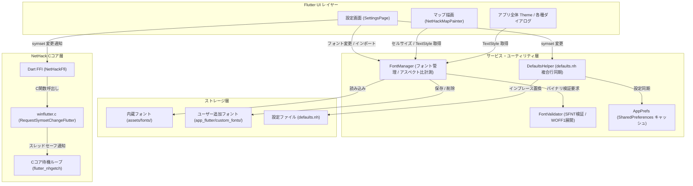
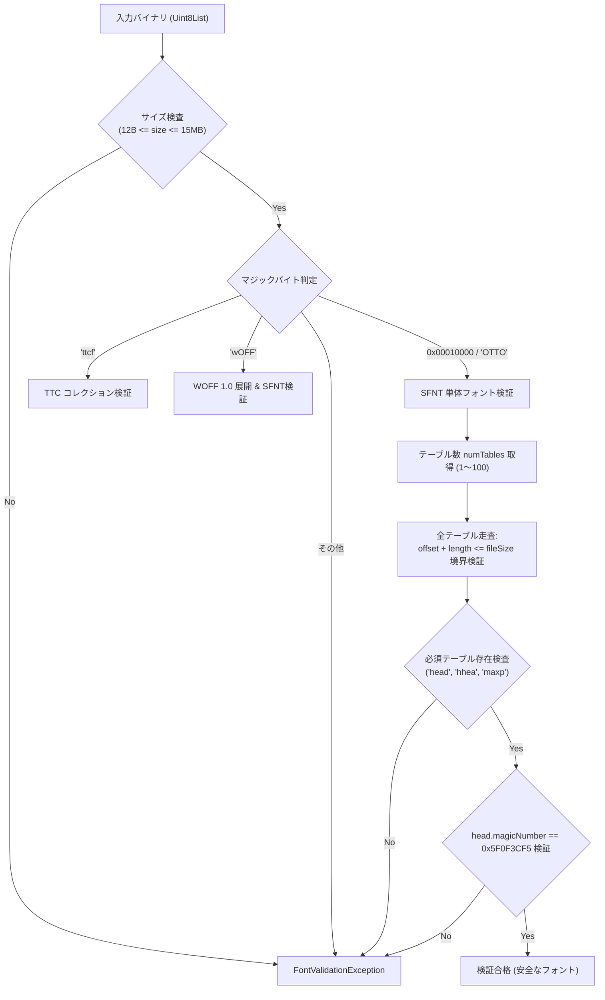

# フォント設定およびシンボルセット (symset / roguesymset) アーキテクチャ設計書

本ドキュメントは、DartHack（NetHack 5.0 Flutter ポート）における **フォントカスタマイズ機能**、**アスキー描画シンボルセット（`OPTIONS=symset` / `roguesymset`）連携**、**外部フォントの安全なインポートと構造バリデーション**、および **マップセルサイズ・描画パイプラインの最適化** に関する包括的な技術仕様・設計書です。

---

## 目次

1. [概要と導入背景](#1-概要と導入背景)
2. [全体アーキテクチャ概要](#2-全体アーキテクチャ概要)
3. [基本設計方針](#3-基本設計方針)
   - 3.1 [5系統の用途別ターゲット分離と一括設定](#31-5系統の用途別ターゲット分離と一括設定)
   - 3.2 [マップ描画における日本語フォールバック完全排除原則](#32-マップ描画における日本語フォールバック完全排除原則)
   - 3.3 [セルサイズ4箇所完全一元化とアスペクト比自動計測](#33-セルサイズ4箇所完全一元化とアスペクト比自動計測)
4. [セキュリティとバイナリ構造検証 (FontValidator)](#4-セキュリティとバイナリ構造検証-fontvalidator)
   - 4.1 [防御脅威モデル](#41-防御脅威モデル)
   - 4.2 [SFNT / TTC テーブルディレクトリ構造検証](#42-sfnt--ttc-テーブルディレクトリ構造検証)
   - 4.3 [WOFF 1.0 の安全な zlib 展開と SFNT 再構築](#43-woff-10-の安全な-zlib-展開と-sfnt-再構築)
5. [フォント管理サービス (FontManager)](#5-フォント管理サービス-fontmanager)
   - 5.1 [内蔵フォント一覧と特性](#51-内蔵フォント一覧と特性)
   - 5.2 [動的フォントロードとサンドボックス永続化](#52-動的フォントロードとサンドボックス永続化)
   - 5.3 [ChangeNotifier によるリアルタイム UI 反映](#53-changenotifier-によるリアルタイム-ui-反映)
6. [アスキーマップ描画最適化 (NetHackMapPainter)](#6-アスキーマップ描画最適化-nethackmappainter)
   - 6.1 [TextPainter LRU キャッシュ設計](#61-textpainter-lru-キャッシュ設計)
   - 6.2 [StrutStyle による等幅・行間固定](#62-strutstyle-による等幅行間固定)
   - 6.3 [アスキーマップ表示倍率スライダー連動](#63-アスキーマップ表示倍率スライダー連動)
7. [シンボルセット (OPTIONS=symset / roguesymset) 連携仕様](#7-シンボルセット-optionssymset--roguesymset-連携仕様)
   - 7.1 [DefaultsHelper における複合行インプレース置換と保護](#71-defaultshelper-における複合行インプレース置換と保護)
   - 7.2 [Cコア winflutter.c における待機ループ即時反映](#72-cコア-winflutterc-における待機ループ即時反映)
8. [フォントの追加手順](#8-フォントの追加手順)
   - 8.1 [【開発者向け】プロジェクトへの新規内蔵フォント追加手順](#81-開発者向けプロジェクトへの新規内蔵フォント追加手順)
   - 8.2 [【ユーザー向け】設定画面からの外部フォントインポート手順](#82-ユーザー向け設定画面からの外部フォントインポート手順)
   - 8.3 [推奨フォント選定ガイド](#83-推奨フォント選定ガイド)
9. [開発上の注意点とトラブルシューティング](#9-開発上の注意点とトラブルシューティング)
   - 9.1 [Windows FakeAsync テスト環境における runAsync 必須ルール](#91-windows-fakeasync-テスト環境における-runasync-必須ルール)
   - 9.2 [Cコア 40バイト文字列オプション制限と SharedPreferences 専管化](#92-cコア-40バイト文字列オプション制限と-sharedpreferences-専管化)

---

## 1. 概要と導入背景

NetHack の醍醐味の一つである「アスキーアート（文字記号）によるダンジョン描画」は、使用するフォントやシンボルセット（`symset`）によって視認性や世界観が劇的に変化します。
DartHack では従来、固定のフォントファミリーと固定のシンボルセット（`IBMGraphics_2`）のみが利用可能であり、以下の課題が存在していました：

1. **フォントの固定化**: タイル表示を OFF にした際のアスキーマップ描画やメッセージ、UI 各部でフォントを変更できず、クラシックなレトロ PC 調やビットマップフォントを楽しめない。
2. **シンボルセット変更の制約**: `defaults.nh` 内の `OPTIONS=symset` や `OPTIONS=roguesymset`（ローグ階層専用）を設定画面から直感的に変更できず、変更時にもアプリ再起動が必要であった。
3. **複合設定行の破壊リスク**: 既存端末に配布済みの `OPTIONS=symset:IBMGraphics_2,runmode:walk` などの複合行を単純に置換すると、同一行にある他の必須オプション（`runmode:walk`）が欠落するリスクがあった。
4. **東アジア曖昧幅全角文字によるマップグリッド崩れ**: マップ描画で日本語フォントへのフォールバックが走ると、欧文記号（罫線文字やハイフン、引用符等）が全角扱いとなり、マップのマス目（80x21）が大きく乱れる。
5. **外部フォントのセキュリティリスク**: ユーザーが所有する任意のフォントファイル（`.ttf`, `.otf`, `.ttc`, `.woff`）を読み込む際、偽装ファイルや悪意あるバイナリによるクラッシュ・メモリ破壊を防御する必要があった。

これらを根本解決するため、**「安全なフォント検証・インポート基盤」「用途別5系統フォント管理」「日本語フォールバック排除型高速マップ描画」「Cコア連携型シンボルセット即時反映」** を備えた統合アーキテクチャを構築しました。

---

## 2. 全体アーキテクチャ概要



---

## 3. 基本設計方針

### 3.1 5系統の用途別ターゲット分離と一括設定

フォント設定は、画面要素の視認性と特性に応じて **5系統（+一括設定）** に分離して管理されます。

| ターゲット (`FontTarget`) | SharedPreferences キー | 主な適用箇所 | 特性・推奨 |
| :--- | :--- | :--- | :--- |
| **マップ (`map`)** | `font_map` | `NetHackMapPainter` (アスキーマップ), 全体マップ | **等幅フォント必須**。日本語フォールバック一切なし |
| **メッセージ (`message`)** | `font_message` | 画面上部直近メッセージ、メッセージ履歴 (`MsgHistoryDialog`) | 欧文・日本語の可読性重視（日本語フォールバックあり） |
| **ステータス (`status`)** | `font_status` | 画面上部/下部ステータス行（HP、階層、ゴールド等） | 数値やバーの等幅性が望ましい（日本語フォールバックあり） |
| **メニュー＆テキスト (`menuText`)** | `font_menu_text` | メニュー (`MenuOverlay`), テキスト (`TextOverlay`), 墓石, スポイラー | 本文が美しく整列するフォント（日本語フォールバックあり） |
| **UI＆コントローラ (`ui`)** | `font_ui` | アプリ全体テーマ、ボタン、D-Pad、コマンドパネル、設定画面 | 視認性が高くモダンなフォント（日本語フォールバックあり） |

- **一括変更機能**: 設定画面の「一括フォント変更」ドロップダウンを操作すると、全5系統が一括で同一フォントに更新されます。

### 3.2 マップ描画における日本語フォールバック完全排除原則

#### 課題
NetHack のダンジョンマップ（80列×21行）には、壁（`|`, `-`）、部屋の床（`.`）、通路（`#`）、階段（`<`, `>`）、各種アイテム・モンスターなどの ASCII/拡張記号のみが出現し、**日本語テキストは一切出現しません**。
しかし、一般的な Flutter アプリのように `fontFamilyFallback: ['NotoSansJP', ...]` を指定すると、以下の重大な問題が発生します：
1. **東アジア曖昧幅（East Asian Ambiguous Width）記号の全角化**: 罫線文字やハイフン、引用符などが日本語フォント側の「全角グリフ」にマッピングされ、横幅が2マス分に広がってダンジョンマップ全体のグリッドが大きく崩壊する。
2. **描画負荷の増大**: 毎フレームの描画時にフォールバックチェーンのグリフ探索が発生し、フレームレートが低下する。

#### 対策
[`nethack_map_painter.dart`](file:///c:/Users/satok/DartHack/sys/flutter/lib/nethack_map_painter.dart) の `TextStyle` 構築において、**`fontFamilyFallback` を完全に `null`（排除）** して描画します。
これにより、選択されたフォント単体で 100% 正確なアスペクト比かつ超高速にアスキーマップを描画します。
一方、メッセージやステータス、メニュー等の 4系統には適切な日本語フォールバックを維持し、欧文フォント選択時でも日本語が「豆腐（文字化け）」にならない堅牢性を両立しています。

### 3.3 セルサイズ4箇所完全一元化とアスペクト比自動計測

フォントによって、半角文字の縦横比（アスペクト比 $W/H$）は大きく異なります（例: `Terminus` は約 0.50、`Unscii-8` は 1.00 の正方形、`Unscii-16` は 0.50）。
もしマップ描画とカメラ追従・タップ判定で異なるセルサイズが用いられると、「画面中央センタリングがズレる」「タップしたマスと実際に移動する座標が食い違う」という致命的な不具合が発生します。

そのため、[`FontManager`](file:///c:/Users/satok/DartHack/sys/flutter/lib/services/font_manager.dart) の `getMapCellSize` 関数を設け、アプリ内の **以下の4箇所すべてで同一のセルサイズ計算を一元適用** しています：

1. **マップ描画**: [`nethack_map_painter.dart`](file:///c:/Users/satok/DartHack/sys/flutter/lib/nethack_map_painter.dart) 内のグリッド・文字描画
2. **主人公カメラ追従**: [`main.dart:1200`](file:///c:/Users/satok/DartHack/sys/flutter/lib/main.dart) 付近の `InteractiveViewer` 自動センタリング計算
3. **マップタップ移動逆算**: [`main.dart:2320`](file:///c:/Users/satok/DartHack/sys/flutter/lib/main.dart) 付近のスクリーン座標 $\to$ マップ座標 $(x, y)$ 変換
4. **全体マップダイアログ**: [`widgets/full_map_dialog.dart:128`](file:///c:/Users/satok/DartHack/sys/flutter/lib/widgets/full_map_dialog.dart) のミニマップ縮小描画

---

## 4. セキュリティとバイナリ構造検証 (FontValidator)

ユーザーが端末内の任意のファイルを選択して読み込む機能は、悪意ある細工が施されたファイルによる **バッファオーバーリード、クラッシュ、プロセス異常終了** の標的となり得ます。
DartHack では [`FontValidator`](file:///c:/Users/satok/DartHack/sys/flutter/lib/services/font_validator.dart) を導入し、OS やグラフィックエンジン（Skia / Impeller）にフォントバイナリを渡す前に Dart 側で厳格な構造バリデーションを実施しています。

### 4.1 防御脅威モデル

1. **ファイルサイズ攻撃（Zip Bomb / メモリ枯渇）**: 極端に巨大なファイルによる OOM（Out of Memory）クラッシュ。
   $\to$ **15MB の厳格な上限制限** を適用。
2. **拡張子偽装攻撃**: 実行ファイルや画像を `.ttf` と偽って読み込ませる攻撃。
   $\to$ マジックバイト検証および必須テーブル（`head`, `hhea`, `maxp` 等）の存在検査。
3. **領域外参照（OOB Read）攻撃**: テーブル長やオフセットをファイル終端外に偽装した不正 SFNT テーブル。
   $\to$ すべてのテーブルエントリに対して $\text{offset} + \text{length} \le \text{fileSize}$ の境界安全性を確認。
4. **head テーブル改変攻撃**: フォントの整合性検査。
   $\to$ `head` テーブル内の `magicNumber` が規格通りの `0x5F0F3CF5` であることを検証。

### 4.2 SFNT / TTC テーブルディレクトリ構造検証

TrueType（`0x00010000`）、OpenType（`OTTO`）、TrueType Collection（`ttcf`）の各形式について、以下のパイプラインで検証します：



### 4.3 WOFF 1.0 の安全な zlib 展開と SFNT 再構築

ウェブ用フォント形式として普及している `.woff`（WOFF 1.0）ファイルは、各テーブルが個別または一括で zlib 圧縮されています。Flutter 標準の `FontLoader` は WOFF 形式を直接解釈できない場合があるため、`FontValidator` は以下を自前で行います：

1. WOFF ヘッダー（`wOFF`、フレーバー、ヘッダー長 `totalSFNTSize`）の検証。
2. テーブルディレクトリの走査と、圧縮サイズ（`compLength`）$\le$ 元サイズ（`origLength`）の健全性確認。
3. Dart 標準の `zlib.decode` による安全な展開。
4. 展開後のテーブル群を再結合し、標準的な SFNT（TrueType / OpenType）バイナリへと再構築して返却。

これにより、ユーザーがダウンロードした Web フォント（WOFF）であっても、一切のプラグイン依存なく透過的に読み込み・使用可能です。

---

## 5. フォント管理サービス (FontManager)

[`FontManager`](file:///c:/Users/satok/DartHack/sys/flutter/lib/services/font_manager.dart) はシングルトンとして動作し、アプリ起動時のフォント初期化、設定変更の監視、動的ロード、および設定の永続化を統括します。

### 5.1 内蔵フォント一覧と特性

アプリに初期同梱されているフォントは以下の通りです：

| フォント ID | 表示名 | 特徴・アスペクト比 | ライセンス |
| :--- | :--- | :--- | :--- |
| `System` | システム標準 (Default) | デバイス標準の等幅フォント（Roboto Mono / Menlo / Consolas 等） | OS 依存 |
| `Terminus` | Terminus (クラシック等幅) | アスペクト比約 0.50。NetHack 伝統の鮮明なビットマップ調等幅 | SIL OFL 1.1 |
| `Unscii-8` | Unscii 8x8 (レトロPC) | アスペクト比 1.00（正方形セル）。C64 やファミコンを思わせるレトロ調 | Public Domain |
| `Unscii-16` | Unscii 8x16 (スリムレトロ) | アスペクト比 0.50。縦長で情報量の多いクラシックスタイル | Public Domain |
| `MisakiGothic`| 美咲ゴシック (日本語8x8) | 8x8 ドットの超小型日本語ビットマップフォント。日本語UIに完全対応 | フリー (自由利用) |

### 5.2 動的フォントロードとサンドボックス永続化

外部フォントファイルがインポートされた際のフロー：

1. **ファイル検証**: `FontValidator.validateAndNormalize` でバイナリを検査。
2. **サンドボックス保存**: アプリ専有領域（`getApplicationDocumentsDirectory()/custom_fonts/`）にコピー保存。OS によるパーミッション問題や外部ファイルの勝手な削除を防止。
3. **動的登録**: Flutter の `FontLoader` を用いて、アプリを再起動することなく実行中の Dart VM / Flutter エンジンへ新規フォントファミリーとして即時登録。
4. **SharedPreferences 永続化**: `AppPrefs` にフォントメタデータ（ID、表示名、ファイルパス、アスペクト比特性等）を JSON 形式で保存。

### 5.3 ChangeNotifier によるリアルタイム UI 反映

`FontManager` は `ChangeNotifier` を継承しており、フォント設定が変更されると `notifyListeners()` が発行されます。
`main.dart` のルートウィジェットが `ListenableBuilder` で `FontManager.instance` を購読しているため、設定画面を閉じた瞬間（あるいは設定画面内でのフォント選択時）、**画面のリロードやアプリ再起動を一切必要とせず、画面全体のフォントが即座に切り替わります**。

---

## 6. アスキーマップ描画最適化 (NetHackMapPainter)

[`nethack_map_painter.dart`](file:///c:/Users/satok/DartHack/sys/flutter/lib/nethack_map_painter.dart) は、タイル表示 OFF 時（アスキーモード）において毎フレームの描画を担う最重要コンポーネントです。

### 6.1 TextPainter LRU キャッシュ設計

マップ画面は毎秒最大数十回、80列×21行（＝最大1680文字）のグリフを描画します。毎文字ごとに `TextPainter` をインスタンス化して `layout()` を実行すると、顕著なフレームドロップが発生します。

これを解決するため、以下のキーを用いた **LRU キャッシュ（上限 512件）** を実装しています：

```dart
class _TextPainterKey {
  final int charCode;
  final int colorValue;
  final String? fontFamily;
  final double cellHeight;
  ...
}
```

同一文字・色・フォント・サイズの描画要求はキャッシュから即座に取り出され、描画負荷が 90% 以上削減されます。

### 6.2 StrutStyle による等幅・行間固定

フォントによっては、特定の記号（`@`, `#`, `%` 等）で baseline や行の高さが微妙に変動し、縦方向や横方向の罫線が不揃いになる現象（ラインの滲みや隙間）が発生します。
これを防ぐため、`TextPainter` に以下の **`StrutStyle`** を強制適用しています：

```dart
strutStyle: StrutStyle(
  fontFamily: fontFamily,
  fontSize: cellH,
  height: 1.0,
  forceStrutHeight: true,
)
```

これにより、すべての文字グリフが強制的に同一の行高・矩形枠内に収まり、完全に整列したアスキーマップが描画されます。

### 6.3 アスキーマップ表示倍率スライダー連動

ユーザーは設定画面から **アスキーマップの表示倍率（`0.75x 〜 2.0x`）** をスライダーで無段階に変更できます。
`FontManager.instance.getMapCellSize` はこの倍率係数を加味して動的にセルサイズを返すため、視力や画面サイズに合わせて自由に見やすいアスキー文字サイズへと拡大・縮小が可能です。

---

## 7. シンボルセット (OPTIONS=symset / roguesymset) 連携仕様

アスキーマップ描画で使用する記号体系（壁を `|` `-` で描くか、DEC / IBM の太線・細線罫線で描くかなど）は、NetHack 本来のオプションである `OPTIONS=symset`（通常ダンジョン階層用）および `OPTIONS=roguesymset`（ローグレベル専用）によって定義されます。

### 7.1 DefaultsHelper における複合行インプレース置換と保護

#### 既存端末の課題
既にインストールされている端末の `defaults.nh` には、以下のような複合行が存在します：
```text
OPTIONS=symset:IBMGraphics_2,runmode:walk
```
もし `symset` の変更時に行全体を `OPTIONS=symset:Unicode Graphics` で上書きしてしまうと、末尾の `runmode:walk`（移動モード設定）が失われてしまいます。

#### 実装解決策
[`defaults_helper.dart`](file:///c:/Users/satok/DartHack/sys/flutter/lib/utils/defaults_helper.dart) の `saveToFile` において、`OPTIONS=` 行内のカンマ区切りトークン走査時に：
1. `symset` キーのみをインプレース置換する（`symset:Unicode Graphics`）。
2. 同一行に存在する他のキー（`runmode:walk` 等）は **そのまま保持** して再結合する。
3. レガシー記法（`OPTIONS=DECgraphics` や `OPTIONS=IBMgraphics`）も `symset` として安全に正規化更新する。

### 7.2 Cコア winflutter.c における待機ループ即時反映

#### Cコアとスレッドセーフ通信
設定画面でシンボルセットが変更された際、アプリを再起動することなくプレイ中の画面に即座に反映させるため、Cコア側（[`winflutter.c`](file:///c:/Users/satok/DartHack/sys/flutter/android/app/src/main/cpp/winflutter.c)）に以下の即時反映フックを追加しました：

1. **`RequestSymsetChangeFlutter(const char *name, int isRogue)`**:
   Dart FFI から呼び出されると、リクエストされたシンボルセット名が Cコアの静的バッファに安全に保存され、フラグが立ちます。
2. **待機ループ (`flutter_nhgetch`) での反映**:
   Cコアスレッドがキー入力待ち（`flutter_nhgetch`）に入っている安全なタイミングで、`parsesymbols(buf)` を実行してシンボルテーブルを再構築します。
3. **DEC罫線・Unicode glyph 対応**:
   シンボルセット変更に伴い、`H_DEC` や `H_UTF8` などのマッピングモードを自動再判定し、`newsym` / `docrt()` をトリガーして即座に画面全体を再描画します。

---

## 8. フォントの追加手順

### 8.1 【開発者向け】プロジェクトへの新規内蔵フォント追加手順

新しいフォントをアプリ標準の内蔵フォントとして追加する手順は以下の通りです：

#### 手順 1: フォントファイルの配置
フォントファイル（`.ttf` または `.otf`）を以下のディレクトリに配置します：
```text
sys/flutter/assets/fonts/MyNewFont-Regular.ttf
```

#### 手順 2: `pubspec.yaml` への登録
[`sys/flutter/pubspec.yaml`](file:///c:/Users/satok/DartHack/sys/flutter/pubspec.yaml) の `fonts:` セクションにフォントファミリーを登録します：
```yaml
flutter:
  fonts:
    - family: MyNewFont
      fonts:
        - asset: assets/fonts/MyNewFont-Regular.ttf
```

#### 手順 3: `FontManager` への登録
[`sys/flutter/lib/services/font_manager.dart`](file:///c:/Users/satok/DartHack/sys/flutter/lib/services/font_manager.dart) の `_builtinFonts` リストに `FontInfo` を追加します：
```dart
FontInfo(
  id: 'MyNewFont',
  displayName: 'My New Font (説明)',
  fontFamily: 'MyNewFont',
  isMonospace: true,       // 等幅フォントの場合は true
  aspectRatio: 0.50,       // 半角幅 / 高さ の比率（計測値）
  isBuiltin: true,
),
```

#### 手順 4: ライセンスの確認とクレジット表記
フォントのライセンス条件（OFL、SIL、パブリックドメイン等）を確認し、設定画面のクレジット表示欄（[`settings_page.dart`](file:///c:/Users/satok/DartHack/sys/flutter/lib/settings_page.dart)）に著作権・ライセンス情報を明記します。

---

### 8.2 【ユーザー向け】設定画面からの外部フォントインポート手順

エンドユーザーが自身の端末内に保存されているフォントファイルを追加・使用する手順：

1. アプリを起動し、右上の歯車アイコン等から **「設定画面（詳細設定）」** を開きます。
2. **「フォント設定」** セクションを展開します。
3. **「端末からフォントファイルを追加」** ボタンをタップします。
4. システム標準のファイルピッカーが開くので、使用したいフォントファイル（`.ttf`, `.otf`, `.ttc`, `.woff`）を選択します。
5. ファイルの安全性（SFNT テーブルディレクトリ構造）が自動検証され、合格するとアプリ内に安全にコピー保存されます。
6. 各ターゲット（マップ、メッセージ、ステータス、メニュー、UI）のドロップダウン、または「一括フォント変更」に、追加したフォントが即座に表示され、選択できるようになります。
7. 不要になったフォントは、**「追加済みフォントの管理・削除」** ボタンからいつでも安全に削除できます。

---

### 8.3 推奨フォント選定ガイド

| 用途 | 推奨フォントの条件 | おすすめのフォント例 |
| :--- | :--- | :--- |
| **マップ (`font_map`)** | **正真正銘の等幅フォント（Monospace）** であること。ASCII 記号（特に罫線や記号）が全角化せず、半角幅で揃っていること。 | `Terminus`, `Unscii-8`, `Unscii-16`, `ProggyClean`, `Courier New` |
| **メッセージ / ステータス** | 欧文・数字が読みやすく、かつ日本語フォールバックと調和すること。 | `Roboto Mono`, `JetBrains Mono`, `Hack`, `美咲ゴシック` |
| **メニュー / テキスト** | 長文を読んだ際に疲れにくく、文字間が整っていること。 | `Noto Sans Mono`, `M+ 1m`, `Source Han Code JP` |

---

## 9. 開発上の注意点とトラブルシューティング

### 9.1 Windows FakeAsync テスト環境における runAsync 必須ルール

#### 現象
Flutter のウィジェットテスト（`testWidgets`）において、ドロップダウン操作から呼ばれる `DefaultsHelper.syncFromPrefsToFile` や `File.readAsString()` などの非同期ファイル I/O を実行した際、**テストが完了せず 10分タイムアウト（`TimeoutException`）または Windows エラー 32（`ERROR_SHARING_VIOLATION`）で失敗する** 現象が発生しました。

#### 原因
`testWidgets` は内部で **FakeAsync** を用いてフレーム進行やタイマーを仮想時間で制御しています。しかし、`dart:io` の実ディスクファイル I/O（`File.readAsLines()` や `File.writeAsString()`）は OS のネイティブ I/O スレッドからのイベント完了通知を待つ必要があります。FakeAsync 内では実時間の I/O イベントがディスパッチされないため、Future の解決が永遠に停止してタイムアウトに陥ります。

#### 対策
ウィジェットテスト内で `dart:io` のファイル読み書きを伴う処理をテストする場合は、**必ず `await tester.runAsync(() async { ... })` で囲んで実非同期ゾーン内で実行** してください：

```dart
// 正しいテスト実装例
String savedContent = '';
await tester.runAsync(() async {
  final helper = DefaultsHelper();
  await helper.syncFromPrefsToFile(defaultsFile.path);
  savedContent = await defaultsFile.readAsString();
});
expect(savedContent, contains('symset:Unicode Graphics'));
```

### 9.2 Cコア 40バイト文字列オプション制限と SharedPreferences 専管化

NetHack Cコアの `OPTIONS=` パーサー（`src/options.c`）における文字列オプションバッファは、伝統的に約 40 バイト前後の短い固定長配列（`optlist.h`）で宣言されています。
もし外部フォントのファイルパスや長いフォントファミリー名を `defaults.nh` の Cコアオプションとして持たせようとすると、Cコア側でバッファオーバーフローや予期せぬトランケート（文字列切り捨て）が発生します。

そのため、フォント設定値（`font_map`, `font_message` 等）は Cコアの `defaults.nh` には書き出さず、**Flutter 側の `SharedPreferences`（`AppPrefs`）専管データとして完全に分離管理** しています。これにより Cコアのメモリ安全性を担保し、長大なフォント名やパスであっても安全に保持・運用できます。

