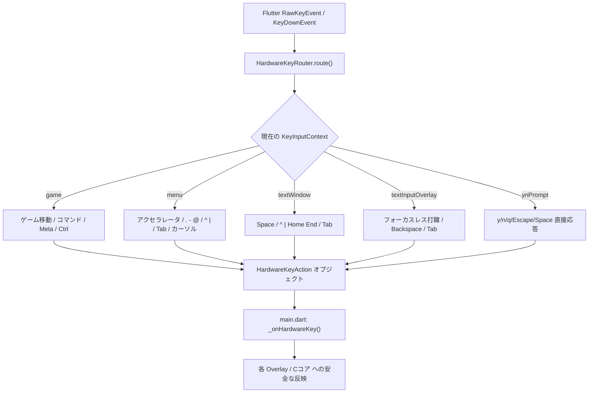

<!-- Modified by NetHackJP contributor @satokiyon; latest change date: 2026-11-05. -->
# 物理キーボード操作・設計ガイド (Hardware Keyboard Guide)

NetHack 5.0 (日本語版 / 英語版) の Flutter ポートにおける、**物理キーボード（ハードウェアキーボード）による操作仕様、設計方針、実装アーキテクチャ**を解説する総合ドキュメントです。

スマートフォン・タブレットに外付けした物理キーボード（Bluetooth / USB）、および PC（Windows / デスクトップ環境）において、NetHack 本来の軽快かつ確実な打鍵操作と、Flutter のモダンな UI/UX を完全に両立させるための設計が組み込まれています。

---

## 📑 目次

1. [設計方針・基本原則](#1-設計方針基本原則)
   - [フォーカスレス入力原則 (Focusless Input Principle)](#フォーカスレス入力原則-focusless-input-principle)
   - [初期フォーカス非活性原則 (Initial Focusless State)](#初期フォーカス非活性原則-initial-focusless-state)
   - [Tab キーフォーカス完全循環 (Tab Focus Cycling)](#tab-キーフォーカス完全循環-tab-focus-cycling)
2. [画面コンポーネント別の物理キーボード操作仕様](#2-画面コンポーネント別の物理キーボード操作仕様)
   - [ダンジョン・ゲームマップ画面](#ダンジョンゲームマップ画面)
   - [一行テキスト入力ダイアログ (GetLineOverlay)](#一行テキスト入力ダイアログ-getlineoverlay)
   - [拡張コマンド一覧ダイアログ (# コマンド)](#拡張コマンド一覧ダイアログ--コマンド)
   - [単一選択・複数選択メニュー (MenuOverlay)](#単一選択複数選択メニュー-menuoverlay)
   - [スクロール対応画面全般 (MenuOverlay / TextOverlay)](#スクロール対応画面全般-menuoverlay--textoverlay)
   - [Y/N プロンプトダイアログ (YnOverlay)](#yn-プロンプトダイアログ-ynoverlay)
3. [物理キーボード操作早見表 (Cheat Sheet)](#3-物理キーボード操作早見表-cheat-sheet)
4. [実装アーキテクチャとコード構造](#4-実装アーキテクチャとコード構造)
   - [HardwareKeyRouter の責務とルーティング設計](#hardwarekeyrouter-の責務とルーティング設計)
   - [アクションディスパッチと状態更新フロー](#アクションディスパッチと状態更新フロー)
   - [自動テストとリグレッション防止](#自動テストとリグレッション防止)

---

## 1. 設計方針・基本原則

### フォーカスレス入力原則 (Focusless Input Principle)

モバイル端末（Android 等）において、テキスト入力欄を持つダイアログ（願い、名前入力、`#annotate`、拡張コマンド検索など）を開いた際、一般的な Flutter アプリのように `autofocus: true` を設定すると、**OS のソフトウェアキーボード（IME）が画面下半分を覆うように強制ポップアップ**してしまいます。

物理キーボードを接続している環境であれば、OSの設定（「物理キーボード接続時にオンスクリーンキーボードを表示しない」など）によってソフトウェアキーボードを非表示に設定することも可能です。したがって、この強制ポップアップを回避する主な対象は**物理キーボードを使用していない環境（タッチ操作のみの通常プレイ時）**となります。

ただし、物理キーボードを使用している場合であっても、OS設定を変更していなければ依然としてソフトウェアキーボードが表示されてしまうため、そのような環境においても視界の遮断を防ぐ重要な役割を果たします。

そのため、本プロジェクトでは以下の原則を徹底しています。

- **`autofocus: false` の標準適用**: すべてのダイアログ・オーバーレイでテキスト入力欄の自動フォーカスを無効化します。これにより、ダイアログを開いた瞬間に画面下半分がキーボードで塞がれることなく、まずダイアログ全体の内容を快適に確認できます。
- **物理キーイベントの直接捕捉**: `FocusNode` に依存せず、Flutter の `HardwareKeyboard.instance` またはルートのキーハンドラから直接キー入力を取得し、[`HardwareKeyRouter`](../lib/input/hardware_key_router.dart) を経由して文字バッファへ追記・削除します。
- **IME 自動表示の抑止**: 画面上のテキスト欄を直接タップした場合のみ `FocusNode.requestFocus()` を発行して IME を立ち上げます。物理キーボード接続時は一切ソフトウェアキーボードをポップアップさせずに文字入力・決定を完結させることができます。

### 初期フォーカス非活性原則 (Initial Focusless State)

メニューやダイアログ、テキスト入力画面が表示された直後は、**どのボタンや入力欄にもフォーカスが当たっていない「初期状態（`none`）」** を維持します。

- 画面を開いた瞬間に決定ボタンやキャンセルボタンにフォーカスが当たっていると、プレイヤーが意図しない Enter キー押下で即座に閉じてしまうなどの誤操作が発生します。
- 最初はフォーカスレス状態を維持し、文字入力やショートカットキー、スクロール操作をそのまま受け付けます。

### Tab キーフォーカス完全循環 (Tab Focus Cycling)

物理キーボードの `Tab` キーを押すことで、初めて画面内の各操作要素に視覚的なフォーカスハイライトが当たり、順番にフォーカスが移動します。

- **循環順序（正順）**: `初期状態 (none)` → `文字入力欄 (TextField)` → `アクションボタン 1` → `アクションボタン 2` → ... → `初期状態 (none)`
- **循環順序（逆順 / Shift+Tab）**: 逆向きに要素間を移動し、先頭要素からさらに Shift+Tab を押すと初期状態（`none`）に戻ります。
- **初期状態への復帰**: 最後のボタンからさらに Tab を押すと、何も選択されていない「初期状態」に自然に戻り、もう一度 Tab を押すと再び第1要素から巡回を開始します。
- **Enter キーによる実行**: ボタンにフォーカスが当たっている状態で Enter キーを押すと、そのボタンのタップ操作（決定、キャンセル、全選択など）が即座に実行されます。フォーカスが初期状態（`none`）のときは、ダイアログ本来の確定処理（テキスト決定やメニュー送信）が行われます。

---

## 2. 画面コンポーネント別の物理キーボード操作仕様

### ダンジョン・ゲームマップ画面

ゲームマップ上でのキャラクター移動やコマンド実行は、PC版 NetHack と同等の操作性を実現しています。

- **移動**:
  - **テンキー移動**: `1`〜`9`（`number_pad` オプションに応じて斜め移動・テンキー移動に対応）
  - **Viキー移動**: `h`, `j`, `k`, `l`, `y`, `u`, `b`, `n`（伝統的な NetHack キーバインド）
  - **カーソルキー移動**: `↑`, `↓`, `←`, `→`
- **コマンド・アクション**:
  - すべての単一キーコマンド（`o` でドアを開ける、`c` で閉じる、`e` で食べる、`d` で置く、`i` で持ち物等）
  - **Ctrl キー**: `Ctrl+P`（直前メッセージ再表示）、`Ctrl+D`（キック）など
  - **Alt / Meta キー**:
    - `Alt+Letter`: `M-c`（話しかける）、`M-l`（フロアメモ閲覧）などの拡張コマンド
    - `Alt+Digit`: `M-2`, `M-5` などの回数指定カウント
    - `Alt+Shift+Letter`: `M-C`、`M-A` などの大文字メタコマンド
- **拡張コマンドの直接呼び出し**: `#` キーを押すことで、後述の拡張コマンド一覧ダイアログが開きます。

### 一行テキスト入力ダイアログ (GetLineOverlay)

願い事、名前入力、金庫番の誰何、`#annotate`（フロアメモ入力）、`#name`（名前付け）など、Cコアからの `getlin` 要求で開くダイアログです。

- **文字入力**: フォーカスレスでそのままアルファベット・数字・記号を打鍵可能。
- **文字削除**: `Backspace` で1文字削除、`Delete` で全消去。
- **確定・キャンセル**: `Enter` で入力内容を確定、`Escape` で入力をキャンセル。
- **Tab キー循環**:
  - `none` → `文字入力欄` → `決定ボタン` → `キャンセルボタン` → `none`
  - 文字入力欄にフォーカスが当たるとキャレットが表示され、カーソル移動や編集が可能です。

### 拡張コマンド一覧ダイアログ (# コマンド)

マップ上で `#` キーを押したときに開く、NetHack の全拡張コマンド一覧画面です。

- **全件初期表示**:
  - ダイアログ起動時から、**最初からすべての拡張コマンド（58個以上）がフルリストで表示**されます（従来のように `*` キーを押す必要はありません）。
- **フォーカスレス絞り込み**:
  - キーボードで文字（例: `p`, `r` 等）を打つと、検索欄にフォーカスを当てなくても即座に入力され、該当するコマンドのみがリアルタイムにインクリメンタル絞り込みされます。
- **可視領域追従スクロール**:
  - 上下カーソルキー（`↑` / `↓`）で候補を移動する際、検索バーやヘッダーの高さを考慮した精密なスクロール量計算により、**選択行が常に画面内に収まるよう自動追従スクロール**します。
- **実行**:
  - ハイライトされた状態で `Enter` を押すと、そのコマンド（`#pray`、`#chat` 等）が直ちに実行されます。

### 単一選択・複数選択メニュー (MenuOverlay)

持ち物一覧（インベントリ）、アイテム選択、装備変更、魔法詠唱リスト、オプション設定などで開くメニューです。

- **アクセラレータキー選択**:
  - 項目先頭に表示されている英字記号（`a`〜`z`, `A`〜`Z`）を押すことで、該当アイテムを即座に選択・トグルできます。
- **カーソルキー操作**:
  - `↑` / `↓` キーで項目を前後に移動、画面端に達すると自動スクロールします。
- **複数選択操作 (`menuHow == 2` / `PICK_ANY`)**:
  - **`.:全選択`** (`menu_select_all` 相当): 物理キーボードの `.`（ピリオド）キーを押すと、選択可能な全項目が一括選択されます。
  - **`-:選択解除`** (`menu_deselect_all` 相当): 物理キーボードの `-`（ハイフン/マイナス）キーを押すと、すべての選択が解除されます。
  - **`@:選択反転`** (`menu_invert_all` 相当): 物理キーボードの `@`（アットマーク）キーを押すと、現在の選択状態が反転します（未選択項目が選択され、選択済み項目が解除されます）。
- **アクションボタンと Tab 循環**:
  - 下部に配置された「`.:全選択`」「`-:選択解除`」「`@:選択反転`」「`決定`」「`閉じる`」ボタンは、画面タップに加えて `Tab` キーで順番にフォーカスを移動し、`Enter` で実行できます。

### スクロール対応画面全般 (MenuOverlay / TextOverlay)

テキスト表示（メッセージ履歴、ヘルプ、ダンプログ、各種案内）や各種メニューなど、縦スクロールが発生する全ウィジェットで利用可能です。

- **ページ送り / 戻し**:
  - `Space` または `PageDown`: 1画面分下へスクロール。
  - `Shift+Space` または `PageUp`: 1画面分上へスクロール。
- **先頭・末尾ジャンプ**:
  - **`^` キー または `Home` キー**: 一覧の最先頭へ瞬時にジャンプスクロール (`menu_first_page` 相当)。
  - **`|` キー または `End` キー**: 一覧の最末尾へ瞬時にジャンプスクロール (`menu_last_page` 相当)。
- **閉じる**:
  - 最下部で `Space`、または `Escape` / `q` / `Enter` で画面を閉じます。

### Y/N プロンプトダイアログ (YnOverlay)

アイテムを拾うか、罠を解除するか、攻撃するか等の確認を求めるプロンプトです。

- **1キー即答**: フォーカスレスで `y`（はい）、`n`（いいえ）、`q`（中断）、`Space`（デフォルト応答）、`Escape`（キャンセル）などのキーを押すだけでダイレクトに応答します。

---

## 3. 物理キーボード操作早見表 (Cheat Sheet)

| コンテキスト | キー操作 | 動作内容 |
| :--- | :--- | :--- |
| **全画面共通** | `Tab` | 次の要素・ボタンへフォーカス移動（`none` から開始・最後に `none` へ復帰） |
| | `Shift + Tab` | 前の要素・ボタンへ逆順フォーカス移動 |
| | `Enter` | フォーカス中の要素を実行（非フォーカス時はデフォルト確定） |
| | `Escape` | キャンセル / ウィンドウを閉じる |
| **マップ画面** | `テンキー (1-9)` | 8方向移動・待機 (`5`) |
| | `h, j, k, l, y, u, b, n` | 8方向 Vi 移動 |
| | `↑, ↓, ←, →` | 4方向カーソル移動 |
| | `Alt + [キー]` | メタコマンド呼び出し (`M-c`, `M-2`, `M-C` 等) |
| | `Ctrl + [キー]` | コントロールコマンド (`Ctrl+P`, `Ctrl+D` 等) |
| | `#` | 拡張コマンド一覧を開く |
| **テキスト入力 (`GetLine`)** | `A-Z, 0-9, 記号` | フォーカスレス文字入力 |
| | `Backspace` | 1文字削除 |
| | `Delete` | 入力欄の全消去 |
| **拡張コマンドメニュー** | `文字入力` | フォーカスレスで候補をインクリメンタル絞り込み |
| | `↑` / `↓` | 選択項目の上下移動（画面内に自動追従スクロール） |
| | `Enter` | ハイライトされているコマンドを実行 |
| **複数選択メニュー (`Menu`)** | `a`〜`z`, `A`〜`Z` | 該当項目のトグル選択 |
| | `.` (ピリオド) | **全選択** (`menu_select_all` / ボタン「`.:全選択`」) |
| | `-` (ハイフン) | **選択解除** (`menu_deselect_all` / ボタン「`-:選択解除`」) |
| | `@` (アットマーク) | **選択反転** (`menu_invert_all` / ボタン「`@:選択反転`」) |
| **スクロール全般 (`Text`/`Menu`)** | `Space` / `PageDown` | 1画面分次へスクロール |
| | `Shift+Space` / `PageUp` | 1画面分前へスクロール |
| | `^` / `Home` | **先頭へジャンプ** (`menu_first_page`) |
| | `\|` / `End` | **末尾へジャンプ** (`menu_last_page`) |

---

## 4. 実装アーキテクチャとコード構造

### HardwareKeyRouter の責務とルーティング設計

物理キーボードからの入力処理は、[`HardwareKeyRouter`](../lib/input/hardware_key_router.dart) (`sys/flutter/lib/input/hardware_key_router.dart`) に集約されています。

- **全角・半角正規化**: `normalizeCharacter` により、日本語入力環境で入力された全角英数記号を自動的に半角へマッピングし、入力モードに関わらず確実な操作を保証します。
- **修飾キー判定**: `Alt`（Meta）、`Ctrl`、`Shift` の状態をビットフラグやイベントプロパティから正確に抽出し、大文字/小文字の区別やシステムショートカットとの衝突を防止します。

### アクションディスパッチと状態更新フロー

[`HardwareKeyRouter`](../lib/input/hardware_key_router.dart) は純粋なルーティング関数として設計されており、Flutter の Widget ツリーに直接依存しません。結果として返される `HardwareKeyAction`（例: `MenuSelectAll`, `MenuJumpEdge`, `TextInputTab` など）を [`main.dart`](../lib/main.dart) で受け取り、対象のオーバーレイの公開メソッドを呼び出します。

- 例: `MenuJumpEdge(bool toTop)` 受信時 → `MenuOverlayState.jumpToEdge(toTop)` を呼び出し、`ScrollController.animateTo()` でスムーズスクロールを実行。
- 例: `MenuInvertAll` 受信時 → `MenuOverlayState.handleInvertAll()` を呼び出し、内部の選択 Map を反転更新して `setState()` を実行。

### 自動テストとリグレッション防止

物理キーボードの全挙動は、以下の自動テストによって継続的に保護されています。

1. [`test/input/hardware_key_router_test.dart`](../test/input/hardware_key_router_test.dart):
   - テンキー移動（`number_pad` 0/1）、Ctrl キー、Alt/Meta キー（大文字/小文字）、全角半角正規化。
   - `.` / `-` / `@` のメニュー一括操作キー、`^` / `|` / `Home` / `End` の先頭・末尾ジャンプキー。
   - `Tab` / `Shift+Tab` による各画面コンテキストでのフォーカスナビゲーションアクション。
2. [`test/widgets/getline_overlay_test.dart`](../test/widgets/getline_overlay_test.dart):
   - `autofocus: false` の検証（IME 非表示保護）。
   - フォーカスレス文字入力、Backspace、Enter 決定の検証。
   - Tab キー循環（`none` → `TextField` → ボタン → `none`）の検証。
3. [`test/widgets/menu_accelerator_test.dart`](../test/widgets/menu_accelerator_test.dart):
   - 拡張コマンドメニューの全件初期表示とカーソル移動時の可視領域スクロール検証。
   - 複数選択メニューにおける「`.:全選択`」「`-:選択解除`」「`@:選択反転`」ボタンのテキストおよびタップ・キー操作検証。

