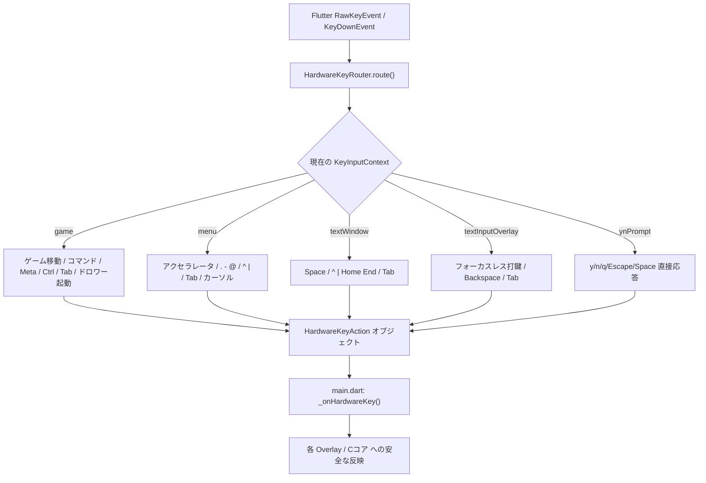

<!-- Modified by NetHackJP contributor @satokiyon; latest change date: 2026-11-06. -->
# 物理キーボード操作・設計ガイド (Hardware Keyboard Guide)

NetHack 5.0 (日本語版 / 英語版) の Flutter ポートにおける、**物理キーボード（ハードウェアキーボード）による操作仕様、プレイングテクニック、設計方針、実装アーキテクチャ**を解説する総合ドキュメントです。

スマートフォン・タブレットに外付けした物理キーボード（Bluetooth / USB）、および PC（Windows / デスクトップ環境）において、**画面に一切触れることなく（完全ハンズフリー）、ゲーム開始からダンジョン探索、各種ダイアログ、ドロワーメニュー、全体マップ、設定画面までキーボードだけで快適にプレイ**できるよう設計されています。

---

## 📑 目次

1. [🎮 プレイヤー向け総合操作ガイド (Player's Guide)](#1--プレイヤー向け総合操作ガイド-players-guide)
   - [1.1 物理キーボードによる完全ハンズフリープレイ](#11-物理キーボードによる完全ハンズフリープレイ)
   - [1.2 プレイスタイル別おすすめキー設定 (Viキー派 / テンキー派 / カーソル派)](#12-プレイスタイル別おすすめキー設定-viキー派--テンキー派--カーソル派)
   - [1.3 ダンジョン探索とコマンド入力](#13-ダンジョン探索とコマンド入力)
   - [1.4 画面上の半透明ボタン操作とドロワーの一発起動](#14-画面上の半透明ボタン操作とドロワーの一発起動)
   - [1.5 各種画面・ダイアログの快適プレイングテクニック](#15-各種画面ダイアログの快適プレイングテクニック)
     - [ドロワーメニュー (GameDrawer)](#ドロワーメニュー-gamedrawer)
     - [全体マップ (FullMapDialog)](#全体マップ-fullmapdialog)
     - [情報表示・ダンジョン概要・死亡時一覧 (TextOverlay / #overview / 怪物・所持品一覧)](#情報表示ダンジョン概要死亡時一覧-textoverlay--overview--怪物所持品一覧)
     - [墓石画面 (UniversalTombstoneWidget)](#墓石画面-universaltombstonewidget)
     - [スコアボード (ScoreboardDialog / TopTenWidget)](#スコアボード-scoreboarddialog--toptenwidget)
     - [ガイドブック・スポイラー閲覧＆目次検索 (Guidebook & Spoilers)](#ガイドブックスポイラー閲覧目次検索-guidebook--spoilers)
     - [詳細設定画面 (SettingsPage)](#詳細設定画面-settingspage)
     - [持ち物・複数選択メニュー (MenuOverlay)](#持ち物複数選択メニュー-menuoverlay)
     - [拡張コマンド一覧ダイアログ (# コマンド)](#拡張コマンド一覧ダイアログ--コマンド)
     - [一行テキスト入力 (願い・名前・フロアメモ)](#一行テキスト入力-願い名前フロアメモ)
     - [Y/N プロンプト (YnOverlay)](#yn-プロンプト-ynoverlay)
2. [⚡ 物理キーボード操作早見表 (Cheat Sheet)](#2--物理キーボード操作早見表-cheat-sheet)
3. [🛠️ 設計方針・UI/UX原則 (Design Principles)](#3-️-設計方針uiux原則-design-principles)
   - [フォーカスレス入力原則 (Focusless Input Principle)](#フォーカスレス入力原則-focusless-input-principle)
   - [初期フォーカス非活性原則 (Initial Focusless State)](#初期フォーカス非活性原則-initial-focusless-state)
   - [Tab キーフォーカス完全循環 (Tab Focus Cycling)](#tab-キーフォーカス完全循環-tab-focus-cycling)
4. [🏗️ 実装アーキテクチャとコード構造 (Architecture)](#4-️-実装アーキテクチャとコード構造-architecture)
   - [HardwareKeyRouter の責務とルーティング設計](#hardwarekeyrouter-の責務とルーティング設計)
   - [アクションディスパッチと状態更新フロー](#アクションディスパッチと状態更新フロー)
   - [自動テストとリグレッション防止](#自動テストとリグレッション防止)

---

## 1. 🎮 プレイヤー向け総合操作ガイド (Player's Guide)

### 1.1 物理キーボードによる完全ハンズフリープレイ

DartHack では、外付けキーボード（Bluetooth や USB-C 接続）や PC 環境において、**タッチパネルやマウスに手を伸ばす必要が一切ありません**。

- **ソフトウェアキーボード（IME）の自動ポップアップ防止**:
  文字入力画面（願い、名前入力、`#annotate` など）を開いても、OS のスクリーンキーボードが画面下半分を塞ぐことはありません。画面全体を見渡しながらそのまま打鍵できます。
- **全画面での統一操作**:
  ダンジョン探索だけでなく、ドロワーメニューの展開、全体マップの拡大・パン移動、スコアボードの閲覧、設定の変更まで、すべてキーボードだけで直感的に完結します。

---

### 1.2 プレイスタイル別おすすめキー設定 (Viキー派 / テンキー派 / カーソル派)

ご使用のキーボード配列や使い慣れたプレイスタイルに合わせて、最適な操作体系を選択できます。

```
【Viキー移動】                【テンキー移動 (number_pad: 1)】
   y   k   u                     7   8   9
    \  |  /                       \  |  /
  h -  .  - l                   4 -  5  - 6
    /  |  \                       /  |  \
   b   j   n                     1   2   3
  (. は待機/自己探索)            (5 は待機/自己探索)
```

1. **伝統的 NetHack スタイル（Viキー派 / ノートPC・コンパクトキーボード）**:
   - **移動**: `h`（西）, `j`（南）, `k`（北）, `l`（東）, `y`（北西）, `u`（北東）, `b`（南西）, `n`（南東）
   - **待機・足元探索**: `.`（ピリオド）または `s`
   - ホームポジションに手を置いたまま、腕を動かさずに最速で探索を進められます。
2. **テンキー移動スタイル（テンキー派 / デスクトップ・フルサイズキーボード）**:
   - ゲーム内オプション `number_pad: 1`（デフォルト推奨）を設定することで、テンキー `1`〜`9` で 8 方向移動、`5` で待機/探索が行えます。
3. **カーソルキー移動スタイル（直感操作派）**:
   - `↑`, `↓`, `←`, `→` のカーソルキーで 4 方向移動が可能です。

---

### 1.3 ダンジョン探索とコマンド入力

NetHack 伝統のコマンドがすべてそのまま利用可能です。

- **単一キーコマンド**:
  - `o`: ドアを開ける (open)
  - `c`: ドアを閉じる (close)
  - `e`: 食べる (eat)
  - `q`: 飲む (quaff)
  - `r`: 読む (read)
  - `w`: 武器を装備する (wield)
  - `W`: 防具を着る (Wear)
  - `T`: 防具を脱ぐ (Take off)
  - `d`: 足元に置く (drop)
  - `i`: 持ち物一覧を見る (inventory)
  - `,`: 足元のアイテムを拾う (pickup)
  - `s`: 周囲を探索する (search)
  - `>`: 階段を降りる / `<`: 階段を登る
- **コントロールキー (`Ctrl + [キー]`)**:
  - `Ctrl + P`: 直前のメッセージ履歴を再表示
  - `Ctrl + D`: 指定方向をキック
- **メタキー (`Alt + [キー]`)**:
  - `Alt + c`: モンスターに話しかける (`#chat`)
  - `Alt + l`: フロアメモを閲覧・確認する
  - `Alt + 2`, `Alt + 5` など: 指定回数アクションを繰り返すカウント指定
- **拡張コマンドの直接呼び出し (`#`)**:
  - `#` キーを押すだけで、拡張コマンド一覧ダイアログが即座に開きます。

---

### 1.4 画面上の半透明ボタン操作とドロワーの一発起動

画面端に配置されている半透明の「メニューボタン」や「全体マップボタン」も、画面に触れずにキーボードから操作できます。

- **Tab キーによるボタンフォーカス循環**:
  - `Tab`: `none`（未選択）→ `メニューボタン` → `全体マップボタン` → `none`
  - `Shift + Tab`: 逆順で循環。
  - フォーカスされたボタンは不透明度 100% に強調され、アンバー色の枠線とシャドウが点灯します。
  - `Enter`（テンキー含む）: フォーカス中のボタンを実行（メニューボタンならドロワーを開く、全体マップボタンなら全体マップを開く）。
  - **自動復帰**: ボタンにフォーカスが当たっている状態でも、キャラクターの移動キーや通常コマンドを押せば自動的にフォーカスが解除され、ゲーム操作が最優先で実行されます。
- **ドロワーメニューの一発ショートカット起動**:
  - ボタンを Tab で選ぶ手間を省き、**`Ctrl + M`**、**`F10`**、またはキーボードの **`Menu / ContextMenu`**（アプリケーションキー）を押すだけで、いつでも瞬時にドロワーメニューを開くことができます。

---

### 1.5 各種画面・ダイアログの快適プレイングテクニック

#### ドロワーメニュー (GameDrawer)
ゲームのセーブ、中断、各種情報確認を行うメインメニューです。
- **開いた直後は安全な状態**: 初期フォーカス非活性（`none`）のため、うっかり Enter を押しても誤爆しません。
- **選択と自動追従スクロール**: `↓` / `Tab` / `j` で下へ移動、`↑` / `Shift+Tab` / `k` で上へ移動。画面外にある項目へ移動した場合も、項目キーのキャッシュ管理により**確実に画面内へスムーズに自動追従スクロール**します。
- **ジャンプ**: `Home` で先頭項目（セーブして終了）、`End` で末尾項目（アプリ設定）へ瞬時にジャンプ。
- **ページ送り**: `PageDown` / `PageUp` でリストを大きく上下スクロール。
- **実行**: `Enter`（テンキー含む）でハイライト中の項目を実行。
  - ※ 誤操作防止のため、`Space` キーでは決定されず安全に無視されます。
- **閉じる**: `Escape`、`Ctrl+M`、`F10`、または `ContextMenu` でドロワーを閉じ、即座にマップ画面へ復帰します。

#### 全体マップ (FullMapDialog)
フロア全体のレイアウトや未探索の通路・部屋を確認できるマップビューです。
- **ズーム操作**:
  - `z`: **主人公座標（または画面中央）を中心に約 6 倍拡大 ⇔ 全体表示（等倍）をアニメーション付きでトグル**（スマホのダブルタップと同等の機能）。部屋の細部確認と全体把握を瞬時に切り替えられます。
  - `+` / `=` / `NumpadAdd`: 画面中央を基準に段階的にズームイン。
  - `-` / `NumpadSubtract`: 段階的にズームアウト。
  - `0` / `Home`: 全体表示（等倍）にアニメーションリセット。
- **パン（マップ平行移動）**:
  - カーソルキー `↑`, `↓`, `←`, `→`
  - 8 方向 Vi キー: `h`（左）, `l`（右）, `j`（下）, `k`（上）, `y`（左上）, `u`（右上）, `b`（左下）, `n`（右下）
  - **高速パン移動**: `Shift` を押しながら移動キーを押すと、**2 倍のスピード（80px/回）で高速パン移動**します。
- **Tab 循環 ＆ 閉じる**:
  - `Tab`: 右上の「閉じる（`×`）」ボタンにアンバー枠ハイライト。
  - `Escape`、`q`、`Space`、`Enter` のいずれでも瞬時にマップを閉じてゲームに戻れます。

#### 情報表示・ダンジョン概要・死亡時一覧 (TextOverlay / #overview / 怪物・所持品一覧)
`#overview` によるダンジョン階層構造表示、ゲーム中のメッセージ確認、および死亡時の「倒した怪物の一覧」「持ち物一覧」「能力一覧」などの長文テキスト表示画面です。
- **スムーズなスクロール＆即時閉鎖**:
  - `Space` / `PageDown`: 1 画面分下スクロール。**最下部に達した状態で `Space` を押す（または最初から 1 画面に収まる短い文章の場合）と、そのまま即座に画面が閉じます**。
  - `Enter`: スクロール位置に関わらず、いつでも瞬時に画面を閉じて次へ進めます。もう Esc キーを何回も連打する必要はありません。
  - `Shift+Space` / `PageUp`: 1 画面分上スクロール。
  - `↑` / `↓` または Viキー `k` / `j`: 1 行ずつ細かく上下スクロール。
  - `Home` / `End`: 最先頭 / 最末尾へ瞬時ジャンプ。
- **Tab フォーカス循環**:
  - `Tab` / `Shift+Tab`: `none` ↔ 下部の「OK」ボタン ↔「履歴」ボタン（履歴表示可能な場合）をアンバー枠で巡回。
  - フォーカスされた状態で `Enter` を押すと、そのボタンのアクション（OK 決定、またはメッセージ履歴の表示）が実行されます。
- **Esc 閉鎖**: `Escape` または `q` で即座に閉じることも可能です。

#### 墓石画面 (UniversalTombstoneWidget)
冒険の終了時（死亡時・昇天時）に表示される墓碑銘画面です。
- **スクロールと快適な閉鎖**:
  - スクロールビューが物理キーボードと完全連動しています。
  - `Space` / `PageDown` やカーソルキー `↓` で墓石の下部までスムーズにスクロールできます。
  - **最下部に到達した状態で `Space` を押すか、`Enter` または `Escape` を押すだけで、軽快に画面が閉じて次の情報やスコアボードへ進みます**。

#### スコアボード (ScoreboardDialog / TopTenWidget)
過去のハイスコア記録や今回の冒険の成績を確認する画面です。
- **閲覧**: `↑` / `↓` または Viキー `k` / `j` で 1 行ずつスクロール。
- **ページ送り**: `PageDown` / `>` または `Space` で 1 画面分スピーディーに下スクロール、`PageUp` / `<` または `Shift+Space` で上スクロール。
- **スマート終了**: リストの最下部に達した状態で `Space` を押すか、`Enter` / `Escape` / `q` を押せば即座に閉じます。
- **Tab 循環**: `Tab` で下部の「閉じる」ボタンを強調枠表示。

#### ガイドブック・スポイラー閲覧＆目次検索 (Guidebook & Spoilers)
ゲーム内からいつでも閲覧できる詳細マニュアルおよびスポイラーです。
- **目次からの一発ジャンプ (`t`)**:
  - 閲覧中に **`t` キーを押すだけで目次モーダルがポップアップ**。
  - そのままキーボードで文字（例: 「ノーム」「指輪」「ドラゴ」「shop」など）を打つと、**検索欄に自動で文字が入力され、リアルタイムに章がインクリメンタル絞り込み**されます。
  - `↓` / `↑` / `j` / `k` で章を選び、`Enter` を押すと該当章の本文へ直接ジャンプ！
- **本文リーダー操作**:
  - `↑` / `↓` または `k` / `j` で段落単位スクロール。
  - `Space` / `PageDown` / `>` でページ送り、`Shift+Space` / `PageUp` / `<` でページ戻し。
  - `Home` / `^` でドキュメント最先頭、`End` / `|` で最末尾へ瞬時ジャンプ。
- **Tab 循環 ＆ 閉じる**:
  - `Tab`: `none` ↔ `目次ボタン` ↔ `閉じるボタン` で循環。
  - `Escape`、または検索欄の外で `q` を押せば即座にダンジョンへ復帰。

#### 詳細設定画面 (SettingsPage)
操作パッド配置、サウンド音量、タイル・フォント設定などをカスタマイズする画面です。
- **高速スクロール**: マウスホイールを使わなくても、`PageDown` / `PageUp` や `Home` / `End` で長大な設定リストを高速上下スクロールできます。
- **キーボードナビゲーション**:
  - `Tab` / `Shift+Tab`、または `↑` / `↓` で各設定項目（スイッチ、選択肢、入力欄）間を巡回。
  - フォーカスされた項目にはアンバー色のハイライトが点灯し、画面外にある場合は自動で追従スクロールします。
  - `Space` または `Enter` でトグルの反転や選択肢の決定を実行。
- **設定保存と復帰**: 設定を変更した後は、**`Escape` キーを押すだけで変更内容を安全に保存して前画面へ戻ります**。

#### 持ち物・複数選択メニュー (MenuOverlay)
アイテム一覧、装備、魔法、地面のアイテム一括取得などで開くメニューです。
- **アクセラレータキー**: 項目先頭のアルファベット（`a`〜`z`, `A`〜`Z`）を押すだけで直接トグル・決定。
- **一括複数選択ショートカット**:
  - **`.`（ピリオド）**: 選択可能なアイテムを**全選択** (`menu_select_all`)。
  - **`-`（ハイフン）**: すべての選択を**解除** (`menu_deselect_all`)。
  - **`@`（アットマーク）**: 現在の選択状態を**反転** (`menu_invert_all`)。
- **ページジャンプ**: `^` / `Home` で先頭ページ、`|` / `End` で末尾ページへジャンプ。
- **Tab 循環**: `Tab` で下部の「全選択」「選択解除」「反転」「決定」「閉じる」ボタンへ順番にフォーカス移動し、`Enter` で実行。
- **閲覧専用メニューのスマート閉鎖**: アイテムの閲覧やスキル確認など選択不要なメニューでは、`Enter` または最下部での `Space` を押すだけで安全に画面を閉じることができます。

#### 拡張コマンド一覧ダイアログ (# コマンド)
マップ上で `#` キーを押して開く画面です。
- **全件初期表示**: 最初からすべての拡張コマンド（58 個以上）が一覧表示されています。
- **インクリメンタル検索**: 画面をタップする必要はありません。キーボードで文字（例: `p`, `r`）を打つだけで、即座に `#pray` などが絞り込まれます。
- **Tab / Shift+Tab による巡回オートコンプリート**:
  - 入力欄に `"over"` と打って `Tab` を押すと、即座に先頭候補の `"#overview"` が補完されます。
  - さらに `Tab` を押すと次の候補へ、`Shift+Tab` で前の候補へと順送り・逆送りに巡回補完できます。
  - 矢印キー `↑` / `↓` で候補一覧の特定項目をハイライトしている状態で `Tab` を押せば、その項目名が直接入力欄に補完されます。
- **確実なコマンド実行**:
  - 補完後または候補選択後にそのまま `Enter` を押すと、**プレフィックスの `#` が自動的に切除されて C コアへ送信され、コマンド（例: `overview`）が確実に実行されます**。
- **上下移動と自動追従**: `↑` / `↓` で候補を移動すると、選択行が常に画面内に見えるよう自動追従スクロール。

#### 一行テキスト入力 (願い・名前・フロアメモ)
Cコアからの一行文字列入力要求ダイアログです。
- **文字入力**: 画面をタップして IME を出さなくても、物理キーボードでそのまま英数字・記号を入力できます。
- **文字削除**: `Backspace` で 1 文字削除、`Delete` で全消去。
- **決定・キャンセル**: `Enter` で確定、`Escape` でキャンセル。
- **Tab 循環**: `Tab` で「入力欄」→「決定ボタン」→「キャンセルボタン」を巡回。

#### Y/N プロンプト (YnOverlay)
アイテム拾得、危険な行動の確認、および死亡時の各種情報確認（「持ち物を確認しますか」「能力を表示しますか」等）で表示されるプロンプトです。
- **ダイレクト即答**: フォーカスを合わせる必要はなく、`y`（はい）、`n`（いいえ）、`q`（中断）、`Space`（デフォルト応答）、`Escape`（キャンセル）を押すだけで 1 キー即答できます。
- **Tab キーによるボタンフォーカス循環**:
  - `Tab` / `Shift+Tab` を押すと、「y:はい」「n:いいえ」などの各選択肢ボタンに加え、画面上の「履歴」ボタンも含めてアンバー枠のハイライトが順番に巡回します。
- **フォーカス選択の優先実行**:
  - Tab キーで「y:はい」にフォーカスを合わせた状態で `Enter` を押すと、**プロンプトの既定値（デフォルト 'n'）に誤爆することなく、フォーカスされている「y」が確実に決定・実行されます**。
  - ボタンにフォーカスが当たっていない初期状態（`none`）で `Enter` または `Space` を押した場合は、NetHack 本来のデフォルト応答が安全に実行されます。

---

## 2. ⚡ 物理キーボード操作早見表 (Cheat Sheet)

### 探索・移動・ゲームマップ

| キー操作 | 動作内容 |
| :--- | :--- |
| `テンキー (1-9)` | 8 方向移動・待機 (`5`) ※`number_pad: 1` 時 |
| `h, j, k, l, y, u, b, n` | 8 方向 Vi 移動 (`.` で待機) |
| `↑, ↓, ←, →` | 4 方向カーソル移動 |
| `Tab` / `Shift + Tab` | 画面上の半透明ボタン（メニューボタン・全体マップボタン）のフォーカス循環 |
| `Enter` | フォーカス中の半透明ボタンを実行（メニューを開く / 全体マップを開く） |
| **`Ctrl + M` / `F10` / `ContextMenu`** | **ドロワーメニューを一発起動** |
| `Alt + [キー]` | メタコマンド呼び出し (`Alt+c`: 話しかける, `Alt+l`: フロアメモ 等) |
| `Ctrl + [キー]` | コントロールコマンド (`Ctrl+P`: 履歴再表示, `Ctrl+D`: キック 等) |
| `#` | 拡張コマンド一覧を開く |

### ドロワーメニュー (GameDrawer)

| キー操作 | 動作内容 |
| :--- | :--- |
| `↓` / `Tab` / `j` | 次の項目へ移動（末尾を超えると `none` に復帰） |
| `↑` / `Shift + Tab` / `k` | 前の項目へ移動（先頭を超えると `none` に復帰） |
| `Home` / `End` | 最先頭 / 最末尾の項目へジャンプ |
| `PageDown` / `PageUp` | メニューリストのページスクロール |
| `Enter` | 選択中の項目を実行（`none` 時は何もしない） |
| `Space` | 誤爆防止のため無効化（安全に消費） |
| `Escape` / `Ctrl + M` / `F10` | ドロワーを閉じてゲーム画面へ復帰 |

### 全体マップ (FullMapDialog)

| キー操作 | 動作内容 |
| :--- | :--- |
| **`z`** | **6 倍拡大 ⇔ 全体表示（等倍）アニメーショントグル**（ダブルタップ相当） |
| `+` / `=` / `NumpadAdd` | 画面中央を基準に段階的ズームイン |
| `-` / `NumpadSubtract` | 画面中央を基準に段階的ズームアウト |
| `0` / `Home` | 全体表示（等倍）にアニメーションリセット |
| `↑, ↓, ←, →` | マップのパン（平行移動） |
| `h, j, k, l, y, u, b, n` | 8 方向 Vi キーによるマップパン移動 |
| **`Shift` + 移動キー** | **2 倍のスピードで高速パン移動** |
| `Tab` / `Shift + Tab` | `none` ↔ 右上の閉じるボタン間でフォーカス循環 |
| `Escape` / `q` / `Space` / `Enter` | 全体マップを閉じる |

### ガイドブック・スポイラー閲覧画面

| キー操作 | 動作内容 |
| :--- | :--- |
| **`t`** | **目次モーダルを開く** |
| *(目次内)* `文字キー打鍵` | **自動で検索欄に入力し、目次項目をリアルタイム絞り込み** |
| *(目次内)* `↓` / `↑` / `j` / `k` | 目次項目の選択（自動スクロール） |
| *(目次内)* `Enter` | 選択した章へジャンプして目次を閉じる |
| *(目次内)* `Escape` | 目次を閉じて本文へ復帰 |
| `↑` / `↓` / `k` / `j` | 本文を行・ブロック単位で上下スクロール |
| `Space` / `PageDown` / `>` | 1 画面分下へスクロール |
| `Shift + Space` / `PageUp` / `<` | 1 画面分上へスクロール |
| `Home` / `^` / `End` / `\|` | ドキュメント最先頭 / 最末尾へジャンプ |
| `Tab` / `Shift + Tab` | `none` ↔ `目次ボタン` ↔ `閉じるボタン` のフォーカス循環 |
| `Escape` / `q` | ガイドブック / スポイラーを閉じる |

### 情報表示・ダンジョン概要・死亡時一覧 (TextOverlay / #overview / 怪物・所持品・能力一覧)

| キー操作 | 動作内容 |
| :--- | :--- |
| `Space` / `PageDown` | 1 画面分下へスクロール（**最下部に達した状態、またはスクロール不要時は即座に閉じる**） |
| `Shift + Space` / `PageUp` | 1 画面分上へスクロール |
| `↑` / `↓` / `k` / `j` | 1 行ずつ上下スクロール |
| `Home` / `End` | 最先頭 / 最末尾へジャンプ |
| **`Enter`** | **スクロール位置に関わらず即座に閉じる（またはフォーカス中のボタンを実行）** |
| `Tab` / `Shift + Tab` | `none` ↔「OK」ボタン ↔「履歴」ボタンのフォーカス循環 |
| `Escape` / `q` | 画面を閉じる |

### 墓石画面 (UniversalTombstoneWidget)

| キー操作 | 動作内容 |
| :--- | :--- |
| `Space` / `PageDown` / `↓` | 墓碑銘の下部へスクロール（**最下部に達した状態で Space を押すと閉じる**） |
| `PageUp` / `↑` | 上へスクロール |
| **`Enter` / `Escape`** | **画面を閉じて次のスコアボード等へ進む** |

### スコアボード (ScoreboardDialog)

| キー操作 | 動作内容 |
| :--- | :--- |
| `↑` / `↓` / `k` / `j` | 1 行ずつスクロール |
| `Space` / `PageDown` / `>` | 1 画面分下へスクロール（**最下部に達した状態で Space を押すと閉じる**） |
| `Shift + Space` / `PageUp` / `<` | 1 画面分上へスクロール |
| `Home` / `^` / `End` / `\|` | 最先頭 / 最末尾へジャンプ |
| `Tab` | `none` ↔ 閉じるボタンのフォーカス循環 |
| `Escape` / `q` / `Enter` | スコアボードを閉じる |

### アプリ詳細設定画面 (SettingsPage)

| キー操作 | 動作内容 |
| :--- | :--- |
| **`Escape`** | **設定変更を安全に保存して前画面へ戻る** |
| `PageDown` / `PageUp` | 1 画面分上下スクロール |
| `Home` / `End` | 設定画面の最先頭 / 最末尾へジャンプ |
| `Tab` / `Shift + Tab` | 各設定項目（スイッチ・選択肢・入力欄）間を標準フォーカス移動 |
| `Space` / `Enter` | スイッチのトグル反転・選択肢の決定 |

### メニュー・テキスト入力・プロンプト

| コンテキスト | キー操作 | 動作内容 |
| :--- | :--- | :--- |
| **複数選択メニュー** | `a`〜`z`, `A`〜`Z` | 該当項目のトグル選択 |
| | **`.`** (ピリオド) | **全選択** (`menu_select_all`) |
| | **`-`** (ハイフン) | **選択解除** (`menu_deselect_all`) |
| | **`@`** (アットマーク) | **選択反転** (`menu_invert_all`) |
| | `Space` / `PageDown` | 1 画面分次へスクロール（**閲覧画面では最下部で閉じる**） |
| | `Shift+Space` / `PageUp`| 1 画面分前へスクロール |
| | `^` / `Home` | 最先頭ページへジャンプ (`menu_first_page`) |
| | `\|` / `End` | 最末尾ページへジャンプ (`menu_last_page`) |
| | `Tab` / `Shift+Tab` | アクションボタン（全選択、解除、決定等）の巡回 |
| | `Enter` | 確定送信（**閲覧画面では安全に閉じる**） |
| **拡張コマンドメニュー** | `文字入力` | フォーカスレスで候補をインクリメンタル絞り込み |
| | **`Tab` / `Shift+Tab`** | **候補の順送り・逆送り巡回オートコンプリート** |
| | `↑` / `↓` | 選択項目の上下移動（自動追従スクロール） |
| | **`Enter`** | **ハイライト・補完されたコマンドを即座に実行（# は自動切除）** |
| **テキスト入力 (`GetLine`)**| `A-Z, 0-9, 記号` | フォーカスレス文字入力 |
| | `Backspace` | 1 文字削除 |
| | `Delete` | 入力欄の全消去 |
| | `Tab` | 入力欄 ↔ 決定ボタン ↔ キャンセルボタンの巡回 |
| | `Enter` | 入力確定 |
| **Y/N プロンプト** | `y` / `n` / `q` | 1 キー即答（はい / いいえ / 中断） |
| | **`Tab` / `Shift+Tab`** | **全選択肢ボタン ↔「履歴」ボタンのフォーカス循環** |
| | **`Enter`** | **フォーカス中の選択肢を優先実行（フォーカスなし時はデフォルト応答）** |
| | `Space` / `Escape` | デフォルト応答 / キャンセル |

---

## 3. 🛠️ 設計方針・UI/UX原則 (Design Principles)

### フォーカスレス入力原則 (Focusless Input Principle)

モバイル端末（Android 等）において、テキスト入力欄を持つダイアログ（願い、名前入力、`#annotate`、拡張コマンド検索など）を開いた際、一般的な Flutter アプリのように `autofocus: true` を設定すると、**OS のソフトウェアキーボード（IME）が画面下半分を覆うように強制ポップアップ**してしまいます。

物理キーボードを接続している環境であれば、OSの設定（「物理キーボード接続時にオンスクリーンキーボードを表示しない」など）によってソフトウェアキーボードを非表示に設定することも可能です。しかし、OS 設定を変更していない環境であっても視界の遮断を防ぎ、タッチ操作環境と物理キーボード環境の双方で最高の UX を提供するため、本プロジェクトでは以下の原則を徹底しています。

- **`autofocus: false` の標準適用**: すべてのダイアログ・オーバーレイでテキスト入力欄の自動フォーカスを無効化します。これにより、ダイアログを開いた瞬間に画面下半分がキーボードで塞がれることなく、まずダイアログ全体の内容を快適に確認できます。
- **物理キーイベントの直接捕捉**: `FocusNode` に依存せず、Flutter の `HardwareKeyboard.instance` またはルートのキーハンドラから直接キー入力を取得し、[`HardwareKeyRouter`](../lib/input/hardware_key_router.dart) を経由して文字バッファへ追記・削除します。
- **IME 自動表示の抑止**: 画面上のテキスト欄を直接タップした場合のみ `FocusNode.requestFocus()` を発行して IME を立ち上げます。物理キーボード接続時は一切ソフトウェアキーボードをポップアップさせずに文字入力・決定を完結させることができます。

### 初期フォーカス非活性原則 (Initial Focusless State)

メニューやダイアログ、テキスト入力画面が表示された直後は、**どのボタンや項目にもフォーカスが当たっていない「初期状態（`none`）」** を維持します。

- 画面を開いた瞬間に決定ボタンやキャンセルボタンにフォーカスが当たっていると、プレイヤーが意図しない Enter キー押下で即座に閉じてしまうなどの誤操作が発生します。
- 最初はフォーカスレス状態を維持し、文字入力やショートカットキー、スクロール操作をそのまま受け付けます。

### Tab キーフォーカス完全循環 (Tab Focus Cycling)

物理キーボードの `Tab` キーを押すことで、初めて画面内の各操作要素に視覚的なフォーカスハイライトが当たり、順番にフォーカスが移動します。

- **循環順序（正順）**: `初期状態 (none)` → `第 1 要素` → `第 2 要素` → ... → `初期状態 (none)`
- **循環順序（逆順 / Shift+Tab）**: 逆向きに要素間を移動し、先頭要素からさらに Shift+Tab を押すと初期状態（`none`）に戻ります。
- **初期状態への復帰**: 最後のボタンからさらに Tab を押すと、何も選択されていない「初期状態」に自然に戻り、もう一度 Tab を押すと再び第 1 要素から巡回を開始します。
- **Enter キーによる実行**: ボタンにフォーカスが当たっている状態で Enter キーを押すと、そのボタンのタップ操作が即座に実行されます。フォーカスが初期状態（`none`）のときは、ダイアログ本来の確定処理（テキスト決定やメニュー送信）が行われます。

---

## 4. 🏗️ 実装アーキテクチャとコード構造 (Architecture)

### HardwareKeyRouter の責務とルーティング設計

物理キーボードからの入力処理は、[`HardwareKeyRouter`](../lib/input/hardware_key_router.dart) (`sys/flutter/lib/input/hardware_key_router.dart`) に集約されています。



- **全角・半角正規化**: `normalizeCharacter` により、日本語入力環境で入力された全角英数記号を自動的に半角へマッピングし、入力モードに関わらず確実な操作を保証します。
- **修飾キー判定**: `Alt`（Meta）、`Ctrl`、`Shift` の状態をビットフラグやイベントプロパティから正確に抽出し、大文字/小文字の区別やシステムショートカットとの衝突を防止します。

### アクションディスパッチと状態更新フロー

[`HardwareKeyRouter`](../lib/input/hardware_key_router.dart) は純粋なルーティング関数として設計されており、Flutter の Widget ツリーに直接依存しません。結果として返される `HardwareKeyAction`（例: `MenuSelectAll`, `MenuJumpEdge`, `TextInputTab`, `GameTab`, `OpenDrawerMenu` など）を [`main.dart`](../lib/main.dart) で受け取り、対象のオーバーレイやダイアログの公開メソッドを呼び出します。

- 例: `MenuJumpEdge(bool toTop)` 受信時 → `MenuOverlayState.jumpToEdge(toTop)` を呼び出し、`ScrollController.animateTo()` でスムーズスクロールを実行。
- 例: `MenuInvertAll` 受信時 → `MenuOverlayState.handleInvertAll()` を呼び出し、内部の選択 Map を反転更新して `setState()` を実行。
- 例: `GameTab` 受信時 → `_mapButtonFocus` 状態を循環更新し、画面上のメニューボタン/全体マップボタンのハイライトを更新。

### 自動テストとリグレッション防止

物理キーボードの全挙動は、以下の自動テストスイートによって継続的に保護されています。

1. [`test/input/hardware_key_router_test.dart`](../test/input/hardware_key_router_test.dart):
   - テンキー移動（`number_pad` 0/1）、Ctrl キー、Alt/Meta キー（大文字/小文字）、全角半角正規化。
   - `.` / `-` / `@` のメニュー一括操作キー、`^` / `|` / `Home` / `End` の先頭・末尾ジャンプキー。
   - `Tab` / `Shift+Tab` による各画面コンテキストでのフォーカスナビゲーションアクション（YnSubmit、TextOverlayTab、GetLineTab 等）。
   - `Ctrl+M` / `F10` / `ContextMenu` によるドロワー起動ルーティング。
2. [`test/game_drawer_keyboard_test.dart`](../test/game_drawer_keyboard_test.dart):
   - 初期フォーカス非活性（`none`）、`↓`/`Tab`/`j` および `↑`/`Shift+Tab`/`k` による循環選択。
   - 画面外項目選択時の `Scrollable.ensureVisible` 自動追従スクロール検証。
   - `Home`/`End` ジャンプ、`PageDown`/`PageUp` スクロール、`Enter` 決定、`Escape`/`Ctrl+M`/`F10` 閉鎖の検証。
3. [`test/ext_cmd_autocomplete_test.dart`](../test/ext_cmd_autocomplete_test.dart):
   - 拡張コマンド一覧ダイアログでの `Tab` / `Shift+Tab` 順送り・逆送り巡回補完（オートコンプリート）。
   - 矢印キー選択時の直接補完、および Enter 送信時の `#` プレフィックス自動切除・コマンド実行検証。
4. [`test/yn_overlay_keyboard_focus_test.dart`](../test/yn_overlay_keyboard_focus_test.dart):
   - Y/N プロンプトにおける `Tab` / `Shift+Tab` の選択肢ボタン・履歴ボタン巡回フォーカス。
   - Tab 選択後の Enter 押下時に、デフォルト値ではなくフォーカス中の選択肢（`y` 等）が優先決定されることの検証。
5. [`test/text_overlay_keyboard_test.dart`](../test/text_overlay_keyboard_test.dart):
   - 長文テキスト画面における `Space` ページ送り、および最下部到達時（またはスクロール不要時）の `Space` 即時閉鎖検証。
   - `Enter` キーによる任意位置からの即時閉鎖、`Tab` / `Shift+Tab` による OK / 履歴ボタンフォーカス循環と Enter 実行検証。
6. [`test/tombstone_keyboard_test.dart`](../test/tombstone_keyboard_test.dart):
   - 墓石表示画面（`UniversalTombstoneWidget`）におけるスクロールコントローラー接続の検証。
   - `Space` / 矢印キーによる墓碑銘スクロール、および最下部での `Space` / `Enter` / `Escape` 閉鎖検証。
7. [`test/widgets/scoreboard_dialog_keyboard_test.dart`](../test/widgets/scoreboard_dialog_keyboard_test.dart):
   - Tab 循環による閉じるボタンのハイライト枠切り替え。
   - 矢印キー・`j`/`k` スクロール、PageDown/PageUp、Space によるページ送りおよび最下部閉鎖。
   - `q` / `Escape` / `Enter` 閉鎖の検証。
8. [`test/widgets/full_map_dialog_test.dart`](../test/widgets/full_map_dialog_test.dart):
   - `+` / `-` 段階的ズーム、`0` / `Home` リセット、`z` キーの 6 倍アニメーショントグル。
   - 矢印キーおよび 8 方向 Vi キー（`hjkl yubn`）によるパン移動、Tab フォーカス循環、`q`/`Escape`/`Space` 閉鎖の検証。
9. [`test/widgets/guidebook_keyboard_test.dart`](../test/widgets/guidebook_keyboard_test.dart):
   - ガイドブックおよびスポイラーの Tab 循環（目次ボタン・閉じるボタン）、`t` キーによる目次モーダル起動。
   - 目次内での上下選択・文字入力インクリメンタル絞り込み・Enter ジャンプ、`q`/`Escape` 閉鎖の検証。
10. [`test/widgets/settings_page_keyboard_test.dart`](../test/widgets/settings_page_keyboard_test.dart):
    - `Escape` キーによる前画面復帰（保存連携）。
    - `PageDown`/`PageUp`/`Home`/`End` による設定リスト高速スクロール、Tab キーによるコントロール間フォーカス移動の検証。
11. [`test/widgets/getline_overlay_test.dart`](../test/widgets/getline_overlay_test.dart):
    - `autofocus: false` の検証（IME 非表示保護）。
    - フォーカスレス文字入力、Backspace、Enter 決定の検証。
    - Tab キー循環（`none` → `TextField` → ボタン → `none`）の検証。
12. [`test/widgets/menu_accelerator_test.dart`](../test/widgets/menu_accelerator_test.dart):
    - 拡張コマンドメニューの全件初期表示とカーソル移動時の可視領域スクロール検証。
    - 複数選択メニューにおける「`.:全選択`」「`-:選択解除`」「`@:選択反転`」ボタンのテキストおよびタップ・キー操作検証。
