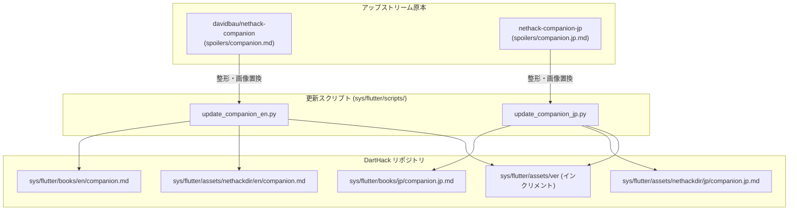

<!-- Modified by NetHackJP contributor @satokiyon; latest change date: 2026-10-27. -->
# NetHack 5.0 スポイラー（攻略手引書）更新手順書

本ドキュメントでは、DartHack のゲーム内スポイラービューア（`SpoilerDialog`）で使用される攻略情報（`companion.md` / `companion.jp.md`）を、原本リポジトリから取り込んで整形・同期する手順および仕様について解説します。

> [!NOTE]
> スポイラー Markdown の整形処理方針、アンカーリンク自動解決の技術的詳細、および包括的なパイプライン設計については、ルート設計書 [docs/spoiler_markdown_pipeline_guide.md](../../../docs/spoiler_markdown_pipeline_guide.md) を参照してください。

---

## 1. 概要とアーキテクチャ

DartHack では、David Bau 氏らによる NetHack 5.0 総合スポイラー『A Traveler's Companion to the Mazes of Menace』の英語版および日本語版をアプリ内に同梱しています。

- **原本管理**: `sys/flutter/books/` 配下で Markdown 原本を Git バージョン管理。
  - 英語版: `sys/flutter/books/en/companion.md`
  - 日本語版: `sys/flutter/books/jp/companion.jp.md`
- **実行時アセット**: `sys/flutter/assets/nethackdir/` 配下に完全同一のファイルを配置。
  - 英語版: `sys/flutter/assets/nethackdir/en/companion.md`
  - 日本語版: `sys/flutter/assets/nethackdir/jp/companion.jp.md`
- **キャッシュ管理**: アセット更新時は必ず `sys/flutter/assets/ver` のバージョン番号（整数値）をインクリメントし、端末・クライアント側でのキャッシュ無効化・強制再配置を保証。



---

## 2. DartHack 固有のフォーマット原則（AGENTS.md ルール51）

原本の Markdown をそのまま DartHack に配置するのではなく、モバイル環境での可読性と Flutter の Markdown パーサー（`SpoilerDialog`）の描画要件を満たすため、以下の変換・整形を必ず適用します。

1. **パラグラフ単位の改行（ハードラップの排除）**:
   - 70〜80文字ごとの固定改行を行わず、「1段落1行（ソフトラップ）」で改行・管理します。
   - 引用ブロック（`>`）やリスト項目（`- `, `1. `）も項目ごとに1行に連結します。
2. **コードブロックおよびテーブルの完全保護**:
   - コードブロック（```` ... ````）に含まれるダンジョンマップ、アスキーアート、等幅テキストは、改行・インデント・空白を 100% 保持します。
   - テーブル（`| ... |`）の行構造を維持します。
3. **インライン SVG マップ・フローチャートの WebP 化**:
   - 原本に含まれる `<!-- DMAP-BEGIN -->` 〜 `<!-- DMAP-END -->`（SVGマップ）は、Flutter の画像アセット `` に置換します。
   - `<!-- FLOWCHART-BEGIN -->` 〜 `<!-- FLOWCHART-END -->`（SVGフローチャート）は、`` に置換します。
4. **LaTeX・Pandoc・生HTML特有構文のクレンジング**:
   - ````{=latex} ... ````、````{=html} ... ````、`<aside> ... </aside>`、`::: ...` ブロック、および印刷専用の LaTeX 索引（`::: print-only`）を除去します。
   - **生 HTML・JavaScript・価格識別ツールバーの完全除去**: Web版固有の `<script> ... </script>`、`<div class="price-id-toolbar"></div>`、存在しないツールバーに言及した本文説明文を完全に除去します。
   - **<small> タグの解除**: 杖注記の `<small>...</small>` タグを除去し、注記テキストを Markdown イタリック（`*...*`）に変換します。
   - **テーブル内 <br> の改行化**: セル内改行の `<br>` は Markdown 構造として維持し、Flutter ビューア（`SpoilerDialog`）側で `\n` に変換して正しく2行表示させます。
   - 冒頭のタイトル・名言 HTML は、イタリック Markdown（`*...*`）に変換します。
   - HTML コメント（`<!-- ... -->`）を除去します。
   - **整形後バリデーション**: `validate_markdown()` により、禁止残骸が 0 件であることを自動検証します。

---

## 3. 日本語版の更新手順 (`update_companion_jp.py`)

`nethack-companion-jp` リポジトリ側で翻訳やセグメントが更新された際の手順です。

### 基本実行コマンド
```powershell
cd sys/flutter
python scripts/update_companion_jp.py
```

### 原本パスの探索順序
引数 `--source` を指定しない場合、以下のパスを自動探索します：
1. `../../nethack-companion-jp/spoilers/companion.jp.md`（DartHack の隣接フォルダ）
2. `../nethack-companion-jp/spoilers/companion.jp.md`

任意のパスを指定する場合：
```powershell
python scripts/update_companion_jp.py --source "C:/path/to/companion.jp.md"
```

### 主なオプション
- `--source <path>`, `-s <path>`: 入力元 Markdown のパスを指定。
- `--no-ver`: `sys/flutter/assets/ver` のインクリメントをスキップ。
- `--no-test`: 更新後の Flutter 検証テスト実行をスキップ。

---

## 4. 英語版の更新手順 (`update_companion_en.py`)

`davidbau/nethack-companion` 原著リポジトリ側で更新があった際の手順です。

### 基本実行コマンド
```powershell
cd sys/flutter
python scripts/update_companion_en.py
```

### 原本パスの探索順序
引数 `--source` を指定しない場合、以下のパスを自動探索します：
1. `../../nethack-companion-jp/spoilers/companion.md`（日本語版リポジトリ内の原著原本）
2. `../../nethack-companion/spoilers/companion.md`（隣接する原著クローン）
3. `../nethack-companion/spoilers/companion.md`

任意のパスを指定する場合：
```powershell
python scripts/update_companion_en.py --source "C:/path/to/companion.md"
```

### 主なオプション
- `--source <path>`, `-s <path>`: 入力元 Markdown のパスを指定。
- `--no-ver`: `sys/flutter/assets/ver` のインクリメントをスキップ。
- `--no-test`: 更新後の Flutter 検証テスト実行をスキップ。

---

## 5. 検証とテスト

スクリプト実行時、自動的に以下の Flutter 単体テストが実行され、整合性が検証されます。手動でテストを実行する場合は以下のコマンドを使用します：

```powershell
cd sys/flutter

# 日本語版スポイラーの構文・見出し・画像リンク検証
flutter test test/widgets/companion_jp_parse_test.dart

# 英語版スポイラーの構文・見出し・画像リンク検証
flutter test test/widgets/companion_en_parse_test.dart

# スポイラービューア UI ダイアログの総合テスト
flutter test test/widgets/spoiler_dialog_test.dart
```

---

## 6. コミットと反映チェックリスト

更新作業完了後は、以下のチェックリストを確認して Git コミットを行ってください：

- [ ] `sys/flutter/books/jp/companion.jp.md` または `books/en/companion.md` が更新されていること
- [ ] `sys/flutter/assets/nethackdir/jp/companion.jp.md` または `assets/nethackdir/en/companion.md` が原本と完全一致していること
- [ ] `sys/flutter/assets/ver` の数値がインクリメントされていること
- [ ] `flutter test` が全件パスすること
- [ ] コミットメッセージのプレフィックスに `docs(spoiler):` を使用すること

